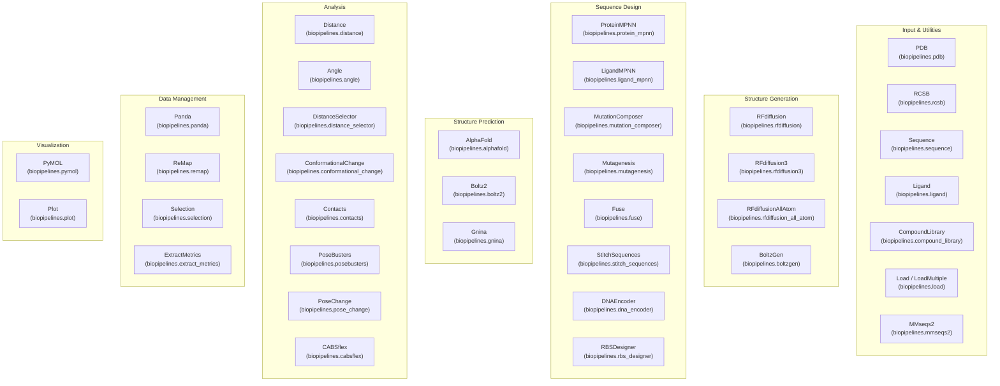
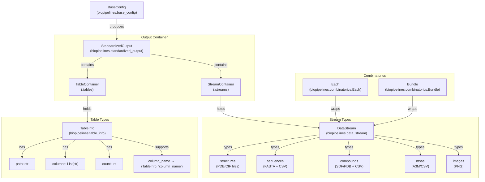
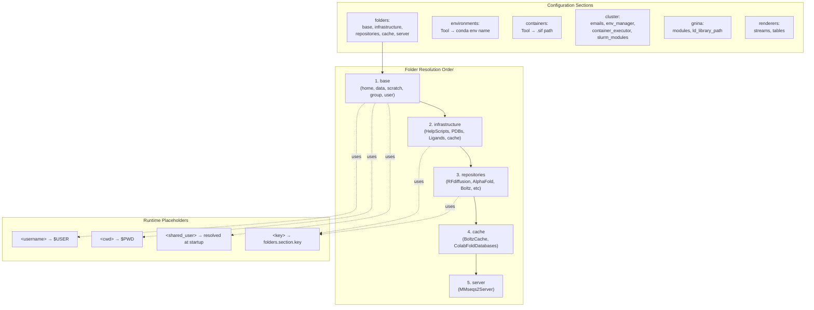
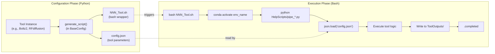

# Reference

<details>
<summary>Relevant source files</summary>

The following files were used as context for generating this wiki page:

- [Docs/Tool/Analysis.md](Docs/Tool/Analysis.md)
- [Docs/Tool/DataManagement.md](Docs/Tool/DataManagement.md)
- [Docs/ToolReference.md](Docs/ToolReference.md)
- [Docs/UserManual.md](Docs/UserManual.md)
- [config.yaml](config.yaml)

</details>


This section provides complete reference documentation for BioPipelines configuration and tools. Use this material for quick lookups of parameter specifications, output formats, and configuration settings.

For step-by-step usage guides, see [Getting Started](#2). For conceptual explanations of the framework architecture, see [Core Concepts](#3). For detailed workflow examples, see [Major Workflows](#6).

---

## What's in This Section

The reference documentation is organized into two main subsections:

| Page | Purpose | Use When You Need To... |
|------|---------|--------------------------|
| [Configuration Reference](#8.1) | Complete specification of `config.yaml` | Configure folder paths, environment mappings, container images, or cluster-specific settings |
| [Complete Tool Reference](#8.2) | Detailed parameter lists and output specifications for all tools | Look up exact parameters, understand output table columns, or find examples for a specific tool |

---

## Quick Reference: Tool Categories

BioPipelines tools are organized into seven functional categories. Each tool inherits from `BaseConfig` and produces `StandardizedOutput` containing `DataStream` objects and `TableInfo` metadata.



**Tool Category Summary**:

| Category | Tools | Primary Purpose |
|----------|-------|-----------------|
| **Utilities** | PDB, RCSB, Sequence, Ligand, CompoundLibrary, Load, MMseqs2 | Data input and retrieval |
| **Structure Generation** | RFdiffusion, RFdiffusion3, RFdiffusionAllAtom, BoltzGen | Create novel protein backbones |
| **Sequence Design** | ProteinMPNN, LigandMPNN, MutationComposer, Mutagenesis, Fuse, StitchSequences, DNAEncoder, RBSDesigner | Design and manipulate sequences |
| **Structure Prediction** | AlphaFold, Boltz2, Gnina | Predict structures and dock ligands |
| **Analysis** | Distance, Angle, DistanceSelector, ConformationalChange, Contacts, PoseBusters, PoseChange, CABSflex | Measure structural properties |
| **Data Management** | Panda, ReMap, Selection, ExtractMetrics | Filter, transform, and manipulate data |
| **Visualization** | PyMOL, Plot | Generate images and plots |

**Sources**: [Docs/ToolReference.md:1-98](), [Docs/UserManual.md:221-326]()

---

## Quick Reference: Data Types

BioPipelines uses a hierarchical type system for passing data between tools. All tools inherit from `BaseConfig` and produce `StandardizedOutput` objects.



**Core Data Type Properties**:

| Type | Key Attributes | Access Pattern | Example |
|------|---------------|----------------|---------|
| `DataStream` | `ids: List[str]`<br/>`files: List[str]`<br/>`format: str`<br/>`map_table: str` | `tool.streams.structures`<br/>`for item in stream: ...` | `boltz.streams.structures.ids`<br/>`boltz.streams.structures.files` |
| `TableInfo` | `path: str`<br/>`columns: List[str]`<br/>`count: int`<br/>`.info` metadata<br/>`.column_name` reference | `tool.tables.confidence`<br/>`tool.tables.confidence.plddt` | `boltz.tables.confidence.info.path`<br/>`(ref, col) = boltz.tables.confidence.plddt` |
| `StreamContainer` | `structures`<br/>`sequences`<br/>`compounds`<br/>`msas`<br/>`images` | `tool.streams.<name>` | `boltz.streams.structures`<br/>`pmpnn.streams.sequences` |
| `TableContainer` | Dynamic table names | `tool.tables.<name>` | `boltz.tables.confidence`<br/>`panda.tables.result` |

**Sources**: [Docs/UserManual.md:172-220](), [Docs/Tool/Analysis.md:1-458]()

---

## Quick Reference: Configuration Structure

The `config.yaml` file controls all environment-specific settings. It uses hierarchical placeholder resolution with runtime injection.



**Configuration Keys**:

| Section | Key | Purpose | Example Value |
|---------|-----|---------|---------------|
| `folders.base` | `home` | User home directory | `/home/<username>` |
| `folders.base` | `biopipelines_output` | Pipeline output root | `<user>/BioPipelines` |
| `folders.infrastructure` | `HelpScripts` | Helper script directory | `<biopipelines>/HelpScripts` |
| `folders.repositories` | `RFdiffusion` | RFdiffusion installation | `<data>/RFdiffusion` |
| `folders.cache` | `BoltzCache` | Boltz model cache | `<cache>/Boltz` |
| `environments` | `RFdiffusion` | Conda env for RFdiffusion | `SE3nv` |
| `environments` | `Boltz2` | Conda env for Boltz2 | `Boltz2Env` |
| `containers` | `RFdiffusionAllAtom` | Container image (optional) | `<containers>/rf_se3_diffusion.sif` |
| `cluster` | `env_manager` | Environment manager | `mamba` / `conda` / `pip` |
| `cluster` | `container_executor` | Container runtime | `apptainer` / `singularity` |

**Sources**: [config.yaml:1-188]()

---

## Quick Reference: Common Parameter Patterns

Many tools share common parameter patterns. Use this table for quick lookup of parameter types.

| Parameter Type | Description | Example Tools | Example Values |
|---------------|-------------|---------------|----------------|
| `structures` | Input structures (PDB/CIF) | Most analysis & prediction tools | `boltz`, `rfd.streams.structures` |
| `sequences` | Input sequences | AlphaFold, Boltz2 | `pmpnn.streams.sequences`, `Sequence("MKTV...")` |
| `ligands` | Small molecules | Boltz2, RFdiffusionAllAtom, Gnina | `Ligand("ATP")`, `CompoundLibrary({...})` |
| `contigs` | Contig specification | RFdiffusion, RFdiffusion3 | `"50-70/A81-140"`, `"10-40/0 25-35"` |
| `num_designs` | Number of designs | RFdiffusion, ProteinMPNN | `10`, `50` |
| `redesigned` | Positions to redesign | ProteinMPNN, LigandMPNN | `"10-20+30-40"`, `rfd.tables.structures.designed` |
| `fixed` | Fixed positions | ProteinMPNN | `"1-50"`, `fuse.tables.sequences.L1` |
| `selection` | PyMOL selection | ConformationalChange, Selection | `"10-20+30-40"`, `None` |
| `tables` | Input table(s) | Panda | `boltz.tables.confidence`, `[t1, t2]` |
| `operations` | Table operations | Panda | `[Panda.filter("x > 0"), Panda.sort("y")]` |
| `pool` | File copy source | Panda | `boltz` |
| `rename` | ID renaming pattern | Panda, ReMap | `"best"`, `{"old": "new"}` |

**Sources**: [Docs/UserManual.md:221-326](), [Docs/Tool/Analysis.md:1-458](), [Docs/Tool/DataManagement.md:1-247]()

---

## Quick Reference: Output Stream and Table Names

Tools produce standardized output types. Use this table to predict what outputs a tool will generate.

**Common Stream Names**:

| Stream Name | Format | Contains | Typical Producers |
|-------------|--------|----------|------------------|
| `structures` | PDB/CIF | Protein/complex structures | RFdiffusion, Boltz2, AlphaFold, CABSflex |
| `sequences` | FASTA + CSV | Protein/DNA sequences | ProteinMPNN, LigandMPNN, Sequence, Fuse |
| `compounds` | SDF/PDB + CSV | Small molecules | Ligand, CompoundLibrary |
| `msas` | A3M | Multiple sequence alignments | MMseqs2 |
| `images` | PNG/SVG | Visualization outputs | PyMOL, Plot, CABSflex |
| `rmsf` | CSV | Per-residue RMSF values | CABSflex |

**Common Table Names**:

| Table Name | Columns (Examples) | Typical Producers |
|------------|-------------------|------------------|
| `structures` | id, file, designed, fixed | RFdiffusion, RFdiffusion3, BoltzGen |
| `sequences` | id, sequence, sequence_type | ProteinMPNN, LigandMPNN, Fuse, StitchSequences |
| `confidence` | id, pTM, ipTM, pLDDT, ranking_score | AlphaFold, Boltz2 |
| `affinity` | id, affinity, affinity_confidence | Boltz2 |
| `distances` | id, source_structure, {metric_name}, unit | Distance |
| `angles` | id, source_structure, {metric_name}, unit | Angle |
| `contacts` | id, source_structure, contacts, min_distance | Contacts |
| `posebusters` | id, all_pass, sanitization, bond_lengths, ... | PoseBusters |
| `changes` | id, reference_structure, target_structure, RMSD | ConformationalChange, PoseChange |
| `result` | (varies) | Panda |
| `selections` | id, pdb, within, beyond | DistanceSelector |

**Sources**: [Docs/UserManual.md:172-220](), [Docs/Tool/Analysis.md:1-458](), [Docs/Tool/DataManagement.md:1-247]()

---

## Quick Reference: Helper Script Patterns

Most tools delegate execution to helper scripts in the `HelpScripts/` directory. These scripts follow a common config-driven pattern.



**Common Helper Scripts** (located in `HelpScripts/`):

| Helper Script | Purpose | Used By |
|---------------|---------|---------|
| `pipe_pdb.py` | Structure fetching and conversion | PDB, multiple tools |
| `pipe_ligand.py` | Ligand processing | Ligand, multiple tools |
| `pipe_sequence.py` | Sequence CSV/FASTA generation | Sequence |
| `pipe_boltz_config_unified.py` | Boltz2 YAML config generation | Boltz2 |
| `pipe_boltz_postprocessing.py` | Boltz2 output renaming | Boltz2 |
| `pipe_boltzgen.py` | BoltzGen execution | BoltzGen |
| `pipe_boltzgen_import.py` | BoltzGen structure import | BoltzGen |
| `pipe_boltzgen_merge.py` | BoltzGen run merging | BoltzGen |
| `pipe_rfdiffusion3_postprocess.py` | RFdiffusion3 CIF decompression | RFdiffusion3 |
| `pipe_rfdiffusion3_table.py` | RFdiffusion3 contig parsing | RFdiffusion3 |
| `pipe_mmseqs2_sequences.py` | MMseqs2 MSA generation | MMseqs2 |
| `pipe_distance_selector.py` | Distance-based selection | DistanceSelector |
| `pipe_pmpnn_fixed_positions.py` | ProteinMPNN position file | ProteinMPNN |
| `pipe_lmpnn_runtime_positions.py` | LigandMPNN position file | LigandMPNN |
| `pipe_stitch_sequences.py` | Sequence stitching | StitchSequences |
| `pipe_plot.py` | Plot generation | Plot |
| `pipe_pymol.py` | PyMOL operations | PyMOL |

**Sources**: [Docs/UserManual.md:1-611]()

---

## Quick Reference: Combinatorics Operators

Control how multiple inputs combine using `Each` and `Bundle` from `biopipelines.combinatorics`.


**Combinatorics Rules**:

| Pattern | Behavior | ID Naming | Use Case |
|---------|----------|-----------|----------|
| No wrapper | Each (default) | `input1_input2` | Screen all combinations |
| `Each(a, b)` | Explicit Cartesian product | `a_id_b_id` | Same as no wrapper |
| `Bundle(a, b)` | Group as single entity | `other_id` | Multiple chains/ligands together |
| `Bundle(Each(a), b)` | Each a with b together | `a_id` | Screen library with cofactor |
| Nested `Each`/`Bundle` | Arbitrary combinations | Hierarchical joining | Complex screening designs |

**ID Propagation**: All output tables include `{stream_name}.id` columns (e.g., `sequences.id`, `compounds.id`) for provenance tracking.

**Sources**: [Docs/UserManual.md:327-371]()

---

## Quick Reference: Resource Allocation

The `Resources` class (from `biopipelines.pipeline`) controls compute resource allocation and batch dependencies.

**GPU Specification**:

| Value | Meaning | SLURM Mapping |
|-------|---------|---------------|
| `"A100"` | Specific GPU model | SLURM constraint |
| `"32GB"` | Minimum GPU memory | Memory-based selection |
| `"80GB|96GB"` | Multiple acceptable values | OR constraint |
| `"any"` | Any GPU | Generic GPU request |
| `"high-memory"` | High-memory GPUs | Pre-configured set |
| `None` | CPU-only | No GPU request |

**Example Patterns**:

```python
# Specific GPU
Resources(gpu="A100", memory="32GB", time="4:00:00")

# Memory-based
Resources(gpu="32GB|80GB", memory="64GB", time="12:00:00")

# CPU-only with many cores
Resources(memory="128GB", time="24:00:00", cpus=32)

# Batch dependencies (sequential execution)
Resources(gpu="V100", time="4:00:00")    # Batch 1
tool1 = RFdiffusion(...)

Resources(time="2:00:00")                # Batch 2 (waits for Batch 1)
tool2 = Panda(...)
```

**Sources**: [Docs/UserManual.md:395-418]()

---

## Next Steps

- **Configure your environment**: See [Configuration Reference](#8.1) for complete `config.yaml` documentation
- **Look up tool parameters**: See [Complete Tool Reference](#8.2) for detailed parameter lists and examples
- **Understand tool outputs**: See [Data Streams and StandardizedOutput](#3.3) for output type specifications
- **Learn execution modes**: See [Execution Modes](#4) for SLURM, local, and interactive execution

---