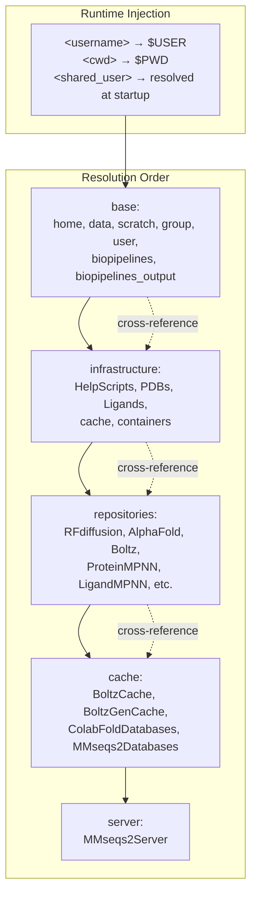
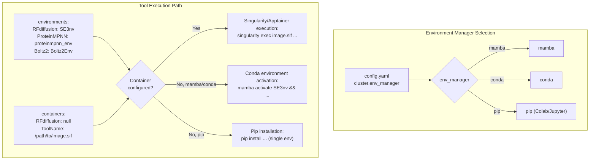
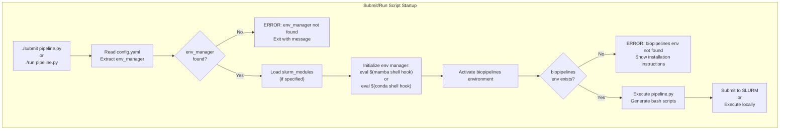

# Configuration Reference (config.yaml)

<details>
<summary>Relevant source files</summary>

The following files were used as context for generating this wiki page:

- [Docs/UserManual.md](Docs/UserManual.md)
- [config.yaml](config.yaml)
- [run](run)
- [submit](submit)

</details>


This page provides a complete reference for `config.yaml`, the primary configuration file that controls BioPipelines execution environments, file system paths, and cluster integration.

`config.yaml` defines where BioPipelines looks for tools, stores outputs, and which conda environments or containers to use for each tool. It uses a hierarchical placeholder resolution system to enable flexible deployment across different computing environments (HPC clusters, local workstations, Google Colab).

For general installation and setup instructions, see [Getting Started](#2). For Google Colab-specific configuration, see the [Google Colab Configuration](#google-colab-configuration-colabyaml) section below. For container execution details, see [Container Execution with Singularity](#7.3).

---

## File Location and Structure

`config.yaml` is located at the repository root: `biopipelines/config.yaml`. The file is automatically loaded by:
- The `submit` script when submitting jobs to SLURM [submit:18]()
- The `run` script when executing pipelines locally [run:18]()
- The `Pipeline` class during configuration phase [Docs/UserManual.md:69]()

Sources: [config.yaml:1-188](), [submit:16-18](), [run:16-18]()

---

## Configuration Sections Overview

The configuration file is organized into seven major sections:

| Section | Purpose | Required |
|---------|---------|----------|
| `folders` | File system paths with hierarchical placeholder resolution | Yes |
| `environments` | Tool → conda environment mappings | Yes |
| `containers` | Tool → Singularity/Apptainer container overrides | No |
| `cluster` | Cluster-specific settings (SLURM, env manager, emails) | Yes |
| `gnina` | GNINA-specific CUDA module configuration | No |
| `renderers` | Jupyter notebook rendering scripts for output types | No |

Sources: [config.yaml:9-188]()

---

## Folder Configuration

### Hierarchical Resolution System



**Folder Resolution System**

Sources: [config.yaml:6-7](), [config.yaml:10-60]()

Folders are resolved in strict hierarchical order. Each level can reference folders from previous levels using `<key>` syntax:

1. **base**: Resolved first. Uses runtime placeholders (`<username>`, `<cwd>`)
2. **infrastructure**: References base folders (e.g., `<biopipelines>`, `<group>`)
3. **repositories**: References base and infrastructure folders
4. **cache**: References repositories and infrastructure
5. **server**: References all previous levels

### Placeholder Syntax

**Static placeholders** (cross-references):
```yaml
infrastructure:
  HelpScripts: "<biopipelines>/HelpScripts"  # References folders.base.biopipelines
  cache: "<group>/cache"                      # References folders.base.group
```

**Runtime placeholders** (injected at execution):
```yaml
base:
  home: "/home/<username>"        # <username> → actual Unix username ($USER)
  biopipelines: "<cwd>"           # <cwd> → current working directory ($PWD)
```

Sources: [config.yaml:5-8](), [config.yaml:12-14]()

### Base Folders

The `base` section defines root paths for the entire system:

| Key | Default Value | Description |
|-----|---------------|-------------|
| `home` | `/home/<username>` | User home directory |
| `data` | `<home>/data` | User data storage |
| `scratch` | `/scratch/<username>` | Temporary scratch space |
| `group` | `/shares/locbp.chem.uzh` | Shared group storage |
| `user` | `<group>/<username>` | User folder in group storage |
| `biopipelines` | `<cwd>` | BioPipelines repository root |
| `biopipelines_output` | `<user>/BioPipelines` | Default pipeline output location |

Sources: [config.yaml:15-22]()

### Infrastructure Folders

System-level paths used by the framework:

| Key | Default Value | Purpose |
|-----|---------------|---------|
| `HelpScripts` | `<biopipelines>/HelpScripts` | Helper script executables |
| `PDBs` | `<biopipelines>/PDBs` | Local PDB structure cache |
| `Ligands` | `<biopipelines>/Ligands` | Local ligand file cache |
| `Sequences` | `<biopipelines>/Sequences` | Local sequence file cache |
| `Tables` | `<biopipelines>/Tables` | Local table file cache |
| `cache` | `<group>/cache` | Shared model weight cache |
| `containers` | `<group>/containers` | Singularity container images |

Sources: [config.yaml:24-32]()

### Repository Folders

Tool installation directories (cloned repositories):

```yaml
repositories:
  RFdiffusion: "<data>/RFdiffusion"
  ProteinMPNN: "<data>/ProteinMPNN"
  AlphaFold: "<data>/localcolabfold"
  Boltz: "<data>/boltz"
  BoltzGen: "<data>/boltzgen"
  # ... etc
```

Each tool's repository path is referenced by helper scripts to locate executables and weights.

Sources: [config.yaml:34-48]()

### Cache Folders

Shared model weight and database directories:

```yaml
cache:
  BoltzCache: "<cache>/Boltz"
  BoltzGenCache: "<cache>/BoltzGen"
  ColabFoldDatabases: "<group>/models/colabfold_databases"
  MMseqs2Databases: "<group>/models/mmseqs2_databases/gpu"
```

These are typically on shared storage to avoid duplicating large files across users.

Sources: [config.yaml:50-55]()

### Server Folders

Paths for distributed services:

```yaml
server:
  MMseqs2Server: "<biopipelines_output>/MMseqs2Server"
```

Used by the MMseqs2 client-server architecture for distributed MSA generation.

Sources: [config.yaml:57-59]()

---

## Environment Management



**Environment Management Decision Flow**

Sources: [config.yaml:61-121](), [config.yaml:122-128](), [config.yaml:140-146]()

### Environment Manager Selection

The `cluster.env_manager` setting controls how tools activate their execution environments:

```yaml
cluster:
  env_manager: "mamba"  # Options: "mamba", "conda", "pip"
```

| Manager | Use Case | Activation Command | Multi-Environment |
|---------|----------|-------------------|-------------------|
| `mamba` | HPC clusters (recommended) | `mamba activate <env>` | Yes (per-tool) |
| `conda` | Local workstations | `conda activate <env>` | Yes (per-tool) |
| `pip` | Google Colab / Jupyter | No activation (single env) | No (everything in one env) |

The `submit` and `run` scripts read this setting to initialize the environment manager: [submit:21-26](), [run:20-25]()

Sources: [config.yaml:140-142](), [submit:21-40](), [run:20-42]()

### Tool-Environment Mappings

The `environments` section maps each tool to its conda/mamba environment:

```yaml
environments:
  # Structure generation
  RFdiffusion: "SE3nv"
  RFdiffusionAllAtom: "SE3nv"
  RFdiffusion3: "foundry"
  BoltzGen: "boltzgen"
  
  # Sequence design
  ProteinMPNN: "SE3nv"
  LigandMPNN: "ligandmpnn_env"
  
  # Structure prediction
  AlphaFold: "biopipelines"
  Boltz2: "Boltz2Env"
  
  # Data management (uses biopipelines base env)
  Panda: "biopipelines"
  Load: "biopipelines"
```

When `env_manager: "mamba"` or `"conda"`, helper scripts activate the specified environment before execution. When `env_manager: "pip"`, this section is ignored (all tools share the notebook's Python environment).

Sources: [config.yaml:61-121]()

### Container Overrides

The `containers` section provides Singularity/Apptainer container paths that **override** conda environments:

```yaml
containers:
  # Example: RFdiffusionAllAtom uses a container instead of conda
  RFdiffusionAllAtom: "<containers>/rf_diffusion_all_atom.sif"
```

When a container is configured for a tool:
1. The conda environment mapping is ignored
2. The tool executes inside the container using `singularity exec` or `apptainer exec`
3. The `cluster.container_executor` setting determines which command is used

Sources: [config.yaml:122-128](), [config.yaml:144-146]()

---

## Cluster Configuration

### SLURM Modules

The `cluster.slurm_modules` list defines modules to load in SLURM wrapper scripts:

```yaml
cluster:
  slurm_modules:
    - "miniforge3"
    - "apptainer"
```

These are executed at the top of generated `slurm.sh` scripts:
```bash
module load miniforge3
module load apptainer
```

Set to empty list `[]` if your system does not use the module system.

Sources: [config.yaml:148-153](), [submit:29-34]()

### Email Notifications

The `cluster.emails` mapping associates Unix usernames with email addresses for SLURM notifications:

```yaml
cluster:
  emails:
    gquarg: "gianluca.quargnali@chem.uzh.ch"
    username: "user@example.com"
```

When a `Pipeline` is created with `email="auto"`, the framework looks up the current username and adds SLURM email directives to the job script.

Sources: [config.yaml:134-138]()

### Container Executor

```yaml
cluster:
  container_executor: "apptainer"  # Options: "apptainer", "singularity"
```

Controls which command is used for container execution. Most systems use Apptainer (the renamed/forked version of Singularity).

Sources: [config.yaml:144-146]()

---

## Tool-Specific Settings

### GNINA Configuration

GNINA requires specific CUDA modules and library paths for CNN-based scoring:

```yaml
gnina:
  modules:
    - "cuda/12.6.3"
    - "cudnn/9.8.0.87-12"
  ld_library_path: "/apps/u24/opt/x86_64_v3/cuda-12.6.3-.../targets/x86_64-linux/lib"
```

These are prepended to the GNINA helper script to ensure GPU acceleration works correctly.

Sources: [config.yaml:155-162]()

---

## Renderer Configuration

The `renderers` section maps output formats to Jupyter notebook rendering scripts:

```yaml
renderers:
  streams:
    pdb: Renderers/structures.py        # 3D structure viewer
    fasta: Renderers/fasta.py            # Sequence alignment
    png: Renderers/images.py             # Image display
    _default: Renderers/streams.py       # Generic file list
  tables:
    _default: Renderers/tables.py        # CSV table preview
```

When a tool output is displayed in a Jupyter notebook, BioPipelines:
1. Checks the stream name (e.g., `structures`)
2. Falls back to format (e.g., `pdb`)
3. Falls back to `_default`
4. Executes the corresponding renderer script to generate HTML/JavaScript

Sources: [config.yaml:164-188]()

---

## Google Colab Configuration (colab.yaml)

BioPipelines automatically detects Google Colab and Jupyter environments and loads `colab.yaml` instead of `config.yaml`. This alternative configuration sets `env_manager: "pip"` and adjusts paths for notebook execution.

### Colab-Specific Settings

```yaml
# colab.yaml (simplified structure)
folders:
  base:
    biopipelines: "<cwd>"                    # Current directory (./biopipelines)
    biopipelines_output: "./BioPipelines"    # Local output in current dir
  
  # Minimal infrastructure (no shared storage)
  infrastructure:
    HelpScripts: "<biopipelines>/HelpScripts"
    PDBs: "<biopipelines>/PDBs"
    cache: "<biopipelines>/cache"           # Local cache instead of shared

  # Tool repositories installed via pip (no explicit paths needed)
  repositories: {}

cluster:
  env_manager: "pip"            # Single environment mode
  slurm_modules: []             # No SLURM in Colab
```

### Key Differences from config.yaml

| Setting | config.yaml (HPC) | colab.yaml (Colab/Jupyter) |
|---------|-------------------|----------------------------|
| `env_manager` | `mamba` or `conda` | `pip` |
| `biopipelines_output` | Shared storage | `./BioPipelines` (current dir) |
| `cache` | Shared group storage | Local repository folder |
| `slurm_modules` | Cluster-specific modules | `[]` (empty) |
| `repositories` | Explicit paths | Not needed (pip installs) |

### Installation Workflow

In Colab, tools are installed using `.install()`:
```python
from biopipelines.rfdiffusion import RFdiffusion
RFdiffusion.install()  # pip install + download weights to local cache
```

This contrasts with HPC deployment, where conda environments are pre-created and repository paths are configured in `config.yaml`.

Sources: [Docs/UserManual.md:73-139]()

---

## Complete Configuration Schema

```yaml
# BioPipelines Configuration Schema
folders:
  base:
    home: "/home/<username>"
    data: "<home>/data"
    scratch: "/scratch/<username>"
    group: "/shares/locbp.chem.uzh"
    user: "<group>/<username>"
    biopipelines: "<cwd>"
    biopipelines_output: "<user>/BioPipelines"
  
  infrastructure:
    HelpScripts: "<biopipelines>/HelpScripts"
    PDBs: "<biopipelines>/PDBs"
    Ligands: "<biopipelines>/Ligands"
    Sequences: "<biopipelines>/Sequences"
    Tables: "<biopipelines>/Tables"
    cache: "<group>/cache"
    containers: "<group>/containers"
  
  repositories:
    RFdiffusion: "<data>/RFdiffusion"
    RFdiffusionAllAtom: "<data>/rf_diffusion_all_atom"
    RFdiffusion3: "<data>/rfdiffusion3"
    ProteinMPNN: "<data>/ProteinMPNN"
    LigandMPNN: "<data>/LigandMPNN"
    AlphaFold: "<data>/localcolabfold"
    Boltz: "<data>/boltz"
    BoltzGen: "<data>/boltzgen"
    GhostFold: "<data>/ghostfold"
    MMseqs2: "<data>/mmseqs"
    ModelForge: "<data>/modelforge"
    Gnina: "<data>/gnina"
  
  cache:
    BoltzCache: "<cache>/Boltz"
    BoltzGenCache: "<cache>/BoltzGen"
    ColabFoldDatabases: "<group>/models/colabfold_databases"
    MMseqs2Databases: "<group>/models/mmseqs2_databases/gpu"
  
  server:
    MMseqs2Server: "<biopipelines_output>/MMseqs2Server"

environments:
  # Structure generation
  RFdiffusion: "SE3nv"
  RFdiffusionAllAtom: "SE3nv"
  RFdiffusion3: "foundry"
  BoltzGen: "boltzgen"
  BoltzGenMerge: "boltzgen"
  BoltzGenImport: "boltzgen"
  
  # Sequence design
  ProteinMPNN: "SE3nv"
  LigandMPNN: "ligandmpnn_env"
  MutationComposer: "MutationEnv"
  Mutagenesis: "MutationEnv"
  Fuse: "biopipelines"
  StitchSequences: "biopipelines"
  DNAEncoder: "biopipelines"
  RBSDesigner: "rbs_designer"
  
  # Structure prediction
  AlphaFold: "biopipelines"
  GhostFold: "ghostfold"
  Boltz2: "Boltz2Env"
  RF3: "modelforge"
  
  # Analysis
  Gnina: "biopipelines"
  Distance: "biopipelines"
  DistanceSelector: "biopipelines"
  ConformationalChange: "ProteinEnv"
  PoseBusters: "posebusters"
  Contacts: "ProteinEnv"
  PoseChange: "ProteinEnv"
  SASA: "ProteinEnv"
  CABSflex: "CABSflex"
  
  # Data management
  Panda: "biopipelines"
  ExtractMetrics: "biopipelines"
  Selection: "ProteinEnv"
  
  # Utilities
  Load: "biopipelines"
  MMseqs2: "biopipelines"
  MMseqs2Server: "biopipelines"
  CompoundLibrary: "biopipelines"
  PDB: "biopipelines"
  Ligand: "biopipelines"
  Sequence: "biopipelines"
  PyMOL: "ProteinEnv"
  Plot: "biopipelines"

containers:
  # Optional: Override conda environments with Singularity containers
  # RFdiffusionAllAtom: "<containers>/rf_diffusion_all_atom.sif"

cluster:
  emails:
    username: "user@example.com"  # Add your username → email mapping
  
  env_manager: "mamba"              # Options: "mamba", "conda", "pip"
  container_executor: "apptainer"   # Options: "apptainer", "singularity"
  
  slurm_modules:                    # Modules loaded before SLURM jobs
    - "miniforge3"
    - "apptainer"

gnina:
  modules:
    - "cuda/12.6.3"
    - "cudnn/9.8.0.87-12"
  ld_library_path: "/apps/.../cuda-12.6.3/.../targets/x86_64-linux/lib"

renderers:
  streams:
    _metadata: Renderers/streams.py
    pdb: Renderers/structures.py
    cif: Renderers/structures.py
    "pdb|cif": Renderers/structures.py
    png: Renderers/images.py
    fasta: Renderers/fasta.py
    _default: Renderers/streams.py
  tables:
    _default: Renderers/tables.py
```

Sources: [config.yaml:1-188]()

---

## Configuration Validation



**Configuration Validation Flow in submit/run Scripts**

The `submit` and `run` scripts validate configuration before executing pipelines:

1. **Read env_manager**: Extract from `config.yaml` using grep/sed [submit:21-26](), [run:20-25]()
2. **Load SLURM modules**: If `slurm_modules` is non-empty [submit:29-34]()
3. **Initialize environment manager**: Execute shell hook for mamba/conda [submit:36-41](), [run:28-42]()
4. **Check biopipelines environment**: Verify it exists before activation [submit:46-57](), [run:47-58]()
5. **Execute pipeline script**: Generate bash scripts and output `RunTime` directories
6. **Submit/execute**: Parse `RunTime` paths and submit to SLURM or execute locally

Sources: [submit:16-63](), [run:16-59]()

---

## Common Configuration Patterns

### Single-User HPC Setup

```yaml
folders:
  base:
    home: "/home/<username>"
    data: "<home>/data"
    biopipelines: "/home/<username>/biopipelines"
    biopipelines_output: "<home>/BioPipelines"

cluster:
  env_manager: "mamba"
  slurm_modules:
    - "miniforge3"
```

All tools and outputs are in user's home directory. No shared storage.

### Multi-User Lab Setup (Shared Cache)

```yaml
folders:
  base:
    group: "/shares/lab"
    user: "<group>/<username>"
    biopipelines_output: "<user>/BioPipelines"
  
  infrastructure:
    cache: "<group>/cache"
  
  cache:
    BoltzCache: "<cache>/Boltz"
    ColabFoldDatabases: "<group>/models/colabfold_databases"

cluster:
  env_manager: "mamba"
```

Model weights and databases are shared across users to save space. Individual users have separate output directories.

### Local Workstation (No SLURM)

```yaml
folders:
  base:
    home: "/home/<username>"
    biopipelines: "<home>/biopipelines"
    biopipelines_output: "<home>/BioPipelines"

cluster:
  env_manager: "conda"
  slurm_modules: []  # No SLURM modules

# Use ./run instead of ./submit
```

Execute pipelines with `./run pipeline.py` instead of `./submit`. No SLURM submission.

### Container-Only Execution

```yaml
environments:
  RFdiffusion: "SE3nv"                # Ignored when container is configured
  ProteinMPNN: "proteinmpnn_env"

containers:
  RFdiffusion: "<containers>/rfdiffusion.sif"  # Overrides conda env
  ProteinMPNN: "<containers>/proteinmpnn.sif"

cluster:
  container_executor: "apptainer"
```

Tools with containers configured execute inside Singularity/Apptainer. Others use conda.

Sources: [config.yaml:1-188]()

---