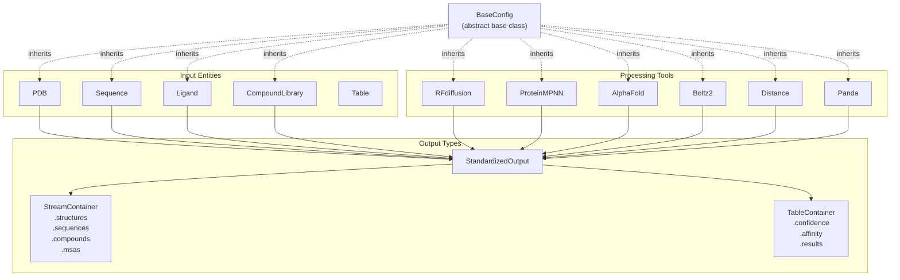
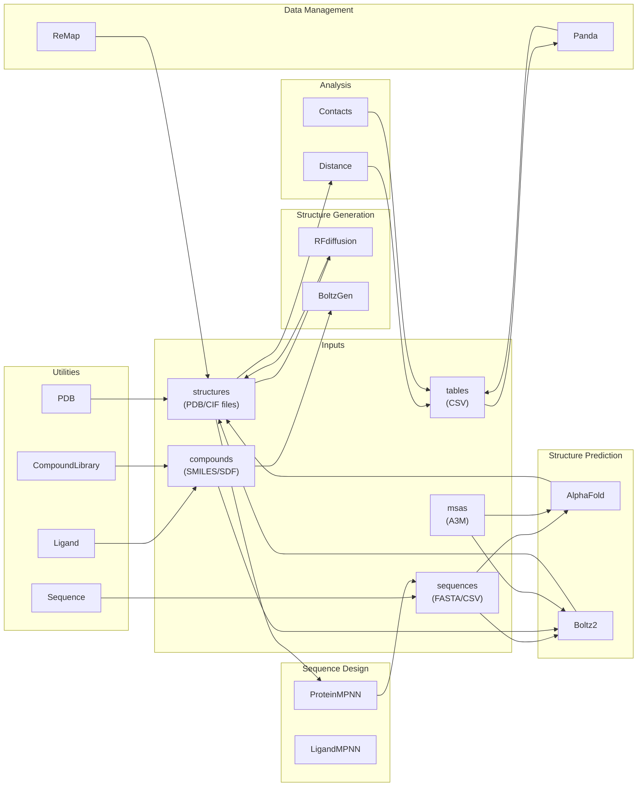

# Complete Tool Reference

<details>
<summary>Relevant source files</summary>

The following files were used as context for generating this wiki page:

- [Docs/Tool/Analysis.md](Docs/Tool/Analysis.md)
- [Docs/Tool/DataManagement.md](Docs/Tool/DataManagement.md)
- [Docs/ToolReference.md](Docs/ToolReference.md)
- [Docs/UserManual.md](Docs/UserManual.md)
- [config.yaml](config.yaml)

</details>


This page provides a comprehensive reference for all tools available in BioPipelines, organized by functional category. Each tool entry includes its conda environment, complete parameter list with types, output specifications (streams and tables), and usage examples.

For an overview of how tools fit into the pipeline architecture, see [Core Concepts](#3). For detailed workflow guides involving multiple tools, see [Major Workflows](#6). For tool-specific helper scripts and their internals, see [Helper Script Architecture](#7.1).

---

## Tool Categories Overview

The following table summarizes all available tools organized by category:

| Category | Tools | Primary Use |
|----------|-------|-------------|
| **Utilities** | PDB, RCSB, Sequence, Ligand, CompoundLibrary, Load/LoadMultiple, MMseqs2 | Data input and retrieval |
| **Structure Generation** | RFdiffusion, RFdiffusionAllAtom, RFdiffusion3, BoltzGen | De novo backbone design |
| **Sequence Design** | ProteinMPNN, LigandMPNN, MutationComposer, Mutagenesis, Fuse, StitchSequences, DNAEncoder, RBSDesigner | Sequence optimization and engineering |
| **Structure Prediction** | AlphaFold, Boltz2, GhostFold, RF3, Gnina | Folding and docking predictions |
| **Analysis** | Distance, Angle, DistanceSelector, ConformationalChange, Contacts, PoseBusters, PoseChange, CABSflex, SASA | Structural analysis and validation |
| **Statistics** | MutationProfiler, SequenceMetricCorrelation, BayesianAdjuster | Mutation frequency analysis |
| **Data Management** | Panda, ReMap, Selection, ExtractMetrics | Table filtering and ID management |
| **Visualization** | PyMOL, Plot | Session creation and plotting |

---

## Tool Architecture and Data Flow

The following diagram shows how tools inherit from `BaseConfig` and produce standardized outputs:



**Sources:** [Docs/UserManual.md:175-220](), [config.yaml:62-121]()

---

## Input/Output Type Mapping

This diagram shows the primary input and output types for each tool category:



**Sources:** [Docs/UserManual.md:172-220]()

---

## 1. Utilities

Input entities and utility tools for data retrieval and preparation.

### PDB

Fetches protein structures from local folders or RCSB PDB. Also generates protein sequences for each chain.

**Environment:** `biopipelines`

**Helper Script:** [HelpScripts/pipe_pdb.py]()

**Parameters:**
- `pdbs`: `str | List[str]` (required) - PDB IDs (e.g., "4ufc"), file paths, or folder path
- `ids`: `str | List[str]` = None - Custom IDs (default: PDB codes)
- `chains`: `str | List[str]` = None - Chain selection (e.g., "A", ["A", "B"])
- `remove_water`: `bool` = True - Remove water molecules
- `convert`: `str | None` = None - Format conversion: "pdb", "cif", or None (keep original)

**Priority Lookup:** local folder → `<biopipelines>/PDBs/` → RCSB download

**Streams:**
- `structures`: PDB/CIF files
- `sequences`: Protein sequences (CSV with id, sequence, chain columns)

**Tables:**
- `structures`: Structure metadata with columns: id, file, chains

**Example:**
```python
from biopipelines.pdb import PDB

# Fetch from RCSB
protein = PDB("4ufc")

# Multiple structures with custom IDs
proteins = PDB(["4ufc", "1aki"], ids=["POI1", "POI2"])

# From local folder
proteins = PDB("/path/to/structures")

# Specific chain, convert to PDB format
protein = PDB("4ufc", chains="A", convert="pdb")
```

**Sources:** [Docs/UserManual.md:233-246](), [config.yaml:116]()

---

### RCSB

Searches the RCSB PDB database using their REST API and downloads matching structures.

**Environment:** `biopipelines`

**Parameters:**
- `query`: `str` (required) - RCSB search query (JSON or simplified syntax)
- `max_results`: `int` = 100 - Maximum number of structures to retrieve
- `chains`: `str | List[str]` = None - Chain selection
- `remove_water`: `bool` = True - Remove water molecules
- `convert`: `str | None` = None - Format conversion

**Streams:**
- `structures`: PDB/CIF files
- `sequences`: Protein sequences per chain

**Tables:**
- `structures`: Structure metadata

**Example:**
```python
from biopipelines.rcsb import RCSB

# Simple search
structures = RCSB(query="kinase", max_results=10)

# Advanced JSON query
structures = RCSB(
    query='{"query": {"type": "terminal", "service": "text", "parameters": {"value": "lysozyme"}}}',
    max_results=50
)
```

**Sources:** [Docs/ToolReference.md:13]()

---

### Sequence

Creates protein, DNA, or RNA sequences from strings or files.

**Environment:** `biopipelines`

**Helper Script:** [HelpScripts/pipe_sequence.py]()

**Parameters:**
- `sequences`: `str | List[str] | Path` (required) - Sequence strings, list, or CSV file path
- `ids`: `str | List[str]` = None - Custom IDs (default: seq_1, seq_2, ...)
- `type`: `str` = "auto" - Sequence type: "auto", "protein", "dna", "rna"

**Auto-detection:** Analyzes amino acid/nucleotide composition to determine type

**Streams:**
- `sequences`: FASTA files and CSV with id, sequence columns

**Tables:**
- `sequences`: Sequence metadata

**Example:**
```python
from biopipelines.sequence import Sequence

# Single protein sequence
seq = Sequence("MKTVRQERLKSIVRILERSKEPVSGAQ", ids="my_protein")

# Multiple sequences
seqs = Sequence(["MKTVRQ...", "AETGFT..."], ids=["p1", "p2"])

# From CSV file (must have id, sequence columns)
seqs = Sequence("/path/to/sequences.csv")

# DNA sequences
dna = Sequence("/path/to/genes.csv", type="dna")
```

**Sources:** [Docs/UserManual.md:248-259](), [config.yaml:118]()

---

### Ligand

Fetches small molecules from RCSB CCD, PubChem, or from SMILES/CDXML input.

**Environment:** `biopipelines`

**Helper Script:** [HelpScripts/pipe_ligand.py]()

**Parameters:**
- `ligands`: `str | List[str]` = None - CCD codes, PubChem names/IDs, or file paths
- `smiles`: `str | List[str]` = None - SMILES strings
- `cdxml`: `str` = None - ChemDraw CDXML file path
- `ids`: `str | List[str]` = None - Custom IDs
- `codes`: `str | List[str]` = None - 3-letter residue codes for output structures

**Priority Lookup:** local folder → `<biopipelines>/Ligands/` → RCSB CCD → PubChem

**Format Conversion:** SMILES → PDB/CIF via RDKit → OpenBabel fallback

**Streams:**
- `compounds`: PDB/CIF/SDF files with SMILES column

**Tables:**
- `compounds`: Ligand metadata with id, smiles, code columns

**Example:**
```python
from biopipelines.ligand import Ligand

# RCSB CCD code
atp = Ligand("ATP")

# PubChem by name
aspirin = Ligand("aspirin", codes="ASP")

# Direct SMILES
ethanol = Ligand(smiles="CCO", ids="ethanol", codes="ETH")

# From CDXML file (ChemDraw names used as IDs)
ligands = Ligand(cdxml="my_ligands.cdxml")
```

**Sources:** [Docs/UserManual.md:261-275](), [config.yaml:117]()

---

### CompoundLibrary

Creates compound collections with optional placeholder expansion for combinatorial chemistry.

**Environment:** `biopipelines`

**Parameters:**
- `library`: `dict | str` (required) - Dictionary with SMILES, or CSV/CDXML file path
- `generate_images`: `bool` = False - Generate 2D molecule images (PNG) via RDKit

**Placeholder Expansion:** SMILES can contain `<key>` placeholders referencing other dictionary entries. Primary key auto-detected by order of appearance. Branching columns track substituents.

**Streams:**
- `compounds`: SMILES CSV (with branching columns if expansion used)
- `images`: PNG files (if `generate_images=True`)

**Tables:**
- `compounds`: Compound metadata

**Example:**
```python
from biopipelines.compound_library import CompoundLibrary

# Simple dictionary (no expansion)
library = CompoundLibrary({
    "aspirin": "CC(=O)OC1=CC=CC=C1C(=O)O",
    "caffeine": "CN1C=NC2=C1C(=O)N(C(=O)N2C)C"
})

# With placeholder expansion
library = CompoundLibrary({
    "scaffold": "<aryl><amide>",
    "aryl": ["C1(=CC(F)=CC=C1)", "C1(=CC(O)=CC=C1)"],
    "amide": ["C(=O)N", "C(=O)NC", "C(=O)NCC(F)(F)F"]
})
# Generates 2×3=6 compounds with aryl, amide branching columns

# From CDXML file (ChemDraw R-group enumeration)
library = CompoundLibrary("my_library.cdxml")

# With 2D images
library = CompoundLibrary({...}, generate_images=True)
```

**Sources:** [Docs/UserManual.md:277-302](), [config.yaml:115]()

---

### Load / LoadMultiple

Loads previous tool outputs for reuse in new pipelines.

**Environment:** `biopipelines`

**Parameters (Load):**
- `path`: `str` (required) - Path to tool output folder (e.g., `/path/to/job/001_Boltz2`)

**Parameters (LoadMultiple):**
- `path`: `str` (required) - Path to job folder
- `tool`: `str` (required) - Tool name to load (e.g., "Boltz2")

**Streams/Tables:** Reconstructed from loaded tool's outputs

**Example:**
```python
from biopipelines.load import Load, LoadMultiple

# Single output
prev = Load("/path/to/job/001_Boltz2")

# Multiple outputs by tool name
all_boltz = LoadMultiple("/path/to/job/", tool="Boltz2")
```

**Sources:** [Docs/UserManual.md:600-610](), [Docs/ToolReference.md:19](), [config.yaml:112]()

---

### MMseqs2

Generates multiple sequence alignments (MSAs) using MMseqs2 distributed client-server architecture.

**Environment:** `biopipelines`

**Helper Scripts:** [HelpScripts/pipe_mmseqs2_sequences.py](), [HelpScripts/mmseqs2_client.sh]()

**Parameters:**
- `sequences`: `DataStream | StandardizedOutput` (required) - Input sequences
- `mask_positions`: `str | tuple[TableInfo, str]` = None - Positions to mask in MSA (PyMOL selection format)
- `server`: `str` = "auto" - Server mode: "auto", "gpu", "cpu"
- `max_retries`: `int` = 3 - Maximum retry attempts
- `poll_interval`: `int` = 30 - Status check interval (seconds)

**Client-Server Architecture:** Submits jobs to MMseqs2 server, polls for completion, retrieves results. Server auto-resubmission if not running.

**Streams:**
- `msas`: A3M files

**Tables:**
- `msas`: MSA metadata with id, file, num_sequences columns

**Example:**
```python
from biopipelines.mmseqs2 import MMseqs2

# Basic MSA generation
msas = MMseqs2(sequences=proteins)

# With position masking
msas = MMseqs2(
    sequences=designs,
    mask_positions=rfd.tables.structures.designed
)
```

**Sources:** [Docs/ToolReference.md:20](), [config.yaml:113]()

---

### PyMOL

Creates PyMOL sessions and generates images using declarative operations.

**Environment:** `ProteinEnv`

**Parameters:**
- `structures`: `DataStream | StandardizedOutput` (required) - Input structures
- `operations`: `List[Operation]` = [] - Sequence of PyMOL operations
- `output_format`: `str` = "session" - Output type: "session", "png", "both"
- `width`: `int` = 1200 - Image width (pixels)
- `height`: `int` = 900 - Image height (pixels)

**Operations:** Declarative PyMOL commands (color, show, hide, set, orient, zoom, select, etc.)

**Streams:**
- `sessions`: PyMOL session files (.pse)
- `images`: PNG files (if output_format includes images)

**Tables:**
- `structures`: Metadata

**Example:**
```python
from biopipelines.pymol import PyMOL

# Basic session
session = PyMOL(
    structures=boltz,
    operations=[
        PyMOL.color("cyan", "chain A"),
        PyMOL.show("cartoon"),
        PyMOL.zoom()
    ]
)

# Generate PNG images
images = PyMOL(
    structures=designs,
    operations=[
        PyMOL.hide("everything"),
        PyMOL.show("cartoon", "polymer"),
        PyMOL.show("sticks", "resn LIG"),
        PyMOL.color("green", "resn LIG"),
        PyMOL.orient("resn LIG")
    ],
    output_format="png",
    width=800,
    height=600
)
```

**Sources:** [Docs/ToolReference.md:23-24](), [config.yaml:119]()

---

### Plot

Generates publication-quality plots (scatter, histogram, bar, heatmap) from table data.

**Environment:** `biopipelines`

**Helper Script:** [HelpScripts/pipe_plot.py]()

**Parameters:**
- `tables`: `TableInfo | List[TableInfo]` (required) - Input table(s)
- `plot_type`: `str` (required) - "scatter", "histogram", "bar", "column", "heatmap"
- `x`: `str` = None - X-axis column
- `y`: `str` = None - Y-axis column
- `hue`: `str` = None - Color grouping column
- `title`: `str` = None - Plot title
- `xlabel`: `str` = None - X-axis label
- `ylabel`: `str` = None - Y-axis label
- Additional matplotlib/seaborn parameters

**Dual Output:** PNG plot + data CSV for reproducibility

**Streams:**
- `plots`: PNG files

**Tables:**
- `plot_data`: Source data used for plotting

**Example:**
```python
from biopipelines.plot import Plot

# Scatter plot
scatter = Plot(
    tables=boltz.tables.confidence,
    plot_type="scatter",
    x="pTM",
    y="complex_plddt",
    title="Confidence Metrics",
    hue="compounds.id"
)

# Histogram
hist = Plot(
    tables=distances.tables.distances,
    plot_type="histogram",
    x="distance",
    bins=30
)

# Heatmap (requires pivot table or matrix format)
heatmap = Plot(
    tables=contacts.tables.contacts,
    plot_type="heatmap",
    title="Contact Map"
)
```

**Sources:** [Docs/ToolReference.md:24](), [config.yaml:120]()

---

## 2. Structure Generation

Tools for de novo protein backbone generation.

### RFdiffusion

Unconditional and conditional protein backbone diffusion. Generates novel protein structures.

**Environment:** `SE3nv`

**Repository:** [config.yaml:36]() `<data>/RFdiffusion`

**Parameters:**
- `pdb`: `DataStream | StandardizedOutput` = None - Conditional structures
- `contigs`: `str` (required) - Contig specification (e.g., "50-100" or "A10-50/0 50-100")
- `num_designs`: `int` = 1 - Number of designs per input
- `hotspot`: `str` = None - Hotspot residues (e.g., "A30,A33,A34")
- `timesteps`: `int` = 50 - Diffusion timesteps
- `additional_flags`: `str` = "" - Extra RFdiffusion flags

**Contig Syntax:** 
- `50-100`: Design 50-100 residues
- `A10-50/0 50-100`: Fixed A10-50, gap, designed 50-100 residues
- Chain labels, gaps (0), length ranges supported

**Streams:**
- `structures`: Generated PDB files

**Tables:**
- `structures`: Metadata with columns: id, file, designed, fixed

**Example:**
```python
from biopipelines.rfdiffusion import RFdiffusion

# Unconditional design
backbones = RFdiffusion(contigs="50-100", num_designs=10)

# Conditional: redesign N-terminus
lysozyme = PDB("168L")
redesigned = RFdiffusion(
    pdb=lysozyme,
    contigs="50-70/A81-140",
    num_designs=5
)

# With hotspot constraint
binder = RFdiffusion(
    pdb=target,
    contigs="70-100/A1-100",
    hotspot="A30,A33,A34",
    num_designs=20
)
```

**Sources:** [Docs/UserManual.md:30-45](), [Docs/ToolReference.md:32](), [config.yaml:67]()

---

### RFdiffusionAllAtom

All-atom diffusion including ligands and non-standard residues.

**Environment:** `SE3nv` (or container via [config.yaml:128]())

**Repository:** [config.yaml:37]() `<data>/rf_diffusion_all_atom`

**Parameters:**
- `pdb`: `DataStream | StandardizedOutput` = None - Conditional structures
- `ligands`: `DataStream | StandardizedOutput` = None - Ligand structures
- `contigs`: `str` (required) - Contig specification
- `num_designs`: `int` = 1 - Number of designs
- `ligand_flag`: `str` = "substruct" - Ligand mode: "substruct", "around"
- `additional_flags`: `str` = "" - Extra flags

**Ligand Preparation:** Requires dummy peptide attachment (handled by [HelpScripts/pipe_rfdaa_prepare_ligand.py]())

**Streams:**
- `structures`: Generated PDB files with ligands

**Tables:**
- `structures`: Metadata

**Example:**
```python
from biopipelines.rfdiffusion_all_atom import RFdiffusionAllAtom

# Design around ligand
atp = Ligand("ATP")
binder = RFdiffusionAllAtom(
    ligands=atp,
    contigs="70-100",
    num_designs=10,
    ligand_flag="around"
)

# Conditional with existing structure
template = PDB("1ABC")
redesigned = RFdiffusionAllAtom(
    pdb=template,
    ligands=ligand_library,
    contigs="A10-50/0 50-100",
    num_designs=5
)
```

**Sources:** [Docs/ToolReference.md:33](), [config.yaml:68]()

---

### RFdiffusion3

Third-generation RFdiffusion with improved architecture and new features.

**Environment:** `foundry`

**Repository:** [config.yaml:38]() `<data>/rfdiffusion3`

**Helper Scripts:** [HelpScripts/pipe_rfdiffusion3_postprocess.py](), [HelpScripts/pipe_rfdiffusion3_table.py]()

**Parameters:**
- `pdb`: `DataStream | StandardizedOutput` = None - Conditional structures
- `contigs`: `str` (required) - Contig specification
- `num_designs`: `int` = 1 - Number of designs
- `timesteps`: `int` = 50 - Diffusion timesteps
- `additional_flags`: `str` = "" - Extra flags

**Post-processing:** CIF.gz decompression, CIF → PDB conversion, sampled_contig parsing

**Streams:**
- `structures`: PDB files (converted from CIF)

**Tables:**
- `structures`: Metadata with designed/fixed residue tracking

**Example:**
```python
from biopipelines.rfdiffusion3 import RFdiffusion3

# Basic design
backbones = RFdiffusion3(contigs="50-100", num_designs=10)

# Conditional design
template = PDB("1ABC")
redesigned = RFdiffusion3(
    pdb=template,
    contigs="A10-50/0 70-100",
    num_designs=5
)
```

**Sources:** [Docs/ToolReference.md:34](), [config.yaml:69]()

---

### BoltzGen

End-to-end binder design using Boltz generative model. Supports importing external structures and inverse folding.

**Environment:** `boltzgen`

**Repository:** [config.yaml:44]() `<data>/boltzgen`

**Helper Scripts:** [HelpScripts/pipe_boltzgen_import.py](), [HelpScripts/pipe_boltzgen_merge.py](), [HelpScripts/pipe_boltzgen.py]()

**Workflow:** Import → Design → Merge (optional) → Post-process

**See:** [BoltzGen Workflow](#6.2) for complete workflow documentation

**Parameters:**
- `structures`: `DataStream | StandardizedOutput` (required) - Input structures (imported via BoltzGenImport)
- `mode`: `str` = "design" - "design" or "inverse_folding"
- `num_designs`: `int` = 1 - Number of designs per input
- `additional_flags`: `str` = "" - Extra BoltzGen flags

**Streams:**
- `structures`: CIF files
- `sequences`: Designed sequences

**Tables:**
- `structures`: Metadata
- `sequences`: Sequence metadata

**Example:**
```python
from biopipelines.boltzgen import BoltzGen, BoltzGenImport, BoltzGenMerge

# Import external PDB
imported = BoltzGenImport(
    structures=target,
    target_chain="A",
    binder_chains=None,
    mode="design"
)

# Design binders
designs = BoltzGen(structures=imported, num_designs=50)

# Merge multiple runs
merged = BoltzGenMerge(
    sources=[run1, run2, run3],
    prefixes=["r1", "r2", "r3"]
)
```

**Sources:** [Docs/ToolReference.md:35](), [config.yaml:70-72]()

---

## 3. Sequence Design

Tools for sequence optimization and manipulation on fixed or generated backbones.

### ProteinMPNN

Fixed-backbone sequence design using MPNN architecture.

**Environment:** `SE3nv`

**Repository:** [config.yaml:39]() `<data>/ProteinMPNN`

**Parameters:**
- `structures`: `DataStream | StandardizedOutput` (required) - Input structures
- `num_sequences`: `int` = 1 - Sequences per structure
- `temperature`: `float` = 0.1 - Sampling temperature
- `redesigned`: `str | tuple[TableInfo, str]` = None - Positions to redesign (PyMOL selection or column reference)
- `fixed`: `str | tuple[TableInfo, str]` = None - Positions to keep fixed
- `chains_to_design`: `str` = None - Chain selection (e.g., "A,B")
- `additional_flags`: `str` = "" - Extra ProteinMPNN flags

**Position Specification:** Fixed = explicit fixed + complement of redesigned (handled by [HelpScripts/pipe_pmpnn_fixed_positions.py]())

**Streams:**
- `sequences`: FASTA files

**Tables:**
- `sequences`: Sequence metadata with id, sequence, structures.id columns

**Example:**
```python
from biopipelines.protein_mpnn import ProteinMPNN

# Redesign all positions
sequences = ProteinMPNN(structures=backbones, num_sequences=5)

# Redesign specific region
sequences = ProteinMPNN(
    structures=rfd,
    num_sequences=8,
    redesigned=rfd.tables.structures.designed
)

# Fix specific positions
sequences = ProteinMPNN(
    structures=backbones,
    num_sequences=10,
    fixed="10-20+30-40",
    temperature=0.2
)
```

**Sources:** [Docs/UserManual.md:42-44](), [config.yaml:75]()

---

### LigandMPNN

Ligand-aware sequence design considering protein-ligand interactions.

**Environment:** `ligandmpnn_env`

**Repository:** [config.yaml:40]() `<data>/LigandMPNN`

**Helper Script:** [HelpScripts/pipe_lmpnn_runtime_positions.py]()

**Parameters:**
- `structures`: `DataStream | StandardizedOutput` (required) - Protein-ligand complexes
- `ligand`: `str` (required) - Ligand residue name (3-letter code)
- `num_sequences`: `int` = 1 - Sequences per structure
- `temperature`: `float` = 0.1 - Sampling temperature
- `redesigned`: `str | tuple[TableInfo, str]` = None - Positions to redesign
- `fixed`: `str | tuple[TableInfo, str]` = None - Positions to keep fixed
- `chains_to_design`: `str` = None - Chain selection
- `bias_AA`: `dict` = None - Per-position amino acid biases
- `additional_flags`: `str` = "" - Extra LigandMPNN flags

**Position Sources:** String selection, table column reference, or DistanceSelector output

**Streams:**
- `sequences`: FASTA files

**Tables:**
- `sequences`: Sequence metadata

**Example:**
```python
from biopipelines.ligand_mpnn import LigandMPNN
from biopipelines.distance_selector import DistanceSelector

# Redesign near ligand
selector = DistanceSelector(structures=rfdaa, ligand="LIG", distance=8.0)
sequences = LigandMPNN(
    structures=rfdaa,
    ligand="LIG",
    num_sequences=10,
    redesigned=selector.tables.selections.within
)

# With amino acid bias
sequences = LigandMPNN(
    structures=rfdaa,
    ligand="ATP",
    num_sequences=5,
    bias_AA={"10": {"W": 2.0, "Y": 2.0}}  # Favor aromatic at position 10
)
```

**Sources:** [Docs/ToolReference.md:44](), [config.yaml:76]()

---

### MutationComposer

Creates combinatorial mutant libraries by exploring all combinations of specified mutations.

**Environment:** `MutationEnv`

**Parameters:**
- `sequences`: `DataStream | StandardizedOutput` (required) - Input sequences
- `mutations`: `dict` (required) - Position → amino acids mapping
- `max_mutations`: `int` = None - Limit simultaneous mutations
- `include_wt`: `bool` = True - Include wild-type sequence

**Mutation Specification:** `{position: amino_acids}` where position is 1-indexed and amino_acids is a string of one-letter codes

**Streams:**
- `sequences`: FASTA files

**Tables:**
- `sequences`: Metadata with mutation tracking columns

**Example:**
```python
from biopipelines.mutation_composer import MutationComposer

# Combinatorial library
sequences = Sequence("MKTVRQERLK", ids="wt")
library = MutationComposer(
    sequences=sequences,
    mutations={
        3: "ACDEFGHIKLMNPQRSTVWY",  # Position 3: all amino acids
        5: "RK",                     # Position 5: R or K
        8: "DE"                      # Position 8: D or E
    }
)
# Generates 20 × 2 × 2 = 80 mutants (+ WT if include_wt=True)

# Limit to single/double mutants
library = MutationComposer(
    sequences=sequences,
    mutations={3: "ACDEF", 5: "RK", 8: "DE"},
    max_mutations=2
)
```

**Sources:** [Docs/ToolReference.md:45](), [config.yaml:77]()

---

### Mutagenesis

Systematic site-directed mutagenesis (SDM). Generates all single-point mutants or specified substitution sets.

**Environment:** `MutationEnv`

**Parameters:**
- `sequences`: `DataStream | StandardizedOutput` (required) - Input sequences
- `positions`: `str | List[int]` = "all" - Positions to mutate
- `amino_acids`: `str` = "ACDEFGHIKLMNPQRSTVWY" - Allowed amino acids
- `include_wt`: `bool` = True - Include wild-type

**Streams:**
- `sequences`: FASTA files

**Tables:**
- `sequences`: Metadata

**Example:**
```python
from biopipelines.mutagenesis import Mutagenesis

# All single mutants at all positions
library = Mutagenesis(sequences=wt_sequence)

# Specific positions
library = Mutagenesis(
    sequences=wt_sequence,
    positions=[10, 20, 30],
    amino_acids="ACDEFGHIKLMNPQRSTVWY"
)
```

**Sources:** [Docs/ToolReference.md:46](), [config.yaml:78]()

---

### Fuse

Creates fusion proteins with flexible linkers. Supports N-terminal/C-terminal fusions and custom linker libraries.

**Environment:** `biopipelines`

**Parameters:**
- `sequences`: `List[DataStream | StandardizedOutput]` (required) - Sequences to fuse (2-N)
- `linkers`: `str | List[str]` = ["GS", "GSGS", "GSGSGS"] - Linker sequences
- `positions`: `List[str]` = None - Fusion positions: "N" or "C" for each sequence
- `combinatorial`: `bool` = True - Try all linker combinations

**Streams:**
- `sequences`: FASTA files

**Tables:**
- `sequences`: Metadata with fusion tracking (L1, L2, etc. for sequences; Linker1, Linker2, etc. for linkers)

**Example:**
```python
from biopipelines.fuse import Fuse

# Simple fusion with default linkers
seq1 = Sequence("MKTVRQ", ids="domain1")
seq2 = Sequence("AETGFT", ids="domain2")
fusions = Fuse(sequences=[seq1, seq2])

# Custom linkers
fusions = Fuse(
    sequences=[seq1, seq2, seq3],
    linkers=["GGS", "GGGGS", "GGGGSGGGGS"],
    combinatorial=True
)

# N-terminal fusion to seq2
fusions = Fuse(
    sequences=[seq1, seq2],
    positions=["C", "N"],
    linkers=["GS"]
)
```

**Sources:** [Docs/ToolReference.md:47](), [config.yaml:79]()

---

### StitchSequences

Combines sequences via substitutions (position-to-position replacement) and indels (segment insertion/deletion/replacement).

**Environment:** `biopipelines`

**Helper Script:** [HelpScripts/pipe_stitch_sequences.py]()

**Parameters:**
- `base_sequences`: `DataStream | StandardizedOutput` (required) - Base sequences
- `substitutions`: `dict` = {} - Position mapping: `{base_pos: (donor_seq, donor_pos)}`
- `indels`: `List[tuple]` = [] - Segment replacements: `[(start, end, donor_seq, donor_start, donor_end)]`
- `combinatorial`: `bool` = True - Cartesian product expansion

**Streams:**
- `sequences`: FASTA files

**Tables:**
- `sequences`: Metadata with operation tracking

**Example:**
```python
from biopipelines.stitch_sequences import StitchSequences

base = Sequence("MKTVRQERLKSIVRILERSKEPVSGAQ", ids="base")
donor = Sequence("AETGFTGHIKLMNPQRSTVWY", ids="donor")

# Simple substitution
stitched = StitchSequences(
    base_sequences=base,
    substitutions={5: (donor, 3)}  # Replace base[5] with donor[3]
)

# Indel: replace base[10:15] with donor[5:10]
stitched = StitchSequences(
    base_sequences=base,
    indels=[(10, 15, donor, 5, 10)]
)

# Combinatorial (with multiple donors)
stitched = StitchSequences(
    base_sequences=base,
    substitutions={5: (donor, 3), 10: (donor, 8)},
    combinatorial=True
)
```

**Sources:** [Docs/ToolReference.md:48](), [config.yaml:80]()

---

### DNAEncoder

Optimizes protein sequences for expression by performing codon optimization and adding restriction sites.

**Environment:** `biopipelines`

**Parameters:**
- `sequences`: `DataStream | StandardizedOutput` (required) - Protein sequences
- `organism`: `str` = "e_coli" - Host organism for codon optimization
- `restriction_sites`: `List[str]` = [] - Restriction sites to add (e.g., ["NdeI", "XhoI"])
- `avoid_sites`: `List[str]` = [] - Sites to avoid

**Streams:**
- `sequences`: DNA sequences (FASTA)

**Tables:**
- `sequences`: Metadata with codon usage statistics

**Example:**
```python
from biopipelines.dna_encoder import DNAEncoder

# Basic codon optimization
dna = DNAEncoder(sequences=protein_sequences, organism="e_coli")

# With restriction sites
dna = DNAEncoder(
    sequences=protein_sequences,
    organism="e_coli",
    restriction_sites=["NdeI", "XhoI"],
    avoid_sites=["BamHI"]
)
```

**Sources:** [Docs/ToolReference.md:49](), [config.yaml:81]()

---

### RBSDesigner

Designs ribosome binding sites (RBS) for bacterial expression with target translation initiation rates.

**Environment:** `rbs_designer`

**Parameters:**
- `sequences`: `DataStream | StandardizedOutput` (required) - DNA sequences
- `target_tir`: `float` = 10000 - Target translation initiation rate
- `organism`: `str` = "e_coli" - Host organism

**Streams:**
- `sequences`: DNA sequences with RBS (FASTA)

**Tables:**
- `sequences`: Metadata with predicted TIR values

**Example:**
```python
from biopipelines.rbs_designer import RBSDesigner

# Design RBS for moderate expression
rbs = RBSDesigner(sequences=dna_sequences, target_tir=10000)

# High expression
rbs = RBSDesigner(sequences=dna_sequences, target_tir=50000)
```

**Sources:** [Docs/ToolReference.md:50](), [config.yaml:82]()

---

## 4. Structure Prediction

Tools for predicting protein structures, complexes, and ligand binding poses.

### AlphaFold

AlphaFold2 structure prediction via LocalColabFold.

**Environment:** `biopipelines`

**Repository:** [config.yaml:41]() `<data>/localcolabfold`

**Parameters:**
- `proteins`: `DataStream | StandardizedOutput` (required) - Protein sequences
- `msas`: `DataStream | StandardizedOutput` = None - Pre-computed MSAs (optional, auto-generated if None)
- `num_models`: `int` = 5 - Number of models (1-5)
- `num_recycles`: `int` = 3 - Recycling iterations
- `use_templates`: `bool` = False - Enable template search
- `additional_flags`: `str` = "" - Extra ColabFold flags

**Auto-MSA Generation:** If `msas=None`, MSAs are generated using MMseqs2

**Streams:**
- `structures`: PDB files

**Tables:**
- `confidence`: Confidence metrics (pLDDT, pTM, etc.)

**Example:**
```python
from biopipelines.alphafold import AlphaFold

# Basic prediction
af = AlphaFold(proteins=sequences)

# With pre-computed MSAs
msas = MMseqs2(sequences=sequences)
af = AlphaFold(proteins=sequences, msas=msas)

# Single model, high recycling
af = AlphaFold(
    proteins=sequences,
    num_models=1,
    num_recycles=20
)
```

**Sources:** [Docs/UserManual.md:44-45](), [Docs/ToolReference.md:58](), [config.yaml:85]()

---

### Boltz2

Biomolecular complex prediction with support for proteins, nucleic acids, ligands, ions, and modified residues. Includes affinity calculation, constraints, and MSA recycling.

**Environment:** `Boltz2Env`

**Repository:** [config.yaml:43]() `<data>/boltz`

**Helper Scripts:** [HelpScripts/pipe_boltz_config_unified.py](), [HelpScripts/pipe_boltz_postprocessing.py]()

**See:** [Boltz2 Workflow](#6.1) for complete workflow with constraints and affinity calculation

**Parameters:**
- `proteins`: `DataStream | StandardizedOutput` = None - Protein sequences
- `ligands`: `DataStream | StandardizedOutput` = None - Ligands (SMILES or structures)
- `nucleic_acids`: `DataStream | StandardizedOutput` = None - DNA/RNA sequences
- `num_models`: `int` = 1 - Number of models
- `msas`: `DataStream | StandardizedOutput` = None - Pre-computed MSAs
- `msa_server_url`: `str` = None - MSA server URL (auto-detected if None)
- `recycling_steps`: `int` = 3 - MSA recycling iterations
- `calculate_affinity`: `bool` = False - Enable binding affinity calculation (first ligand if Bundle)
- `constraints`: `List[Constraint]` = [] - Structure constraints (see Boltz2 workflow)
- `additional_flags`: `str` = "" - Extra Boltz2 flags

**Combinatorics:** Use `Each` and `Bundle` to control input combinations

**Streams:**
- `structures`: CIF files

**Tables:**
- `confidence`: Confidence metrics (complex_plddt, pTM, pDockQ, etc.)
- `affinity`: Binding affinity predictions (if `calculate_affinity=True`)

**Example:**
```python
from biopipelines.boltz2 import Boltz2
from biopipelines.combinatorics import Each, Bundle

# Basic complex prediction
boltz = Boltz2(proteins=sequences, ligands=ligand)

# Combinatorics: each protein with each ligand
boltz = Boltz2(
    proteins=Each(prot1, prot2),
    ligands=Each(lig1, lig2, lig3)
)  # 2 × 3 = 6 predictions

# Bundle ligands: all ligands together
boltz = Boltz2(
    proteins=protein,
    ligands=Bundle(cofactor, substrate)
)  # 1 prediction with both ligands

# Affinity calculation (first in bundle)
boltz = Boltz2(
    proteins=protein,
    ligands=Bundle(Each(library), cofactor),
    calculate_affinity=True
)  # Affinity for library compounds, cofactor present but not scored

# With MSA recycling
msas = MMseqs2(sequences=sequences)
boltz = Boltz2(
    proteins=sequences,
    ligands=ligand,
    msas=msas,
    recycling_steps=10
)
```

**Sources:** [Docs/UserManual.md:331-358](), [Docs/ToolReference.md:59](), [config.yaml:87]()

---

### GhostFold

Experimental structure prediction tool.

**Environment:** `ghostfold`

**Repository:** [config.yaml:45]() `<data>/ghostfold`

**Parameters:** (Tool-specific, consult repository documentation)

**Sources:** [config.yaml:86]()

---

### RF3

RoseTTAFold3 for joint prediction of protein-ligand complexes.

**Environment:** `modelforge`

**Repository:** [config.yaml:47]() `<data>/modelforge`

**Parameters:** (Tool-specific, consult repository documentation)

**Sources:** [config.yaml:88]()

---

### Gnina

CNN-based molecular docking with GPU acceleration.

**Environment:** `biopipelines`

**Repository:** [config.yaml:48]() `<data>/gnina`

**CUDA Requirements:** See [config.yaml:159-162]() for module configuration

**Parameters:**
- `proteins`: `DataStream | StandardizedOutput` (required) - Receptor structures
- `ligands`: `DataStream | StandardizedOutput` (required) - Ligand structures (PDB/SDF)
- `center`: `tuple[float, float, float]` = None - Search center (x, y, z)
- `autobox_ligand`: `str` = None - Reference ligand for box centering
- `size`: `tuple[float, float, float]` = (20, 20, 20) - Search box size
- `exhaustiveness`: `int` = 8 - Search exhaustiveness
- `num_modes`: `int` = 9 - Number of output poses
- `cnn_scoring`: `bool` = True - Use CNN rescoring
- `additional_flags`: `str` = "" - Extra gnina flags

**Streams:**
- `structures`: Docked poses (PDB)

**Tables:**
- `docking`: Docking scores (CNNscore, CNNaffinity, Vinardo)

**Example:**
```python
from biopipelines.gnina import Gnina

# Basic docking with autobox
protein = PDB("1ABC")
ligands = CompoundLibrary({...})
docking = Gnina(
    proteins=protein,
    ligands=ligands,
    autobox_ligand="LIG",
    exhaustiveness=16
)

# Manual box specification
docking = Gnina(
    proteins=protein,
    ligands=ligands,
    center=(10.5, 20.3, 15.7),
    size=(25, 25, 25),
    num_modes=20
)
```

**Sources:** [Docs/ToolReference.md:60](), [config.yaml:94](), [config.yaml:158-162]()

---

## 5. Analysis

Tools for structural analysis, validation, and comparison.

### Distance

Measures distances between atoms and residues in structures.

**Environment:** `biopipelines`

**Helper Script:** [HelpScripts/pipe_distance.py]() (implied)

**Parameters:**
- `structures`: `DataStream | StandardizedOutput` (required) - Input structures
- `atom`: `str` (required) - Atom selection (e.g., "LIG.Cl", "name CA", "A10.CA")
- `residue`: `str` (required) - Residue selection (e.g., "D in IGDWG", "145", "resn ALA")
- `method`: `str` = "min" - Calculation method: "min", "max", "mean", "closest"
- `metric_name`: `str` = None - Custom column name (default: "distance")
- `unit`: `str` = "angstrom" - Output unit: "angstrom" or "nm"

**Selection Syntax:** PyMOL-style (atom names, residue numbers, sequence context)

**Tables:**
- `distances`: Columns: id, source_structure, {metric_name}, unit

**Example:**
```python
from biopipelines.distance import Distance

# Ligand-protein distance
distances = Distance(
    structures=boltz,
    atom="LIG.Cl",
    residue="D in IGDWG",
    method="min",
    metric_name="chlorine_distance"
)

# CA-CA distance
distances = Distance(
    structures=designs,
    atom="10.CA",
    residue="50.CA",
    method="closest"
)
```

**Sources:** [Docs/Tool/Analysis.md:7-38](), [config.yaml:95]()

---

### Angle

Calculates bond angles, torsional angles, or vector-vector angles in structures.

**Environment:** `biopipelines`

**Parameters:**
- `structures`: `DataStream | StandardizedOutput` (required) - Input structures
- `atoms`: `tuple` (required) - Atom selections (form determines angle mode)
- `metric_name`: `str` = None - Custom column name (default: mode-specific)
- `unit`: `str` = "degrees" - Output unit: "degrees" or "radians"

**Angle Modes:**
- Bond: `(a, o, b)` - Angle at vertex o (a–o–b), range 0–180°
- Torsional: `(a, x1, x2, b)` - Dihedral along axis x1–x2, range −180° to 180°
- Vector: `((a1, a2), (b1, b2))` - Angle between vectors a1→a2 and b1→b2, range 0–180°

**Tables:**
- `angles`: Columns: id, source_structure, {metric_name}, unit

**Example:**
```python
from biopipelines.angle import Angle

# Bond angle (N-CA-C)
bond = Angle(
    structures=boltz,
    atoms=("10.N", "10.CA", "10.C"),
    metric_name="nca_angle"
)

# Phi dihedral (C-N-CA-C)
phi = Angle(
    structures=boltz,
    atoms=("9.C", "10.N", "10.CA", "10.C"),
    metric_name="phi"
)

# Vector angle between structural elements
orientation = Angle(
    structures=boltz,
    atoms=(("66.NE1", "66.CA"), ("-173.OH", "-173.CA")),
    metric_name="helix_orientation",
    unit="radians"
)
```

**Sources:** [Docs/Tool/Analysis.md:42-131]()

---

### DistanceSelector

Selects residues based on proximity to ligands or reference points. Generates PyMOL selections for downstream design tools.

**Environment:** `biopipelines`

**Helper Script:** [HelpScripts/pipe_distance_selector.py]()

**Parameters:**
- `structures`: `DataStream | StandardizedOutput` (required) - Input structures
- `ligand`: `str` (required) - Ligand residue name
- `distance`: `float` = 5.0 - Distance cutoff (Angstroms)
- `reference_type`: `str` = "ligand" - Reference type: "ligand", "atoms", "residues"
- `reference_selection`: `str` = "" - Custom PyMOL selection (if not using ligand)

**Tables:**
- `selections`: Columns: id, pdb, within, beyond, distance_cutoff, reference_ligand

**Example:**
```python
from biopipelines.distance_selector import DistanceSelector
from biopipelines.ligand_mpnn import LigandMPNN

# Select residues near ligand
selector = DistanceSelector(
    structures=rfdaa,
    ligand="ATP",
    distance=8.0
)

# Use selection in LigandMPNN
sequences = LigandMPNN(
    structures=rfdaa,
    ligand="ATP",
    redesigned=selector.tables.selections.within
)
```

**Sources:** [Docs/Tool/Analysis.md:135-162](), [config.yaml:96]()

---

### ConformationalChange

Quantifies structural changes between reference and target structures using RMSD.

**Environment:** `ProteinEnv`

**Parameters:**
- `reference_structures`: `DataStream | StandardizedOutput` (required) - Reference structures
- `target_structures`: `DataStream | StandardizedOutput` (required) - Target structures
- `selection`: `str | tuple[TableInfo, str]` = None - Residue selection (PyMOL format or column reference)
- `alignment`: `str` = "align" - Alignment method: "align", "super", "cealign"
- `atoms`: `str` = "all" - Atoms for RMSD: "all", "CA", "backbone", or custom (e.g., "CA+CB")

**Alignment Method Selection:** `align` for >50% sequence similarity, `cealign` for distant homologs

**Tables:**
- `changes`: Columns: id, reference_structure, target_structure, selection, num_aligned_atoms, RMSD

**Example:**
```python
from biopipelines.conformational_change import ConformationalChange

# All-atom RMSD on binding site
conf_change = ConformationalChange(
    reference_structures=apo,
    target_structures=holo,
    selection="10-50",
    alignment="super"
)

# CA-only RMSD on designed region
conf_change = ConformationalChange(
    reference_structures=design,
    target_structures=refolded,
    selection=rfd.tables.structures.designed,
    atoms="CA"
)
```

**Sources:** [Docs/Tool/Analysis.md:166-215](), [config.yaml:97]()

---

### Contacts

Analyzes protein-ligand contacts. Calculates distance statistics and contact counts.

**Environment:** `ProteinEnv`

**Parameters:**
- `structures`: `DataStream | StandardizedOutput` (required) - Input structures
- `selections`: `str | tuple[TableInfo, str]` = None - Protein region (PyMOL format, column reference, or None for all)
- `ligand`: `str` (required) - Ligand residue name
- `contact_threshold`: `float` = 5.0 - Contact distance cutoff (Angstroms)
- `contact_metric_name`: `str` = None - Custom contact count column name (default: "contacts")

**Tables:**
- `contacts`: Columns: id, source_structure, selections, ligand, contacts, min_distance, max_distance, mean_distance, sum_distances_sqrt_normalized

**Example:**
```python
from biopipelines.contacts import Contacts

# Analyze contacts with designed region
contacts = Contacts(
    structures=rfdaa,
    selections=rfdaa.tables.structures.designed,
    ligand="LIG",
    contact_threshold=5.0
)

# All protein contacts
contacts = Contacts(
    structures=boltz,
    ligand="ATP",
    contact_threshold=4.0
)
```

**Sources:** [Docs/Tool/Analysis.md:219-273](), [config.yaml:102]()

---

### PoseBusters

Validates computationally generated poses by checking geometry, clashes, and protein-ligand interactions.

**Environment:** `posebusters`

**Parameters:**
- `structures`: `DataStream | StandardizedOutput` (required) - Protein-ligand complexes
- `ligand`: `str` (required) - Ligand residue name
- `reference_ligand`: `DataStream | StandardizedOutput` = None - Reference for redock mode
- `reference_ligand_code`: `str` = None - Ligand code in reference (default: same as ligand)
- `mode`: `str` = "dock" - Mode: "dock" or "redock"

**Validation Checks:** Bond lengths, bond angles, internal clashes, aromatic flatness, double bond flatness, protein overlap, minimum distance, RMSD (redock mode)

**Tables:**
- `posebusters`: Columns: id, source_structure, mol_pred_loaded, mol_cond_loaded, sanitization, all_atoms_connected, bond_lengths, bond_angles, internal_steric_clash, aromatic_ring_flatness, double_bond_flatness, internal_energy, volume_overlap_with_protein, minimum_distance_to_protein, all_pass (+ mol_true_loaded, rmsd in redock mode)

**Example:**
```python
from biopipelines.posebusters import PoseBusters

# Dock mode
validation = PoseBusters(
    structures=boltz_holo,
    ligand="LIG"
)

# Redock mode with reference
xrc = PDB("1ABC")
validation = PoseBusters(
    structures=boltz_holo,
    ligand="ATP",
    reference_ligand=xrc,
    reference_ligand_code="ATP",
    mode="redock"
)
```

**Sources:** [Docs/Tool/Analysis.md:277-323](), [config.yaml:101]()

---

### PoseChange

Measures ligand pose differences between reference and sample structures.

**Environment:** `ProteinEnv`

**Parameters:**
- `reference_structure`: `DataStream | StandardizedOutput` (required) - Reference structure
- `sample_structures`: `DataStream | StandardizedOutput` (required) - Sample structures
- `reference_ligand`: `str` (required) - Ligand residue name in reference
- `sample_ligand`: `str` = None - Ligand residue name in samples (default: same as reference)
- `reference_alignment`: `str` = None - PyMOL selection for reference alignment (default: "not resn {reference_ligand}")
- `target_alignment`: `str` = None - PyMOL selection for target alignment (default: "not resn {sample_ligand}")

**Tables:**
- `changes`: Columns: id, target_structure, reference_structure, ligand_rmsd, centroid_distance, alignment_rmsd, num_ligand_atoms, reference_alignment, target_alignment

**Example:**
```python
from biopipelines.pose_change import PoseChange
from biopipelines.panda import Panda

# Compare to crystal structure
xrc = PDB("4ufc")
designed = Boltz2(proteins=sequences, ligands="CCO")

pose_analysis = PoseChange(
    reference_structure=xrc,
    sample_structures=designed,
    reference_ligand="ATP",
    sample_ligand="LIG"
)

# Filter good poses
good_poses = Panda(
    tables=pose_analysis.tables.changes,
    pool=designed,
    operations=[Panda.filter("ligand_rmsd < 2.0")]
)
```

**Sources:** [Docs/Tool/Analysis.md:327-383](), [config.yaml:103]()

---

### CABSflex

Fast coarse-grained Monte Carlo simulation of protein flexibility. Produces conformational ensembles and RMSF profiles.

**Environment:** `CABSflex` (Python 2.7)

**Installation:** Requires MODELLER license (free for academics). See [Docs/Tool/Analysis.md:391]()

**Parameters:**
- `structures`: `DataStream | StandardizedOutput` (required) - Input structures
- `num_models`: `int` = 10 - Number of cluster medoids
- `mc_cycles`: `int` = 50 - MC cycles between frames
- `mc_steps`: `int` = 50 - MC steps
- `mc_annealing`: `int` = 20 - Temperature annealing cycles
- `temperature`: `str` = None - Temperature range "TINIT TFINAL" (default: "1.4 1.4")
- `flexibility`: `str | float` = None - Residue flexibility (0=flexible, 1=stiff)
- `filtering_count`: `int` = 1000 - Models for clustering
- `aa_rebuild`: `bool` = True - Rebuild to all-atom with MODELLER
- `restraints`: `str` = "ss2" - Restraint mode: "all", "ss1", "ss2"
- Additional restraint/fit parameters (see [Docs/Tool/Analysis.md:395-412]())

**Streams:**
- `structures`: PDB ensemble models
- `images`: SVG plots (RMSF, RMSD, energy)
- `rmsf`: Per-residue RMSF CSVs

**Tables:**
- `structures`: Metadata with structures.id provenance
- `rmsf_all`: Merged RMSF table (columns: id, chain, resi, rmsf)

**Example:**
```python
from biopipelines.cabsflex import CABSflex

# Basic flexibility simulation
protein = PDB("1AHN")
flex = CABSflex(structures=protein, num_models=10)

# Access merged RMSF
flex.tables.rmsf_all

# Custom parameters
flex = CABSflex(
    structures=protein,
    num_models=5,
    mc_cycles=100,
    temperature="1.4 2.0",
    flexibility=0.5
)
```

**Sources:** [Docs/Tool/Analysis.md:387-457](), [config.yaml:91]()

---

### SASA

Calculates solvent-accessible surface area for structures.

**Environment:** `ProteinEnv`

**Parameters:** (Tool-specific)

**Sources:** [config.yaml:104]()

---

## 6. Statistics

Tools for mutation frequency analysis and correlation-based optimization.

### MutationProfiler

Analyzes mutation patterns in sequence libraries and generates frequency profiles.

**Environment:** `MutationEnv`

**Parameters:** (Tool-specific, consult codebase)

**Sources:** [Docs/ToolReference.md:83](), [config.yaml:98]()

---

### SequenceMetricCorrelation

Correlates mutation positions with experimental metrics to identify beneficial/detrimental mutations.

**Environment:** `MutationEnv`

**Parameters:** (Tool-specific, consult codebase)

**Sources:** [Docs/ToolReference.md:84](), [config.yaml:99]()

---

### BayesianAdjuster

Adjusts amino acid frequencies based on mutation-metric correlations using Bayesian inference.

**Environment:** `MutationEnv`

**Parameters:** (Tool-specific, consult codebase)

**Sources:** [Docs/ToolReference.md:85](), [config.yaml:100]()

---

## 7. Data Management

Tools for table transformation, ID management, and selection manipulation.

### Panda

Unified pandas-style table transformations. Supports filtering, sorting, merging, concatenation, calculation, and more.

**Environment:** `biopipelines`

**Parameters:**
- `table`: `TableInfo | StandardizedOutput | str` = None - Single table input
- `tables`: `List[TableInfo | StandardizedOutput | str]` = None - Multiple tables (for merge/concat)
- `operations`: `List[Operation]` (required) - Sequence of operations
- `pool`: `StandardizedOutput | List[StandardizedOutput]` = None - Copy files matching filtered IDs
- `rename`: `str` = None - Rename output IDs to `{rename}_1`, `{rename}_2`, ...

**Operations:**

| Operation | Example | Description |
|-----------|---------|-------------|
| `filter(expr)` | `Panda.filter("pLDDT > 80")` | Filter rows by expression |
| `sort(by, ascending)` | `Panda.sort("score", ascending=False)` | Sort by column |
| `head(n)` | `Panda.head(10)` | Take first n rows |
| `tail(n)` | `Panda.tail(5)` | Take last n rows |
| `sample(n, frac)` | `Panda.sample(n=100)` | Random sample |
| `rank(by, prefix)` | `Panda.rank(by="score")` | Add rank column |
| `drop_duplicates(subset)` | `Panda.drop_duplicates(subset="sequence")` | Remove duplicates |
| `merge(on, how, prefixes)` | `Panda.merge(prefixes=["a_", "b_"])` | Merge tables horizontally |
| `concat(fill, add_source)` | `Panda.concat(fill="")` | Concatenate vertically |
| `calculate(exprs)` | `Panda.calculate({"delta": "a - b"})` | Compute new columns |
| `groupby(by, agg)` | `Panda.groupby("cat", {"score": "mean"})` | Group and aggregate |
| `select_columns(cols)` | `Panda.select_columns(["id", "score"])` | Keep specific columns |
| `drop_columns(cols)` | `Panda.drop_columns(["temp"])` | Remove columns |
| `rename(mapping)` | `Panda.rename({"old": "new"})` | Rename columns |
| `fillna(value)` | `Panda.fillna(0)` | Fill missing values |
| `pivot(index, columns, values)` | `Panda.pivot("id", "metric", "value")` | Pivot table |
| `melt(id_vars)` | `Panda.melt(id_vars="id")` | Unpivot table |
| `average_by_source()` | `Panda.average_by_source()` | Average by source column |

**Calculate Expressions:** Support math functions (cos, sin, sqrt, log, exp, radians, degrees, pi) and column references

**Streams (pool mode):** `structures`, `sequences`, `compounds` (files matching filtered IDs)

**Tables:**
- `result`: Transformed table
- `missing`: Filtered out IDs (pool mode only)

**Example:**
```python
from biopipelines.panda import Panda

# Filter and sort
best = Panda(
    tables=boltz.tables.confidence,
    operations=[
        Panda.filter("pLDDT > 80"),
        Panda.sort("confidence_score", ascending=False),
        Panda.head(5)
    ]
)

# Merge and calculate
merged = Panda(
    tables=[apo.tables.affinity, holo.tables.affinity],
    operations=[
        Panda.merge(prefixes=["apo_", "holo_"]),
        Panda.calculate({"delta": "holo_affinity - apo_affinity"})
    ]
)

# Pool mode with renaming
ranked = Panda(
    tables=boltz.tables.confidence,
    operations=[Panda.sort("score", ascending=False)],
    rename="best",
    pool=boltz
)  # Output: best_1, best_2, ... with matching structures

# Calculate with math functions
fret = Panda(
    tables=[distances.tables.result, angles.tables.angles],
    operations=[
        Panda.merge(),
        Panda.calculate({
            "kappa2": "cos(orientation) ** 2",
            "R0_eff": "49.0 * (kappa2 / 0.6667) ** (1.0 / 6.0)",
            "efficiency": "1 / (1 + (distance / R0_eff) ** 6)"
        })
    ]
)
```

**Sources:** [Docs/Tool/DataManagement.md:7-117](), [config.yaml:107]()

---

### ReMap

Renames IDs across all streams and tables from a source tool output. Files are symlinked, CSVs rewritten.

**Environment:** `biopipelines`

**Parameters:**
- `source`: `StandardizedOutput` (required) - Tool output to rename
- `onto`: `str | list | dict | list[tuple] | DataStream | StandardizedOutput` (required) - Target ID specification
- `map`: `StandardizedOutput` = None - Intermediate tool for provenance bridging

**`onto` Specification:**

| Type | Behavior | Example |
|------|----------|---------|
| `str` | Auto-number | `"design"` → `design_1`, `design_2`, ... |
| `list[str]` | Explicit IDs | `["new1", "new2"]` |
| `dict` | Selective mapping | `{"old1": "new1", "old2": "new2"}` |
| `list[tuple]` | Same as dict | `[("old1", "new1"), ("old2", "new2")]` |
| `DataStream` | Align onto stream IDs | `tool.streams.structures` |
| `StandardizedOutput` | Align onto tool IDs | `other_tool` |

**Streams:** All source streams with fully mapped IDs (others discarded)

**Tables:** Remapped copies of all source tables

**Example:**
```python
from biopipelines.remap import ReMap

# Auto-numbered
remapped = ReMap(source=tool_a, onto="design")

# Explicit list
remapped = ReMap(source=tool_a, onto=["kinase_apo", "kinase_holo"])

# Dict mapping
remapped = ReMap(
    source=tool_a,
    onto={"prot1": "complex_A", "prot2": "complex_B"}
)

# Align onto another tool
remapped = ReMap(source=tool_a, onto=tool_b)

# Provenance bridge
remapped = ReMap(source=tool_a, onto=tool_c, map=tool_b)
```

**Sources:** [Docs/Tool/DataManagement.md:121-171]()

---

### Selection

Combines and manipulates PyMOL selection strings using composable operations.

**Environment:** `biopipelines`

**Parameters:**
- `*ops`: Sequence of `SelectionOp` objects
- `structures`: `StandardizedOutput` = None - Required for structure-aware ops (expand, shrink, shift, invert)

**Operations:**
- `Selection.add(*refs)` - Union of column references
- `Selection.subtract(*refs)` - Remove residues
- `Selection.expand(n)` - Add n residues on each side
- `Selection.shrink(n)` - Remove n residues from each side
- `Selection.shift(n)` - Shift all intervals by n
- `Selection.invert()` - Select complement

**Tables:**
- `selections`: Columns: id, pdb, {column}, original_{column}

**Example:**
```python
from biopipelines.selection import Selection
from biopipelines.distance_selector import DistanceSelector

# Expand binding site selection
distances = DistanceSelector(structures=rfdaa, ligand="LIG", distance=5)
expanded = Selection(
    Selection.add(distances.tables.selections.within),
    Selection.expand(2),
    structures=rfdaa
)

# Union and invert
fixed = Selection(
    Selection.add(fuse.tables.sequences.L1, fuse.tables.sequences.L2),
    Selection.invert(),
    structures=rfdaa
)
```

**Sources:** [Docs/Tool/DataManagement.md:175-246](), [config.yaml:109]()

---

### ExtractMetrics

Exports metrics as separate CSV files per metric for statistical software (e.g., GraphPad Prism).

**Environment:** `biopipelines`

**Parameters:**
- `tables`: `List[TableInfo | str]` (required) - Input tables (one per condition)
- `metrics`: `List[str]` (required) - Column names to extract
- `table_names`: `List[str]` = None - Custom column names for output CSVs

**Tables:**
- `{metric}`: One CSV per metric with columns for each input table

**Example:**
```python
from biopipelines.extract_metrics import ExtractMetrics

# Extract for Prism
metrics = ExtractMetrics(
    tables=[cycle0.tables.merged, cycle1.tables.merged, cycle2.tables.merged],
    metrics=["affinity_delta", "pLDDT"],
    table_names=["Cycle0", "Cycle1", "Cycle2"]
)
# Output: affinity_delta.csv, pLDDT.csv
```

**Sources:** [Docs/Tool/DataManagement.md:175-200](), [config.yaml:108]()

---

## Common Workflow Patterns

This diagram shows typical tool sequences for major BioPipelines workflows:

```mermaid
graph TB
    subgraph "Binder Design Workflow"
        PDB1["PDB"]
        RFdiffusion1["RFdiffusion"]
        ProteinMPNN1["ProteinMPNN"]
        AlphaFold1["AlphaFold"]
        ConformationalChange1["ConformationalChange"]
        Panda1["Panda"]
        
        PDB1 --> RFdiffusion1
        RFdiffusion1 --> ProteinMPNN1
        ProteinMPNN1 --> AlphaFold1
        AlphaFold1 --> ConformationalChange1
        ConformationalChange1 --> Panda1
    end
    
    subgraph "Ligand-Aware Design Workflow"
        Ligand2["Ligand"]
        RFdiffusionAA2["RFdiffusionAllAtom"]
        DistanceSelector2["DistanceSelector"]
        LigandMPNN2["LigandMPNN"]
        Boltz2_2["Boltz2"]
        Contacts2["Contacts"]
        PoseBusters2["PoseBusters"]
        
        Ligand2 --> RFdiffusionAA2
        RFdiffusionAA2 --> DistanceSelector2
        DistanceSelector2 --> LigandMPNN2
        RFdiffusionAA2 --> LigandMPNN2
        LigandMPNN2 --> Boltz2_2
        Ligand2 --> Boltz2_2
        Boltz2_2 --> Contacts2
        Boltz2_2 --> PoseBusters2
    end
    
    subgraph "Combinatorial Library Screening"
        CompoundLibrary3["CompoundLibrary"]
        Sequence3["Sequence"]
        Boltz2_3["Boltz2"]
        Distance3["Distance"]
        Panda3["Panda"]
        ExtractMetrics3["ExtractMetrics"]
        
        CompoundLibrary3 --> Boltz2_3
        Sequence3 --> Boltz2_3
        Boltz2_3 --> Distance3
        Distance3 --> Panda3
        Panda3 --> ExtractMetrics3
    end
```



**Sources:** [Docs/UserManual.md:30-45](), high-level architecture diagrams

---

## Environment Summary

This table maps all tools to their required conda environments as defined in [config.yaml:65-121]():

| Environment | Tools |
|-------------|-------|
| `biopipelines` | PDB, Ligand, Sequence, CompoundLibrary, Load, MMseqs2, AlphaFold, Gnina, Distance, DistanceSelector, Panda, ExtractMetrics, Fuse, StitchSequences, DNAEncoder, Plot |
| `SE3nv` | RFdiffusion, RFdiffusionAllAtom, ProteinMPNN |
| `foundry` | RFdiffusion3 |
| `boltzgen` | BoltzGen, BoltzGenMerge, BoltzGenImport |
| `ligandmpnn_env` | LigandMPNN |
| `MutationEnv` | MutationComposer, Mutagenesis, MutationProfiler, SequenceMetricCorrelation, BayesianAdjuster |
| `rbs_designer` | RBSDesigner |
| `Boltz2Env` | Boltz2 |
| `modelforge` | RF3 |
| `ghostfold` | GhostFold |
| `CABSflex` | CABSflex |
| `posebusters` | PoseBusters |
| `ProteinEnv` | ConformationalChange, Contacts, PoseChange, SASA, Selection, PyMOL |

**Container Override:** Tools can use Singularity/Apptainer containers instead of conda environments via [config.yaml:125-128]()

**Sources:** [config.yaml:62-121]()

---