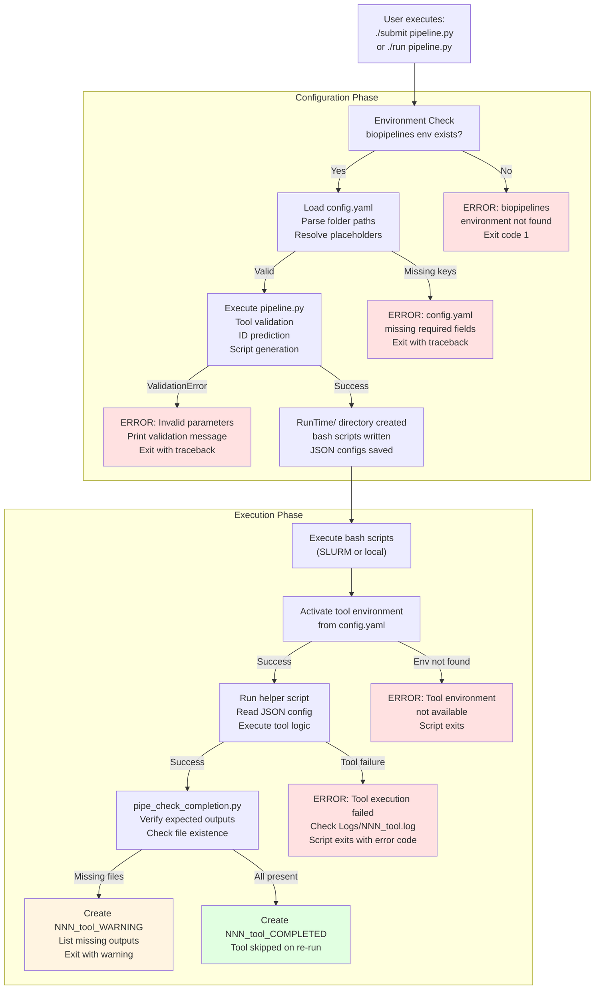
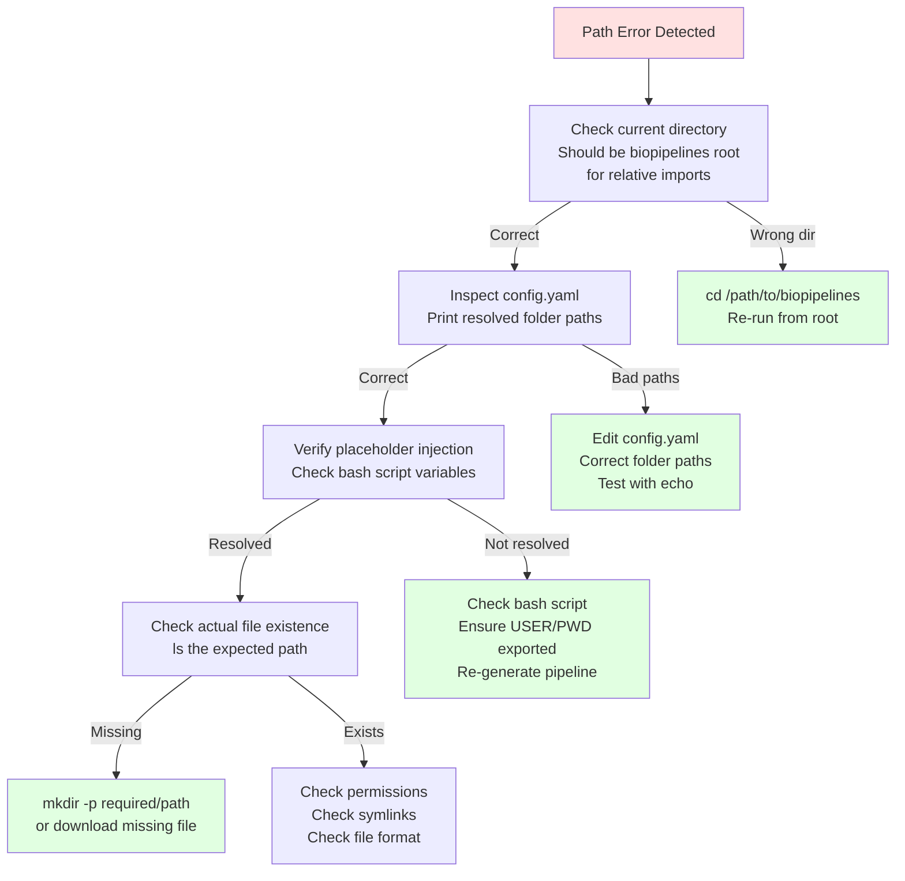
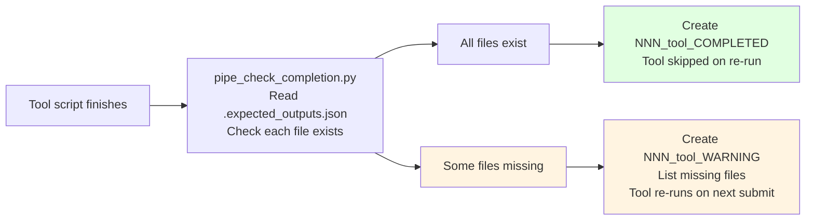
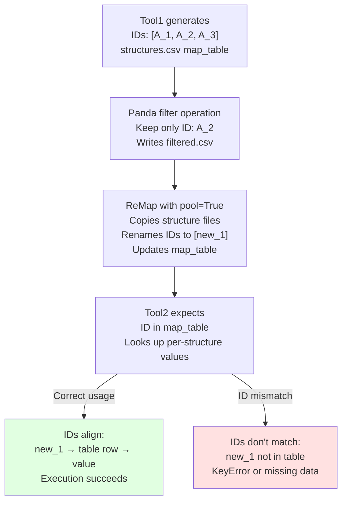
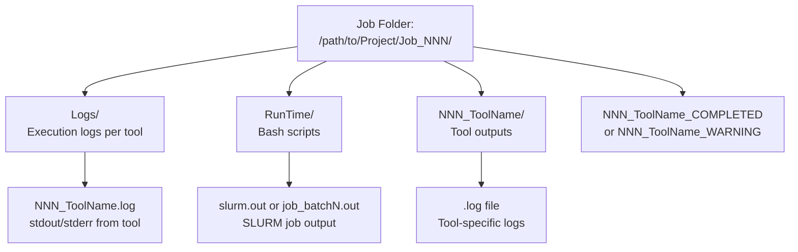

# Troubleshooting and FAQs

<details>
<summary>Relevant source files</summary>

The following files were used as context for generating this wiki page:

- [Docs/UserManual.md](Docs/UserManual.md)
- [HelpScripts/pipe_plot.py](HelpScripts/pipe_plot.py)
- [biopipelines/base_config.py](biopipelines/base_config.py)
- [biopipelines/plot.py](biopipelines/plot.py)
- [biopipelines/pymol.py](biopipelines/pymol.py)
- [config.yaml](config.yaml)
- [run](run)
- [submit](submit)

</details>


This page provides solutions to common issues encountered when using BioPipelines, debugging strategies for diagnosing problems, and answers to frequently asked questions. It covers environment setup failures, execution errors, SLURM submission issues, data mapping problems, and tool-specific troubleshooting.

For general usage patterns and basic pipeline construction, see [Getting Started](#2). For configuration details, see [Configuration Reference](#8.1). For tool-specific parameter issues, see [Complete Tool Reference](#8.2).

---

## Error Detection and Resolution Flow

The following diagram illustrates how BioPipelines detects and reports errors at different stages of the pipeline lifecycle:



**Sources:** [submit:1-311](), [run:1-251](), [biopipelines/base_config.py:499-649]()

---

## Environment and Installation Issues

### Environment Not Found

**Symptom:** `ERROR: biopipelines environment not found` when running `submit` or `run`.

**Cause:** The `biopipelines` conda/mamba environment has not been created.

**Solution:**
```bash
# Create the environment
mamba env create -f Environments/biopipelines.yaml
mamba activate biopipelines
pip install -e .
```

**Verification:**
```bash
# Check environment exists
mamba env list | grep biopipelines

# Check Python package is installed
python -c "import biopipelines; print(biopipelines.__file__)"
```

**Sources:** [submit:46-57](), [run:46-58](), [Docs/UserManual.md:49-70]()

---

### Tool Environment Missing

**Symptom:** Script fails during execution phase with `conda activate <tool_env>: environment not found`.

**Cause:** Tool-specific environment (e.g., `SE3nv`, `Boltz2Env`) not installed.

**Solution:**
```python
# Use the install() method within a Pipeline context
with Pipeline("Setup", "install"):
    Resources(time="2:00:00", memory="16GB")
    RFdiffusion.install()
    ProteinMPNN.install()
    AlphaFold.install()
```

Or manually create environments:
```bash
# Check which environment is needed
grep "RFdiffusion:" config.yaml

# Create it
mamba env create -f Environments/SE3nv.yaml
```

**Verification:**
```bash
# List all tool environments
mamba env list

# Check specific environment
mamba activate SE3nv
python -c "import torch; print(torch.__version__)"
```

**Sources:** [config.yaml:65-120](), [biopipelines/base_config.py:82-115](), [Docs/UserManual.md:94-108]()

---

### Wrong Environment Manager

**Symptom:** `ERROR: env_manager not found in config.yaml` or environment activation fails.

**Cause:** `config.yaml` specifies `mamba` but only `conda` is installed (or vice versa).

**Solution:**
Edit [config.yaml:142]() to match your installation:
```yaml
cluster:
  env_manager: "conda"  # or "mamba"
```

**Verification:**
```bash
# Check what's available
which mamba
which conda

# Test shell hook
mamba shell hook --shell bash  # or conda shell hook
```

**Sources:** [submit:21-26](), [run:20-42](), [config.yaml:140-142]()

---

### Module System Issues

**Symptom:** `module: command not found` in SLURM job logs.

**Cause:** HPC cluster doesn't use environment modules, but `config.yaml` specifies modules to load.

**Solution:**
Edit [config.yaml:151-153]() to disable module loading:
```yaml
cluster:
  slurm_modules: []
```

**Verification:**
Check if module system exists:
```bash
module avail  # Should show available modules or error
```

**Sources:** [config.yaml:148-153](), [submit:31-34]()

---

## Pipeline Execution Errors

### Path Resolution Failures

**Symptom:** `FileNotFoundError` or `No such file or directory` during execution.

**Common Causes:**
1. **Relative paths from wrong directory:** Pipeline script executed from outside BioPipelines root
2. **Placeholder not resolved:** `<username>` or `<cwd>` not replaced at runtime
3. **Incorrect folder configuration:** Paths in `config.yaml` don't match system

**Debugging Steps:**



**Solution Examples:**

```bash
# Always run from biopipelines root
cd /path/to/biopipelines
./submit ExamplePipelines/pipeline.py

# Or use absolute paths
./submit /full/path/to/pipeline.py

# Debug config.yaml resolution
python -c "
from biopipelines.config_manager import ConfigManager
cm = ConfigManager()
import pprint
pprint.pprint(cm.resolve_all_folders())
"
```

**Sources:** [Docs/UserManual.md:583](), [config.yaml:9-60]()

---

### Validation Errors

**Symptom:** Python traceback during configuration phase with `ValueError: Invalid parameter...`.

**Cause:** Tool parameters don't match requirements (e.g., missing required input, invalid value range).

**Common Validation Failures:**

| Error Message | Cause | Solution |
|---------------|-------|----------|
| `structures parameter is required` | Missing input to tool | Pass structures from upstream tool |
| `contigs must be specified` | RFdiffusion requires contigs | Provide contig string |
| `num_designs must be positive` | Invalid parameter value | Use `num_designs=10` (>0) |
| `Column 'xyz' not found in table` | Invalid column reference | Check `table.info.columns` |
| `Cannot resolve outputs from dependency` | Wrong input type | Pass `StandardizedOutput` or `DataStream` |

**Debugging:**
```python
# Print available columns from upstream table
print(boltz.tables.confidence.info.columns)

# Check what structures are available
print(rfd.streams.structures.ids)
print(len(rfd.streams.structures))

# Validate before running
tool = RFdiffusion(pdb=protein, contigs="10-40")
print(tool.params)  # Inspect parameters
```

**Sources:** [biopipelines/base_config.py:283-286]()

---

### SLURM Job Failures

**Symptom:** `sbatch: error: ...` or job never starts.

**Common Issues:**

#### 1. Invalid Resource Specification

```bash
# Symptom in submit output
sbatch: error: Invalid partition name
sbatch: error: Invalid qos specification
```

**Solution:** Check SLURM configuration on your cluster:
```bash
# List available partitions
sinfo

# Check GPU resources
sinfo -o "%20P %10g %20G"

# Adjust Resources() accordingly
Resources(gpu="A100", time="4:00:00", memory="32GB")
```

#### 2. Dependency Failures

```bash
# Symptom: Second batch never starts
# Check with: squeue -u $USER

# Cause: First batch failed, afterok dependency blocks second
```

**Solution:** Review first batch logs:
```bash
# Find job output
ls /path/to/job/RunTime/job_batch1.out

# Check for errors
tail -50 /path/to/job/Logs/001_*.log
```

#### 3. Placeholder Not Replaced

```bash
# Symptom in slurm_batch*.sh
#SBATCH --dependency=afterok:<JOBID>
```

**Cause:** Multi-batch submission failed before updating placeholder.

**Solution:** Manually fix and resubmit:
```bash
# Edit slurm_batch2.sh
sed -i 's/<JOBID>/12345678/g' /path/to/RunTime/slurm_batch2.sh

# Resubmit
sbatch --job-name="pipeline_batch2" \
  --output=/path/to/RunTime/job_batch2.out \
  /path/to/RunTime/slurm_batch2.sh
```

**Sources:** [submit:169-221](), [Docs/UserManual.md:480-494]()

---

### Tool Output Incomplete

**Symptom:** `NNN_tool_WARNING` file created, some outputs missing.

**Completion Check Mechanism:**



**Debugging:**
```bash
# Check which outputs are missing
cat /path/to/job/NNN_tool_WARNING

# Inspect expected outputs
cat /path/to/job/NNN_Tool/.expected_outputs.json | python -m json.tool

# Check actual outputs
ls -lh /path/to/job/NNN_Tool/

# Check tool log for errors
tail -100 /path/to/job/Logs/NNN_tool.log
```

**Common Causes:**
- **Tool crashed mid-execution:** Check log for errors
- **Disk space full:** `df -h` to check
- **Permissions issue:** `ls -l` to verify write access
- **ID mismatch:** Expected IDs don't match generated IDs

**Sources:** [biopipelines/base_config.py:526-649](), [HelpScripts/pipe_check_completion.py]()

---

## Data and ID Mapping Issues

### ID Mismatch Errors

**Symptom:** `KeyError: 'structure_id'` or missing data when using table column references.

**Cause:** IDs between structures and table don't match (e.g., filtering changed IDs).

**ID Mapping Flow:**



**Debugging:**
```python
# Print IDs from structures
print("Structure IDs:", filtered.streams.structures.ids)

# Print IDs from table
import pandas as pd
df = pd.read_csv(filtered.tables.results.info.path)
print("Table IDs:", df['id'].tolist())

# Check if they match
assert set(filtered.streams.structures.ids) == set(df['id'].tolist())

# Check map_table exists
print("Map table:", filtered.streams.structures.map_table)
```

**Solution:** Ensure filtering operations update both structures and tables:
```python
# Correct: use pool=True to copy structures
filtered = Panda(
    tables=boltz.tables.confidence,
    operations=[Panda.filter("pLDDT > 80")],
    pool=boltz  # This copies matching structures
)

# Now IDs match
assert set(filtered.streams.structures.ids) == set(filtered.tables.confidence.ids)
```

**Sources:** [biopipelines/base_config.py:374-423](), [Docs/UserManual.md:356-370]()

---

### Provenance Column Confusion

**Symptom:** Don't understand which `*.id` columns to use for filtering.

**Explanation:** Every combinatorics axis creates a provenance column in output tables.

**Example:**
```python
# Pipeline with 2 proteins × 3 ligands
proteins = PDB(["1abc", "2def"])  # IDs: prot1, prot2
ligands = Ligand(["ATP", "GTP", "CTP"])  # IDs: lig1, lig2, lig3

boltz = Boltz2(proteins=proteins, ligands=ligands)
# Output IDs: prot1_lig1, prot1_lig2, prot1_lig3, prot2_lig1, prot2_lig2, prot2_lig3

# Table has columns: id, sequences.id, compounds.id, confidence, ...
# sequences.id: which protein (prot1 or prot2)
# compounds.id: which ligand (lig1, lig2, or lig3)
```

**Filtering by Provenance:**
```python
import pandas as pd
df = pd.read_csv(boltz.tables.confidence.info.path)

# Get all results for protein prot1
prot1_results = df[df['sequences.id'] == 'prot1']

# Get all results for ligand lig2
lig2_results = df[df['compounds.id'] == 'lig2']

# Get specific combination
prot1_lig2 = df[(df['sequences.id'] == 'prot1') & (df['compounds.id'] == 'lig2')]
```

**Sources:** [Docs/UserManual.md:359-370](), [Page 3.5: ID Generation and Provenance Tracking](#3.5)

---

## Debugging Strategies

### Reading Log Files

**Log File Locations:**



**Debugging Workflow:**
```bash
# 1. Check overall job status
ls /path/to/job/*_COMPLETED
ls /path/to/job/*_WARNING

# 2. Identify failed step
ls -ltr /path/to/job/Logs/

# 3. Read relevant log
tail -100 /path/to/job/Logs/003_AlphaFold.log

# 4. Check SLURM output (if submitted)
cat /path/to/job/RunTime/slurm.out

# 5. Check tool-specific output
cat /path/to/job/003_AlphaFold/.log
```

**Common Log Patterns:**

| Pattern in Log | Meaning | Action |
|----------------|---------|--------|
| `CUDA out of memory` | GPU memory exceeded | Reduce batch size or use larger GPU |
| `FileNotFoundError: /path/to/file` | Missing input file | Check upstream tool outputs |
| `KeyError: 'column_name'` | Column missing from table | Verify table has expected columns |
| `Command not found` | Tool not installed/in PATH | Check environment activation |
| `Segmentation fault` | Tool crashed | Check tool version, input validity |
| `killed` | Out of memory (CPU RAM) | Increase memory in `Resources()` |
| `DiskQuotaExceededError` | Disk full | Clean up or request more space |

**Sources:** [biopipelines/base_config.py:308-328](), [Docs/UserManual.md:589]()

---

### Interactive Debugging

**On-the-Fly Execution:** Test pipelines interactively in Jupyter/IPython:

```python
# In Jupyter notebook or IPython
from biopipelines.pipeline import *

# Pipeline runs immediately, no SLURM submission
Pipeline("Debug", "test", description="Testing")

lysozyme = PDB("168L")
print(f"Found {len(lysozyme.streams.structures)} structures")
print(f"IDs: {lysozyme.streams.structures.ids}")

rfd = RFdiffusion(pdb=lysozyme, contigs='50-70/A81-140', num_designs=2)
print(f"Output folder: {rfd.output_folder}")

# Check outputs immediately
import os
print(os.listdir(rfd.output_folder))
```

**Advantages:**
- See output immediately after each tool
- Inspect intermediate data structures
- Quickly test parameter combinations
- Debug ID mappings and table references

**Sources:** [Docs/UserManual.md:420-454](), [Page 4.3: Interactive Mode](#4.3)

---

### Loading Previous Outputs

**Use Case:** Pipeline failed mid-way, want to inspect/reuse partial results.

```python
from biopipelines.load import Load, LoadMultiple

# Load single tool output
prev_boltz = Load("/path/to/job/003_Boltz2")

# Access structures and tables as if tool just ran
print(prev_boltz.streams.structures.ids)
print(prev_boltz.tables.confidence.info.path)

# Use in downstream pipeline
with Pipeline("Recovery", "continue"):
    # Filter previous results
    best = Panda(
        tables=prev_boltz.tables.confidence,
        operations=[Panda.sort("pLDDT", ascending=False), Panda.head(10)],
        pool=prev_boltz
    )
    
    # Continue from filtered results
    pymol = PyMOL(PyMOL.Load(best), ...)

# Load all instances of a tool
all_boltz = LoadMultiple("/path/to/job/", tool="Boltz2")
for i, boltz_output in enumerate(all_boltz):
    print(f"Boltz2 run {i}: {len(boltz_output.streams.structures)} structures")
```

**Sources:** [Docs/UserManual.md:600-610](), [biopipelines/load.py]()

---

### Forcing Reruns

**Problem:** Tool shows as completed but you need to regenerate outputs.

**Solutions:**

```bash
# Option 1: Delete completion marker (tool will re-run)
rm /path/to/job/003_Boltz2_COMPLETED

# Option 2: Delete entire tool folder
rm -rf /path/to/job/003_Boltz2/

# Option 3: Regenerate pipeline with new job number
# Edit pipeline script, change project/job name, re-submit
```

**Caution:** If downstream tools depend on this tool's outputs, they should also be re-run:
```bash
# Delete everything from step 3 onward
rm /path/to/job/003_*_COMPLETED
rm -rf /path/to/job/003_*/
rm /path/to/job/004_*_COMPLETED
rm -rf /path/to/job/004_*/
```

**Sources:** [biopipelines/base_config.py:499-524]()

---

## Frequently Asked Questions

### Pipeline Execution

**Q: Can I run pipelines without SLURM?**

Yes, use the `run` script instead of `submit`:
```bash
./run pipeline.py
```
This executes tools sequentially on the local machine. Suitable for small jobs or testing.

**Sources:** [run:1-251](), [Docs/UserManual.md:465-478]()

---

**Q: How do I change output location?**

Edit [config.yaml:22]():
```yaml
base:
  biopipelines_output: "/custom/path/to/outputs"
```

Or use `local_output=True` for current directory:
```python
with Pipeline("Test", "Debug", local_output=True):
    # Outputs go to ./BioPipelines/ instead of config path
    ...
```

**Sources:** [Docs/UserManual.md:591-598]()

---

**Q: Pipeline already generated scripts but I changed parameters. Do I need to regenerate?**

Yes. Delete the job folder and re-run the pipeline script:
```bash
rm -rf /path/to/BioPipelines/Project/Job_001/
python pipeline.py  # Regenerates with new parameters
```

Alternatively, increment the job number automatically (BioPipelines will find the next available `Job_002`, `Job_003`, etc.).

---

**Q: Can I run multiple pipelines simultaneously?**

Yes, as long as they have different project/job names. Each pipeline gets its own folder.

```python
# Terminal 1
with Pipeline("Protein1", "analysis"):
    ...

# Terminal 2 (simultaneously)
with Pipeline("Protein2", "analysis"):
    ...
```

---

### Resource Management

**Q: My job was killed with no error message.**

**Likely cause:** Out of memory. SLURM kills jobs that exceed memory allocation without logging errors.

**Solution:**
```python
Resources(memory="64GB", time="12:00:00")  # Increase from default

# Check your cluster's memory limits
# sinfo -o "%20P %10m"
```

---

**Q: How do I know which GPU a tool needs?**

Most GPU tools work with any modern GPU. Specify by memory:
```python
Resources(gpu="80GB", time="4:00:00")  # A100 80GB
Resources(gpu="32GB", time="4:00:00")  # V100 32GB or A100 40GB
Resources(gpu="any", time="4:00:00")   # Any available GPU
```

For CPU-only tools, omit `gpu`:
```python
Resources(memory="32GB", time="2:00:00", cpus=16)
```

**Sources:** [Docs/UserManual.md:395-407]()

---

### Data Management

**Q: Can I use outputs from a previous pipeline in a new one?**

Yes, use `Load()`:
```python
with Pipeline("NewAnalysis", "using_prev_results"):
    prev = Load("/path/to/OldPipeline/Job_005/003_Boltz2")
    
    # Use as input to new tools
    filtered = Panda(tables=prev.tables.confidence, ...)
```

**Sources:** [Docs/UserManual.md:600-610]()

---

**Q: How do I export results for Prism/Excel?**

Use `ExtractMetrics`:
```python
from biopipelines.extract_metrics import ExtractMetrics

metrics = ExtractMetrics(
    tables=[boltz.tables.confidence],
    columns=["id", "pLDDT", "affinity"],
    output_name="prism_export.csv"
)
# Creates a simplified CSV with only specified columns
```

**Sources:** [Page 5.6: Data Management Tools](#5.6)

---

**Q: Panda filter removed all rows. Why?**

Check filter syntax and column types:
```python
import pandas as pd
df = pd.read_csv(boltz.tables.confidence.info.path)

# Debug filter
print(df['pLDDT'].dtype)  # Should be numeric, not string
print(df['pLDDT'].describe())  # Check value range
print(df[df['pLDDT'] > 0.8])  # Test filter manually

# Common mistake: string comparison instead of numeric
# Wrong: Panda.filter("pLDDT > '0.8'")  # Treats 0.8 as string
# Right: Panda.filter("pLDDT > 0.8")
```

---

### Tool-Specific Issues

**Q: AlphaFold/Boltz2 prediction is very slow. Can I speed it up?**

1. **Reduce MSA depth:**
```python
AlphaFold(proteins=seqs, msa_mode="mmseqs2_uniref_env", max_msa=128)
# Instead of default max_msa=512
```

2. **Use pre-generated MSAs:**
```python
msas = MMseqs2(sequences=seqs, max_sequences=128)
alphafold = AlphaFold(proteins=seqs, msas=msas)
```

3. **Request GPU with more memory:**
```python
Resources(gpu="80GB", time="12:00:00")  # Faster than 40GB for large complexes
```

---

**Q: RFdiffusion generates structures but they all look similar.**

Increase sampling diversity:
```python
rfd = RFdiffusion(
    pdb=target,
    contigs="10-40",
    num_designs=100,  # More samples
    inference_steps=100,  # More denoising steps (default: 50)
    T=25  # Higher temperature (default: 10, range: 1-100)
)
```

---

**Q: Boltz2 predictions have low confidence.**

**Common causes:**
1. **No MSA provided:** Boltz2 works better with MSAs
2. **Incompatible complex:** Some protein-ligand combinations are not feasible
3. **Wrong protonation state:** Use pH-appropriate SMILES

**Debugging:**
```python
# Check confidence distribution
import pandas as pd
df = pd.read_csv(boltz.tables.confidence.info.path)
print(df['confidence'].describe())

# Visualize
from biopipelines.plot import Plot
Plot(Plot.Histogram(data=boltz.tables.confidence, x="confidence", bins=20))
```

---

**Q: PyMOL session won't open.**

**Causes:**
1. **PyMOL not installed:** Install with `PyMOL.install()`
2. **Structure files missing:** Check that input structures exist
3. **Wrong PyMOL version:** Session format may be incompatible

**Solution:**
```bash
# Check PyMOL installation
mamba activate ProteinEnv
pymol -c  # Should start command-line PyMOL

# Manually open session
pymol /path/to/job/NNN_PyMOL/session.pse

# If fails, check structure paths in session
grep "load" /path/to/job/NNN_PyMOL/*.py
```

---

### Configuration Issues

**Q: Placeholder `<username>` not resolved in paths.**

**Cause:** Runtime placeholder injection happens during script generation. If you see `<username>` in error messages, the script wasn't generated correctly.

**Solution:** Verify config.yaml placeholders are correct:
```bash
python -c "
from biopipelines.config_manager import ConfigManager
cm = ConfigManager()
print(cm.get_folder('biopipelines_output'))
"
# Should show resolved path with your username
```

**Sources:** [config.yaml:9-22]()

---

**Q: How do I use a different Python environment for each tool?**

Edit [config.yaml:65-120]() to specify per-tool environments:
```yaml
environments:
  RFdiffusion: "SE3nv"
  ProteinMPNN: "proteinmpnn_env"
  Boltz2: "boltz2_env"
  # Or use containers instead:
```

Then in [config.yaml:122-128]() for containerized tools:
```yaml
containers:
  RFdiffusionAllAtom: "/path/to/rf_se3_diffusion.sif"
```

**Sources:** [config.yaml:65-128](), [Page 7.3: Container Execution](#7.3)

---

## Error Message Reference

### Common Error Messages and Solutions

| Error Message | File/Location | Cause | Solution |
|---------------|---------------|-------|----------|
| `ERROR: biopipelines environment not found` | [submit:50-56]() | Conda env not created | Run `mamba env create -f Environments/biopipelines.yaml` |
| `ERROR: env_manager not found in config.yaml` | [submit:23-25]() | Missing config key | Add `env_manager: mamba` to config.yaml cluster section |
| `FileNotFoundError: ToolOutputs/NNN_tool.json` | Pipeline execution | Tool output prediction file missing | Check tool completed successfully, verify output folder exists |
| `ValidationError: structures parameter is required` | Tool initialization | Missing required parameter | Pass structures from upstream tool |
| `KeyError: 'column_name'` | Table column reference | Column doesn't exist in table | Check available columns with `table.info.columns` |
| `JSON serialization error` | [base_config.py:577-619]() | Unsupported object type | Report as bug (should not happen in normal usage) |
| `sbatch: error: Batch job submission failed` | SLURM submission | Invalid SLURM parameters | Check cluster limits with `sinfo`, adjust Resources() |
| `ModuleNotFoundError: No module named 'biopipelines'` | Python execution | Package not installed | Run `pip install -e .` from repo root |
| `RuntimeError: No active pipeline context` | Outside Pipeline block | Tool called outside `with Pipeline():` | Wrap tool calls in Pipeline context manager |

**Sources:** [submit:1-311](), [biopipelines/base_config.py:117-194]()

---

## Recovery and Restart Patterns

### Partial Pipeline Failure

**Scenario:** Pipeline with 10 tools failed at step 7.


**Recovery Strategy:**

```bash
# 1. Diagnose failure
cat /path/to/job/Logs/007_Distance.log
cat /path/to/job/007_Distance_WARNING  # Lists missing outputs

# 2. Fix issue (e.g., install missing dependency)
mamba activate biopipelines
pip install missing_package

# 3. Delete failure marker
rm /path/to/job/007_Distance_WARNING

# 4. Resubmit (steps 1-6 will be skipped due to COMPLETED markers)
./submit pipeline.py
# Or manually run just the failed step:
bash /path/to/job/RunTime/007_Distance.sh
```

**Sources:** [biopipelines/base_config.py:499-524]()

---

### Regenerating with Modified Parameters

**Scenario:** Want to re-run with different parameters without losing old results.

```python
# Original pipeline
with Pipeline("Project", "attempt1"):
    rfd = RFdiffusion(pdb=protein, contigs="10-40", num_designs=10)
    # ... rest of pipeline

# New parameters, different job name
with Pipeline("Project", "attempt2"):  # New job folder: Project/attempt2_002/
    rfd = RFdiffusion(pdb=protein, contigs="10-40", num_designs=100)  # More designs
    # ... rest of pipeline (identical structure)

# Both results preserved for comparison
```

---

### Checkpointing Long Pipelines

**Strategy:** Break long pipelines into phases with manual checkpoints.

```python
# Phase 1: Generation
with Pipeline("Project", "phase1_generation"):
    Resources(gpu="A100", time="8:00:00")
    rfd = RFdiffusion(pdb=protein, contigs="A10-100", num_designs=1000)
    pmpnn = ProteinMPNN(structures=rfd, num_sequences=5)

# Wait for phase 1 to complete, inspect results

# Phase 2: Prediction (uses Load to connect)
with Pipeline("Project", "phase2_prediction"):
    Resources(gpu="A100", time="12:00:00")
    
    # Load previous results
    prev_pmpnn = Load("/path/to/Project/phase1_generation_001/002_ProteinMPNN")
    
    # Filter before expensive prediction
    filtered = Panda(
        tables=prev_pmpnn.tables.sequences,
        operations=[Panda.sample(100)],  # Sample 100 for prediction
        pool=prev_pmpnn
    )
    
    af = AlphaFold(proteins=filtered)
```

**Advantages:**
- Can inspect and filter intermediate results
- Reduces risk of losing all progress on failure
- Easier to debug and optimize resource allocation

---

This troubleshooting guide covers the most common issues encountered in BioPipelines. For tool-specific parameters and advanced usage, consult the [Complete Tool Reference](#8.2). For configuration details, see [Configuration Reference](#8.1).