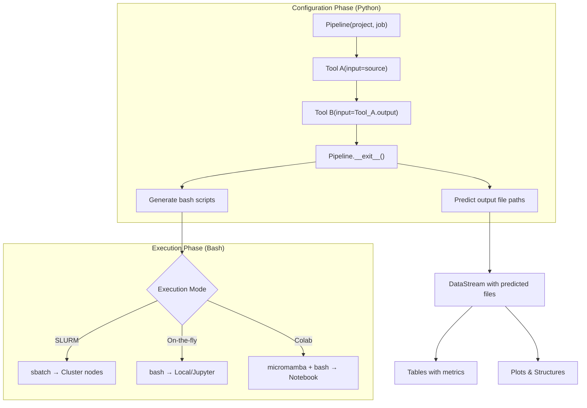
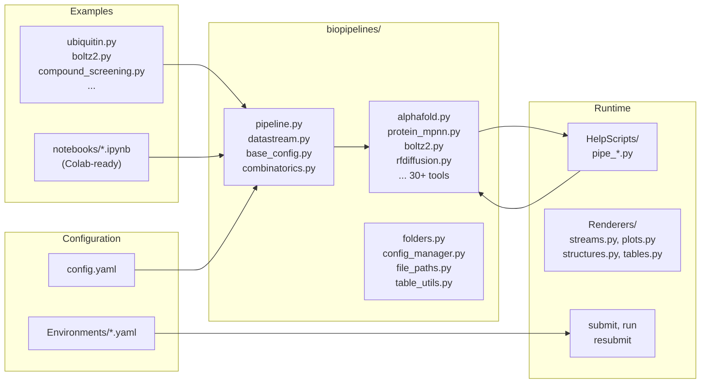

BioPipelines is a Python framework that transforms the complexity of computational protein design into composable, reproducible workflows. Developed at the LOCBP lab (University of Zurich), it provides standardized interfaces to connect over 30 bioinformatics tools — from structure generation with RFdiffusion to sequence design with ProteinMPNN and structure prediction with AlphaFold and Boltz2 — into pipelines that run identically on SLURM clusters and Jupyter notebooks. The framework does not execute computations directly; instead, it generates bash scripts and predicts output file paths, delegating actual execution to your cluster or notebook runtime.


The diagram above illustrates a typical BioPipelines workflow: a PDB structure flows into ProteinMPNN for inverse folding, the designed sequences are validated through AlphaFold refolding and DNA encoding, then filtered by RMSD and pLDDT confidence thresholds. Every arrow represents a **DataStream** — the framework's unified data container — and every box represents a tool invocation defined by a single Python line.

Sources: [README.md](README.md#L1-L82), [Docs/index.md](Docs/index.md#L1-L101)

## How BioPipelines Works

At its core, BioPipelines operates on a **declarative pipeline model**. You describe *what* you want to happen — which tools to run, in what order, with which parameters — and the framework figures out *how* to make it happen: generating SLURM batch scripts, managing conda environments, predicting output paths, and wiring data between tools. This is achieved through three foundational abstractions working in concert.



The **Pipeline** class is the orchestration engine. You open a `with Pipeline(...)` block, instantiate tools inside it, and when the block exits, the framework generates everything needed for execution. Each tool is an instance of a **BaseConfig** subclass — the abstraction layer that normalizes every tool behind a consistent interface regardless of whether it runs RFdiffusion, AlphaFold, or a simple PDB download. Tools communicate through **DataStreams**, lightweight containers that track file paths, IDs, and metadata without loading data into memory.

Sources: [biopipelines/pipeline.py](biopipelines/pipeline.py#L42-L118), [biopipelines/base_config.py](biopipelines/base_config.py#L22-L70), [biopipelines/datastream.py](biopipelines/datastream.py#L1-L80)

## Two Execution Modes

BioPipelines is designed for two fundamentally different computing environments, and switching between them requires **zero code changes**. The same pipeline script runs unchanged on a high-performance SLURM cluster or interactively in a Jupyter notebook (including Google Colab). This is the framework's central design promise.

| Feature | SLURM Cluster | Jupyter / Colab |
|---|---|---|
| **Submission** | `./submit pipeline.py` or `biopipelines-submit pipeline.py` | Run cells directly in a notebook |
| **Execution** | Generates `sbatch` scripts with resource specs | Tools execute on-the-fly per cell |
| **Environment** | Configured in `config.yaml` under `environments` | Auto-detected via `colab.yaml` + `micromamba` |
| **Resource control** | `Resources(gpu="A100", time="4:00:00", memory="16GB")` | Ignored; uses available notebook resources |
| **Output** | `<user>/BioPipelines/<Project>/<Job_NNN>/` | `./tests/` (or configurable via `local_output`) |
| **Batch support** | Multi-batch with SLURM dependencies | Sequential execution |

In cluster mode, the `./submit` bash script activates the conda environment, runs your Python pipeline to generate SLURM scripts and configuration files, then submits them via `sbatch`. In notebook mode, the `Pipeline` class auto-detects the Jupyter environment and sets `on_the_fly=True`, causing each tool to execute immediately when instantiated. The framework even supports multi-batch pipelines where later batches depend on earlier ones completing successfully.

> [!TIP]
> **Notebook auto-detection** happens at `Pipeline.__init__()` — it inspects the call stack for IPython's `ZMQInteractiveShell` or Google Colab's `_shell` module. You can also force it with the `on_the_fly=True` parameter or the `BIOPIPELINES_OTF=1` environment variable.

Sources: [biopipelines/pipeline.py](biopipelines/pipeline.py#L55-L118), [submit](submit#L1-L80), [run](run#L1-L80), [Docs/index.md](Docs/index.md#L42-L76)

## Tool Ecosystem

The framework integrates over 30 tools spanning the entire computational protein design pipeline, from input preparation to final analysis. Each tool is a Python class that you instantiate with natural parameters — the framework handles environment switching, file path management, and output prediction automatically.

| Category | Tools | Purpose |
|---|---|---|
| **Utilities & Inputs** | `PDB`, `Sequence`, `Ligand`, `CompoundLibrary`, `Load`, `MMseqs2` | Load and prepare input data |
| **Structure Generation** | `RFdiffusion`, `RFdiffusionAllAtom`, `RFdiffusion3`, `BoltzGen` | Generate novel protein backbones and complexes |
| **Sequence Design** | `ProteinMPNN`, `LigandMPNN`, `MutationComposer`, `Mutagenesis`, `Fuse`, `StitchSequences`, `DNAEncoder`, `RBSDesigner` | Design or optimize amino acid sequences |
| **Structure Prediction** | `AlphaFold`, `Boltz2`, `Gnina` | Predict 3D structures from sequences |
| **Analysis** | `Distance`, `Angle`, `DistanceSelector`, `ConformationalChange`, `Contacts`, `PoseBusters`, `PoseChange`, `CABSflex` | Measure and analyze structural properties |
| **Statistics** | `MutationProfiler`, `SequenceMetricCorrelation`, `BayesianAdjuster` | Profile mutations and correlate metrics |
| **Data Management** | `Panda`, `ExtractMetrics`, `Selection` | Filter, merge, sort, and transform result tables |
| **Visualization** | `PyMOL`, `Plot` | Generate molecular visualizations and plots |

The `Panda` tool deserves special mention — it provides pandas-style data operations (`merge`, `filter`, `sort`, `calculate`, `concat`) that work on the result tables produced by other tools, enabling sophisticated filtering without leaving the pipeline. Combined with **Bundle** and **Each** combinatorics, you can systematically explore protein-ligand-structure spaces with minimal code.


Sources: [README.md](README.md#L39-L82), [biopipelines/__init__.py](biopipelines/__init__.py#L1-L124), [Docs/index.md](Docs/index.md#L14-L30)

## Project Structure

The repository is organized into five functional zones. Understanding this layout helps you navigate the codebase and find what you need quickly.



- **`biopipelines/`** — The core Python package containing the orchestration engine, all tool classes, and infrastructure modules (folder management, config resolution, table utilities). This is the only directory you `import` from.
- **`config.yaml`** — Central configuration file defining folder paths (with placeholder resolution like `<username>`, `<cwd>`), default conda environments per tool, cluster settings, and Jupyter renderer mappings. This is the file you customize for your environment.
- **`Environments/`** — Conda/mamba environment YAML files for each tool (e.g., `SE3nv.yaml` for RFdiffusion/ProteinMPNN, `Boltz2Env.yaml` for Boltz2). Tools are isolated into their own environments and activated automatically at execution time.
- **`ExamplePipelines/`** — Working pipeline scripts (`.py`) and Colab-ready notebooks (`.ipynb`) that demonstrate every major capability. Start here to learn by example.
- **`HelpScripts/`** — Python and shell scripts invoked at execution time by the generated bash scripts. Each `pipe_*.py` handles the runtime details of a specific tool (config generation, output parsing, etc.). You rarely interact with these directly.
- **`Renderers/`** — Display adapters for Jupyter notebooks that render tool outputs inline — molecular structures via py3Dmol, plots, FASTA sequences, and data tables.
- **`submit` / `run`** — CLI entry points for cluster submission and local execution respectively, also available as `biopipelines-submit` and `biopipelines-run` after `pip install`.

Sources: [config.yaml](config.yaml#L1-L188), [mkdocs.yml](mkdocs.yml#L1-L70), [pyproject.toml](pyproject.toml#L24-L30)

## A Complete Pipeline in 30 Lines

The best way to understand BioPipelines is to see it in action. Here is the complete ubiquitin inverse folding pipeline — a real, production-ready workflow that retrieves a PDB structure, designs 10 new sequences, validates them through refolding, and filters by structural fidelity.

```python
from biopipelines.pipeline import *
from biopipelines.protein_mpnn import ProteinMPNN
from biopipelines.alphafold import AlphaFold
from biopipelines.conformational_change import ConformationalChange
from biopipelines.panda import Panda
from biopipelines.dna_encoder import DNAEncoder

with Pipeline(project="Ubiquitin", job="InverseFolding"):
    Resources(gpu="A100", time="4:00:00", memory="16GB")

    # Load input structure from RCSB PDB
    ubiquitin = PDB("4LCD", chain="E")

    # Design 10 sequences via inverse folding
    sequences = ProteinMPNN(structures=ubiquitin,
                            num_sequences=10,
                            soluble_model=True)

    # Predict folded structures
    folded = AlphaFold(proteins=sequences)

    # Encode sequences as DNA for experimental use
    dna = DNAEncoder(sequences=sequences, organism="EC")

    # Measure structural deviation from reference
    conf_change = ConformationalChange(reference_structures=ubiquitin,
                                       target_structures=folded)

    # Filter: keep sequences with RMSD < 1.5Å and pLDDT > 80
    filtered_sequences = Panda(
        tables=[folded.tables.confidence, conf_change.tables.changes],
        operations=[Panda.merge(),
                    Panda.filter("RMSD < 1.5 and plddt > 80")],
        pool=sequences
    )

    # Re-encode filtered sequences as DNA
    dna = DNAEncoder(sequences=filtered_sequences, organism="EC")
```

Notice the key pattern: **each tool receives another tool's output as input**. The `structures=ubiquitin` parameter passes the DataStream from `PDB("4LCD")` directly to `ProteinMPNN`. The framework resolves these references at generation time, predicting the exact output file paths before any computation runs. This is what enables the two-phase execution model — the entire dependency graph is known upfront.

> [!TIP]
> **Tool outputs are accessed via dot notation.** `folded.tables.confidence` gives you a table reference to AlphaFold's confidence metrics, and `conf_change.tables.changes` gives RMSD values. These `TableReference` objects can be passed directly to `Panda` for merging and filtering — no file path manipulation needed.

Sources: [ExamplePipelines/ubiquitin.py](ExamplePipelines/ubiquitin.py#L1-L44), [Docs/examples.md](Docs/examples.md#L1-L51)

## What You Can Build

BioPipelines supports a wide range of computational protein design workflows. Here are some of the capabilities demonstrated in the example pipelines and Colab notebooks available in the repository.

| Workflow | Example | Key Tools |
|---|---|---|
| **Inverse Folding** | Ubiquitin sequence redesign | ProteinMPNN → AlphaFold → ConformationalChange → Panda |
| **De Novo Backbone Design** | Kinase LID domain generation | RFdiffusion → ProteinMPNN → AlphaFold → PyMOL |
| **Protein–Ligand Co-folding** | Compound library screening | CompoundLibrary → Boltz2 → Panda → Plot |
| **Iterative Directed Evolution** | 5-cycle binding optimization | LigandMPNN → MutationProfiler → MutationComposer → Boltz2 |
| **Split Sequence Design** | Enzyme redesign near/from ligand | RFdiffusion3 → DistanceSelector → ProteinMPNN + LigandMPNN → StitchSequences → Boltz2 |
| **FRET Biosensor Design** | Linker length optimization | DistanceSelector → Fuse → AlphaFold → Angle → Panda |
| **Combinatorial Screening** | Protein × ligand matrices | Bundle / Each → Boltz2 → Panda |

Every example is available as both a standalone `.py` script and a Colab-ready `.ipynb` notebook, so you can explore them interactively or run them on a cluster.

Sources: [README.md](README.md#L11-L36), [Docs/examples.md](Docs/examples.md#L55-L200)

## Where to Go Next

This overview introduced the conceptual foundations of BioPipelines. To start building your own pipelines, follow this reading progression through the documentation:

1. **[Quick Start](2-quick-start)** — Install BioPipelines and run your first pipeline in under 10 minutes, with environment setup for both cluster and Colab.
2. **[Installation and Environment Setup](3-installation-and-environment-setup)** — Detailed configuration of `config.yaml`, conda environments, and tool installations.
3. **[Architecture Overview](5-architecture-overview)** — Deeper dive into the Pipeline → BaseConfig → DataStream architecture and how the two-phase execution model works internally.
4. **[Quick Start](2-quick-start)** for hands-on practice, then **[Bundle and Each Input Patterns](14-bundle-and-each-input-patterns)** when you need to explore combinatorial design spaces.
5. **[Tool Reference](Docs/ToolReference.md)** for the complete parameter reference for every tool.
