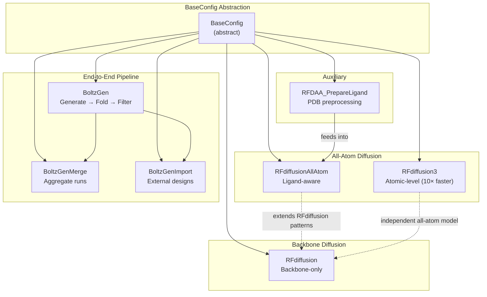
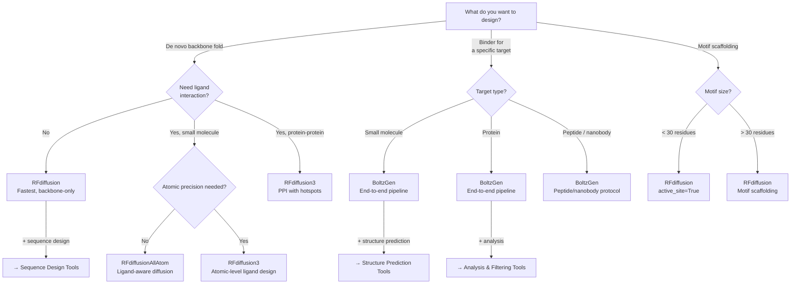
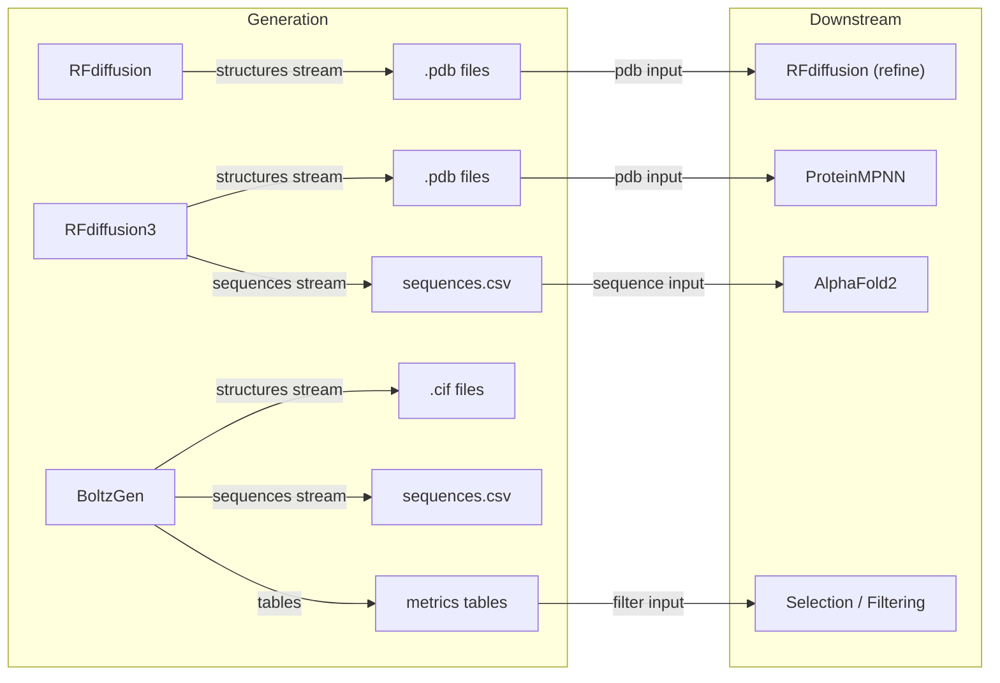

Structure generation is the starting point of most protein design pipelines in BioPipelines. These tools produce novel protein backbone conformations — from simple de novo folds to complex ligand-binding scaffolds — that downstream tools then refine, sequence, and validate. This page covers the four primary generation tools (RFdiffusion, RFdiffusionAllAtom, RFdiffusion3, and BoltzGen) along with their auxiliary utilities (BoltzGenMerge, BoltzGenImport, and RFDAA_PrepareLigand), examining their architectural relationships, configuration surfaces, and output contracts.

## Tool Landscape

The structure generation tools occupy a layered capability space. RFdiffusion provides the foundational backbone-only diffusion model. RFdiffusionAllAtom extends it to handle explicit ligand atoms for small-molecule contexts. RFdiffusion3 represents a generational leap to all-atom design with hotspot-driven control and approximately 10× faster inference. BoltzGen takes a different architectural approach — an end-to-end pipeline that couples diffusion generation with inverse folding, structure prediction, and multi-metric filtering to produce ranked, sequence-validated binders.



All tools inherit from [BaseConfig](biopipelines/base_config.py#L34-L40), which enforces a uniform interface of `validate_params()`, `configure_inputs()`, `generate_script()`, and `get_output_files()` abstract methods. This shared contract means every generation tool can be added to a Pipeline via `pipeline.add()` and will receive automatic environment activation, completion checking, and provenance tracking.

Sources: [base_config.py](biopipelines/base_config.py#L34-L40), [rfdiffusion.py](biopipelines/rfdiffusion.py#L30-L65), [rfdiffusion_allatom.py](biopipelines/rfdiffusion_allatom.py#L31-L39), [rfdiffusion3.py](biopipelines/rfdiffusion3.py#L32-L124), [boltzgen.py](biopipelines/boltzgen.py#L30-L48)

## RFdiffusion: Backbone-Only Diffusion

RFdiffusion is the workhorse for backbone-level protein design. It operates on residue-level representations using a SE(3)-equivariant diffusion process, generating de novo folds or scaffolding functional motifs into new structural contexts. It requires the SE3nv conda environment and downloads model weights (Base and Complex_base by default, with optional ActiveSite and InpaintSeq checkpoints) into a designated data directory.

The tool's core configuration surface is defined by the [RFdiffusion.__init__](biopipelines/rfdiffusion.py#L255-L265) constructor, which accepts `contigs` (required), an optional `pdb` input, and generation parameters including `num_designs`, `steps`, `partial_steps`, and `active_site`. The contig specification follows a specific grammar: chain-prefixed ranges (e.g., `A1-100`) reference residues from the input PDB, while bare number ranges (e.g., `50-100`) specify new backbone segments to generate. Multiple segments are separated by `/`.

| Parameter | Type | Default | Purpose |
|-----------|------|---------|---------|
| `contigs` | `str` | *(required)* | Contig map: fixed residues (chain+range) and new segments |
| `pdb` | `DataStream / StandardizedOutput` | `None` | Input template for motif scaffolding or binder design |
| `num_designs` | `int` | `1` | Number of independent backbone designs |
| `steps` | `int` | `50` | Denoising diffusion steps (fewer = faster) |
| `partial_steps` | `int` | `0` | Partial diffusion for near-neighbour variants |
| `active_site` | `bool` | `False` | Use ActiveSite checkpoint for small motifs (<30 residues) |
| `inpaint` | `str` | `""` | Residues whose sequence is masked during diffusion |
| `reproducible` | `bool` | `False` | Deterministic (fixed-seed) sampling |

RFdiffusion's script generation ([`generate_script`](biopipelines/rfdiffusion.py#L368-L370)) produces a bash script that activates the SE3nv environment, sets a torch compatibility flag (`TORCH_FORCE_NO_WEIGHTS_ONLY_LOAD=1` for PyTorch 2.6+ compatibility), runs the inference script, creates a results table via a HelpScript, and updates the structures map. When a `pdb` DataStream is provided, the script includes runtime resolution snippets that read the serialized JSON to locate the actual PDB file.

The output contract ([`get_output_files`](biopipelines/rfdiffusion.py#L445-L491)) returns a `structures` DataStream with pattern-based IDs (e.g., `<pipeline_name>_<start>..<end>.pdb`) and a `structures` table with columns for id, pdb path, fixed/designed residue counts, source_fixed, plddt_mean, and status. When a PDB input is present, provenance is tracked linking each generated structure back to its source.

```python
from biopipelines.rfdiffusion import RFdiffusion

# De novo fold of 80-120 residues
rfd = RFdiffusion(contigs="80-120", num_designs=10)

# Motif scaffolding: preserve A6-140, generate flanking regions
rfd_motif = RFdiffusion(
    pdb=upstream_structure,   # DataStream or StandardizedOutput
    contigs="20-40,A6-140,30-50",
    num_designs=50
)
```

Sources: [rfdiffusion.py](biopipelines/rfdiffusion.py#L255-L491)

## RFdiffusionAllAtom: Ligand-Aware Diffusion

[RFdiffusionAllAtom](biopipelines/rfdiffusion_allatom.py#L31-L39) extends the diffusion paradigm to explicitly model ligands and small molecules alongside protein backbones. It shares the SE3nv environment with RFdiffusion but uses a different inference script and substantially different parameters, defaulting to 200 diffusion steps (vs. 50) to accommodate the higher complexity of all-atom representation. The tool supports three major design modes: **ligand-binding site design** (scaffold around a small molecule), **protein-protein interface (PPI) design** (generate a binder with hotspot constraints), and **inpainting** with secondary structure and sequence patterns.

The constructor ([`__init__`](biopipelines/rfdiffusion_allatom.py#L130-L155)) requires a `ligand` identifier (the residue name in the PDB, e.g., `'LIG'` or `'ATP'`) and an optional `pdb` template. It adds ligand-aware parameters such as `ppi_design`, `ppi_hotspot_residues`, `ppi_binder_length`, `autogenerate_contigs`, `model_only_neighbors`, `scaffold_guided`, and `guiding_potentials`. The [`_use_container`](biopipelines/rfdiffusion_allatom.py#L126-L128) method checks whether container mode is configured, allowing RFdiffusion-AllAtom to run inside a Docker/Singularity container if available.

| Parameter | Type | Default | Purpose |
|-----------|------|---------|---------|
| `ligand` | `str` | *(required)* | Ligand residue identifier in PDB (e.g., `'LIG'`) |
| `pdb` | `DataStream / StandardizedOutput` | `None` | Input PDB with ligand present |
| `contigs` | `str` | `""` | Contig specification |
| `steps` | `int` | `200` | Higher default for all-atom convergence |
| `ppi_design` | `bool` | `False` | Enable protein-protein interface design mode |
| `ppi_hotspot_residues` | `List[str]` | `None` | Hotspot residues for PPI binder |
| `ppi_binder_length` | `int` | `None` | Length of designed PPI binder |
| `autogenerate_contigs` | `bool` | `False` | Auto-infer fixed contig segments |
| `scaffold_guided` | `bool` | `False` | Enforce strict scaffold adherence |
| `inpaint_str` | `str` | `None` | Secondary structure pattern for inpainting |
| `guiding_potentials` | `str` | `None` | Custom external guiding potentials |

Script generation ([`generate_script`](biopipelines/rfdiffusion_allatom.py#L300-L302)) delegates to [`_build_inference_args`](biopipelines/rfdiffusion_allatom.py#L328-L387) to construct the argument list, then [`_generate_script_run_rfdiffusion`](biopipelines/rfdiffusion_allatom.py#L387-L420) branches between container and environment execution modes. The output schema is identical to RFdiffusion's `structures` table.

> [!TIP]
> RFdiffusionAllAtom requires ligand-only PDB files to be preprocessed with a dummy peptide before use. The [RFDAA_PrepareLigand](biopipelines/rfdiffusion_allatom.py#L515-L519) tool handles this by accepting a ligand DataStream and producing a `prepared_ligand.pdb` with an appended Gly-Ala-Ala tripeptide, which RFdiffusion-AllAtom needs to identify the protein context.

```python
from biopipelines.rfdiffusion_allatom import RFdiffusionAllAtom

# Design a protein scaffold around a ligand
rfdaa = RFdiffusionAllAtom(
    pdb=template_structure,
    ligand='LIG',
    contigs='10-20,A6-140',
    num_designs=5
)
```

Sources: [rfdiffusion_allatom.py](biopipelines/rfdiffusion_allatom.py#L31-L484), [rfdiffusion_allatom.py](biopipelines/rfdiffusion_allatom.py#L515-L639)

## RFdiffusion3: All-Atom Atomic-Level Diffusion

[RFdiffusion3](biopipelines/rfdiffusion3.py#L32-L33) is a third-generation all-atom model that operates at atomic granularity — 4 backbone + 10 sidechain atoms per residue — rather than the residue-level representation used by its predecessors. It runs through the foundry framework (requiring Python ≥ 3.12), supports hotspot-driven binder design, partial diffusion, and flexible structural constraints, and delivers approximately 10× faster inference than RFdiffusion2 with higher design success rates.

The most significant architectural difference from RFdiffusion is its JSON-based configuration system. Instead of command-line flags, RFdiffusion3 consumes a JSON input file ([`_build_json_config`](biopipelines/rfdiffusion3.py#L382-L442)) that specifies design entries with contig, length, hotspot, and constraint parameters. The script generation flow ([`generate_script`](biopipelines/rfdiffusion3.py#L607-L634)) follows a four-stage pipeline: (1) create the JSON input file, (2) run `rfd3 design` via the foundry CLI, (3) postprocess CIF.gz outputs to PDB in the biopipelines environment (which has BioPython), and (4) create the results table and update the structures map.

| Parameter | Type | Default | Purpose |
|-----------|------|---------|---------|
| `contig` | `str` | `""` | Contig specification (`\0` for chain breaks, not `/`) |
| `length` | `str / int` | `None` | Length range for designed regions (e.g., `"50-150"`) |
| `pdb` | `DataStream / StandardizedOutput` | `None` | Input PDB structure |
| `ligand_code` | `str` | `""` | Ligand code for small-molecule binding |
| `select_hotspots` | `str / Dict` | `None` | Hotspot residues and atoms (e.g., `{"A45": "CA,CB"}`) |
| `select_fixed_atoms` | `bool / str / Dict` | `None` | Chain ranges for atomic constraints |
| `select_buried` | `str / Dict` | `None` | Burial constraints for interface residues |
| `select_exposed` | `str / Dict` | `None` | Exposure constraints |
| `select_hbond_donor` | `Dict` | `None` | H-bond donor constraints |
| `select_hbond_acceptor` | `Dict` | `None` | H-bond acceptor constraints |
| `num_designs` | `int` | `1` | Number of designs (n_batches) |
| `num_models` | `int` | `1` | Models per design (diffusion_batch_size) |
| `json_config` | `str / Dict` | `None` | Full JSON config (bypasses parameter building) |

RFdiffusion3's contig syntax diverges from RFdiffusion: it uses `\0` for chain breaks instead of `/`, which the [validator](biopipelines/rfdiffusion3.py#L286-L296) explicitly catches and rewrites with a clear error message. The hotspot format is flexible — accepting dicts (`{"A45": "CA,CB"}`), colon-separated strings (`"A45:CA,CB;A67:NE"`), or simple residue lists (`"A45,A67"`) — all normalized by [`_format_hotspots`](biopipelines/rfdiffusion3.py#L345-L380).

The output contract ([`get_output_files`](biopipelines/rfdiffusion3.py#L643-L747)) is the richest among generation tools, returning four tables: `structures` (with fixed/designed region counts and contig metadata), `metrics` (quality metrics including clashes, secondary structure fractions, and radius of gyration), `specifications` (design statistics), and `sequences` (extracted protein sequences). It also returns both `structures` and `sequences` DataStreams.

> [!TIP]
> RFdiffusion3's `num_designs` and `num_models` have distinct semantics: `num_designs` controls the number of independent design contexts (`n_batches`), while `num_models` controls how many structural samples are drawn per design (`diffusion_batch_size`). This is roughly equivalent to RFdiffusion's single `num_designs` parameter, but allows decoupling the exploration of different design configurations from sampling within each configuration.

```python
from biopipelines.rfdiffusion3 import RFdiffusion3

# De novo fold
rfd3 = RFdiffusion3(contig="80-120", num_designs=10)

# Binder design with atomic-level hotspot control
rfd3_binder = RFdiffusion3(
    input=target_pdb,
    contig="50-80,A1-100",
    select_hotspots={"A45": "NE,CZ", "A67": "OG"},
    infer_ori_strategy="hotspots",
    num_designs=20
)
```

Sources: [rfdiffusion3.py](biopipelines/rfdiffusion3.py#L32-L771)

## BoltzGen: End-to-End Binder Generation

[BoltzGen](biopipelines/boltzgen.py#L30-L31) takes a fundamentally different architectural approach from the RFdiffusion family. Rather than producing raw backbone structures that require separate downstream processing, BoltzGen implements a complete design pipeline: diffusion-based backbone generation → inverse folding → structure prediction (Boltz-2 refolding) → affinity prediction → multi-metric analysis → diversity filtering. This end-to-end design means a single `pipeline.add(BoltzGen(...))` call produces ranked, sequence-validated, structurally checked binders.

BoltzGen supports two specification modes (controlled internally by the private `spec_mode` attribute). In **manual mode**, the user provides a `design_spec` YAML string or path to an external YAML file that defines entities, binder specifications, binding constraints, and structural requirements. In **automatic mode**, BioPipelines constructs the YAML at runtime from high-level parameters (`ligand`, `target_structure`, `binder_spec`, `binding_region`), delegating to the HelpScript `pipe_boltzgen_config.py` for YAML generation or [`_build_automatic_yaml_spec`](biopipelines/boltzgen.py#L503-L561) for in-memory construction.

| Parameter | Type | Default | Purpose |
|-----------|------|---------|---------|
| `design_spec` | `str / Dict` | `None` | Full YAML spec (manual mode) |
| `ligand` | `DataStream / StandardizedOutput` | `None` | Ligand input (auto-spec mode) |
| `target_structure` | `str / DataStream` | `None` | Target PDB/CIF (auto-spec mode) |
| `binder_spec` | `str / Dict` | `None` | Binder length (e.g., `"140-180"`) |
| `protocol` | `str` | `"protein-anything"` | Design protocol type |
| `num_designs` | `int` | `10000` | Total designs to generate |
| `budget` | `int` | `100` | Final count after diversity filtering |
| `alpha` | `float` | `0.5` | Quality/diversity trade-off (0=quality, 1=diversity) |
| `steps` | `List[str]` | `None` | Run specific pipeline steps only |
| `additional_filters` | `List[str]` | `None` | Hard threshold filters (e.g., `["design_ALA>0.3"]`) |

BoltzGen's multi-step architecture is reflected in its conditional output contract ([`get_output_files`](biopipelines/boltzgen.py#L817-L990)). The predicted outputs depend on which pipeline steps are enabled:

- **Analysis step** → `aggregate_metrics` and `per_target_metrics` tables (comprehensive per-design statistics including amino acid composition, secondary structure, RMSD, and affinity predictions)
- **Filtering step** → `structures` DataStream (ranked `.cif` files), `all_designs_metrics` and `final_designs_metrics` tables, plus `sequences` DataStream
- **Folding step only** (no filtering) → `structures` DataStream from refolded CIFs

The protocol parameter determines the design target: `"protein-anything"` for general protein binders, `"peptide-anything"` for peptide binders, `"protein-small_molecule"` for small-molecule binders, and `"nanobody-anything"` for nanobody design. Resource requirements are substantial — generating 10,000 designs for a 140–180 residue small-molecule binder takes approximately 12–14 hours on an A100 GPU, with the analysis step requiring 64 GB of memory.

```python
from biopipelines.boltzgen import BoltzGen

# Automatic mode: de novo binder against dopamine
designs = BoltzGen(
    ligand=Ligand(lookup="dopamine", ids="dopamine", codes="LIG"),
    binder_spec="140-180",
    protocol="protein-small_molecule",
    num_designs=1000,
    budget=100,
    steps=["design", "inverse_folding", "folding", "design_folding", "affinity"]
)

# Manual mode: full YAML specification
design_yaml = """
entities:
  - protein:
      id: C
      sequence: 80..140
  - file:
      path: target.cif
      include:
        - chain:
            id: A
"""
boltzgen = BoltzGen(
    design_spec=design_yaml,
    protocol="protein-anything",
    num_designs=10000,
    budget=100
)
```

Sources: [boltzgen.py](biopipelines/boltzgen.py#L30-L992), [denovo_dopamine_boltzgen_part1.py](ExamplePipelines/denovo_dopamine_boltzgen_part1.py#L1-L34)

## BoltzGenMerge and BoltzGenImport

Large-scale design campaigns often require parallel execution across multiple GPU jobs followed by aggregation. BoltzGen provides two auxiliary tools for this workflow.

[BoltzGenMerge](biopipelines/boltzgen.py#L1032-L1034) aggregates outputs from multiple BoltzGen runs into a unified dataset. Its constructor accepts a list of source paths (DataStream, StandardizedOutput, or string paths to previous output folders) and an optional `id_template` for naming merged designs. The [`generate_script`](biopipelines/boltzgen.py#L1121-L1195) method delegates to the `pipe_boltzgen_merge.py` HelpScript, which combines the metrics CSVs and structure files, re-ranks across the full set, and writes a merged output folder.

[BoltzGenImport](biopipelines/boltzgen.py#L1217-L1219) brings externally generated designs into the BioPipelines ecosystem for downstream processing. It accepts `designs` (structure files), `sequences` (CSV), and ligand context, then creates the filesystem structure that subsequent BoltzGen analysis and filtering steps expect. This enables workflows where initial designs come from RFdiffusion, experimental structures, or external collaborators, but filtering and ranking still leverage BoltzGen's multi-metric pipeline.

```python
from biopipelines.boltzgen import BoltzGen, BoltzGenMerge

# Part 1: Generate designs in parallel (10 batches of 1000)
for batch in range(10):
    designs = BoltzGen(ligand=ligand, binder_spec="140-180",
                       num_designs=1000, Suffix=f"batch{batch}")

# Part 2: Merge all batches and filter
merged = BoltzGenMerge(sources=designs_output_folders, budget=100)
```

Sources: [boltzgen.py](biopipelines/boltzgen.py#L1032-L1597)

## Choosing a Generation Tool

The decision tree for selecting a structure generation tool depends on three primary factors: the **design target** (backbone fold vs. ligand binder vs. protein-protein interface), the **desired output granularity** (raw backbones vs. ranked, validated binders), and the **computational budget**.



The following table summarizes the key trade-offs across all generation tools:

| Feature | RFdiffusion | RFdiffusionAllAtom | RFdiffusion3 | BoltzGen |
|---------|-------------|-------------------|--------------|----------|
| **Representation** | Backbone (residue-level) | All-atom (protein + ligand) | All-atom (4+10 atoms/residue) | Backbone → full pipeline |
| **Environment** | SE3nv (PyTorch) | SE3nv | foundry (Python ≥ 3.12) | boltzgen (pip install) |
| **Primary use** | De novo folds, motif scaffolding | Ligand-binding site design | Atomic-precision binders, enzymes | End-to-end binder generation |
| **Output format** | PDB | PDB | PDB (from CIF.gz) | CIF (ranked) |
| **Sequence output** | No | No | Yes (extracted from PDB) | Yes (inverse folding) |
| **Built-in filtering** | No | No | No | Yes (multi-metric diversity) |
| **Relative speed** | Baseline | ~4× slower (200 steps) | ~10× faster than RFD2 | Full pipeline (hours) |
| **Parallel scaling** | Per-design | Per-design | Per-design × per-model | Per-batch, merge via BoltzGenMerge |

## Output Contracts and Data Flow

Every structure generation tool returns a consistent output dictionary from `get_output_files()` containing a `structures` DataStream (or `None` for tool steps that don't produce structures), a `tables` dictionary of TableInfo objects, and an `output_folder` path. This uniformity enables seamless chaining — the `structures` DataStream from any generation tool can be passed directly as `pdb` input to RFdiffusion/RFdiffusion3, as `proteins` to a prediction tool, or as `input` to a filtering tool.



For BoltzGen's multi-step workflow, the `steps` parameter enables selective execution. A common production pattern runs GPU-intensive steps (design through affinity) on high-memory GPUs, then submits a second job for the analysis and filtering steps that require more CPU memory but less GPU time. The [dopamine binder example](ExamplePipelines/denovo_dopamine_boltzgen_part1.py#L1-L34) demonstrates this with 10 parallel batches of 1,000 designs each, designed for subsequent merging and filtering.

Sources: [rfdiffusion.py](biopipelines/rfdiffusion.py#L445-L491), [rfdiffusion3.py](biopipelines/rfdiffusion3.py#L643-L747), [boltzgen.py](biopipelines/boltzgen.py#L817-L990)

## Next Steps

Having generated structural candidates, the natural progression depends on your design goal:

- For **sequence validation and optimization** of raw backbones from RFdiffusion or RFdiffusion3, proceed to [Sequence Design Tools](11-sequence-design-tools) — particularly ProteinMPNN for inverse folding and LigandMPNN for ligand-aware sequence design.
- For **structure quality assessment** of any generated structures, see [Structure Prediction Tools](12-structure-prediction-tools) to refold designs with AlphaFold2 or Boltz2 and validate confidence metrics.
- For **filtering and ranking** BoltzGen outputs or large RFdiffusion campaigns, explore [Analysis and Filtering Tools](13-analysis-and-filtering-tools) for selection strategies based on metrics, contacts, or geometric criteria.
- To understand how these tools compose within the pipeline execution model, review the [Two-Phase Execution Model](9-two-phase-execution-model) and [BaseConfig: Tool Abstraction Layer](8-baseconfig-tool-abstraction-layer).