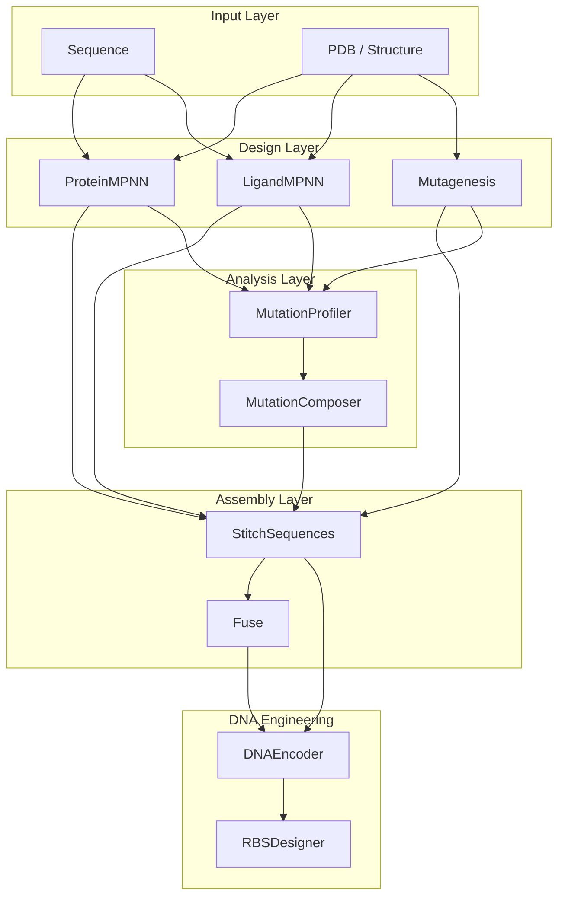

Sequence design in biopipelines encompasses the full spectrum from *de novo* sequence generation through structure-based inverse folding to systematic mutagenesis and gene-level DNA engineering. These tools share a common contract: they accept upstream DataStreams, apply their specialized transformation logic, and emit a `sequences` stream that downstream tools (structure prediction, docking, analysis) consume without adaptation. This page covers every tool in the sequence design layer, organized by the natural workflow progression from design intent to synthesis-ready output.

## Architectural Overview

The sequence design subsystem comprises ten tools that can be classified into four functional tiers. The diagram below shows how data flows between them and how each tier connects to upstream structure tools and downstream prediction tools.



All ten tools inherit from `BaseConfig` and implement the same lifecycle: `__init__` → `validate_params` → `configure_inputs` → `generate_script` → `get_output_files`. The `sequences` stream they emit uses CSV-backed `DataStream` objects whose `map_table` points to a queries CSV, making every tool interoperable via table references like `lmpnn.tables.sequences.id` [Docs/Tool/SequenceDesign.md](Docs/Tool/SequenceDesign.md#L1-L30).

## Tool Taxonomy

| Tool | Primary Input | Output Stream | Key Capability |
|------|--------------|---------------|----------------|
| **Sequence** | Raw strings, FASTA, CSV, PDB codes | `sequences` | Universal sequence entry point |
| **ProteinMPNN** | Structures | `sequences` | Inverse folding with fixed/redesigned regions |
| **LigandMPNN** | Structures + ligand | `sequences` | Ligand-aware inverse folding |
| **Mutagenesis** | Sequences or structures | `sequences` | Systematic AA substitutions (11 modes) |
| **MutationProfiler** | Original + mutant sequences | `plots`, `tables` | Frequency analysis & sequence logos |
| **MutationComposer** | Frequency tables | `sequences` | Guided mutation generation (4 strategies) |
| **StitchSequences** | Template + substitutions/indels | `sequences` | Position-aware sequence assembly |
| **Fuse** | Multiple sequence streams | `sequences` | Linker-mediated fusion (Cartesian product) |
| **DNAEncoder** | Protein sequences | `sequences` (DNA) | Codon optimization for 3 organisms |
| **RBSDesigner** | DNA sequences | `sequences` (DNA) | Translation initiation rate control |

Sources: [Docs/Tool/SequenceDesign.md](Docs/Tool/SequenceDesign.md#L1-L30), [biopipelines/protein_mpnn.py](biopipelines/protein_mpnn.py#L28-L33), [biopipelines/ligand_mpnn.py](biopipelines/ligand_mpnn.py#L28-L33), [biopipelines/mutagenesis.py](biopipelines/mutagenesis.py#L31-L38), [biopipelines/mutation_profiler.py](biopipelines/mutation_profiler.py#L31-L46), [biopipelines/mutation_composer.py](biopipelines/mutation_composer.py#L27-L42), [biopipelines/stitch_sequences.py](biopipelines/stitch_sequences.py#L33-L53), [biopipelines/fuse.py](biopipelines/fuse.py#L33-L53), [biopipelines/dna_encoder.py](biopipelines/dna_encoder.py#L28-L44), [biopipelines/rbs_designer.py](biopipelines/rbs_designer.py#L38-L49)

## Structure-to-Sequence Design

### ProteinMPNN

ProteinMPNN uses graph neural networks to design sequences conditioned on backbone coordinates. It is the standard tool for inverse folding — given a 3D structure (from RFdiffusion, RFdiffusion3, or experimental PDBs), it proposes amino acid sequences predicted to fold into that backbone. The key design control is the **fixed/redesigned region system**: you can freeze portions of the sequence (e.g., conserved active sites) while allowing the model to redesign others [biopipelines/protein_mpnn.py](biopipelines/protein_mpnn.py#L115-L127).

```python
from biopipelines.protein_mpnn import ProteinMPNN

# Classic design pipeline: RFdiffusion → ProteinMPNN → AlphaFold
pmpnn = ProteinMPNN(
    structures=backbones,
    num_sequences=10,
    fixed="1-50+150-200",      # Freeze termini and conserved regions
    redesigned="51-149",         # Redesign the core domain
    sampling_temp=0.1,           # Lower = more deterministic
    model_name="v_48_020"
)
```

**Fixed vs. redesigned positions** use PyMOL-style selection strings (`"1-10+50-60"`) or can reference table columns from upstream tools (e.g., `backbones.tables.structures.fixed`). When `chain="auto"`, the tool detects chain IDs from the input structure. The output table includes `score`, `seq_recovery`, and `rmsd` metrics per designed sequence — note that sample 0 is the original/template sequence, while samples 1+ are the actual designs [biopipelines/protein_mpnn.py](biopipelines/protein_mpnn.py#L282-L320).

The installation requires cloning the official ProteinMPNN repository into your data folder; it runs in the same environment as RFdiffusion [Docs/Tool/SequenceDesign.md](Docs/Tool/SequenceDesign.md#L12-L16).

| Parameter | Default | Purpose |
|-----------|---------|---------|
| `num_sequences` | 1 | Designs per input structure |
| `fixed` | `""` | Positions to keep unchanged |
| `redesigned` | `""` | Positions to redesign |
| `sampling_temp` | 0.1 | Sampling temperature (lower = more conservative) |
| `soluble_model` | True | Use soluble protein model weights |
| `fill_gaps` | `"G"` | Amino acid for gap positions |

Sources: [biopipelines/protein_mpnn.py](biopipelines/protein_mpnn.py#L115-L127), [biopipelines/protein_mpnn.py](biopipelines/protein_mpnn.py#L207-L280), [Docs/Tool/SequenceDesign.md](Docs/Tool/SequenceDesign.md#L1-L30)

### LigandMPNN

LigandMPNN extends ProteinMPNN's architecture to be ligand-aware: it considers protein-ligand interactions during sequence design, producing sequences optimized for binding affinity while maintaining structural stability. The critical difference is the required `ligand` parameter — a ligand identifier present in the input PDB file — and the `design_within` parameter for analysis of residues near the ligand [biopipelines/ligand_mpnn.py](biopipelines/ligand_mpnn.py#L119-L132).

```python
from biopipelines.ligand_mpnn import LigandMPNN

lmpnn = LigandMPNN(
    structures=pocket_designs,
    ligand="LIG",
    num_sequences=5,
    redesigned=pocket_designs.tables.structures.designed,
    model="v_32_010"
)
# Total sequences = num_sequences × num_batches (default 1×1 = 5)
```

> [!TIP]
> **Important**: LigandMPNN's `design_within` parameter is for **post-generation analysis only** — it does not control which positions are designed. To actually restrict design to residues within a distance of the ligand, first run `DistanceSelector` to get a PyMOL selection, then pass that selection to the `redesigned` parameter. The common pattern `rfd3.tables.structures.designed` from RFdiffusion3 output is a convenient shortcut that marks all designed (non-template) positions [Docs/Tool/SequenceDesign.md](Docs/Tool/SequenceDesign.md#L44-L55).

LigandMPNN requires a dedicated `ligandmpnn_env` environment with Python 3.11. Its output table includes `overall_confidence`, `ligand_confidence`, and `seq_rec` columns that enable direct quality filtering of designs [biopipelines/ligand_mpnn.py](biopipelines/ligand_mpnn.py#L305-L345).

Sources: [biopipelines/ligand_mpnn.py](biopipelines/ligand_mpnn.py#L119-L132), [biopipelines/ligand_mpnn.py](biopipelines/ligand_mpnn.py#L262-L290), [Docs/Tool/SequenceDesign.md](Docs/Tool/SequenceDesign.md#L33-L55)

### ProteinMPNN + LigandMPNN Hybrid with StitchSequences

A powerful pattern in ligand-binding protein design combines both MPNN variants. ProteinMPNN designs the scaffold (distant from the ligand) while LigandMPNN handles the binding site. `StitchSequences` merges these per-position, producing a combined sequence that leverages each model's strength [ExamplePipelines/rfd3_pmpnn_ligandmpnn_boltz2.py](ExamplePipelines/rfd3_pmpnn_ligandmpnn_boltz2.py#L1-L80).

```python
from biopipelines.distance_selector import DistanceSelector
from biopipelines.protein_mpnn import ProteinMPNN
from biopipelines.ligand_mpnn import LigandMPNN
from biopipelines.stitch_sequences import StitchSequences

distances = DistanceSelector(structures=rfd3, ligand=":L:", distance=5,
                              restrict_to=rfd3.tables.structures.designed)

pmpnn = ProteinMPNN(structures=rfd3, num_sequences=2,
                    redesigned=distances.tables.selections.beyond)
lmpnn = LigandMPNN(structures=rfd3, ligand=":L:", num_sequences=2,
                   redesigned=distances.tables.selections.within)

# 2×2 = 4 sequences per design (duplicates removed automatically)
sequences = StitchSequences(
    template=rfd3,
    substitutions={
        distances.tables.selections.beyond: pmpnn,
        distances.tables.selections.within: lmpnn
    }
)
```

Sources: [ExamplePipelines/rfd3_pmpnn_ligandmpnn_boltz2.py](ExamplePipelines/rfd3_pmpnn_ligandmpnn_boltz2.py#L1-L80), [Docs/Tool/SequenceDesign.md](Docs/Tool/SequenceDesign.md#L363-L410)

## Systematic Mutagenesis

### Mutagenesis

The Mutagenesis tool generates amino acid substitutions at specified positions with eleven substitution modes spanning from alanine scanning to full saturation. It accepts positions as integers, PyMOL-style selection strings, table column references, or `StandardizedOutput` from the Selection tool — making it seamlessly chainable with spatial analysis tools [biopipelines/mutagenesis.py](biopipelines/mutagenesis.py#L68-L77).

```python
from biopipelines.mutagenesis import Mutagenesis

# Alanine scanning at a single position
sdm = Mutagenesis(original=template, position=42, mutate_to="A")

# Saturation mutagenesis at multiple positions (excluding Cys and Pro)
sdm = Mutagenesis(original=template, position="42+50+55-60",
                  mode="saturation", exclude="CP")

# Per-row positions from a fused linker region
sdm = Mutagenesis(original=fused, position=fused.tables.sequences.L1,
                  mode="saturation")
```

When chaining multiple Mutagenesis steps, the `mutations` column accumulates (e.g., `"A42V,G50L"`) and `mutation_positions` uses PyMOL selection format (e.g., `"42+50"`), providing full provenance of the mutational history. A `missing` table tracks sequences that could not be generated, with `removed_by` and `cause` columns [biopipelines/mutagenesis.py](biopipelines/mutagenesis.py#L257-L333).

| Mode | Amino Acids | Use Case |
|------|-------------|----------|
| `specific` | User-defined via `mutate_to` | Targeted substitutions |
| `saturation` | All 20 | Comprehensive scanning |
| `hydrophobic` | A, F, I, L, M, V, W, Y | Core packing studies |
| `charged` | D, E, H, K, R | Surface charge engineering |
| `polar` | C, D, E, H, K, N, Q, R, S, T, Y | Solvent-exposed positions |
| `aromatic` | F, H, W, Y | π-stacking interactions |
| `aliphatic` | A, G, I, L, V | Hydrophobic core scanning |
| `positive` | H, K, R | DNA/RNA binding sites |
| `negative` | D, E | Metal binding / salt bridges |

Sources: [biopipelines/mutagenesis.py](biopipelines/mutagenesis.py#L42-L62), [biopipelines/mutagenesis.py](biopipelines/mutagenesis.py#L162-L260), [Docs/Tool/SequenceDesign.md](Docs/Tool/SequenceDesign.md#L115-L200)

### MutationProfiler

MutationProfiler performs position-wise statistical analysis comparing original and mutant sequences. It outputs four frequency tables and three sequence logo visualizations, serving as the analytical bridge between sequence generation and informed re-design [biopipelines/mutation_profiler.py](biopipelines/mutation_profiler.py#L90-L97).

```python
from biopipelines.mutation_profiler import MutationProfiler

profile = MutationProfiler(
    original=current_best,
    mutants=variants,
    include_original=True,
    color_palette="okabe-ito"
)
# Access frequency data for downstream MutationComposer
profile.tables.absolute_frequencies   # mutation_count / total_sequences
profile.tables.relative_frequencies   # mutation_count / mutations_at_position
```

The tool uses the `MutationEnv` environment (seaborn, matplotlib, logomaker, scipy) and generates sequence logos in both SVG and PNG formats. The `positions` parameter optionally restricts analysis to a subset of positions. Two color palettes are available: `"okabe-ito"` (colorblind-friendly, default) and `"standard"` [biopipelines/mutation_profiler.py](biopipelines/mutation_profiler.py#L48-L58), [biopipelines/mutation_profiler.py](biopipelines/mutation_profiler.py#L216-L266).

Sources: [biopipelines/mutation_profiler.py](biopipelines/mutation_profiler.py#L90-L97), [biopipelines/mutation_profiler.py](biopipelines/mutation_profiler.py#L169-L215), [HelpScripts/pipe_mutation_profiler.py](HelpScripts/pipe_mutation_profiler.py#L173-L277)

### MutationComposer

MutationComposer transforms mutation frequency profiles into concrete sequence proposals. It consumes the frequency tables from one or more MutationProfiler instances and generates new sequences using four sampling strategies, each suited to a different optimization philosophy [biopipelines/mutation_composer.py](biopipelines/mutation_composer.py#L58-L70).

```python
from biopipelines.mutation_composer import MutationComposer

# Single-source: weighted random multi-point mutations
candidates = MutationComposer(
    frequencies=profile.tables.absolute_frequencies,
    num_sequences=50,
    mode="weighted_random",
    max_mutations=3,
    random_seed=42
)

# Multi-source: combine profiles from different ligand conditions
candidates = MutationComposer(
    frequencies=[profile_atp.tables.absolute_frequencies,
                 profile_amp.tables.absolute_frequencies],
    num_sequences=20,
    mode="weighted_random",
    combination_strategy="average"
)
```

| Mode | Strategy | Best For |
|------|----------|----------|
| `single_point` | One mutation per sequence, ordered by frequency | Exhaustive single-residue exploration |
| `weighted_random` | Random mutations sampled from frequency distribution | Multi-point combinatorial exploration |
| `hotspot_focused` | Concentrate on top N high-frequency positions | Focused optimization on hot positions |
| `top_mutations` | Only the most frequent mutation per position | Conservative high-confidence designs |

The `combination_strategy` parameter controls how multiple frequency tables are merged when multiple profiler outputs are provided: `"average"` and `"maximum"` aggregate before sampling, while `"stack"` and `"round_robin"` interleave mutations from different sources [biopipelines/mutation_composer.py](biopipelines/mutation_composer.py#L58-L70), [HelpScripts/pipe_mutation_composer.py](HelpScripts/pipe_mutation_composer.py#L60-L142).

> [!TIP]
> **Iterative optimization loop**: The canonical pattern — `LigandMPNN → MutationProfiler → MutationComposer → Boltz2 → Panda (select best)` — can be wrapped in a `for` loop to perform multi-cycle sequence optimization. Each cycle uses the Boltz2 affinity prediction to select the current best structure, then designs around it. See the full example at [ExamplePipelines/iterative_binding_optimization.py](ExamplePipelines/iterative_binding_optimization.py#L1-L53).

Sources: [biopipelines/mutation_composer.py](biopipelines/mutation_composer.py#L58-L70), [biopipelines/mutation_composer.py](biopipelines/mutation_composer.py#L117-L145), [ExamplePipelines/iterative_binding_optimization.py](ExamplePipelines/iterative_binding_optimization.py#L1-L53)

## Sequence Assembly

### StitchSequences

StitchSequences is the compositional workhorse for assembling hybrid sequences from multiple design sources. It operates on a template sequence with two modification types applied in strict order: **substitutions** first (position-to-position copy, preserves length), then **indels** (segment replacement, can change length). All combinations are generated as a Cartesian product [biopipelines/stitch_sequences.py](biopipelines/stitch_sequences.py#L68-L100).

```python
from biopipelines.stitch_sequences import StitchSequences

# Combine ProteinMPNN and LigandMPNN designs at their respective regions
stitched = StitchSequences(
    template=rfd3,
    substitutions={
        distances.tables.selections.beyond: pmpnn,   # Scaffold from ProteinMPNN
        distances.tables.selections.within: lmpnn     # Binding site from LigandMPNN
    }
)

# Segment replacement with indels (variable-length changes)
stitched = StitchSequences(
    template="MKTAYIAKQRQISFVKSHFS...",
    indels={
        "11-15": ["AAAAA", "GGGGG"],    # 2 options for segment 11-15
        "20-22": ["XX", "YYY", "ZZZZ"]  # 3 options for segment 20-22
    }
)
# Output: 2 × 3 = 6 combinations

# Concatenation mode: no template, integer keys
stitched = StitchSequences(
    indels={
        1: ["AAAA", "BBBB"],           # Segment 1: 2 options
        2: ["CCCC"],                    # Segment 2: 1 option
        3: ["DDDD", "EEEE", "FFFF"]    # Segment 3: 3 options
    }
)
# Output: 2 × 1 × 3 = 6 concatenated sequences
```

Position syntax supports ranges (`"10-20"`), discontinuous selections (`"10-20+30-40"`), and individual residues (`"145+147+150"`), all 1-indexed. The `id_map` parameter (default `{"*": "*_<S>"}`) controls how output IDs are generated from input IDs. For discontinuous indel selections, each contiguous segment is independently replaced with the full replacement sequence [biopipelines/stitch_sequences.py](biopipelines/stitch_sequences.py#L68-L100), [Docs/Tool/SequenceDesign.md](Docs/Tool/SequenceDesign.md#L363-L410).

Sources: [biopipelines/stitch_sequences.py](biopipelines/stitch_sequences.py#L68-L100), [biopipelines/stitch_sequences.py](biopipelines/stitch_sequences.py#L154-L173), [Docs/Tool/SequenceDesign.md](Docs/Tool/SequenceDesign.md#L363-L410)

### Fuse

Fuse concatenates multiple sequence streams with configurable linkers, generating the full Cartesian product of all sequence variants × linker length combinations. Each junction between adjacent sequences gets its own linker length specification. The output table includes PyMOL-compatible position columns (`S1`, `L1`, `S2`, ...) that enable direct structural visualization of fusion boundaries [biopipelines/fuse.py](biopipelines/fuse.py#L68-L100).

```python
from biopipelines.fuse import Fuse

fused = Fuse(
    sequences=[n_terminal, binding_domain, c_terminal],
    linker="GGGGSGGGGSGGGGSGGGGS",
    linker_lengths=["2-4", "2-4"],  # 3 lengths × 3 lengths = 9 linker combos
    name="tri_domain_fusion"
)
# Total combinations = |n_term| × |binding| × |c_term| × 3 × 3
```

The `linker_lengths` list must contain exactly `n-1` entries for `n` input sequences. Each entry is a range specification like `"1-6"` (lengths 1 through 6 inclusive). When inputs are DataStreams with multiple IDs, the cartesian product is computed across all slots simultaneously [biopipelines/fuse.py](biopipelines/fuse.py#L68-L100).

Sources: [biopipelines/fuse.py](biopipelines/fuse.py#L68-L100), [biopipelines/fuse.py](biopipelines/fuse.py#L191-L235), [Docs/Tool/SequenceDesign.md](Docs/Tool/SequenceDesign.md#L290-L362)

## DNA Engineering

### DNAEncoder

DNAEncoder reverse-translates protein sequences to DNA using organism-specific codon optimization based on the CoCoPUTs genome frequency tables. It supports single and multi-organism optimization using a thresholded weighted sampling strategy: codons with frequency ≥10‰ are preferred, with fallback to ≥5‰ when necessary [biopipelines/dna_encoder.py](biopipelines/dna_encoder.py#L61-L97).

```python
from biopipelines.dna_encoder import DNAEncoder

# E. coli optimized
dna = DNAEncoder(sequences=proteins, organism="EC")

# Cross-species conservative optimization
dna = DNAEncoder(sequences=proteins, organism="EC&HS")
```

The `dna` table outputs `protein_sequence`, `dna_sequence`, `organism`, and `method` columns. An Excel file with color-coded codons (red <5‰, orange 5-10‰, black ≥10‰) provides visual quality assessment. For multi-organism optimization, the tool uses the minimum frequency across organisms, resulting in more conservative (and potentially rarer) codon choices [biopipelines/dna_encoder.py](biopipelines/dna_encoder.py#L28-L44), [Docs/Tool/SequenceDesign.md](Docs/Tool/SequenceDesign.md#L411-L435).

### RBSDesigner

RBSDesigner designs synthetic ribosome binding sites using the Salis thermodynamic model, optimizing sequences to match a target translation initiation rate (TIR). It employs simulated annealing with adaptive temperature control (maintaining 5–20% acceptance rate) and requires the ViennaRNA package for RNA free energy calculations [biopipelines/rbs_designer.py](biopipelines/rbs_designer.py#L91-L97).

```python
from biopipelines.rbs_designer import RBSDesigner

# High expression in E. coli
rbs = RBSDesigner(sequences=dna, tir="high")

# Specific TIR with 5'UTR prefix
rbs = RBSDesigner(sequences=dna, tir=5000, pre_sequence="AATTAA")
```

| TIR Preset | Value (au) | Expression Level |
|------------|-----------|------------------|
| `"low"` | 100 | Minimal expression |
| `"medium"` | 1,000 | Moderate expression |
| `"high"` | 10,000 | Strong expression |
| `"maximum"` | 100,000 | Near-maximal expression |

The thermodynamic model computes: `dG_total = dG_mRNA:rRNA + dG_start + dG_spacing − dG_standby − dG_mRNA`. The output `full_gene` column concatenates `pre_sequence + rbs_sequence + dna_sequence`, producing synthesis-ready DNA. The tool runs in the `rbs_designer` environment (ViennaRNA from bioconda with flexible channel priority) [biopipelines/rbs_designer.py](biopipelines/rbs_designer.py#L29-L35), [biopipelines/rbs_designer.py](biopipelines/rbs_designer.py#L227-L260), [Docs/Tool/SequenceDesign.md](Docs/Tool/SequenceDesign.md#L437-L454).

Sources: [biopipelines/rbs_designer.py](biopipelines/rbs_designer.py#L29-L35), [biopipelines/rbs_designer.py](biopipelines/rbs_designer.py#L91-L97), [biopipelines/rbs_designer.py](biopipelines/rbs_designer.py#L227-L260), [Docs/Tool/SequenceDesign.md](Docs/Tool/SequenceDesign.md#L437-L454)

## Sequence Input: The Sequence Tool

The `Sequence` tool serves as the universal entry point for creating sequence DataStreams from heterogeneous sources. It auto-detects input type (raw string, FASTA file, CSV with id/sequence columns, Excel file, or 4-character RCSB PDB codes) and normalizes everything into the standard `sequences` stream format consumed by all downstream tools [biopipelines/sequence.py](biopipelines/sequence.py#L30-L38).

```python
from biopipelines.sequence import Sequence

# Raw sequence string
seq = Sequence("MKTEFQL...", type="protein")

# From RCSB PDB code (fetches chain sequences from RCSB FASTA API)
seq = Sequence("4AKE")

# Multiple sequences with explicit IDs
seq = Sequence(["MKTE...", "GVNL..."], ids=["kinase_A", "kinase_B"])

# From FASTA or CSV file
seq = Sequence("designs.fasta")
```

Auto-detection distinguishes protein, DNA, and RNA sequences based on character composition. The `type` parameter (default `"auto"`) can override this when ambiguous. Fetched PDB sequences arrive as multi-chain entries, one per chain in the structure [biopipelines/sequence.py](biopipelines/sequence.py#L55-L60), [biopipelines/sequence.py](biopipelines/sequence.py#L332-L355).

Sources: [biopipelines/sequence.py](biopipelines/sequence.py#L30-L38), [biopipelines/sequence.py](biopipelines/sequence.py#L55-L60), [biopipelines/sequence.py](biopipelines/sequence.py#L184-L312)

## Representative Pipeline Patterns

### One-Line Design Pipeline

The simplest design pipeline chains RFdiffusion → ProteinMPNN → AlphaFold in a single expression, leveraging biopipelines' automatic DataStream resolution [ExamplePipelines/rfd_pmpnn_af2_one_line.py](ExamplePipelines/rfd_pmpnn_af2_one_line.py#L15-L22):

```python
AlphaFold(ProteinMPNN(RFdiffusion(contigs='100-150', num_designs=10), num_sequences=2))
```

### Saturation Mutagenesis with Affinity Screening

This pattern explores all amino acid substitutions at a critical position, predicts structures with Boltz2, docks a ligand with GNINA, and compares both affinity methods through merged analysis and visualization [ExamplePipelines/saturation_mutagenesis.py](ExamplePipelines/saturation_mutagenesis.py#L1-L94):

```python
mutant_sequences = Mutagenesis(original=abl1, position=93, mode="saturation")
mutants = Boltz2(proteins=mutant_sequences, ligands=imatinib)
docking = Gnina(structures=mutants, compounds=imatinib)
```

### Iterative Binding Optimization

The most sophisticated pattern wraps LigandMPNN design, MutationProfiler analysis, and MutationComposer-guided proposal in a multi-cycle loop. Each cycle selects the best binder via Panda, designs around it, and evaluates the new candidates — converging toward higher affinity over successive iterations [ExamplePipelines/iterative_binding_optimization.py](ExamplePipelines/iterative_binding_optimization.py#L1-L53).

## Environment Requirements

| Tool | Environment | Key Dependencies |
|------|------------|-----------------|
| ProteinMPNN | Shared with RFdiffusion | Official ProteinMPNN repo |
| LigandMPNN | `ligandmpnn_env` (Python 3.11) | PyTorch, model params |
| Mutagenesis | `MutationEnv` | — |
| MutationProfiler | `MutationEnv` | seaborn, matplotlib, logomaker, scipy |
| MutationComposer | `MutationEnv` | Same as MutationProfiler |
| Sequence | `biopipelines` | — |
| StitchSequences | `biopipelines` | — |
| Fuse | `biopipelines` | — |
| DNAEncoder | `biopipelines` | CoCoPUTs codon tables (bundled) |
| RBSDesigner | `rbs_designer` | ViennaRNA (bioconda), Biopython |

Sources: [biopipelines/mutation_profiler.py](biopipelines/mutation_profiler.py#L48-L58), [biopipelines/rbs_designer.py](biopipelines/rbs_designer.py#L51-L84), [biopipelines/mutagenesis.py](biopipelines/mutagenesis.py#L42-L44), [Docs/Tool/SequenceDesign.md](Docs/Tool/SequenceDesign.md#L33-L42)

---

**Navigation**: For how these tools connect into the broader pipeline engine, see [Pipeline Orchestration Engine](6-pipeline-orchestration-engine) and [DataStream: Unified I/O Container](7-datastream-unified-i-o-container). To understand how sequence design outputs feed into structure prediction, proceed to [Structure Prediction Tools](12-structure-prediction-tools). For the underlying tool abstraction that all these tools inherit from, see [BaseConfig: Tool Abstraction Layer](8-baseconfig-tool-abstraction-layer).