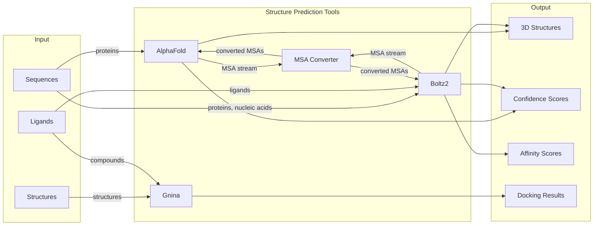
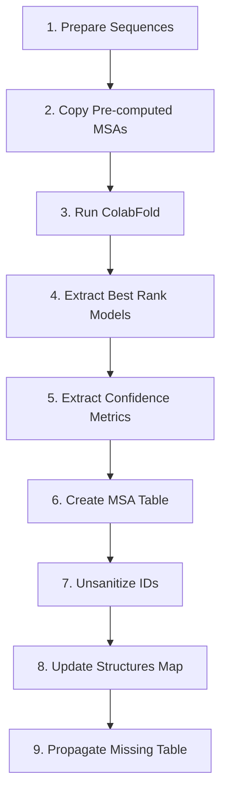
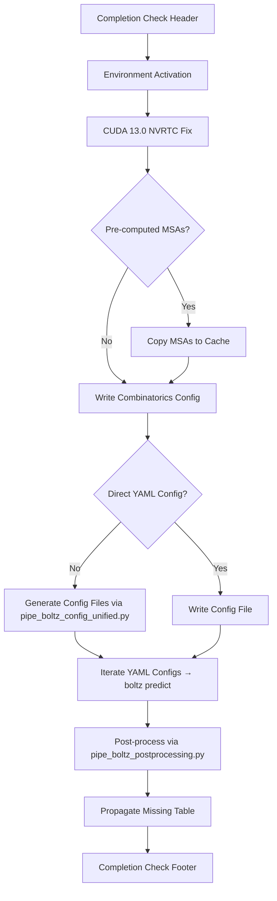
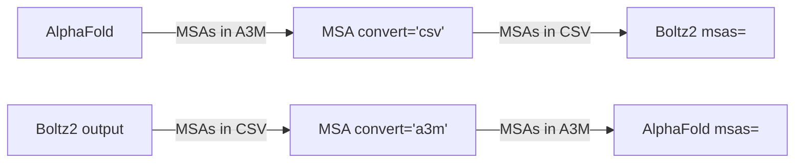

Structure prediction is the computational backbone of the biopipelines framework — the stage where sequences, designed or retrieved, acquire three-dimensional coordinates. This page documents the three core prediction tools and the MSA conversion utility that mediates cross-tool data flow. Each tool extends `BaseConfig` ([base_config.py](/locbp-uzh/biopipelines/blob/main/biopipelines/base_config.py#L34-L40)), inheriting the two-phase execution model, lazy path descriptors, and standardized output contracts described in [BaseConfig: Tool Abstraction Layer](8-baseconfig-tool-abstraction-layer).

## Tool Landscape

The four tools in this category serve distinct but interconnected roles in the prediction domain. AlphaFold handles monomeric protein folding; Boltz2 extends prediction to heteromeric complexes including nucleic acids and small molecules; Gnina docks pre-computed structures against compound libraries; and the MSA tool converts alignment formats to enable recycling between AlphaFold and Boltz2.



The following table summarizes the key characteristics that differentiate these tools:

| Feature | AlphaFold | Boltz2 | Gnina | MSA |
|---------|-----------|--------|-------|-----|
| **Purpose** | Monomeric folding | Complex prediction | Molecular docking | Format conversion |
| **Input types** | Protein sequences | Proteins, DNA, RNA, ligands | Structures + compounds | MSA files |
| **Output structures** | Apo proteins | Apo + holo complexes | Docked complexes | — |
| **Confidence metrics** | pLDDT, PAE, pTM | pTM, ipTM, complex pLDDT | Vina + CNN scores | — |
| **GPU required** | Yes (not H100 NVL) | Yes | Recommended | No |
| **Combinatorics** | Single axis | Multi-axis (Bundle/Each) | Single axis | N/A |
| **MSA recycling** | A3M format | CSV/A3M format | N/A | Bidirectional |

## AlphaFold — Monomeric Protein Structure Prediction

AlphaFold wraps the ColabFold implementation of AlphaFold2 for high-confidence monomeric protein structure prediction. It accepts protein sequences as either `DataStream` or `StandardizedOutput` objects and produces ranked structural models with comprehensive confidence metrics. The tool class `AlphaFold` is defined in [alphafold.py](/locbp-uzh/biopipelines/blob/main/biopipelines/alphafold.py#L30-L45), extending `BaseConfig` with sequence-specific path descriptors and a multi-stage script generation pipeline.

### Constructor and Parameters

The constructor accepts the sequence input and three folding-specific parameters that control relaxation, recycling, and reproducibility:

| Parameter | Type | Default | Description |
|-----------|------|---------|-------------|
| `proteins` | `DataStream \| StandardizedOutput` | required | Input protein sequences |
| `msas` | `StandardizedOutput` | `None` | Pre-computed MSAs in A3M format for recycling |
| `num_relax` | `int` | `0` | Number of best models to relax with AMBER |
| `num_recycle` | `int` | `3` | Recycling iterations for iterative refinement |
| `rand_seed` | `int` | `0` | Random seed (0 = non-deterministic) |

When `proteins` is a `StandardizedOutput`, the constructor extracts its `.streams.sequences` DataStream automatically ([alphafold.py#L144-L152](/locbp-uzh/biopipelines/blob/main/biopipelines/alphafold.py#L144-L152)). The `msas` parameter similarly resolves to a DataStream via the `resolve_input_to_datastream` helper, and validation enforces that the MSA format must be `a3m` — Boltz2 CSV-format MSAs will be rejected unless first converted through the MSA tool ([alphafold.py#L178-L190](/locbp-uzh/biopipelines/blob/main/biopipelines/alphafold.py#L178-L190)).

### Script Generation Pipeline

AlphaFold's `generate_script` method chains nine sequential script sections, each corresponding to a distinct runtime phase ([alphafold.py#L221-L237](/locbp-uzh/biopipelines/blob/main/biopipelines/alphafold.py#L221-L237)):



The sequence preparation step intelligently detects ProteinMPNN output (directory paths ending in `seqs`) and invokes `pipe_fa_to_csv_fasta.py` for conversion, or directly copies CSV/FASTA files otherwise ([alphafold.py#L240-L266](/locbp-uzh/biopipelines/blob/main/biopipelines/alphafold.py#L240-L266)). The ColabFold invocation adapts to the environment manager — on clusters it uses the absolute path to `localcolabfold`, while on Colab it runs in a clean subshell with `CONDA_PREFIX` unset to avoid JAX conflicts ([alphafold.py#L282-L322](/locbp-uzh/biopipelines/blob/main/biopipelines/alphafold.py#L282-L322)).

The post-processing chain extracts rank-1 models (preferring relaxed over unrelaxed), renames them to clean IDs, extracts per-model confidence from JSON result files, and creates an MSA table for downstream recycling.

### Outputs

AlphaFold emits two streams and three tables ([alphafold.py#L438-L520](/locbp-uzh/biopipelines/blob/main/biopipelines/alphafold.py#L438-L520)):

**Streams:**
- `structures` — PDB files of best-ranked models
- `msas` — A3M alignment files (only when MSAs are generated)

**Tables:**

| Table | Columns | Description |
|-------|---------|-------------|
| `structures` | `id`, `file` | Maps IDs to predicted PDB files |
| `confidence` | `id`, `structure`, `plddt`, `max_pae`, `ptm` | Per-model confidence from JSON metrics |
| `msas` | `id`, `sequences.id`, `sequence`, `msa_file` | MSA file locations for recycling |
| `missing` | `id`, `removed_by`, `cause` | Propagated from upstream if present |

### Typical Usage

The canonical pattern chains AlphaFold downstream of ProteinMPNN sequence design, as demonstrated in the ubiquitin example pipeline ([ubiquitin.py](/locbp-uzh/biopipelines/blob/main/ExamplePipelines/ubiquitin.py#L15-L20)):

```python
from biopipelines.alphafold import AlphaFold
from biopipelines.protein_mpnn import ProteinMPNN

# Generate sequences then fold them
sequences = ProteinMPNN(structures=ubiquitin, num_sequences=10)
folded = AlphaFold(proteins=sequences, num_relax=1, num_recycle=5)

# Recycle MSAs from a previous AlphaFold run
folded_again = AlphaFold(proteins=more_sequences, msas=folded)
```

## Boltz2 — Biomolecular Complex Prediction

Boltz2 is the most feature-rich prediction tool in the framework, handling protein-protein, protein-nucleic acid, and protein-ligand complex structure prediction. It supports six distinct input modalities — proteins, ssDNA, dsDNA, ssRNA, dsRNA, and ligands — with full combinatorics support via the `Bundle`/`Each` pattern system ([boltz2.py](/locbp-uzh/biopipelines/blob/main/biopipelines/boltz2.py#L32-L38)).

### Input Modalities and Combinatorics

Boltz2 accepts multiple input axes simultaneously, each resolved to a `DataStream` through the shared `resolve_input_to_datastream` utility. Each axis tracks its combinatorics mode — `Each` (default, cartesian product) or `Bundle` (group together) — via the `get_mode` function ([boltz2.py#L187-L194](/locbp-uzh/biopipelines/blob/main/biopipelines/boltz2.py#L187-L194)). Double-stranded nucleic acids (dsDNA, dsRNA) automatically generate reverse complement chains at config generation time ([pipe_boltz_config_unified.py#L456-L457](/locbp-uzh/biopipelines/blob/main/HelpScripts/pipe_boltz_config_unified.py#L456-L457)).

| Parameter | Type | Default | Description |
|-----------|------|---------|-------------|
| `proteins` | `DataStream \| StandardizedOutput` | `None` | Protein sequences |
| `ssDNA` | `DataStream \| StandardizedOutput` | `None` | Single-stranded DNA (one chain each) |
| `dsDNA` | `DataStream \| StandardizedOutput` | `None` | Double-stranded DNA (auto reverse complement) |
| `ssRNA` / `dsRNA` | `DataStream \| StandardizedOutput` | `None` | RNA sequences (same logic as DNA) |
| `ligands` | `str \| DataStream \| StandardizedOutput` | `None` | SMILES string or compound library |
| `msas` | `StandardizedOutput` | `None` | Pre-computed MSAs for recycling |
| `config` | `str` | `None` | Direct YAML configuration (bypasses generator) |

When `ligands` is `None`, affinity calculation is automatically disabled ([boltz2.py#L220-L224](/locbp-uzh/biopipelines/blob/main/biopipelines/boltz2.py#L220-L224)). When a bare SMILES string is provided, it's stored separately and a ligands CSV is generated at configuration time rather than at runtime ([boltz2.py#L210-L212](/locbp-uzh/biopipelines/blob/main/biopipelines/boltz2.py#L210-L212)).

### Advanced Constraints

Boltz2 supports several structural guidance mechanisms that are translated into YAML config sections by the unified config generator ([pipe_boltz_config_unified.py](/locbp-uzh/biopipelines/blob/main/HelpScripts/pipe_boltz_config_unified.py#L197-L335)):

| Constraint | Parameter | Effect |
|------------|-----------|--------|
| **Template guidance** | `template`, `template_chain_ids`, `template_force` | Constrains prediction toward a reference PDB structure |
| **Pocket constraint** | `pocket_residues`, `pocket_max_distance` | Defines binding pocket via residue positions |
| **N-glycosylation** | `glycosylation` (dict of chain → Asn positions) | Adds NAG ligand with bond constraints at specified sites |
| **Covalent linkage** | `covalent_linkage` (chain, position, atoms) | Creates covalent bond between protein and ligand |
| **Contact constraints** | `contacts` (list of token pairs) | Enforces distance constraints between residues/atoms |

The glycosylation handler is particularly noteworthy: it automatically adds NAG ligand entries and generates appropriate bond constraints in the YAML config ([pipe_boltz_config_unified.py#L238-L269](/locbp-uzh/biopipelines/blob/main/HelpScripts/pipe_boltz_config_unified.py#L238-L269)).

### Prediction Parameters

| Parameter | Type | Default | Description |
|-----------|------|---------|-------------|
| `affinity` | `bool` | `True` | Calculate binding affinity predictions |
| `output_format` | `str` | `"pdb"` | Output format (`pdb` or `mmcif`) |
| `msa_server` | `str` | `"public"` | MSA source (`public` or `local`) |
| `recycling_steps` | `Optional[int]` | `None` | Override model-default recycling count |
| `diffusion_samples` | `Optional[int]` | `None` | Override model-default diffusion sample count |
| `use_potentials` | `bool` | `False` | Enable external potentials |

### Script Generation Architecture

Boltz2's `generate_script` method follows a different pattern than AlphaFold — it delegates config file generation to `pipe_boltz_config_unified.py`, iterates over generated YAML configs, and then post-processes results through `pipe_boltz_postprocessing.py` ([boltz2.py#L373-L540](/locbp-uzh/biopipelines/blob/main/biopipelines/boltz2.py#L373-L540)):



The combinatorics config is written at configuration time (not runtime) by `_write_combinatorics_config`, which calls the shared `generate_combinatorics_config` function to produce a JSON file describing all input axes and their modes ([boltz2.py#L319-L324](/locbp-uzh/biopipelines/blob/main/biopipelines/boltz2.py#L319-L324)). This design allows the HelpScript to generate individual YAML configs for each prediction without reimplementing combinatorics logic.

The post-processing script ([pipe_boltz_postprocessing.py](/locbp-uzh/biopipelines/blob/main/HelpScripts/pipe_boltz_postprocessing.py#L6-L20)) flattens nested confidence JSON (handling multi-chain pTM and ipTM matrices), extracts affinity scores, renames structural files to match predicted IDs, and produces the standardized CSV tables.

### Outputs

Boltz2 emits up to four streams and six tables ([boltz2.py#L593-L695](/locbp-uzh/biopipelines/blob/main/biopipelines/boltz2.py#L593-L695)):

**Streams:**
- `structures` — PDB or mmCIF files
- `sequences` — Input sequences (CSV-backed)
- `compounds` — Ligand definitions (when ligands provided)
- `msas` — Alignment files (CSV for public server, A3M for local)

**Tables:**

| Table | Key Columns | Description |
|-------|-------------|-------------|
| `confidence` | `id`, `input_file`, `confidence_score`, `ptm`, `iptm`, `complex_plddt`, `complex_iplddt` | Multi-metric confidence aggregation |
| `affinity` | `id`, `input_file`, `affinity_pred_value`, `affinity_probability_binary` | Binding affinity (only when `affinity=True`) |
| `sequences` | `id`, `sequence` | Protein input sequences |
| `compounds` | `id`, `format`, `smiles`, `ccd` | Ligand definitions |
| `msas` | `id`, `sequences.id`, `sequence`, `msa_file` | MSA locations for recycling |
| `missing` | `id`, `removed_by`, `cause` | Propagated from upstream |

The `confidence_score` is a weighted aggregate: `0.8 * complex_plddt + 0.2 * iptm`, as documented in the scores explanation file written during post-processing ([pipe_boltz_postprocessing.py#L420-L423](/locbp-uzh/biopipelines/blob/main/HelpScripts/pipe_boltz_postprocessing.py#L420-L423)).

### Combinatorics Examples

The Boltz2 example pipeline demonstrates all combinatorics patterns ([boltz2.py](/locbp-uzh/biopipelines/blob/main/ExamplePipelines/boltz2.py#L60-L100)):

```python
from biopipelines.boltz2 import Boltz2
from biopipelines.combinatorics import Bundle, Each

# Default (Each): Cartesian product → 2 proteins × 3 ligands = 6 predictions
boltz_each = Boltz2(
    proteins=Each(protein_a, protein_b),
    ligands=ligand_library
)

# Bundle ligands: 2 predictions, each with all 3 ligands together
boltz_bundle_ligands = Boltz2(
    proteins=Each(protein_a, protein_b),
    ligands=Bundle(ligand_library)
)

# Bundle proteins: 3 predictions, each with both proteins together
boltz_bundle_proteins = Boltz2(
    proteins=Bundle(protein_a, protein_b),
    ligands=ligand_library
)
```

> [!TIP]
> When recycling MSAs between Boltz2 runs, pass the entire `StandardizedOutput` (not `.msas`) to the `msas` parameter. The Boltz2 constructor accesses `msas.tables.msas.info.path` internally to locate the MSA table. For AlphaFold→Boltz2 recycling, first convert A3M to CSV via `MSA(af_result, convert="csv")`.

## Gnina — Molecular Docking with CNN Scoring

Gnina combines AutoDock Vina's search algorithm with a convolutional neural network for more accurate binding pose prediction. It operates on pre-computed protein structures (typically from Boltz2) and a compound library, producing docked complexes with dual scoring (physics-based Vina scores and learned CNN affinities). The tool class is defined in [gnina.py](/locbp-uzh/biopipelines/blob/main/biopipelines/gnina.py#L43-L73).

### Binding Box Resolution

The binding box — the 3D search space for ligand placement — is determined by a priority cascade checked in order ([gnina.py#L13-L16](/locbp-uzh/biopipelines/blob/main/biopipelines/gnina.py#L13-L16)):

1. **Explicit `center` + `size`** — Full manual control
2. **`autobox_ligand`** — Reference ligand (path, DataStream, or structure ID) defines the box with configurable padding
3. **Crystal ligand HETATM** — Auto-detected from existing ligand records in the input PDB

### Docking Parameters

| Parameter | Type | Default | Description |
|-----------|------|---------|-------------|
| `structures` | `DataStream \| StandardizedOutput` | required | Protein receptor structures |
| `compounds` | `DataStream \| StandardizedOutput` | required | Ligand molecules |
| `autobox_ligand` | `DataStream \| StandardizedOutput \| str` | `None` | Reference ligand for automatic box |
| `center` | `Optional[str]` | `None` | Box center as `"x,y,z"` |
| `size` | `float \| str` | `None` | Box dimensions (float = cubic, `"x,y,z"` = asymmetric) |
| `autobox_add` | `float` | `4.0` | Padding around autobox ligand (Å) |
| `exhaustiveness` | `int` | `32` | Search thoroughness |
| `num_modes` | `int` | `9` | Docked poses per run |
| `num_runs` | `int` | `5` | Independent docking runs per conformer |
| `seed` | `int` | `42` | Base seed (each run increments by index) |
| `cnn_scoring` | `str` | `"rescore"` | CNN mode: `rescore`, `refinement`, `none`, `rescore_only` |

### Conformer Generation

Gnina supports optional RDKit ETKDGv3 conformer generation for flexible ligand docking:

| Parameter | Type | Default | Description |
|-----------|------|---------|-------------|
| `generate_conformers` | `bool` | `False` | Enable conformer generation |
| `num_conformers` | `int` | `50` | Conformers before filtering |
| `energy_window` | `float` | `2.0` | Max MMFF94 energy window (kcal/mol) |
| `conformer_rmsd` | `float` | `1.0` | Butina clustering RMSD cutoff (Å) |

When enabled, the pipeline generates conformers, clusters them, docks each conformer across multiple independent runs, and aggregates statistics including a `pseudo_binding_energy` term that penalizes Vina scores by conformer strain energy.

### Filtering and Consistency

| Parameter | Type | Default | Description |
|-----------|------|---------|-------------|
| `cnn_score_threshold` | `float` | `0.5` | Minimum CNNscore to accept a pose |
| `rmsd_threshold` | `float` | `2.0` | RMSD cutoff for pose consistency clustering |
| `protonate` | `bool` | `True` | Add hydrogens with OpenBabel before docking |
| `pH` | `float` | `7.4` | Protonation pH |

### Outputs

Gnina produces one stream and two tables:

**Streams:**
- `structures` — Combined protein+ligand PDB files of best accepted poses

**Tables:**

| Table | Granularity | Key Columns |
|-------|------------|-------------|
| `docking_results` | Per accepted pose | `id`, `structures.id`, `compounds.id`, `conformer_id`, `run`, `pose`, `vina_score`, `cnn_score`, `cnn_affinity` |
| `docking_summary` | Per (protein, ligand, conformer) group | `best_vina`, `mean_vina`, `std_vina`, `best_cnn_score`, `mean_cnn_affinity`, `pose_consistency`, `conformer_energy`, `pseudo_binding_energy`, `best_pose_file` |

The `docking_summary` table is particularly important for decision-making. The `mean_vina` and `std_vina` columns aggregate only the best pose from each independent run (not all poses), making them robust metrics for ranking compounds. `pose_consistency` measures reproducibility as the fraction of runs whose best pose clusters together within the RMSD threshold — a value of 1.0 indicates perfect convergence across all runs.

## MSA Converter — Cross-Tool Alignment Recycling

The `MSA` tool converts Multiple Sequence Alignment files between CSV format (Boltz2 public server output) and A3M format (AlphaFold/ColabFold input), enabling MSA recycling between prediction tools without redundant server queries ([msa.py](/locbp-uzh/biopipelines/blob/main/biopipelines/msa.py#L30-L64)).

| Parameter | Type | Description |
|-----------|------|-------------|
| `msas` | `StandardizedOutput` | Tool output containing an `msas` stream |
| `convert` | `str` | Target format: `"a3m"` or `"csv"` |

The tool reads from the upstream `msas` table and delegates conversion to `pipe_msa.py`, writing converted files to an `MSAs/` subdirectory with an updated map table. Validation warns (rather than errors) if the input format already matches the target — files are simply copied in that case ([msa.py#L95-L100](/locbp-uzh/biopipelines/blob/main/biopipelines/msa.py#L95-L100)).

### MSA Format Compatibility



Sources: [msa.py](/locbp-uzh/biopipelines/blob/main/biopipelines/msa.py#L86-L100)

> [!TIP]
> AlphaFold performs a strict format check on incoming MSAs. Even if you convert Boltz2 CSV to A3M via `MSA(boltz_result, convert="a3m")`, ColabFold may still reject the files if they lack expected header metadata and re-query the MSA server. For reliable recycling, pass AlphaFold-generated A3M files back to a subsequent AlphaFold run, or Boltz2-generated CSV files back to Boltz2.

## Cross-Tool Pipeline Patterns

The three prediction tools are designed to compose into end-to-end workflows. Below are the most common architectural patterns observed in the example pipelines:

### Sequence-to-Structure-to-Docking Pipeline

This three-stage pattern is the bread-and-butter of computational drug design workflows:

```python
from biopipelines.protein_mpnn import ProteinMPNN
from biopipelines.alphafold import AlphaFold
from biopipelines.boltz2 import Boltz2
from biopipelines.gnina import Gnina
from biopipelines.compound_library import CompoundLibrary

# Stage 1: Design sequences → fold with AlphaFold
sequences = ProteinMPNN(structures=target, num_sequences=20)
folded = AlphaFold(proteins=sequences, num_relax=1)

# Stage 2: Predict protein-ligand complexes with Boltz2
compounds = CompoundLibrary({"aspirin": "CC(=O)OC1=CC=CC=C1C(=O)O"})
complexes = Boltz2(proteins=folded, ligands=compounds)

# Stage 3: Refine poses with Gnina
docked = Gnina(structures=complexes, compounds=compounds, num_runs=10)
```

### Boltz2 Apo-then-Holo with MSA Recycling

Boltz2 can first predict apo structures, then recycle the MSAs for holo (bound) predictions, saving significant computation on MSA generation:

```python
# Apo prediction (generates MSAs as side effect)
apo = Boltz2(proteins=sequences)

# Holo prediction reuses the apo MSAs
holo = Boltz2(proteins=sequences, ligands="CCO", msas=apo)
```

### AlphaFold → Boltz2 via MSA Conversion

To recycle MSAs from AlphaFold into Boltz2, the CSV conversion is required:

```python
from biopipelines.alphafold import AlphaFold
from biopipelines.boltz2 import Boltz2
from biopipelines.msa import MSA

folded = AlphaFold(proteins=sequences)
msas_csv = MSA(folded, convert="csv")  # A3M → CSV for Boltz2
holo = Boltz2(proteins=sequences, ligands=compounds, msas=msas_csv)
```
