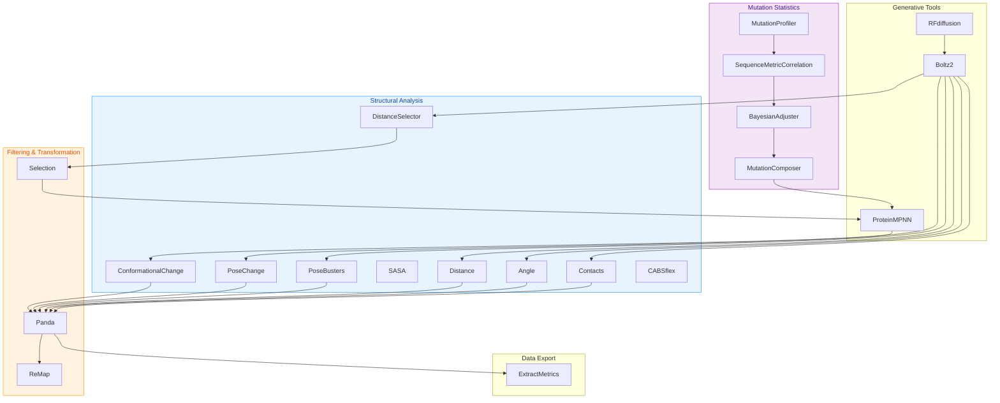
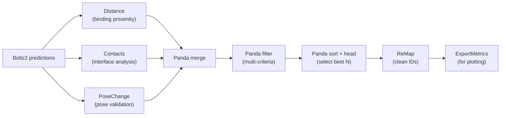

Analysis and filtering tools transform raw structural predictions and sequence designs into actionable, quantitative decisions. They form the **evaluative backbone** of every biopipelines workflow — bridging the gap between generative tools like RFdiffusion or Boltz2 and the downstream sequence optimization loop. Every tool in this category follows the [BaseConfig](8-baseconfig-tool-abstraction-layer) abstraction, meaning they share a uniform interface for input configuration, script generation, and output table production that integrates seamlessly with the [Two-Phase Execution Model](9-two-phase-execution-model).



The architecture above reveals three functional strata. **Structural analysis tools** extract geometric and physicochemical metrics from predicted complexes — distances, angles, contact maps, RMSD values. **Filtering and transformation tools** then act on the resulting tables to select, sort, merge, and reshape data. Finally, **mutation statistics tools** close the feedback loop by correlating sequence mutations with performance metrics, producing frequency-adjusted inputs for the next design cycle. All outputs propagate through the [DataStream: Unified I/O Container](7-datastream-unified-i-o-container) and are referenceable via [Table Reference and Provenance](16-table-reference-and-provenance).

## Structural Metric Extraction

Structural metric tools answer a single fundamental question: *how good are the predicted structures?* They accept a `StandardizedOutput` from any upstream tool, compute geometric measurements using PyMOL's internal engine, and emit tables that downstream filtering tools consume. The selection syntax is shared across Distance, Angle, and Contacts — using PyMOL-style selectors like `'10.CA'` for specific atoms, `'LIG.C1'` for ligand atoms, and `'D in IGDWG'` for contextual residue matching.

Sources: [distance.py](biopipelines/distance.py#L5-L11), [angle.py](biopipelines/angle.py#L5-L16), [contacts.py](biopipelines/contacts.py#L5-L10)

### Distance

The `Distance` tool measures inter-atomic or atom-to-residue distances across an entire structure set. It is the workhorse metric for validating ligand binding proximity — answering questions like "is the catalytic chlorine within 3 Å of the binding pocket?" The tool operates through a generated HelpScript ([pipe_distance.py](HelpScripts/pipe_distance.py)) that loads each structure and computes distances at runtime.

Four methods are available, each answering a different structural question:

| Method | Computation | Use Case |
|--------|-------------|----------|
| `min` | Closest atom pair | Ligand binding proximity |
| `max` | Farthest atom pair | Pocket dimension estimation |
| `mean` | Average across all pairs | Bulk interaction strength |
| `closest` | Centroid-to-closest | Region-level proximity |

The output table contains one row per input structure, with the computed distance in the specified unit. When a selection resolves to multiple atoms (e.g., `'D in IGDWG'` matches several aspartates), the method determines how to aggregate. The `metric_name` parameter controls the column label, which becomes critical when multiple Distance instances feed into a Panda merge for multi-dimensional filtering.

```python
from biopipelines.distance import Distance

# Validate chlorine positioning relative to binding motif
chlorine_dist = Distance(
    structures=boltz,
    atom="LIG.Cl",
    residue="D in IGDWG",
    method="min",
    metric_name="chlorine_distance"
)
```

Sources: [distance.py](biopipelines/distance.py#L57-L65), [distance.py](biopipelines/distance.py#L141-L155)

### Angle

The `Angle` tool is more expressive than Distance, supporting three distinct geometric modes determined by the shape of the `atoms` tuple. This polymorphic design — where input structure drives behavior — is a distinctive pattern in biopipelines tool architecture. The `_parse_atoms` static method inspects tuple nesting to classify the mode, then serializes the flat selection list to JSON for the HelpScript ([pipe_angle.py](HelpScripts/pipe_angle.py)).

| Mode | Tuple Shape | Geometric Meaning | Range |
|------|-------------|-------------------|-------|
| Bond angle | `(a, o, b)` | Angle at vertex *o* between arms *a–o–b* | 0–180° |
| Torsion | `(a, x₁, x₂, b)` | Dihedral angle around axis *x₁–x₂* | −180° to 180° |
| Vector | `((a₁, a₂), (b₁, b₂))` | Angle between direction vectors | 0–180° |

The vector mode deserves special attention: it measures the angle between two directed segments, making it ideal for quantifying relative domain orientations (e.g., helix packing angles). When used with `unit="radians"`, the output integrates directly into Panda's `calculate` expressions via `cos()` and `sin()` — enabling FRET efficiency calculations through the Förster equation.

> [!TIP]
> Angle supports negative residue indexing (`'-1.C'` for the C-terminus carbon) and contextual matching (`'D in IGDWG'`). When a contextual match resolves to multiple atoms, centroids are computed automatically. This makes backbone dihedral analysis robust across homologous structures with minor length variations.

Sources: [angle.py](biopipelines/angle.py#L55-L58), [angle.py](biopipelines/angle.py#L139-L175), [angle.py](biopipelines/angle.py#L73-L78)

### Contacts

The `Contacts` tool shifts from point measurements to region-level analysis. Rather than a single atom pair, it evaluates **every residue** in a selection against the ligand, producing per-residue distance statistics and a contact count (residues within the threshold). The output includes `min_distance`, `max_distance`, `mean_distance`, and a `sum_distances_sqrt_normalized` column — the latter dividing total distances by √(residue count) to penalize loose, diffuse contacts.

The `selections` parameter accepts either a string (`'10-20+30-40'`) or a table reference from DistanceSelector, enabling dynamic, structure-aware contact analysis. When `selections` is `None`, all protein residues are evaluated against the ligand.

Sources: [contacts.py](biopipelines/contacts.py#L62-L69), [contacts.py](biopipelines/contacts.py#L105-L109)

### SASA

The `SASA` tool computes **delta solvent accessible surface area** — the difference between ligand SASA alone and ligand SASA in complex. This metric directly quantifies how much of the ligand surface is buried by protein binding: `delta_SASA = SASA_ligand_alone − SASA_ligand_in_complex`. It runs in the `biopipelines` environment using PyMOL's built-in SASA calculation with configurable dot density. The output table provides a single numeric score per structure, ideal for ranking binding modes by buried surface area.

Sources: [sasa.py](biopipelines/sasa.py#L5-L13), [sasa.py](biopipelines/sasa.py#L58-L63)

## Structural Comparison

Structural comparison tools answer a different class of question: *how much did the structure change?* Whether comparing a designed model to an experimental reference, or evaluating conformational variability across an ensemble, these tools produce RMSD-based metrics that quantify structural fidelity.

Sources: [conformational_change.py](biopipelines/conformational_change.py#L5-L10), [pose_change.py](biopipelines/pose_change.py#L5-L10)

### ConformationalChange

`ConformationalChange` aligns two structure sets using PyMOL and reports the per-structure RMSD. The `alignment` parameter selects the alignment algorithm — `align` for sequence-similar structures (>50% identity), `super` for a different minimization strategy, and `cealign` for sequence-divergent structures using combinatorial extension. The `atoms` parameter controls granularity: `"CA"` for backbone-only, `"backbone"` for CA+C+N+O, `"all"` for every atom, or custom combinations like `"CA+CB"`.

The `selection` parameter restricts analysis to specific residue ranges (e.g., `'10-50'`), enabling targeted RMSD evaluation of redesigned loops or binding interfaces while ignoring flexible termini. A table reference can also be passed, allowing dynamic selection from upstream tools.

Sources: [conformational_change.py](biopipelines/conformational_change.py#L63-L69), [conformational_change.py](biopipelines/conformational_change.py#L125-L131)

### PoseChange

`PoseChange` specializes in **ligand pose validation** — aligning protein structures then measuring ligand RMSD and centroid distance. It automatically excludes the ligand from alignment (`"not resn {reference_ligand}"`), ensuring that protein alignment is independent of the ligand pose being evaluated. This makes it the gold standard for answering "does my designed structure reproduce the crystallographic binding pose?"

The output includes `ligand_rmsd` (post-alignment ligand RMSD), `centroid_distance` (spatial displacement), and `alignment_rmsd` (protein fit quality). A typical filtering threshold is `ligand_rmsd < 2.0 Å`, though stricter criteria may apply depending on the application.

Sources: [pose_change.py](biopipelines/pose_change.py#L61-L68), [pose_change.py](biopipelines/pose_change.py#L111-L113)

### PoseBusters

`PoseBusters` provides comprehensive **pose sanity checking** that goes beyond geometric comparison. Based on Buttenschoen et al. (2024), it validates generated poses against chemical and structural plausibility criteria: bond lengths, bond angles, internal steric clashes, aromatic ring flatness, double bond flatness, internal energy, volume overlap with protein, and minimum distance to protein. It runs in a dedicated `posebusters` conda environment with Python 3.10.

Two modes are supported: `dock` (standalone validation) and `redock` (adds RMSD comparison against a reference ligand). The output table contains boolean pass/fail columns for each check, plus an `all_pass` aggregate column. A common pattern is filtering on `all_pass == True` to eliminate chemically implausible poses before further analysis.

Sources: [posebusters.py](biopipelines/posebusters.py#L5-L16), [posebusters.py](biopipelines/posebusters.py#L92-L100)

### CABSflex

`CABSflex` provides **fast coarse-grained flexibility simulation** using Monte Carlo sampling. Unlike the comparison tools above, it generates new structural data — conformational ensembles with per-residue RMSF profiles. It operates in a dedicated `CABSflex` conda environment (Python 2.7) and optionally rebuilds models to all-atom representation using MODELLER (requires academic license). The output includes ensemble structures, SVG diagnostic plots, and a merged RMSF table across all input structures.

Sources: [cabsflex.py](Docs/Tool/Analysis.md#L399-L458)

## Selection and Proximity Tools

Selection tools bridge structural analysis and sequence design by converting geometric criteria into position specifications that downstream tools consume. They answer the question: *which residues matter?*

Sources: [distance_selector.py](biopipelines/distance_selector.py#L5-L10), [selection.py](biopipelines/selection.py#L5-L26)

### DistanceSelector

`DistanceSelector` identifies residues within a cutoff distance from a reference ligand, outputting PyMOL-formatted selection strings in two columns: `within` (residues inside the cutoff) and `beyond` (residues outside). The `reference_type` parameter supports `"ligand"`, `"atoms"`, and `"residues"` as reference sources. The `restrict_to` parameter further constrains the selection to specific chains or residue ranges.

The output table is directly consumable by ProteinMPNN's `fixed_positions` parameter and by the `Selection` tool for further manipulation.

Sources: [distance_selector.py](biopipelines/distance_selector.py#L51-L60), [distance_selector.py](biopipelines/distance_selector.py#L115-L117)

### Selection

`Selection` provides a **composable, operation-based API** for manipulating PyMOL selection strings. Operations are applied left-to-right to a running selection set, using lightweight `SelectionOp` descriptors. This functional composition pattern — where operations are first-class objects chained through positional arguments — is unique to Selection among biopipelines tools.

| Operation | Effect | Structure-Aware? |
|-----------|--------|-------------------|
| `add(*refs)` | Union of referenced columns | No |
| `subtract(*refs)` | Remove referenced residues | No |
| `expand(n)` | Add *n* residues on each side | Yes |
| `shrink(n)` | Remove *n* residues from each side | Yes |
| `shift(n)` | Translate all intervals by *n* | Yes |
| `invert()` | Select complement | Yes |

Structure-aware operations (`expand`, `shrink`, `shift`, `invert`) require a `structures` parameter because they need to know the total residue count and chain boundaries. A common pattern is combining DistanceSelector output with `expand` to create a buffer zone around the binding pocket for fixed-position design.

```python
from biopipelines.selection import Selection

# Expand binding pocket by 2 residues for fixed-position design
expanded = Selection(
    Selection.add(distances.tables.selections.within),
    Selection.expand(2),
    structures=boltz
)
```

Sources: [selection.py](biopipelines/selection.py#L108-L129), [selection.py](biopipelines/selection.py#L134-L137)

## Table Filtering and Transformation with Panda

`Panda` is the **central filtering engine** of biopipelines — a unified, operations-based tool that replaces six legacy tools (Filter, Rank, SelectBest, MergeTables, ConcatenateTables, SliceTable). It accepts tables from any upstream tool, applies a chain of `Operation` objects, and optionally propagates filtered IDs back to associated structure and sequence streams via the `pool` mechanism.

Sources: [panda.py](biopipelines/panda.py#L5-L11), [panda.py](biopipelines/panda.py#L53-L53)

### Operation Architecture

Each Panda operation is a lightweight `Operation` dataclass with a `type` string and a `params` dictionary. Operations are created via static factory methods on the Panda class and serialized to JSON for the HelpScript ([pipe_panda.py](HelpScripts/pipe_panda.py)). The `_validate_operations` method enforces compatibility — for instance, `merge` requires multiple input tables, while `filter` requires exactly one.

The following table groups operations by their primary function:

| Category | Operation | Key Parameters |
|----------|-----------|----------------|
| **Row selection** | `filter`, `head`, `tail`, `sample`, `drop_duplicates` | Expression string, counts, random state |
| **Ordering** | `sort`, `rank` | Column name(s), ascending flag |
| **Reshaping** | `select_columns`, `drop_columns`, `rename`, `fillna` | Column lists, mappings |
| **Computation** | `calculate` | Dict of `{name: expression}` |
| **Combining** | `merge`, `concat` | Join keys, prefixes, fill values |
| **Aggregation** | `groupby`, `average_by_source`, `pivot`, `melt` | Group columns, aggregation functions |

Sources: [panda.py](biopipelines/panda.py#L30-L50), [panda.py](biopipelines/panda.py#L118-L400)

### Filtering with Pool Propagation

The `pool` parameter is what makes Panda a true filtering tool rather than just a table transformer. When `pool` is set to a `StandardizedOutput`, Panda tracks which IDs pass the operation chain and creates a filtered output containing only the matching structures, sequences, and compounds. The `rename` parameter additionally renumbers IDs (`"best"` → `best_1`, `best_2`, ...) for clean downstream reference.

```python
from biopipelines.panda import Panda

# Select top-5 structures by confidence, propagate to streams
best = Panda(
    tables=boltz.tables.confidence,
    operations=[
        Panda.sort("confidence_score", ascending=False),
        Panda.head(5)
    ],
    rename="best",
    pool=boltz
)
# best.streams.structures now contains only the 5 best PDBs
```

> [!TIP]
> Panda's `calculate` operation supports mathematical functions (`cos`, `sin`, `sqrt`, `log`, `exp`, `radians`, `degrees`, `pi`) and allows expressions that reference columns defined earlier in the same `calculate` dict. This enables complex derived metrics like FRET efficiency in a single operation chain, without intermediate tables.

Sources: [panda.py](biopipelines/panda.py#L480-L487), [panda.py](biopipelines/panda.py#L544-L558), [panda.py](biopipelines/panda.py#L289-L315)

### Multi-Table Workflows

Panda's `merge` and `concat` operations enable sophisticated multi-table analysis. `merge` joins tables on biopipelines ID matching (when `on=None`) or on explicit columns, with optional prefixes to disambiguate shared column names. `concat` stacks tables vertically with a `source_table` column tracking provenance. Multi-pool selection — passing multiple `StandardizedOutput` objects to `pool` — allows selecting the best candidate across multiple design cycles.

Sources: [panda.py](biopipelines/panda.py#L335-L365), [panda.py](biopipelines/panda.py#L366-L385)

## Mutation Analysis Pipeline

The mutation analysis pipeline is a three-stage feedback system that connects sequence diversity with quantitative performance metrics. It enables **data-driven sequence optimization** by learning which mutations improve (or degrade) binding affinity, stability, or any other measurable property.

Sources: [mutation_profiler.py](biopipelines/mutation_profiler.py#L5-L11), [Docs/Tool/Statistics.md](Docs/Tool/Statistics.md#L1-L194)

### Stage 1: MutationProfiler

`MutationProfiler` takes original and mutant sequences, identifies mutations at each position, and computes amino acid frequency distributions. It outputs four tables: `profile` (per-position summary), `mutations` (mutation type breakdown), `absolute_frequencies`, and `relative_frequencies`. Visualization outputs include sequence logos in both SVG and PNG formats, using either a colorblind-friendly `"okabe-ito"` palette or a property-based `"standard"` palette. It runs in a lightweight `MutationEnv` environment (seaborn, matplotlib, pandas, logomaker, scipy).

Sources: [mutation_profiler.py](biopipelines/mutation_profiler.py#L90-L97), [mutation_profiler.py](biopipelines/mutation_profiler.py#L216-L266)

### Stage 2: SequenceMetricCorrelation

`SequenceMetricCorrelation` quantifies how specific mutations affect a chosen metric using Cohen's d-like effect sizes. It computes two correlation tables: 1D (position-level: does *any* mutation at position *i* affect the metric?) and 2D (amino acid-specific: does substituting to *aa* at position *i* improve the metric?). The 2D correlation table is the critical output — it maps directly to the frequency tables from MutationProfiler, enabling per-position, per-amino-acid effect quantification.

The formulas use standardized effect sizes with pooled variance estimates:

```
c(i, aa) = (m̄ᵢ,ₐₐ − m̄ᵢ,¬ₐₐ) / √(s²ᵢ,ₐₐ + s²ᵢ,¬ₐₐ)
```

Multi-cycle accumulation is supported by passing lists of mutant tables and data tables, enabling correlation signals to strengthen across iterative design cycles.

Sources: [Docs/Tool/Statistics.md](Docs/Tool/Statistics.md#L58-L87)

### Stage 3: BayesianAdjuster

`BayesianAdjuster` closes the loop by converting correlation signals into adjusted mutation frequencies for the next design cycle. It applies a Bayesian log-odds update:

```
p(i, aa | c) = σ(σ⁻¹(p₀(i, aa)) + γ · c(i, aa))
```

The `gamma` hyperparameter controls adjustment aggressiveness (default 3.0), while `pseudocount` (default 0.01) prevents zero-probability lock-in and allows beneficial but previously unobserved mutations to "resurrect." The `mode` parameter sets optimization direction: `"min"` for metrics where lower is better (binding affinity), `"max"` for higher-is-better (activity). Output includes both absolute and relative normalized probabilities, plus a detailed adjustment log.

```python
from biopipelines.bayesian_adjuster import BayesianAdjuster

adjuster = BayesianAdjuster(
    frequencies=profiler.tables.absolute_frequencies,
    correlations=correlation.tables.correlation_2d,
    mode="min",      # Minimize affinity
    gamma=3.0,       # Adjustment strength
    pseudocount=0.01 # Resurrection threshold
)
```

Sources: [Docs/Tool/Statistics.md](Docs/Tool/Statistics.md#L105-L130)

## Data Export and ID Management

### ExtractMetrics

`ExtractMetrics` creates separate CSV files per metric from multiple input tables, formatted for direct import into GraphPad Prism or similar statistical software. Given multiple condition tables and a list of metric column names, it produces one CSV per metric with each table's values as a separate column. The `table_names` parameter provides human-readable condition labels.

Sources: [extract_metrics.py](biopipelines/extract_metrics.py#L5-L11), [extract_metrics.py](biopipelines/extract_metrics.py#L56-L60)

### ReMap

`ReMap` renames IDs across all streams and tables of a source output, supporting auto-numbering (`"design"` → `design_1`), explicit lists, dictionary mappings, or alignment onto another tool's IDs. At execution time, files are symlinked and CSV tables are rewritten. The `map` parameter enables provenance bridging — remapping tool A's IDs onto tool C's schema while maintaining tool B as an intermediate reference.

Sources: [Docs/Tool/DataManagement.md](Docs/Tool/DataManagement.md#L67-L87)

## Typical Analysis-Filtering Workflow

The following flowchart shows a canonical workflow for analyzing and filtering Boltz2 predictions, demonstrating how structural metrics feed into Panda for multi-criteria selection:



This pattern — compute independent metrics, merge into a unified table, apply filtering expressions, select top candidates — is the standard analysis idiom in biopipelines. Each metric tool produces a table keyed by structure ID; Panda's `merge` (with `on=None`) automatically joins on these IDs; and the `filter` expression can reference any column from any merged table. The `pool` parameter then propagates the selection back to the physical structure files.

For iterative design workflows — where analysis informs the next generation of designs — the mutation analysis pipeline (MutationProfiler → SequenceMetricCorrelation → BayesianAdjuster → MutationComposer) replaces the terminal filtering step with a frequency-adjusted input for ProteinMPNN or LigandMPNN, enabling **machine-learning-guided sequence optimization** across design cycles.

## Environment Requirements Summary

Analysis and filtering tools span multiple conda environments depending on their computational dependencies:

| Tool | Environment | Key Dependencies |
|------|-------------|-----------------|
| Distance, Angle, Panda, Selection, ReMap, ExtractMetrics | `biopipelines` | pandas, PyMOL (for geometric tools) |
| Contacts, ConformationalChange, PoseChange | `ProteinEnv` | PyMOL |
| PoseBusters | `posebusters` | posebusters (Python 3.10) |
| CABSflex | `CABSflex` | cabs, modeller (Python 2.7) |
| MutationProfiler, SequenceMetricCorrelation, BayesianAdjuster | `MutationEnv` | seaborn, matplotlib, logomaker, scipy |

Sources: [Docs/Tool/Analysis.md](Docs/Tool/Analysis.md#L1-L20), [Docs/Tool/Statistics.md](Docs/Tool/Statistics.md#L1-L30), [posebusters.py](biopipelines/posebusters.py#L53-L60)

---

**Next Steps**: To understand how these tools integrate into the execution infrastructure, see [HelpScripts Runtime Layer](18-helpscripts-runtime-layer) for the generated script patterns that power all analysis tools at runtime. For building custom analysis tools, see [Custom Tool Development Guide](21-custom-tool-development-guide) for the BaseConfig implementation contract. For advanced data flow patterns including multi-pool filtering and cross-cycle accumulation, see [Bundle and Each Input Patterns](14-bundle-and-each-input-patterns) and [Table Reference and Provenance](16-table-reference-and-provenance).