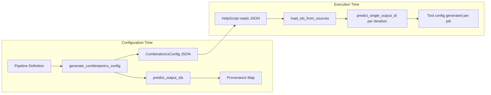

When a tool receives multiple inputs from upstream tools, biopipelines must decide how to combine them. The combinatorics system — implemented in [combinatorics.py](biopipelines/combinatorics.py) — provides two complementary wrappers, `Each` and `Bundle`, that let you control whether inputs form a **cartesian product** or a **single grouped entity**. This page explains the mechanics, ID generation rules, and practical patterns you will encounter when building multi-input pipelines.

Sources: [combinatorics.py](biopipelines/combinatorics.py#L5-L29)

## The Problem: Multiple Inputs, Multiple Strategies

Consider two upstream tools that each produce multiple results: `ToolA` outputs proteins *prot1, prot2* and `ToolB` outputs ligands *lig1, lig2, lig3*. When you pass both into `ToolC`, the framework must resolve one fundamental question: **how many jobs should ToolC run, and what goes into each one?** The answer is determined by how you wrap the inputs. Without any wrapper, every input is treated as an independent axis of iteration — the default `Each` behavior. Wrapping an input in `Bundle` collapses all its elements into a single group that appears together in every job configuration.

Sources: [combinatorics.py](biopipelines/combinatorics.py#L6-L13), [boltz2.py](ExamplePipelines/boltz2.py#L96-L112)

## Each: The Cartesian Product Default

`Each` marks one or more sources as independent iteration axes. When every input to a tool uses `Each` (the default for bare values), the framework generates the full cartesian product of all input sets. This is the most common combinatorics pattern and requires no explicit wrapper at all.

```python
# Explicit Each (equivalent to bare values)
boltz = Boltz2(
    proteins=Each(protein_a, protein_b),   # 2 proteins
    ligands=ligand_library                  # 3 ligands (default: Each)
)
# → 6 predictions: prot1+lig1, prot1+lig2, prot1+lig3,
#                   prot2+lig1, prot2+lig2, prot2+lig3
```

The `Each` class itself is minimal — a thin container that holds references to source objects and signals the combinatorics engine to treat each element as a separate iteration point. Its constructor requires at least one source and stores them in the `sources` attribute for later unwrapping.

Sources: [combinatorics.py](biopipelines/combinatorics.py#L37-L48), [boltz2.py](ExamplePipelines/boltz2.py#L96-L112)

## Bundle: Grouping Elements Together

`Bundle` collapses multiple elements into a single entity. Instead of iterating over them independently, all bundled elements are combined into one configuration that appears together in every job. This is the pattern to use when a tool should process a fixed group of items as a unit — for example, a protein complex of multiple chains, or a set of cofactors that must always be present together.

```python
# Bundle all ligands together — each protein sees all ligands at once
boltz = Boltz2(
    proteins=Each(protein_a, protein_b),
    ligands=Bundle(ligand_library)
)
# → 2 predictions:
#   ProteinA with (aspirin+caffeine+ibuprofen)
#   ProteinB with (aspirin+caffeine+ibuprofen)
```

The `Bundle` class mirrors `Each` structurally — same constructor signature, same `sources` attribute — but the combinatorics engine interprets it entirely differently. Where `Each` contributes to the cartesian product, `Bundle` collapses into a static group.

Sources: [combinatorics.py](biopipelines/combinatorics.py#L51-L62), [boltz2.py](ExamplePipelines/boltz2.py#L115-L123)

## Input Combination Patterns

The power of this system lies in mixing `Bundle` and `Each` across different inputs. The following table summarizes every meaningful combination, using 2 proteins and 3 ligands as running inputs:

| Pattern | Code Sketch | Jobs | Output IDs |
|---|---|---|---|
| **All Each** (default) | `Each(protA, protB), Each(lig1, lig2, lig3)` | 6 | `prot1+lig1`, `prot1+lig2`, …, `prot2+lig3` |
| **Bundle ligands** | `Each(protA, protB), Bundle(lig1, lig2, lig3)` | 2 | `prot1+(lig1+lig2+lig3)`, `prot2+(lig1+lig2+lig3)` |
| **Bundle proteins** | `Bundle(protA, protB), Each(lig1, lig2, lig3)` | 3 | `(protA+protB)+lig1`, `(protA+protB)+lig2`, `(protA+protB)+lig3` |
| **Bundle both** | `Bundle(protA, protB), Bundle(lig1, lig2, lig3)` | 1 | `protA+protB+lig1+lig2+lig3` |

When **all axes are bundled**, the framework produces exactly one job containing every element from every input. This is the degenerate case — no iteration, just a single combined configuration.

Sources: [boltz2.py](ExamplePipelines/boltz2.py#L96-L135), [combinatorics.py](biopipelines/combinatorics.py#L518-L600)

## Nested Patterns: Bundle Containing Each

The most advanced combinatorics pattern nests `Each` inside `Bundle`. This creates a hybrid: a group where some members iterate while others remain static across all iterations. The canonical use case is adding a **common cofactor** to every member of a ligand library.

```python
# Each library ligand is bundled with ATP as a cofactor
atp = Ligand("ATP")
boltz = Boltz2(
    proteins=protein_a,
    ligands=Bundle(Each(ligand_library), atp)
)
# → 3 predictions:
#   proteinA + (aspirin + ATP)
#   proteinA + (caffeine + ATP)
#   proteinA + (ibuprofen + ATP)
```

The unwrapping logic in [`_unwrap_sources`](biopipelines/combinatorics.py#L217-L278) processes this recursively: when it encounters a `Bundle`, it iterates over its `sources`. Any `Each` wrapper found inside is marked with `iterate: True` (its elements generate separate jobs), while bare sources inside the `Bundle` are marked `iterate: False` (they appear statically in every job). The outer mode remains `"bundle"` so the framework knows the whole group must be assembled per-iteration.

**Order matters within a `Bundle`**. In some tools (notably Boltz2), the first ligand in a bundle determines which affinity prediction is reported. Placing `Each` before the static cofactor means affinity is calculated for the library ligand in the presence of the cofactor; reversing the order swaps the affinity target.

```python
# Affinity calculated for ATP (first in bundle) in presence of each library ligand
boltz = Boltz2(
    proteins=protein_a,
    ligands=Bundle(atp, Each(ligand_library))  # ATP is first → affinity target
)
# Affinity for: ATP (presence of aspirin), ATP (presence of caffeine), ATP (presence of ibuprofen)
```

Sources: [boltz2.py](ExamplePipelines/boltz2.py#L137-L159), [combinatorics.py](biopipelines/combinatorics.py#L217-L278)

## ID Generation Mechanics

Output IDs are computed at **configuration time** by `predict_output_ids_with_provenance` and must match exactly what the runtime HelpScript produces. The ID naming rules follow a strict hierarchy:

1. **Single iterated axis**: output IDs are the axis IDs directly (e.g., `prot1`, `prot2`)
2. **Multiple iterated axes**: full cartesian product joined with `+` (e.g., `prot1+lig1`, `prot1+lig2`)
3. **Pure bundle axes** (no iteration): all unique IDs joined with `+` into a single ID
4. **Mixed bundle + iterated axes**: bundle prefix prepended to iterated IDs with `+` separator

The `+` separator is semantically significant — it is distinct from `_`, which is reserved for parent→child suffix relationships (e.g., a design tool producing `protein_1`, `protein_2`). This separation ensures that `id_map_utils` can correctly match multi-axis components without ambiguity.

For nested `Bundle(Each(...), static)` patterns, static IDs are joined and positioned relative to the iterated IDs based on their order within the `Bundle`. The [`_collect_static_ids_from_value`](biopipelines/combinatorics.py#L448-L478) function tracks both the static ID values and whether they appear before or after the `Each` wrapper to determine the correct output ID ordering.

Sources: [combinatorics.py](biopipelines/combinatorics.py#L518-L600), [combinatorics.py](biopipelines/combinatorics.py#L688-L751)

## The Tuple Convention: Stream Naming

When a tool's combinatorics axis maps to a non-default stream, you use the **tuple convention** to tell the framework which stream to extract. A named input can be:

- A **bare value**: the parameter name doubles as the stream name
- A **2-tuple** `(value, stream_name)`: explicit stream routing
- A **3-tuple** `(value, stream_name, entity_type)`: adds entity metadata (`"protein"`, `"dna"`, `"ligand"`, etc.)

```python
# Tuple convention with entity_type metadata
generate_combinatorics_config(
    "config.json",
    proteins=(lmpnn_output, "sequences", "protein"),
    ligands=(compounds_output, "compounds", "ligand")
)
```

The [`_unpack_input`](biopipelines/combinatorics.py#L147-L174) function normalizes all three forms into a consistent `(actual_value, stream_name, entity_type)` triple. This mechanism lets you pass a tool's sequence output to a parameter named `proteins` while explicitly routing through the `"sequences"` stream — keeping the provenance column named `"proteins"` in the output table.

Sources: [combinatorics.py](biopipelines/combinatorics.py#L147-L174), [combinatorics.py](biopipelines/combinatorics.py#L280-L327)

## Provenance Tracking

Every combinatorics operation generates **provenance metadata** — a mapping from axis aliases to the specific input IDs that contributed to each output. For a 2×3 cartesian product of proteins and ligands, the provenance dictionary contains two lists of six entries each, aligned with the output IDs:

```python
provenance = {
    "proteins": ["prot1", "prot1", "prot1", "prot2", "prot2", "prot2"],
    "ligands":  ["lig1",  "lig2",  "lig3",  "lig1",  "lig2",  "lig3"]
}
```

For bundle axes with multiple elements, the framework emits both a combined provenance entry (all IDs joined with `+`) and indexed sub-entries (`axis.1`, `axis.2`, ...) for granular lookup. This provenance flows into the output map table, enabling downstream tools and analysis steps to trace any result back to its exact input origins.

> [!TIP]
> Provenance columns are named after the **parameter alias** (the kwarg key), not the stream name. Use the tuple convention to decouple the user-facing column name from the internal stream routing when they differ.

Sources: [combinatorics.py](biopipelines/combinatorics.py#L518-L600), [combinatorics.py](biopipelines/combinatorics.py#L83-L104)

## Two-Phase Architecture: Configuration and Execution

The combinatorics system operates across two distinct phases, separated by the pipeline's save-and-submit boundary.



At **configuration time**, `generate_combinatorics_config` serializes the full combinatorics description into a `CombinatoricsConfig` JSON file stored alongside the tool's execution script. This file contains every axis definition — its mode, source paths, and iterate flags — plus the predicted output IDs and provenance for validation.

At **execution time**, the tool's HelpScript reads this JSON, loads actual IDs from the CSV source files via `load_ids_from_sources`, and iterates using `predict_single_output_id` to reconstruct the exact same ID that was predicted at configuration time. This two-phase design ensures that configuration-time predictions and runtime behavior always agree, even when the actual data files change between phases (e.g., when a HelpScript filters or transforms inputs before the combinatorics step).

> [!TIP]
> The `predict_single_output_id` function always uses full cartesian naming with `+` separators, regardless of axis count. This mirrors `predict_output_ids` without the single-axis shortcut, ensuring config-time and SLURM-time ID generation produce identical strings.

Sources: [combinatorics.py](biopipelines/combinatorics.py#L280-L327), [combinatorics.py](biopipelines/combinatorics.py#L688-L751), [combinatorics.py](biopipelines/combinatorics.py#L353-L387)

## Data Flow: From Sources to AxisConfig

The complete journey from a user's Python expression to the serialized JSON consumed by HelpScripts involves three transformations:

1. **Tuple unpacking** — `_unpack_input` normalizes bare values, 2-tuples, and 3-tuples into `(value, stream_name, entity_type)`
2. **Wrapper unwrapping** — `_unwrap_sources` recursively opens `Bundle`/`Each` wrappers and extracts CSV paths from `DataStream`, `StandardizedOutput`, or `ToolOutput` objects, tagging each source with an `iterate` flag
3. **Axis assembly** — `generate_combinatorics_config` packages the unwrapped sources into `AxisConfig` dataclasses, attaches provenance, and serializes to JSON

Each source path extracted by `_extract_source_paths` points to a map table CSV. The `iterate` flag determines whether IDs from that source expand the cartesian product or remain static within each bundle iteration.

Sources: [combinatorics.py](biopipelines/combinatorics.py#L147-L278), [combinatorics.py](biopipelines/combinatorics.py#L175-L215)

## Quick Reference

| Expression | Meaning | Iteration |
|---|---|---|
| `proteins=source` | Each (implicit default) | Over source IDs |
| `proteins=Each(a, b)` | Each (explicit) | Over combined IDs from a and b |
| `proteins=Bundle(a, b)` | Bundle | No iteration; a and b grouped together |
| `ligands=Bundle(Each(lib), cofactor)` | Hybrid | Over library IDs; cofactor static in each group |
| `proteins=(source, "sequences", "protein")` | Tuple routing | Each over sequences stream, entity type metadata |

| Function | Phase | Purpose |
|---|---|---|
| `generate_combinatorics_config` | Configuration | Main entry point; builds and saves JSON config |
| `predict_output_ids_with_provenance` | Configuration | Computes output IDs and provenance mapping |
| `predict_single_output_id` | Execution | Reconstructs one output ID per iteration in HelpScripts |
| `load_ids_from_sources` | Execution | Reads actual IDs from CSV source files |
| `is_combinatorics_wrapper` | Configuration | Type check for Bundle/Each presence |

For the broader context of how these patterns fit into pipeline construction, see [DataStream: Unified I/O Container](7-datastream-unified-i-o-container) for the underlying data representation and [Pipeline Orchestration Engine](6-pipeline-orchestration-engine) for how tools consume combinatorics configs during script generation. The ID patterns produced by these combinations are described in detail in [Pattern-Based ID Expansion](15-pattern-based-id-expansion).