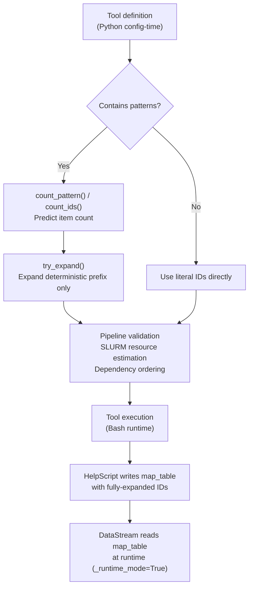

BioPipelines uses a declarative pattern language to represent large ID spaces compactly. Instead of materializing every identifier at configuration time, the framework stores symbolic patterns in `DataStream` objects and expands them lazily—only when a specific count, index, or file path is needed. This design keeps pipeline configuration lightweight even when a single tool produces thousands of designs, and it enables a two-phase execution model where config-time prediction coexists with runtime certainty.

## Pattern Syntax Reference

The pattern system recognizes two delimiter styles—angle brackets for deterministic slots and square brackets for runtime-dependent (lazy) slots. The core module is [id_patterns.py](biopipelines/id_patterns.py), which is deliberately standalone with no DataStream imports.

### Deterministic Slots `<…>`

Deterministic slots are expanded fully at configuration time using the regex `_SLOT_RE = re.compile(r'<([^>\[\]]+)>')` at [line 25](biopipelines/id_patterns.py#L25-L25). They support two internal grammars:

| Syntax | Expansion | Example | Result |
|--------|-----------|---------|--------|
| `<N..M>` | Inclusive numeric range | `<0..49>` | `0, 1, …, 49` (50 values) |
| `<A B C>` | Explicit space-separated set | `<A V I L>` | `A, V, I, L` (4 values) |

Multiple slots in a single string compute their **Cartesian product**, ordered by slot position. The expansion engine uses `itertools.product` and substitutes slots in reverse order to preserve positional indices [lines 184–192](biopipelines/id_patterns.py#L184-L192).

```python
'<0..2>_<A B>'  →  ['0_A', '0_B', '1_A', '1_B', '2_A', '2_B']
```

A single DataStream `ids` list can contain multiple pattern strings; each is expanded independently and concatenated. For instance, `ids=["5HG6_<0..4>", "UBQ_<0..9>"]` represents 15 distinct items.

### Lazy (Runtime) Slots `[…]`

Square bracket segments mark portions of an ID that cannot be resolved until execution completes. The helper `is_lazy()` at [line 36](biopipelines/id_patterns.py#L36-L38) detects them via `_BRACKET_RE = re.compile(r'\[([^\]]+)\]')` at [line 28](biopipelines/id_patterns.py#L28-L28). Attempting to fully expand a lazy pattern raises `LazyPatternError` [line 31](biopipelines/id_patterns.py#L31-L33).

```
prot_<0..4>[_<N><S A L K>]
├── Deterministic prefix: prot_<0..4>  →  5 IDs at config time
└── Lazy suffix: [_<N><S A L K>]       →  resolved at runtime
```

The function `try_expand()` at [line 58](biopipelines/id_patterns.py#L58-L73) returns a tuple `(ids, is_complete)` where `is_complete` is `False` when brackets remain. The function `strip_brackets()` at [line 46](biopipelines/id_patterns.py#L46-L55) removes all bracket segments, yielding the deterministic prefix. The function `glob_from_lazy()` at [line 76](biopipelines/id_patterns.py#L76-L83) replaces brackets with `*` for filesystem globbing.

## Two-Phase Expansion Architecture

The pattern system implements a deliberate split between configuration-time prediction and runtime resolution. This is not a performance optimization alone—it is the mechanism by which the pipeline validates structure without knowing exact outputs.



At configuration time, `len(stream)` calls `count_ids()` at [line 158](biopipelines/id_patterns.py#L158-L160), which sums per-pattern counts without materializing any strings. This means a pattern like `design_<0..999>` reports `len == 1000` in O(k) where k is the number of slots, not the number of IDs.

At runtime, when `_runtime_mode` is `True` on the DataStream, the `ids_expanded` property at [lines 118–136](biopipelines/datastream.py#L118-L136) reads fully materialized IDs directly from the `map_table` CSV written by the bash HelpScript:

```python
if self._runtime_mode:
    # Runtime: fully-expanded IDs are in the map_table written by bash
    self._ids_expanded = list(self._get_map_data()['id'])
else:
    # Config time: expand only the deterministic prefix
    self._ids_expanded, _ = id_patterns.try_expand_ids(self.ids)
```

## O(1) Index Access for Single-Slot Patterns

A critical performance feature is `expand_at()` at [line 243](biopipelines/id_patterns.py#L243-L277). For single-slot patterns, it computes the indexed element directly from the range parameters without generating the full list:

```python
# expand_at('design_<0..999>', 42) → 'design_42'  — O(1)
# expand_at('<0..2>_<A B>', 4)     → '1_B'         — O(k) slots, not O(n) items
```

The algorithm decomposes the flat index into per-slot indices using row-major order division. The DataStream `__getitem__` at [lines 205–250](biopipelines/datastream.py#L205-L250) exploits this for integer indexing when `len(self.ids) == 1` (single-pattern case).

> [!TIP]
> When iterating a DataStream in a notebook, `__getitem__` uses `expand_at` for O(1) random access on single-slot patterns. This means `stream[99999]` on `ids=["design_<0..99999>"]` does not allocate a 100k-element list. However, slicing or multi-pattern IDs triggers full expansion.

## File Pattern Templates

File paths use a separate template mechanism distinct from ID slots. The `<id>` placeholder in a file template is substituted per expanded ID via `expand_file_pattern()` at [line 280](biopipelines/id_patterns.py#L280-L285):

```python
# DataStream with template
DataStream(
    ids=["5HG6_<0..3>"],
    files=["output/<id>.pdb"],
    format="pdb"
)
# files_expanded → ["output/5HG6_0.pdb", "output/5HG6_1.pdb", ...]
```

The `files_expanded` property at [lines 139–158](biopipelines/datastream.py#L139-L158) detects the `<id>` template when `len(files) == 1 and '<id>' in files[0]`. When lazy patterns are present, the glob variant `glob_from_lazy_ids()` at [line 86](biopipelines/id_patterns.py#L86-L99) replaces bracket segments with `*` before expanding deterministic slots, producing glob-ready paths like `prot_0*+9DP.pdb`.

## Pattern Composition in Combinatorics

The [combinatorics module](biopipelines/combinatorics.py) uses pattern composition to generate downstream IDs without expanding parent patterns. The function `generate_multiplied_ids_pattern()` at [line 792](biopipelines/combinatorics.py#L792-L817) appends a suffix pattern to each parent ID string:

```python
generate_multiplied_ids_pattern(
    ["5HG6_<0..4>"], "<1..3>"
)
→ ["5HG6_<0..4>_<1..3>"]   # 5 × 3 = 15 items, zero allocations
```

This is the mechanism behind multi-step pipelines. When ProteinMPNN generates 10 sequences per input structure, the tool appends `_<1..10>` to each parent ID pattern. The resulting composed pattern propagates through the pipeline without ever expanding the intermediate lists. The helper `append_suffix()` at [line 311](biopipelines/id_patterns.py#L311-L317) provides the same composition for standalone use.

The constructor helpers `make_range()` and `make_set()` at [lines 295–308](biopipelines/id_patterns.py#L295-L308) offer programmatic pattern construction:

```python
make_range('design', 0, 49)          → 'design_<0..49>'
make_set('pos', ['42A', '42V', '42W']) → 'pos_<42A 42V 42W>'
```

## Deduplication and Containment

When a pipeline mixes literal IDs with patterns that already cover them, `dedup_parent_children()` at [line 222](biopipelines/id_patterns.py#L222-L240) eliminates the redundancy:

```python
dedup_parent_children(['prot_<0..2>', 'prot_0', 'prot_1'])
→ ['prot_<0..2>']
```

It expands each pattern string and removes any literal IDs found in the expanded set. For lazy patterns, it uses `try_expand()` to avoid raising `LazyPatternError`.

## Complete API Surface

| Function | Purpose | Raises on |
|----------|---------|-----------|
| `contains_pattern(s)` | Detect `<…>` slots | — |
| `is_lazy(s)` / `has_brackets(s)` | Detect `[…]` segments | — |
| `is_literal(s)` | No pattern slots at all | — |
| `count_pattern(s)` | Count expanded size without expanding | — |
| `count_ids(ids)` | Sum counts across list | — |
| `expand_pattern(s)` | Full expansion to string list | `LazyPatternError` |
| `expand_ids(ids)` | Expand each element and concatenate | `LazyPatternError` |
| `try_expand(s)` | Expand prefix, return `(ids, is_complete)` | — |
| `try_expand_ids(ids)` | Batch `try_expand` | — |
| `expand_at(s, index)` | O(1) single element by index | `IndexError` |
| `strip_brackets(s)` | Remove `[…]` segments | — |
| `glob_from_lazy(s)` | Replace `[…]` with `*` | — |
| `glob_from_lazy_ids(ids)` | Glob-ready expanded file paths | — |
| `expand_file_pattern(template, id)` | Substitute `<id>` placeholder | — |
| `file_has_glob(template)` | Check for `*` wildcard | — |
| `make_range(base, start, end)` | Build `base_<start..end>` | — |
| `make_set(base, values)` | Build `base_<v1 v2 …>` | — |
| `append_suffix(parent_ids, suffix)` | Append pattern suffix | — |
| `dedup_parent_children(ids)` | Remove literals covered by patterns | — |

## Relationship to Multi-Axis IDs

Pattern expansion operates independently from the multi-axis combinatorics system described in [Bundle and Each Input Patterns](14-bundle-and-each-input-patterns). The two systems serve different purposes: **patterns** compactly represent enumerations within a single axis (e.g., "10 designs per structure"), while **combinatorics** control how multiple input axes are combined (e.g., "3 proteins × 5 ligands"). Multi-axis IDs use `+` as separator (e.g., `prot1+lig1`), while pattern-generated suffixes use `_` (e.g., `prot1_3`). The [id_map_utils module](biopipelines/id_map_utils.py) respects this distinction when matching IDs across tables, splitting on `+` for provenance resolution while using `_<S>` or `_<N>` patterns for suffix stripping.

## Next Steps

- **[Bundle and Each Input Patterns](14-bundle-and-each-input-patterns)** — How pattern-composed IDs interact with cartesian product and bundling across multiple input axes.
- **[Table Reference and Provenance](16-table-reference-and-provenance)** — How `id_map_utils` resolves pattern-expanded IDs back to their parent sources using recursive suffix stripping.
- **[DataStream: Unified I/O Container](7-datastream-unified-i-o-container)** — The full DataStream lifecycle including pattern-aware iteration, filtering, and serialization.