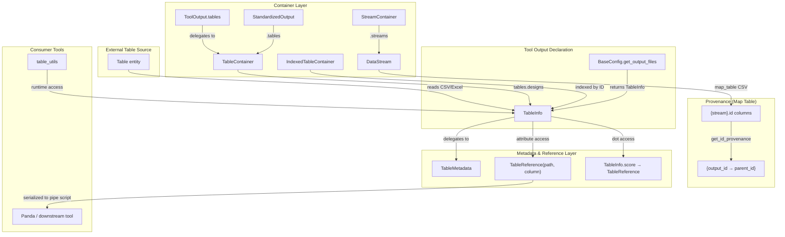

Tables are the connective tissue of a biopipelines workflow. Every tool that produces structured output emits one or more named tables — CSV files on disk whose schema is declared at configuration time. Downstream tools consume these tables by name, reference individual columns by attribute access, and automatically inherit the provenance chain that links every output row back to its input origins. This page documents the table lifecycle from creation through column reference, transformation, and provenance tracking.

## Table Architecture Overview

The table subsystem spans four architectural layers: tool output declaration, configuration-time metadata, runtime CSV materialization, and downstream reference resolution. At the center sits `TableInfo`, a dual-purpose object that both describes a table's schema and acts as a factory for column references consumed by subsequent tools.



## TableInfo: Schema Description and Column Factory

`TableInfo` is the central abstraction that every tool returns when it declares tabular output. It wraps a `TableMetadata` object holding the table's name, filesystem path, column list, description, and row count. More importantly, `TableInfo` intercepts any attribute access that does not match its own properties and returns a `TableReference` — a lightweight serializable tuple of `(path, column_name)` that downstream tools can resolve at runtime.

Sources: [base_config.py](biopipelines/base_config.py#L753-L801)

The `TableMetadata` dataclass holds the raw schema fields and is exposed through the `.info` property. This separation ensures that metadata access never accidentally creates a column reference — only the explicit `.info` prefix reaches the metadata layer, while every other attribute name is assumed to be a column.

Sources: [base_config.py](biopipelines/base_config.py#L738-L774)

```python
# TableInfo declared by ProteinMPNN
tables = {
    "sequences": TableInfo(
        name="sequences",
        path="/output/pipeline/ProteinMPNN/queries.csv",
        columns=["id", "structures.id", "source_pdb", "sequence", "score", "seq_recovery", "gaps"],
        description="ProteinMPNN sequence results",
        count=100
    )
}

# Metadata access
tables["sequences"].info.path       # "/output/pipeline/ProteinMPNN/queries.csv"
tables["sequences"].info.columns    # ["id", "structures.id", ...]
tables["sequences"].info.count      # 100

# Column reference (any attribute becomes TableReference)
tables["sequences"].score           # TableReference(path, "score")
tables["sequences"].seq_recovery    # TableReference(path, "seq_recovery")
```

## TableContainer and IndexedTableContainer

When a tool's `get_output_files()` returns a `tables` dictionary, the pipeline wraps it in a `TableContainer` at configuration time. `TableContainer` supports both dictionary-style access (`tables["sequences"]`) and attribute access (`tables.sequences`), returning `TableInfo` objects in either case. This is the object you interact with through `ToolOutput.tables`.

Sources: [base_config.py](biopipelines/base_config.py#L924-L1000)

Some tools produce one table per input ID — for example, a per-residue RMSF calculation yields a separate CSV for each structure. These tools return an `IndexedTableContainer` instead of a plain `TableInfo`. An `IndexedTableContainer` maps entry IDs to individual `TableInfo` objects, all sharing a common schema, and integrates into `TableContainer` as a single named entry. You retrieve individual tables by ID using bracket notation.

Sources: [base_config.py](biopipelines/base_config.py#L804-L920)

| Container | Use Case | Access Pattern | Result |
|-----------|----------|----------------|--------|
| `TableInfo` | Single output table | `tables.sequences` | `TableInfo` with `.info` and column references |
| `IndexedTableContainer` | One table per input ID | `tables.rmsf["1a2j"]` | `TableInfo` for that specific ID |
| `TableContainer` | Named collection | `tables.keys()` | All table names in the output |

## The Table Entity: Loading External Data

The `Table` class extends `BaseConfig` to provide a zero-execution entity that loads an existing CSV or Excel file into the pipeline at configuration time. It reads column headers and row counts immediately, then wraps the file in a `TableInfo` that downstream tools can reference exactly as if the table had been produced by a computational tool. Excel files are transparently converted to CSV on first load.

Sources: [table.py](biopipelines/table.py#L26-L164)

This is particularly useful for injecting pre-computed metrics, experimental data, or external design specifications into a pipeline without any runtime computation. The `Table` entity generates a no-op bash script — its output already exists on disk.

Sources: [table.py](biopipelines/table.py#L123-L137)

```python
# Load an external table
metrics = Table("/path/to/experimental_metrics.csv", name="experimental")

# Reference its columns in downstream tools — identical to tool-produced tables
mpnn = ProteinMPNN(
    structures=proteins,
    fixed=(metrics.tables.experimental, "fixed_residues")
)
```

## Column References: The TableReference Protocol

The `TableReference` mechanism is what enables tools to accept "a specific column from a specific table" as a parameter. When you write `mpnn_fixed = af_output.tables.structures.fixed`, the attribute access on `TableInfo` returns a `TableReference` containing the table's CSV path and the column name `"fixed"`. At script generation time, the tool serializes this reference into the bash script, and the corresponding HelpScript reads the column values at runtime.

Sources: [base_config.py](biopipelines/base_config.py#L776-L782)

ProteinMPNN exemplifies this pattern: its `fixed` and `redesigned` parameters accept either a PyMOL-style selection string or a `(TableInfo, column_name)` tuple. When a `TableReference` is provided, the HelpScript `pipe_pmpnn_fixed_positions.py` reads per-structure fixed-position specifications from the referenced CSV column rather than applying a uniform selection to all inputs.

Sources: [protein_mpnn.py](biopipelines/protein_mpnn.py#L115-L172)

## Table Utilities: Runtime Navigation

The `table_utils` module provides a small set of functions for accessing tables at runtime from any output source format. These functions handle the polymorphism between `ToolOutput`, `StandardizedOutput`, and raw dictionaries, giving HelpScripts a uniform access layer.

Sources: [table_utils.py](biopipelines/table_utils.py#L1-L133)

| Function | Purpose | Returns |
|----------|---------|---------|
| `get_table(source, name)` | Retrieve `TableInfo` by name | `TableInfo` or raises `KeyError` |
| `get_table_path(source, name)` | Get the CSV filesystem path | `str` path |
| `list_tables(source)` | List all available table names | `List[str]` |
| `get_indexed_table(source, name, entry_id)` | Get a per-ID table from an `IndexedTableContainer` | `TableInfo` |
| `table_exists(source, name)` | Check if a named table is available | `bool` |

> [!TIP]
> `get_table` resolves through multiple source types in order: raw dictionary → object with `.tables` attribute (including `ToolOutput` and `StandardizedOutput`). This means HelpScripts can accept outputs from any tool without type-checking, since all tools conform to the same `get_output_files()` contract.

## Map Tables and Provenance Columns

Every `DataStream` may carry a `map_table` — a CSV file that minimally contains `id`, `file`, and `value` columns, plus any number of **provenance columns**. Provenance columns follow the naming convention `{stream_name}.id` and record which input ID produced each output ID. When ProteinMPNN generates 10 sequences per structure, the sequences map table contains a `structures.id` column that maps each sequence ID back to its parent structure ID.

Sources: [datastream.py](biopipelines/datastream.py#L430-L562)

The `create_map_table` factory function handles provenance population through two mechanisms: explicit provenance dictionaries and automatic provenance generation from `parent_ids` combined with a `suffix_pattern`. When a tool uses `suffix_pattern` (e.g., `"<1..10>"`) along with `parent_ids` and `input_stream_name`, the factory automatically replicates each parent ID once per suffix value, establishing the complete parent→child mapping without manual provenance construction.

Sources: [datastream.py](biopipelines/datastream.py#L436-L530)

```csv
# Example map table produced by ProteinMPNN (queries.csv)
id,structures.id,source_pdb,sequence,score,seq_recovery,gaps
5HG6_1,5HG6,5HG6.pdb,MTYKL...,0.82,0.91,0
5HG6_2,5HG6,5HG6.pdb,VTYKL...,0.78,0.85,0
6MRR_1,6MRR,6MRR.pdb,GLAEN...,0.85,0.93,1
6MRR_2,6MRR,6MRR.pdb,ALAEQ...,0.79,0.87,0
```

## Provenance Extraction: get_id_provenance

The `BaseConfig.get_id_provenance()` method reads every output stream's map table and extracts all `{stream_name}.id` columns into a structured mapping: `{axis_name → {output_id → parent_id}}`. This is the mechanism that enables the pipeline to trace any output back through the full chain of tools that produced it. The method deduplicates by tracking which map tables it has already visited, avoiding redundant reads when multiple streams share the same underlying CSV.

Sources: [base_config.py](biopipelines/base_config.py#L374-L423)

```python
# Called on any tool config — returns all provenance from its output streams
provenance = mpnn_config.get_id_provenance()
# {
#     "structures": {
#         "5HG6_1": "5HG6",
#         "5HG6_2": "5HG6",
#         "6MRR_1": "6MRR",
#         "6MRR_2": "6MRR"
#     }
# }
```

This provenance data is particularly critical when tools produce N outputs per input (as with `num_sequences` in ProteinMPNN or `num_designs` in RFdiffusion). Without the provenance column, there would be no way to associate a generated sequence like `5HG6_2` back to its originating structure `5HG6`.

## Table Transformation with Panda

The `Panda` tool consumes `TableInfo` objects (or `StandardizedOutput` wrappers) and applies a chain of pandas-style operations — filtering, sorting, merging, concatenation, calculated columns, and more. Panda accepts tables as positional arguments or via the `tables` parameter, and operations as a list of `Operation` objects created through `Panda`'s static methods.

Sources: [panda.py](biopipelines/panda.py#L53-L1005)

```python
# Sort ProteinMPNN outputs by score, take top 50, merge with experimental data
Panda(
    tables=[mpnn_output.tables.sequences, metrics.tables.experimental],
    operations=[
        Panda.sort("score", ascending=False),
        Panda.head(50),
        Panda.merge(on="id", how="inner")
    ]
)
```

Each `Operation` is a `dataclass` with a `type` string and a `params` dictionary, serialized to JSON for the runtime HelpScript. Panda also produces its own output table, which becomes a `TableInfo` consumable by subsequent tools — maintaining the same reference chain through the pipeline.

Sources: [panda.py](biopipelines/panda.py#L30-L50)

## Missing Table Propagation

Tools that filter or deduplicate output emit a `missing` table recording which IDs were removed and why. The `missing` table carries columns `id`, `removed_by` (the tool name), and `cause` (the reason for removal). When a downstream tool needs to propagate this information, it calls `BaseConfig._get_upstream_missing_table_path()` to locate any `missing` table from its inputs and passes the path to its HelpScript via an `--upstream-missing` flag.

Sources: [base_config.py](biopipelines/base_config.py#L658-L690)

This mechanism ensures that if ProteinMPNN removes duplicate sequences, and those sequences are then passed to AlphaFold, AlphaFold's missing table will include both its own removals and the upstream ProteinMPNN removals — providing a complete audit trail.

## Serialization and Runtime Resolution

`TableInfo` objects serialize to plain dictionaries via `to_dict()`, containing `name`, `path`, `columns`, `description`, and `count`. `IndexedTableContainer` extends this with a `_type` discriminator and an `entries` mapping. The pipeline persists these dictionaries in tool configuration JSON, and the runtime HelpScript layer reads them back. The `TableReference` objects themselves are not serialized directly — instead, the tool's `generate_script()` method renders the `(path, column)` pair into the bash script as string arguments that the HelpScript interprets.

Sources: [base_config.py](biopipelines/base_config.py#L793-L801), [base_config.py](biopipelines/base_config.py#L882-L911)

The `DataStreamResolver` provides the inverse operation: converting any input format (file paths, dictionaries, existing DataStreams) into a `DataStream` with an auto-generated map table. This resolver is used by tools that need to construct streams from heterogeneous inputs, ensuring that every stream — regardless of origin — carries the same map table structure for provenance and runtime lookup.

Sources: [datastream_resolver.py](biopipelines/datastream_resolver.py#L18-L163)

---

For the pipeline mechanism that produces `ToolOutput` and `StandardizedOutput` wrapping these tables, see [Pipeline Orchestration Engine](6-pipeline-orchestration-engine). For the `DataStream` container that holds map tables and drives pattern-based ID expansion, see [DataStream: Unified I/O Container](7-datastream-unified-i-o-container). For the pattern system used in provenance suffix generation, see [Pattern-Based ID Expansion](15-pattern-based-id-expansion).