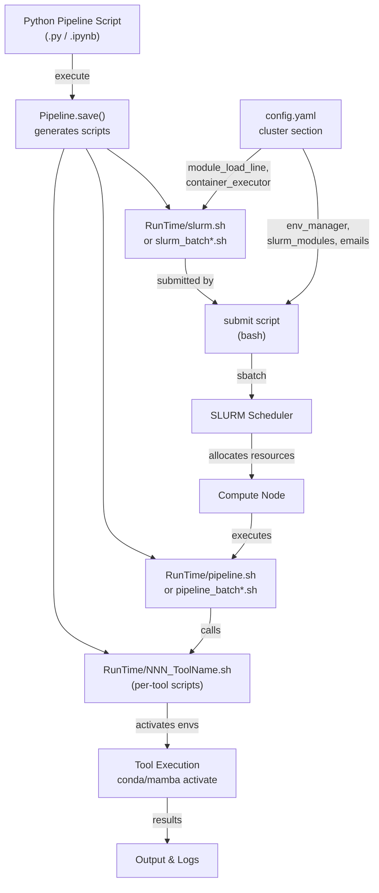
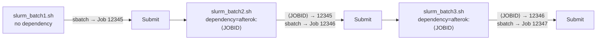
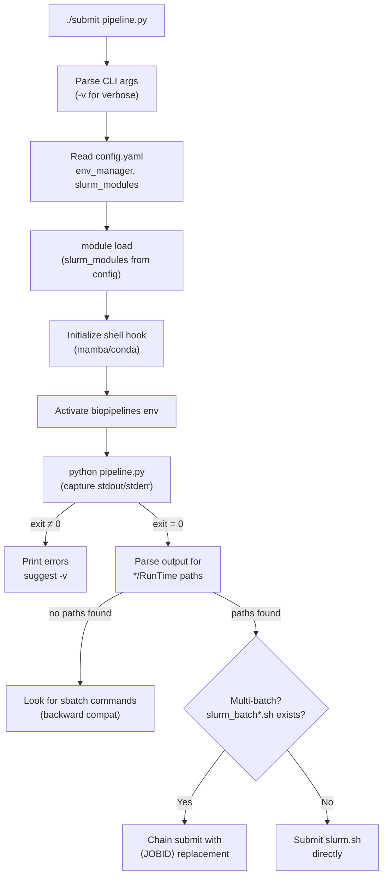

BioPipelines bridges the gap between declarative pipeline definition and HPC execution by generating SLURM job scripts, managing multi-batch job chaining, and providing a unified submission interface. This page covers the complete lifecycle—from how the `Pipeline` class produces SLURM scripts, through the shell scripts that submit and monitor them, to the configuration that ties your cluster environment to the framework.

## Execution Architecture Overview

The SLURM integration operates as a two-stage pipeline: Python-based script generation followed by bash-based submission and execution. The `Pipeline` class generates all necessary SLURM wrapper scripts and pipeline execution scripts during the **save phase**, then the `submit` shell script orchestrates their submission to the cluster.



The key architectural insight is that **pipeline definition and cluster submission are decoupled**: the Python layer never calls `sbatch` directly. Instead, it generates SLURM-compatible shell scripts that the `submit` bash wrapper feeds to the scheduler. This separation allows the same pipeline definition to be executed locally via the `run` script or on any SLURM cluster via `submit`.

Sources: [pipeline.py](biopipelines/pipeline.py#L42-L120), [submit](submit#L1-L50), [config.yaml](config.yaml#L130-L153)

## Cluster Configuration

All cluster-specific settings live under the `cluster` key in `config.yaml`. The `ConfigManager` singleton reads these values and injects them into generated SLURM scripts and submission workflows.

| Setting | Type | Purpose | Default |
|---------|------|---------|---------|
| `env_manager` | `string` | Shell environment manager: `"mamba"` or `"conda"` | `"mamba"` |
| `container_executor` | `string` | Container runtime for wrapped tools: `"apptainer"` or `"singularity"` | `"apptainer"` |
| `slurm_modules` | `list[string]` | Modules to `module load` at the top of every SLURM script | `["miniforge3", "apptainer"]` |
| `emails` | `map<string, string>` | Unix username → notification email (used with `email="auto"`) | `{}` |

The `ConfigManager` consumes these through targeted accessors. The shell hook command is derived from `env_manager`—for mamba it generates `eval "$(mamba shell hook --shell bash)"`, and the module load line is assembled from `slurm_modules` as `module load miniforge3 apptainer`. Both are embedded directly into generated SLURM wrapper scripts.

Sources: [config.yaml](config.yaml#L130-L153), [config_manager.py](biopipelines/config_manager.py#L144-L211)

## Resource Specification and Batch Boundaries

The `Resources()` method (and its instance-level counterpart `pipeline.resources()`) is the primary mechanism for declaring computational requirements. Each call to `Resources()` creates a **new batch boundary**—tools added after one `Resources()` call and before the next belong to that batch and share its resource allocation.

### GPU Specification Grammar

The GPU parameter supports a rich specification language that maps to SLURM constraint directives:

| Spec | Generated SBATCH | Behavior |
|------|-------------------|----------|
| `"A100"`, `"H100"`, `"V100"`, `"L4"` | `--gpus=1` | Request exactly 1 GPU of named model |
| `"gpu"` or `"any"` | `--gpus=1` | Any available GPU |
| `"24GB"`, `"32GB"`, `"80GB"`, `"96GB"` | `--gpus=1 --constraint="GPUMEM32GB"` | Memory-based GPU selection |
| `"32GB\|80GB\|96GB"` | `--gpus=1 --constraint="GPUMEM32GB\|GPUMEM80GB\|GPUMEM96GB"` | Accept multiple memory tiers |
| `"high-memory"` | `--gpus=1 --constraint="GPUMEM32GB\|GPUMEM80GB\|GPUMEM96GB"` | Shorthand for 32+ GB |
| `"!L4"` | `--gpus=1 --constraint="GPUMEM32GB\|GPUMEM80GB\|GPUMEM96GB"` | Exclude L4 (maps to high-memory) |
| `"!T4"` | `--gpus=1 --constraint="~GPUT4"` | Exclude T4 (generic exclusion) |
| `None` or `"none"` | *(no GPU line)* | CPU-only batch |

When a GPU is requested, the generated SLURM script also includes a diagnostic line that prints the allocated GPU model via `nvidia-smi` at job start, providing immediate visibility into resource allocation.

### Resource Inheritance

Subsequent `Resources()` calls inherit unspecified values from the previous batch. The first batch defaults to `memory="15GB"` and `time="24:00:00"` if left unspecified. Additional SLURM parameters (like `cpus`, `nodes`, `partition`) can be passed as keyword arguments and are translated to SBATCH directives with automatic underscore-to-hyphen conversion (e.g., `cpus=32` becomes `--cpus-per-task=32`).

> [!TIP]
> **Batch boundaries are implicit.** Every `Resources()` call creates a new batch. If you need five tools to share one GPU allocation and three to run CPU-only, place exactly two `Resources()` calls in your pipeline—tools are assigned to batches in the order they are added.

Sources: [pipeline.py](biopipelines/pipeline.py#L913-L985), [pipeline.py](biopipelines/pipeline.py#L660-L683)

## SLURM Script Generation

The `Pipeline.slurm()` method triggers script generation. If the pipeline has not yet been saved (via `save()` or `Save()`), it calls `save()` automatically before generating SLURM wrappers.

### Single-Batch Pipelines

When only one `Resources()` call exists, a single `slurm.sh` is generated in the `RunTime/` directory. The script contains all SBATCH directives, the module load line from config, a GPU diagnostic block (if applicable), and the full pipeline execution script inline.

The generated script includes `umask 002` to ensure all output files are group-writable—a practical choice for shared HPC environments where collaborators need access to each other's results.

### Multi-Batch Pipelines

Multiple `Resources()` calls produce a set of files:

- **`slurm_batch1.sh`, `slurm_batch2.sh`, ...** — One SLURM wrapper per batch
- **`pipeline_batch1.sh`, `pipeline_batch2.sh`, ...** — One pipeline execution script per batch
- **`config_batch1.sh`, `config_batch2.sh`, ...** — Configuration display scripts per batch

Each batch SLURM script (batch 2+) includes a `--dependency=afterok:<JOBID>` placeholder. The `submit` script performs runtime substitution—replacing `<JOBID>` with the actual job ID returned by `sbatch --parsable` from the previous batch—creating a proper SLURM dependency chain without requiring manual intervention.



### Email Notification

The `email` parameter to `slurm()` supports three modes:
- **`"auto"`** (default): Looks up the current Unix username in `cluster.emails` from `config.yaml`. Warns and disables notifications if no mapping exists.
- **`""`**: No email notifications at all.
- **Specific address**: Uses the provided email directly, generating `--mail-type=END,FAIL` and `--mail-user=` directives.

Sources: [pipeline.py](biopipelines/pipeline.py#L610-L829), [pipeline.py](biopipelines/pipeline.py#L714-L756)

## External Job Dependencies

The `Dependencies()` convenience function (or `pipeline.set_dependencies()`) lets a pipeline wait for unrelated SLURM jobs to complete before its first batch starts. The dependency is injected as `--dependency=afterok:JOBID1:JOBID2` into the first batch's SLURM script, while subsequent batches retain their internal chaining logic.

```python
with Pipeline("DrugScreen", "V2", "Compound screening with dependencies"):
    Dependencies("88432150")              # Wait for external job
    Resources(gpu="A100", memory="32GB", time="24:00:00")
    tool1 = Boltz2(...)
```

This pattern enables orchestrating multi-pipeline workflows where one pipeline's output feeds another—chain them with `Dependencies()` using the job ID printed by `submit`.

Sources: [pipeline.py](biopipelines/pipeline.py#L898-L912), [pipeline.py](biopipelines/pipeline.py#L1507-L1541)

## The `submit` Script

The `submit` bash script at the repository root is the primary entry point for cluster execution. It handles environment initialization, pipeline generation, output parsing, and SLURM submission in a single command.

### Execution Flow



The script performs several important behaviors:
- **Environment bootstrapping**: Reads `env_manager` from `config.yaml` via grep (avoiding a Python dependency at this stage) and initializes the appropriate shell hook before running the pipeline script.
- **Module loading**: Loads all modules listed in `cluster.slurm_modules` before pipeline execution.
- **Output parsing**: Scans pipeline stdout for `RunTime` directory paths using a grep pattern (`/[^ ]*/RunTime`), then looks for SLURM scripts within those directories.
- **Error filtering**: In non-verbose mode, still surfaces full tracebacks and lines matching `*Error:` or `*Exception:` patterns so failures are diagnosable without re-running.
- **Batch chaining**: For multi-batch pipelines, iterates through `slurm_batch*.sh` files in sorted order, substitutes the `<JOBID>` placeholder with the previous submission's actual job ID, and submits sequentially.

Sources: [submit](submit#L16-L57), [submit](submit#L81-L260), [submit](submit#L265-L311)

## The `resubmit` Script

The `resubmit` script handles the common case of re-running a failed or modified SLURM job without overwriting previous output. Given a path to any `slurm.sh` file, it:

1. Extracts the job name from the `#SBATCH --job-name=` directive (falls back to the parent folder name)
2. Finds the next available `slurm_N.out` number in the script's directory
3. Submits via `sbatch` with the original script but a new output file

This ensures incremental output preservation—each resubmission gets its own log file (`slurm_1.out`, `slurm_2.out`, ...).

Sources: [resubmit](resubmit#L1-L55)

## Local Execution: The `run` Script

The `run` script mirrors `submit`'s interface but executes pipelines locally instead of submitting to SLURM. It shares the same environment initialization logic (config reading, module loading, conda activation) and the same output parsing approach, but executes `pipeline.sh` or `pipeline_batch*.sh` directly via `bash` instead of `sbatch`. Multi-batch pipelines execute sequentially in the local shell.

This is the natural counterpart for development and debugging—iterate locally with `./run pipeline.py`, then submit to the cluster with `./submit pipeline.py` when ready.

Sources: [run](run#L1-L58), [run](run#L82-L200)

## Auto-Submission via Context Manager

When using the `with Pipeline(...)` pattern in script mode (not a notebook), the context manager's `__exit__` method automatically calls `self.slurm()` if no exception occurred and `Save()` was not explicitly called. This means a standard pipeline script generates and prints SLURM scripts upon exiting the `with` block, ready for `./submit` to pick up.

In contrast, notebook mode (`on_the_fly=True`, auto-detected for `.ipynb` files) keeps the pipeline context alive across cells and does not auto-submit—tools execute immediately via the [Two-Phase Execution Model](9-two-phase-execution-model).

Sources: [pipeline.py](biopipelines/pipeline.py#L163-L191), [pipeline.py](biopipelines/pipeline.py#L1479-L1504)

## Generated Directory Structure

A typical multi-batch pipeline produces the following layout under the output folder:

```
<ProjectName>/<JobName>_001/
├── RunTime/
│   ├── slurm_batch1.sh          # SLURM wrapper for batch 1
│   ├── slurm_batch2.sh          # SLURM wrapper for batch 2 (depends on batch 1)
│   ├── pipeline_batch1.sh       # Execution script for batch 1
│   ├── pipeline_batch2.sh       # Execution script for batch 2
│   ├── config_batch1.sh         # Configuration display for batch 1
│   ├── config_batch2.sh         # Configuration display for batch 2
│   ├── 001_RFdiffusion.sh       # Per-tool script (batch 1)
│   ├── 002_ProteinMPNN.sh       # Per-tool script (batch 1)
│   ├── 003_AlphaFold.sh         # Per-tool script (batch 2)
│   ├── pipeline.py              # Copy of original pipeline script
│   ├── tool_outputs/            # Exported output metadata (JSON)
│   └── id_lineage.csv           # ID provenance tracking
├── Logs/
│   ├── 001_RFdiffusion.log
│   ├── 002_ProteinMPNN.log
│   └── 003_AlphaFold.log
├── 001_RFdiffusion/             # Tool output folder
├── 002_ProteinMPNN/
├── 003_AlphaFold/
├── job_batch1.out               # SLURM stdout (after submission)
├── job_batch2.out
└── <ProjectName>_config.txt     # Combined configuration log
```

The `FolderManager` creates the `RunTime/` and `Logs/` directories during pipeline initialization, and the output folder receives a unique numeric suffix (e.g., `_001`) to prevent collisions between runs of the same project/job combination.

Sources: [folders.py](biopipelines/folders.py#L149-L180), [pipeline.py](biopipelines/pipeline.py#L830-L896)

## Troubleshooting

| Symptom | Likely Cause | Resolution |
|---------|-------------|------------|
| `env_manager not found in config.yaml` | Missing `cluster` section | Add `cluster:` with `env_manager: mamba` to `config.yaml` |
| `biopipelines environment not found` | Conda env not installed | Run `mamba env create -f Environments/biopipelines.yaml && pip install -e .` |
| `Resources() must be called before generating SLURM scripts` | No `Resources()` in pipeline | Add `Resources(...)` before any tool in the `with` block |
| `No email mapping found for user 'X'` | Username not in `cluster.emails` | Add your username and email to `config.yaml` under `cluster.emails` |
| `No runtime directories found in pipeline output` | Pipeline didn't reach save/exit | Check for errors in pipeline script, re-run with `./submit -v` |
| `<JOBID>` placeholder not replaced | Manual batch submission | Use `./submit` instead of manual `sbatch` for multi-batch pipelines |

## Summary

| Component | File | Role |
|-----------|------|------|
| Resource declaration | [pipeline.py](biopipelines/pipeline.py#L913-L985) | `Resources()` creates batch boundaries with GPU, memory, time specs |
| SLURM script generation | [pipeline.py](biopipelines/pipeline.py#L610-L829) | Produces `slurm.sh` or `slurm_batch*.sh` with SBATCH directives |
| Cluster config | [config.yaml](config.yaml#L130-L153) | `cluster` section: env_manager, modules, emails, container executor |
| Config accessors | [config_manager.py](biopipelines/config_manager.py#L144-L211) | `get_env_manager()`, `get_module_load_line()`, `get_emails()` |
| Submission script | [submit](submit#L1-L311) | Environment init → pipeline execution → SLURM submission |
| Local execution | [run](run#L1-L252) | Same flow as `submit`, but executes locally via `bash` |
| Job resubmission | [resubmit](resubmit#L1-L55) | Re-submit with incremental output file naming |
| External dependencies | [pipeline.py](biopipelines/pipeline.py#L1507-L1541) | `Dependencies()` adds `afterok:` to first batch |
| Auto-submit on exit | [pipeline.py](biopipelines/pipeline.py#L163-L191) | Context manager calls `slurm()` unless `Save()` was called |

For details on how the `Pipeline` class orchestrates tool execution before SLURM generation, see [Pipeline Orchestration Engine](6-pipeline-orchestration-engine). For the on-the-fly execution path used in notebooks (which bypasses SLURM entirely), see [Two-Phase Execution Model](9-two-phase-execution-model). For how tool environments are activated within generated scripts, see [BaseConfig: Tool Abstraction Layer](8-baseconfig-tool-abstraction-layer).