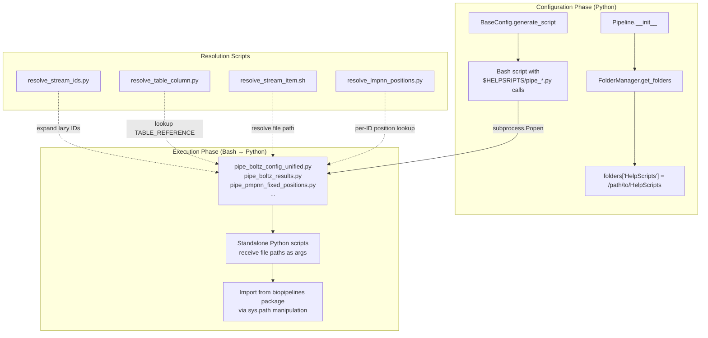

The HelpScripts directory constitutes biopipelines' **runtime execution substrate** — a collection of standalone CLI scripts that bridge the gap between the framework's Python-based configuration phase and its bash-script execution phase. When a pipeline tool's `generate_script()` method emits a bash script, the actual computational work is delegated to these HelpScripts, which are invoked as subprocesses with file-path arguments rather than in-memory Python objects. This separation ensures that every pipeline step, whether executed interactively in a notebook or on a SLURM cluster, runs through a uniform, reproducible runtime interface.

Sources: [folders.py](biopipelines/folders.py#L37-L198), [pipeline.py](biopipelines/pipeline.py#L347-L408)

## Architectural Position

HelpScripts occupy a distinct layer between the framework core and the external tools. During configuration time, `BaseConfig` subclasses define parameters, resolve dependencies, and predict outputs entirely within Python. At execution time, the generated bash script replaces all of that in-memory state with **file paths and CLI arguments**, executing HelpScripts as isolated processes. The `FolderManager` injects the `HelpScripts` folder path into every pipeline's folder dictionary, which tool configs then reference via `self.folders["HelpScripts"]` to construct absolute paths to their associated scripts.

Sources: [boltz2.py](biopipelines/boltz2.py#L101-L103), [folders.py](biopipelines/folders.py#L182-L189)



## Script Taxonomy

The 60+ scripts in `HelpScripts/` fall into three functional categories, each serving a different role in the runtime lifecycle.

### Pipeline Stage Scripts (`pipe_*.py`)

These are the primary workhorses — computationally intensive Python scripts that implement the core logic for individual pipeline stages. Each is a standalone argparse-based CLI program that receives absolute file paths, processes data, and writes output files to designated locations. They are **generated** by tool configs but **executed** as independent processes, meaning they must reconstruct any needed context from the filesystem alone.

| Script | Purpose | Key Imports from biopipelines |
|--------|---------|------------------------------|
| `pipe_boltz_config_unified.py` | Generates Boltz2 YAML configs for all combinatorics input combinations | `combinatorics.predict_single_output_id`, `CombinatoricsConfig` |
| `pipe_boltz_results.py` | Rearranges Boltz2 outputs, ranks models, generates PyMOL sessions | pandas, json, csv (standalone) |
| `pipe_boltz_postprocessing.py` | Extracts confidence metrics, affinity scores, and sequences from predictions | — |
| `pipe_pmpnn_fixed_positions.py` | Establishes fixed/designed residue selections for ProteinMPNN from structures | `pdb_parser`, `biopipelines_io`, `sele_utils` |
| `pipe_alphafold_msas.py` | Creates MSA CSV table from AlphaFold `.a3m` output files | pandas (standalone) |
| `pipe_compound_library.py` | Handles SMILES library generation, validation, deduplication, and filtering | rdkit (optional) |
| `pipe_boltzgen.py` | BoltzGen postprocessing: structure collection, sequence extraction, table conversion | Bio.PDB (optional) |
| `pipe_gnina.py` | Molecular docking result processing and scoring | — |
| `pipe_filter_execution.py` | Executes filtering logic based on metric thresholds | — |
| `pipe_mutation_composer.py` | Composes mutation variants from combinatorial specifications | — |

Sources: [pipe_boltz_config_unified.py](HelpScripts/pipe_boltz_config_unified.py#L1-L46), [pipe_pmpnn_fixed_positions.py](HelpScripts/pipe_pmpnn_fixed_positions.py#L10-L36), [pipe_alphafold_msas.py](HelpScripts/pipe_alphafold_msas.py#L1-L79), [pipe_compound_library.py](HelpScripts/pipe_compound_library.py#L1-L50)

### Resolution Scripts (`resolve_*.py` / `resolve_*.sh`)

These are lightweight lookup utilities that resolve references at runtime — expanding lazy ID patterns, looking up table column values, and retrieving per-item data from DataStream JSON files. They are designed to be **sourced or called inline** within bash scripts, typically via command substitution (`$(python resolve_... args)`).

| Script | Input | Output | Pattern |
|--------|-------|--------|---------|
| `resolve_stream_ids.py` | DataStream JSON path | Expanded IDs (one per line, stdout) | Handles lazy patterns via runtime mode |
| `resolve_stream_item.sh` | DataStream JSON + item_id | Resolved file path (stdout) | Bash function sourced inline |
| `resolve_table_column.py` | `TABLE_REFERENCE:path:column` + item_id | Cell value (stdout) | Delegates to `biopipelines_io` |
| `resolve_lmpnn_positions.py` | Positions JSON + struct_id | Two lines: fixed_option, redesigned_option | Minimal JSON lookup |
| `resolve_stream_ids.py` uses `load_datastream` in runtime mode, which triggers lazy ID expansion against the `map_table` — the same mechanism used during configuration-time provenance tracking but deferred to the point of actual execution. |

Sources: [resolve_stream_ids.py](HelpScripts/resolve_stream_ids.py#L1-L23), [resolve_stream_item.sh](HelpScripts/resolve_stream_item.sh#L1-L27), [resolve_table_column.py](HelpScripts/resolve_table_column.py#L1-L32), [resolve_lmpnn_positions.py](HelpScripts/resolve_lmpnn_positions.py#L1-L24)

### Service Scripts (`.sh`)

Long-running or daemon-style shell scripts that provide shared infrastructure services. The MMseqs2 client/server pair implements a job-queue architecture for distributed MSA generation across compute nodes.

| Script | Role | Execution Context |
|--------|------|-------------------|
| `mmseqs2_server_gpu.sh` | MSA generation server with GPU-accelerated MMseqs2 search | SLURM job (persistent) |
| `mmseqs2_client.sh` | Client that submits sequences and polls for results | Inline in pipeline bash script |

The MMseqs2 server script uses a `require_folder()` pattern that resolves folder paths via environment variables first, then falls back to `biopipelines-config folder <key>` — providing a two-tier resolution strategy that works both in interactive and SLURM contexts.

Sources: [mmseqs2_server_gpu.sh](HelpScripts/mmseqs2_server_gpu.sh#L22-L49), [mmseqs2_client.sh](HelpScripts/mmseqs2_client.sh#L12-C44)

## Runtime Invocation Mechanism

The complete lifecycle of a HelpScript execution follows a precise sequence. When a tool is registered with a pipeline, `Pipeline._auto_register()` configures its inputs and creates a step-numbered output folder ([pipeline.py#L308-L323](biopipelines/pipeline.py#L308-L323)). During `save()` or on-the-fly execution, `BaseConfig.generate_script()` produces a bash script that references HelpScripts via the `HELPSCRIPTS` variable (injected by the pipeline script generator). The resulting bash script contains lines like:

```bash
HELPSCRIPTS="/absolute/path/to/HelpScripts"
python "$HELPSCRIPTS/pipe_boltz_config_unified.py" \
    "/runtime/001_Boltz2/combininatorics_config.json" \
    "/runtime/001_Boltz2/queries.csv" \
    ...
```

In on-the-fly mode, `Pipeline._execute_tool_on_the_fly()` writes this script to disk, makes it executable, and invokes it via `subprocess.Popen` with line-buffered streaming — enabling real-time output visibility in notebooks while simultaneously writing to log files ([pipeline.py#L381-C404](biopipelines/pipeline.py#L381-L404)). If the process exits with a non-zero code, a `RuntimeError` is raised immediately.

> [!TIP]
> **HelpScripts are stateless** — they receive no in-memory Python objects. All context must be serialized to files (JSON, CSV, YAML) during configuration time and deserialized by the script at runtime. This is the fundamental constraint that enables cluster execution: any state an `execute`-mode user can create, a `save`-and-submit user can also reproduce.

> [!TIP]
> **Resolution scripts are the glue between bash loops and Python data structures.** When a generated bash script needs to iterate over DataStream IDs or look up per-item values, it calls `resolve_*.py` via command substitution rather than embedding Python logic inline. This keeps the generated bash script readable and the resolution logic centralized.

## Integration Pattern with BaseConfig

Every `BaseConfig` subclass that requires runtime processing declares HelpScript paths as `Path` descriptors. The `Boltz2` config exemplifies this pattern comprehensively:

```python
boltz_config_unified_py = Path(lambda self: os.path.join(
    self.folders["HelpScripts"], "pipe_boltz_config_unified.py"))
boltz_postprocessing_py = Path(lambda self: os.path.join(
    self.folders["HelpScripts"], "pipe_boltz_postprocessing.py"))
boltz_msa_copy_py = Path(lambda self: os.path.join(
    self.folders["HelpScripts"], "pipe_boltz_msa_copy.py"))
```

These lazy-evaluated path descriptors resolve at script-generation time, after `set_pipeline_context()` has populated `self.folders`. The `generate_script()` method then interpolates these paths into the bash template, producing a self-contained execution script with no runtime dependency on the Python pipeline context.

Sources: [boltz2.py](biopipelines/boltz2.py#L101-L103), [base_config.py](biopipelines/base_config.py#L437-L443)

## Package Import Convention

HelpScripts that need access to the `biopipelines` package use a consistent import bootstrap pattern — inserting the parent directory of `HelpScripts/` (i.e., the repository root) into `sys.path`:

```python
_biopipelines_dir = os.path.join(os.path.dirname(os.path.abspath(__file__)), '..', 'biopipelines')
sys.path.insert(0, _biopipelines_dir)
from biopipelines.combinatorics import predict_single_output_id
```

This allows HelpScripts to import from the framework's internal modules (`combinatorics`, `biopipelines_io`, `pdb_parser`, `sele_utils`) while remaining executable as standalone scripts outside any package context. The approach is deliberately redundant with proper package installation — it ensures scripts work even when `biopipelines` is not pip-installed, which is the common case during SLURM execution where scripts run from the repository checkout.

Sources: [pipe_boltz_config_unified.py](HelpScripts/pipe_boltz_config_unified.py#L30-L32), [pipe_pmpnn_fixed_positions.py](HelpScripts/pipe_pmpnn_fixed_positions.py#L11-L13), [resolve_stream_ids.py](HelpScripts/resolve_stream_ids.py#L17-L19)

## Summary: HelpScripts as the Serialization Boundary

The HelpScripts layer is not an implementation detail — it is the **architectural serialization boundary** between biopipelines' rich Python configuration model and its bash-script execution model. By constraining all runtime computation to standalone CLI scripts that communicate exclusively through the filesystem, the framework achieves three critical properties: (1) **reproducibility** — every pipeline step is a deterministic function of input files and CLI arguments; (2) **portability** — the same bash scripts run identically on a laptop, a Jupyter notebook, or a SLURM cluster; and (3) **debuggability** — any pipeline step can be inspected, rerun, or modified by editing a single self-contained script in the `runtime/` folder.

For a deeper understanding of how HelpScripts are *generated* and *orchestrated*, see [Pipeline Orchestration Engine](18-helpscripts-runtime-layer). For the data structures that flow through these scripts, see [DataStream: Unified I/O Container](7-datastream-unified-i-o-container). For details on how tools define their script-generation logic, see [BaseConfig: Tool Abstraction Layer](8-baseconfig-tool-abstraction-layer).