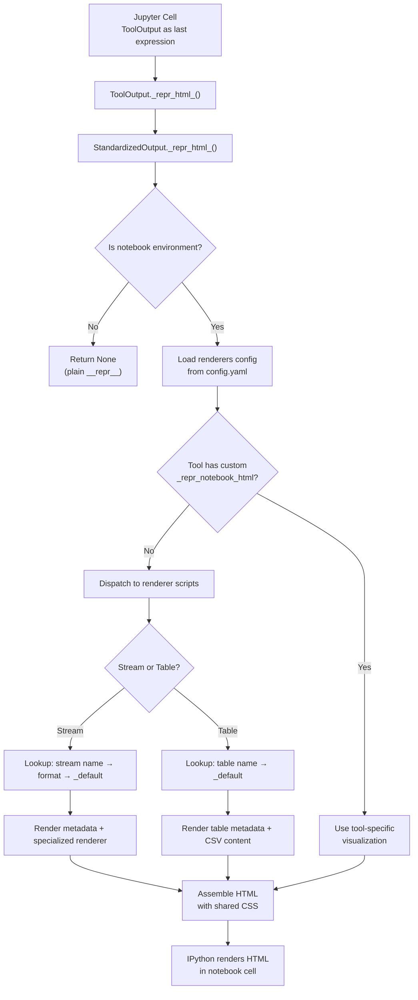

The Jupyter Renderer System transforms raw pipeline output data into rich, interactive HTML visualizations directly within notebook cells. Rather than requiring separate plotting or inspection scripts, it leverages IPython's `_repr_html_()` display protocol so that any `ToolOutput` or `StandardizedOutput` object automatically renders as formatted HTML when it appears as the last expression in a cell. This system is the bridge between the pipeline's data layer — `DataStream` objects, `TableInfo` metadata, and file-based outputs — and the developer's visual inspection workflow.

## Rendering Architecture

The system follows a configuration-driven dispatch model. A central renderer registry in `config.yaml` maps stream formats and table names to Python scripts under `Renderers/`. When a `StandardizedOutput` needs to display itself, it loads the registry, matches each output stream or table to the appropriate renderer script, and calls the script's `render()` function to produce HTML fragments. These fragments are assembled with a shared CSS stylesheet into a single HTML string that the notebook frontend renders inline.



The entry point is `StandardizedOutput._repr_html_()` in [biopipelines/base_config.py](biopipelines/base_config.py#L1521-L1645). It first checks whether the code is running inside a notebook or Colab environment via `_is_notebook()` — if not, it returns `None` and IPython falls back to the plain-text `__repr__()`. Within a notebook, it loads the renderer configuration, iterates over all active streams and tables, dispatches each to the matched renderer, and concatenates the results.

Sources: [biopipelines/base_config.py](biopipelines/base_config.py#L1521-L1645), [config.yaml](config.yaml#L169-L188)

## Configuration and Dispatch Registry

Renderer mappings live under the `renderers` key in `config.yaml`. The configuration has two sections — `streams` and `tables` — each containing key-value pairs where keys are format identifiers or stream/table names, and values are paths to Python scripts relative to the repository root.

```yaml
renderers:
  streams:
    _metadata: Renderers/streams.py
    pdb: Renderers/structures.py
    cif: Renderers/structures.py
    "pdb|cif": Renderers/structures.py
    png: Renderers/images.py
    jpg: Renderers/images.py
    jpeg: Renderers/images.py
    svg: Renderers/images.py
    gif: Renderers/images.py
    bmp: Renderers/images.py
    tiff: Renderers/images.py
    webp: Renderers/images.py
    plots: Renderers/plots.py
    fasta: Renderers/fasta.py
    fa: Renderers/fasta.py
    _default: Renderers/streams.py
  tables:
    _default: Renderers/tables.py
```

The `_metadata` key plays a special role: when a specialized renderer is matched for a stream (e.g., `pdb` → `Renderers/structures.py`), the system first renders the stream's metadata using the `_metadata` script, then appends the specialized renderer's output. This ensures every stream always displays its summary table (name, format, item count, map_table) regardless of which visual renderer handles the data itself.

The lookup priority for streams follows a three-tier fallback: **stream name** → **format string** → **format.lower()** → **`_default`**. This means you can register a renderer by stream name (e.g., if a tool creates a stream named `plots`), by its format (e.g., `pdb`), or rely on the catch-all default. For tables, the lookup is simpler: **table name** → **`_default`**.

Sources: [config.yaml](config.yaml#L169-L188), [biopipelines/base_config.py](biopipelines/base_config.py#L1489-L1520)

## Renderer Module Contract

Every renderer script under `Renderers/` must expose a top-level `render()` function with a consistent signature. The system loads these scripts dynamically using `importlib.util` and caches the loaded `render()` function in `StandardizedOutput._renderer_cache` to avoid redundant imports when the same renderer is invoked for multiple streams in a single cell output.

```python
# Renderer contract — every Renderers/*.py file must follow this pattern:
def render(stream_or_table_info, output):
    """
    Args:
        stream_or_table_info: DataStream (for stream renderers)
                              or TableInfo (for table renderers)
        output: StandardizedOutput — provides output_folder,
                rendering_parameters, and other context
    Returns:
        str — HTML fragment, or empty string / None to skip
    """
    ...
```

The renderer caching mechanism in `_load_render_fn()` resolves each script path to a module, extracts its `render` function, and stores it in the class-level `_renderer_cache` dictionary. Subsequent calls with the same path retrieve the cached function directly, which is critical when a notebook cell output contains many streams of the same format.

Sources: [biopipelines/base_config.py](biopipelines/base_config.py#L1476-L1488)

## Stream Renderers

### Default Metadata Renderer (`Renderers/streams.py`)

The default stream renderer serves two purposes: it acts as the `_metadata` pre-renderer for all streams, and it is the fallback visual renderer via the `_default` key. It produces a metadata table showing the stream's name, format, item count, map_table path, pattern status, and any metadata key-value pairs. Below the metadata, it renders the stream's actual data — either from the map_table CSV (if present) or as an id/file pairing table — using the same compact 2+…+2 row truncation pattern used across all table renderers.

The `_rel()` helper function in this renderer (and in `Renderers/tables.py`) converts absolute file paths to relative paths using the `<output_folder>/` prefix for cleaner display within notebook cells.

Sources: [Renderers/streams.py](Renderers/streams.py#L1-L109)

### 3D Structure Viewer (`Renderers/structures.py`)

The most feature-rich renderer in the system. It handles streams with formats `pdb`, `cif`, or the compound format `pdb|cif`, producing a fully interactive 3D molecular viewer powered by **py3Dmol** (loaded from a CDN). The renderer reads each structure file, embeds the atomic data as JSON literals directly in the generated JavaScript, and constructs a complete single-file HTML widget.

**Interactive controls** include a style toolbar with four molecular representations (cartoon, stick, sphere, surface), a ligand display toggle with three states (element coloring, pLDDT coloring, off), a spin toggle for continuous rotation, and navigation arrows for browsing through structures in the stream. Each structure also has a download button that creates a Blob URL for the current model's raw PDB/CIF text.

The viewer supports **pLDDT confidence coloring** for AlphaFold/Boltz predictions. When `rendering_parameters` on the output contain a `plddt_upper` value for the stream, the renderer activates a B-factor-based color function that maps residues to the standard AF confidence palette (blue ≥90%, cyan 70–90%, yellow 50–70%, orange <50%). A color legend is shown below the viewer when pLDDT mode is active. The pLDDT threshold scales linearly — a structure with `plddt_upper: 50` remaps the color boundaries proportionally, accommodating tools that normalize B-factors to different ranges.

Structures are capped at 50 items with a truncation notice, and format detection for `pdb|cif` streams inspects individual file extensions rather than assuming a uniform format across the entire stream.

Sources: [Renderers/structures.py](Renderers/structures.py#L8-L319)

### Image Renderer (`Renderers/images.py`)

Handles raster and vector image formats (png, jpg, jpeg, svg, gif, bmp, tiff, webp). For SVG files, it reads the raw markup and embeds it directly in the HTML, preserving scalability. For all other formats, it encodes the binary file contents as a base64 data URI with the appropriate MIME type (`image/png`, `image/jpeg`, etc.). Each image is displayed with its item ID as a caption above it, wrapped in a responsive container that constrains width to 100%.

Sources: [Renderers/images.py](Renderers/images.py#L1-L50)

### Plot Renderer (`Renderers/plots.py`)

A specialized renderer for plot-type streams. It reads each PNG image as base64 (like the generic image renderer) but adds a distinctive feature: it automatically discovers a **companion CSV file** at the same path with a `.csv` extension. If found, the CSV is parsed into a DataFrame and rendered as a compact HTML table alongside the plot image in a side-by-side flexbox layout — table on the left, image on the right. This layout is particularly useful for analysis tools like `Distance`, `Angle`, or `SequenceMetricCorrelation` that produce both a visualization and the underlying numerical data.

Sources: [Renderers/plots.py](Renderers/plots.py#L1-L101)

### FASTA Renderer (`Renderers/fasta.py`)

Renders FASTA sequence data as inline, colored, monospace sequence blocks following ClustalX conventions. The renderer parses the first valid FASTA file in the stream, auto-detects whether sequences are nucleotide or amino acid based on character composition, and applies the appropriate color palette. Amino acids are colored by property (hydrophobic = blue, positive = red, negative = magenta, polar = green, glycine = orange, proline = yellow, aromatic = cyan), while nucleotides use distinct colors for A, T/U, G, and C.

The display is capped at 50 sequences and 300 residues per line, with truncation notices where applicable. Gap characters (`-`, `.`) receive a neutral gray background. Sequence IDs are left-padded for alignment, creating a clean alignment-like visual block.

Sources: [Renderers/fasta.py](Renderers/fasta.py#L7-L140)

## Table Renderer (`Renderers/tables.py`)

The table renderer handles `TableInfo` objects (not `DataStream` objects). It renders a horizontal metadata row showing the table's name, path, column list, description, and row count, followed by the actual CSV content as an HTML table. Like the stream renderers, it uses the compact 2+…+2 row truncation pattern: when the table has more than 4 rows, only the first two and last two rows are displayed with an ellipsis row showing the count of hidden rows.

Sources: [Renderers/tables.py](Renderers/tables.py#L1-L87)

## Shared Visual Patterns

Several patterns recur across the renderer system and constitute its visual language:

**Compact truncation** is applied universally. Both stream data tables and table CSV content use the same algorithm: if the item count exceeds 4, display rows at indices 0, 1, n-2, n-1 with an ellipsis row after index 1 showing `"... N more ..."`. Individual cell values longer than 60 characters are truncated with `...` suffix.

**CSS class system** is centralized in `StandardizedOutput._CSS`. All renderers produce HTML using three CSS classes: `bp-table` for data tables (with alternating row backgrounds via `:nth-child(even)`), `bp-section` for top-level content blocks, and `bp-section-title` for section headings. The `bp-ellipsis` class styles truncation notice rows with italic gray text and centered alignment.

**Tool-specific override** is supported via a backward-compatibility hook. If a tool's `BaseConfig` subclass defines a `_repr_notebook_html(self, output)` method, the dispatch system calls it before the standard stream-by-stream rendering. If the method returns non-empty HTML, the entire standard rendering is skipped in favor of the tool's custom visualization. This allows individual tools to provide bespoke layouts — for example, a tool might want to render a specific matplotlib figure alongside its standard stream output.

Sources: [biopipelines/base_config.py](biopipelines/base_config.py#L1511-L1520), [Renderers/tables.py](Renderers/tables.py#L15-L47)

## Renderer Summary

| Renderer Script | Triggered By | Input Type | Output Format | Key Capability |
|---|---|---|---|---|
| `Renderers/streams.py` | `_metadata`, `_default` | `DataStream` | Metadata + data table | Universal fallback for any stream |
| `Renderers/structures.py` | `pdb`, `cif`, `pdb\|cif` | `DataStream` | Interactive 3D widget | py3Dmol viewer with pLDDT coloring, navigation, download |
| `Renderers/images.py` | `png`, `jpg`, `jpeg`, `svg`, `gif`, `bmp`, `tiff`, `webp` | `DataStream` | Inline images | SVG passthrough, base64 raster, responsive layout |
| `Renderers/plots.py` | `plots` (by name) | `DataStream` | Image + companion CSV | Side-by-side plot/table layout |
| `Renderers/fasta.py` | `fasta`, `fa` | `DataStream` | Colored sequence block | ClustalX coloring, auto nucleotide/protein detection |
| `Renderers/tables.py` | `_default` | `TableInfo` | Metadata + CSV table | Named column display, compact truncation |

## Extending the Renderer System

To add a new renderer, create a Python file in `Renderers/` following the module contract (a `render(stream, output)` function returning HTML), then register it in `config.yaml` under the appropriate section. The key you choose determines when the renderer activates — use a format string like `sdf` to intercept all streams of that format, or a stream name to target a specific tool's output. Renderer scripts are loaded lazily and cached, so adding new renderers has no impact on startup performance for pipelines that don't produce the corresponding stream types.

For tools that require highly customized visualization — for instance, a tool that generates a multi-panel matplotlib figure combining structure overlays with scatter plots — the `_repr_notebook_html()` override on the tool's `BaseConfig` subclass provides full control over the HTML output, bypassing the standard dispatch entirely while still receiving the `StandardizedOutput` object for access to all stream and table data.

Sources: [biopipelines/base_config.py](biopipelines/base_config.py#L1582-L1591)

## Related Pages

The renderer system is the visual layer built on top of the data structures produced by pipeline execution. For understanding the data containers it renders, see [DataStream: Unified I/O Container](7-datastream-unified-i-o-container). For how outputs are produced and structured by tools, see [BaseConfig: Tool Abstraction Layer](8-baseconfig-tool-abstraction-layer). For the execution model that triggers output creation, see [Two-Phase Execution Model](9-two-phase-execution-model).