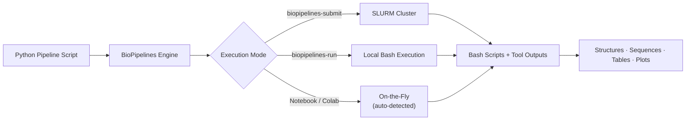
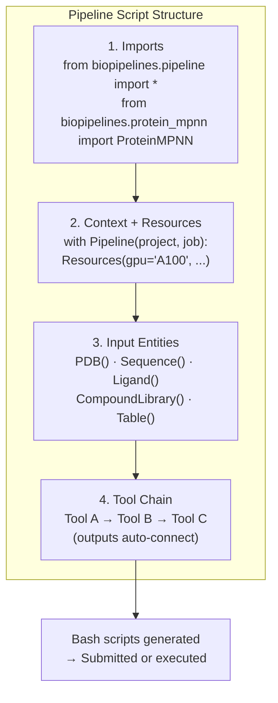

This page walks you through your first BioPipelines pipeline from zero to a working submission. By the end, you will understand the install → configure → write → run cycle and have a running inverse folding example. For deeper installation details, see [Installation and Environment Setup](3-installation-and-environment-setup); for Colab-specific guidance, see [Google Colab Notebooks Guide](4-google-colab-notebooks-guide).

## How BioPipelines Works at a Glance

BioPipelines does **not** execute bioinformatics tools directly. Instead, you write a declarative Python script that chains tool configurations together. When you run that script, BioPipelines **generates bash scripts and predicts output file paths** — a configuration phase. Those scripts are then either submitted to a SLURM cluster or executed interactively in a Jupyter notebook. This separation is the key architectural idea behind the framework.



The pipeline script you write has two responsibilities: **declare tool inputs and parameters**, and **connect outputs to downstream inputs**. The framework handles environment switching, dependency ordering, filesystem layout, and SLURM resource management.

Sources: [pipeline.py](biopipelines/pipeline.py#L42-L48), [UserManual.md](Docs/UserManual.md#L159-L173)

## Step 1 — Install BioPipelines

### Cluster Installation (conda / mamba)

Clone the repository, create the conda environment, and install the package in editable mode. Editable installation means `git pull` updates take effect immediately without reinstalling.

```bash
# 1. Clone and enter the repository
git clone https://github.com/locbp-uzh/biopipelines
cd biopipelines

# 2. Create the base environment (contains pyyaml, pandas, ipykernel, etc.)
mamba env create -f Environments/biopipelines.yaml
mamba activate biopipelines

# 3. Install in editable mode
pip install -e .

# 4. Register as a Jupyter kernel (optional, for notebooks)
ipython kernel install --user --name biopipelines
```

> [!TIP]
> If your cluster allocates low memory to the default shell (causing `std_alloc` errors during environment creation), run the entire procedure inside an interactive SLURM session: `srun --mem=16GB --time=1:00:00 --pty bash`.

Sources: [UserManual.md](Docs/UserManual.md#L49-L72), [pyproject.toml](pyproject.toml#L1-L37)

### Google Colab Installation

Colab requires no cluster — BioPipelines auto-detects the Colab environment and loads `colab.yaml` instead of `config.yaml`. Tools are installed via `micromamba` into isolated environments. Run these cells at the top of your notebook:

```python
# Cell 1: Install BioPipelines and micromamba
!git clone https://github.com/locbp-uzh/biopipelines
%cd biopipelines
!pip install -e ".[all]"
!wget -q https://github.com/mamba-org/micromamba-releases/releases/latest/download/micromamba-linux-64 -O /usr/local/bin/micromamba && chmod +x /usr/local/bin/micromamba
!micromamba create -f Environments/biopipelines.yaml -y
```

```python
# Cell 2: Install the specific tools you need (one-time per session)
from biopipelines.pipeline import *
from biopipelines.rfdiffusion import RFdiffusion

with Pipeline("Setup", "install", description="Install tools"):
    RFdiffusion.install()
```

Sources: [UserManual.md](Docs/UserManual.md#L73-L127), [index.md](Docs/index.md#L1-L101)

## Step 2 — Configure Your Environment

Before running any pipeline, edit `config.yaml` at the repository root to match your system. The two critical sections are:

| Section | Purpose | What to change |
|---------|---------|----------------|
| `folders.base` | Define home, scratch, and group paths | Set `<username>` or hardcode paths |
| `environments` | Map each tool to its conda environment name | Ensure environment names match your system |

```yaml
# config.yaml — key sections to review
folders:
  base:
    home: "/home/<username>"
    data: "<home>/data"
    scratch: "/scratch/<username>"
    group: "/shares/locbp.chem.uzh"     # ← your group share
    biopipelines_output: "<user>/BioPipelines"

cluster:
  env_manager: "mamba"                  # "mamba" or "conda"
  slurm_modules:                        # module load commands for SLURM
    - "miniforge3"
    - "apptainer"
```

Use `bp-config show` to verify the fully resolved configuration after editing:

```bash
bp-config show    # prints all resolved paths and environment names
```

Individual tool models (AlphaFold, RFdiffusion, Boltz2, etc.) must be installed separately. The repository provides an automated installer:

```bash
cd ExamplePipelines
biopipelines-submit install_tools.py
```

Refer to each tool's official documentation if your cluster requires custom adjustments.

Sources: [config.yaml](config.yaml#L1-L188), [UserManual.md](Docs/UserManual.md#L556-L585)

## Step 3 — Write Your First Pipeline

A BioPipelines pipeline follows a consistent pattern: **create a context → declare resources → chain tools → let the framework handle execution**. Every tool is a Python class whose constructor defines its inputs and parameters. Outputs are returned as structured objects that you pass directly to the next tool.

Here is the complete inverse folding example from [ExamplePipelines/ubiquitin.py](ExamplePipelines/ubiquitin.py):

```python
from biopipelines.pipeline import *
from biopipelines.protein_mpnn import ProteinMPNN
from biopipelines.alphafold import AlphaFold
from biopipelines.conformational_change import ConformationalChange
from biopipelines.panda import Panda
from biopipelines.dna_encoder import DNAEncoder

with Pipeline(project="Ubiquitin", job="InverseFolding"):
    Resources(gpu="A100", time="4:00:00", memory="16GB")

    # Step 1: Fetch a structure from RCSB (chain E of 4LCD)
    ubiquitin = PDB("4LCD", chain="E")

    # Step 2: Design 10 new sequences with ProteinMPNN
    sequences = ProteinMPNN(structures=ubiquitin,
                            num_sequences=10,
                            soluble_model=True)

    # Step 3: Predict folded structures with AlphaFold
    folded = AlphaFold(proteins=sequences)

    # Step 4: Calculate structural deviation from the original
    conf_change = ConformationalChange(reference_structures=ubiquitin,
                                       target_structures=folded)

    # Step 5: Filter — keep only sequences with RMSD < 1.5 Å and pLDDT > 80
    filtered_sequences = Panda(tables=[folded.tables.confidence,
                                       conf_change.tables.changes],
                               operations=[Panda.merge(),
                                           Panda.filter("RMSD < 1.5 and plddt > 80")],
                               pool=sequences)

    # Step 6: Generate optimized DNA coding sequences
    dna = DNAEncoder(sequences=filtered_sequences, organism="EC")
```


Let's break down the key structural elements in this script:

**Pipeline context** — The `with Pipeline(...)` block creates a named, versioned job. The `project` and `job` parameters determine the output folder hierarchy: `<biopipelines_output>/<project>/<job>_001/`. Re-running the same pipeline increments the suffix automatically ([_save_original_pipeline_script](biopipelines/pipeline.py#L1361-L1367)).

**Resources()** — Declares SLURM requirements (GPU type, memory, time). When using multiple `Resources()` calls, the pipeline is split into sequential batches where later batches wait for earlier ones to complete ([Resources](biopipelines/pipeline.py#L1421-L1449)).

**Tool chaining** — Each tool returns a `ToolOutput` object containing **streams** (file-backed data like structures, sequences, compounds) and **tables** (CSV metadata like confidence scores, affinities). You pass these outputs directly into the next tool's constructor. The framework resolves all paths and dependencies automatically ([_auto_register](biopipelines/pipeline.py#L277-L346)).

**Panda for filtering** — The `Panda` tool provides pandas-style operations (filter, sort, merge, concat). When you pass `pool=sequences`, Panda copies the structures matching filtered IDs into its own output, creating a ready-to-use filtered result ([UserManual.md](Docs/UserManual.md#L499-L555)).

Sources: [ubiquitin.py](ExamplePipelines/ubiquitin.py#L1-L44), [pipeline.py](biopipelines/pipeline.py#L50-L50), [pipeline.py](biopipelines/pipeline.py#L913-L987)

## Step 4 — Run the Pipeline

### Option A: Submit to SLURM Cluster

The recommended path for production workloads. BioPipelines generates a bash script and submits it via `sbatch`:

```bash
# From any directory (biopipelines env must be activated)
biopipelines-submit ExamplePipelines/ubiquitin.py

# Or from the repository root, using the shell script
./submit ExamplePipelines/ubiquitin.py

# Verbose mode shows full generation output
biopipelines-submit -v ExamplePipelines/ubiquitin.py
```

You can also submit from a Jupyter notebook:

```bash
biopipelines-submit ExamplePipelines/notebooks/ubiquitin.ipynb
```

### Option B: Run Locally

Execute the generated bash scripts directly on the current machine without SLURM:

```bash
biopipelines-run ExamplePipelines/ubiquitin.py
./run ExamplePipelines/ubiquitin.py
```

### Option C: On-the-Fly (Jupyter / Colab)

On-the-fly execution is **automatically enabled** inside Jupyter notebooks and Google Colab. Tools run sequentially as they are added — no `with` block or `Resources()` required. The pipeline context persists across notebook cells:

```python
# Cell 1: First tools execute immediately
Pipeline("Test", "quick_run")
protein = PDB("168L")
rfd = RFdiffusion(pdb=protein, contigs='50-70/A81-140', num_designs=3)
# ← rfd is already complete at this point

# Cell 2: Continue building on previous results
pmpnn = ProteinMPNN(structures=rfd, num_sequences=2)
# ← pmpnn is already complete
```

### Execution Modes at a Glance

| Feature | `biopipelines-submit` | `biopipelines-run` | On-the-Fly (Notebook) |
|---------|:---:|:---:|:---:|
| SLURM job scheduling | ✅ | ❌ | ❌ |
| Environment auto-switching | ✅ | ✅ | ✅ |
| Interactive / step-by-step | ❌ | ❌ | ✅ |
| GPU resource management | ✅ | Manual | Colab-assigned |
| Requires `with` block | ✅ | ✅ | Optional |
| Requires `Resources()` | ✅ | Ignored | Optional |
| Completion check (skip done) | ✅ | ✅ | ✅ |
| Output location | Config-defined | Config-defined | `./BioPipelines/` |

Sources: [cli.py](biopipelines/cli.py#L99-L106), [submit](submit#L1-L50), [run](run#L1-L50), [UserManual.md](Docs/UserManual.md#L423-L460)

## Step 5 — Understand the Output

After a pipeline runs, all artifacts are organized in a deterministic folder structure:

```
<biopipelines_output>/<project>/<job>_001/
├── RunTime/                    # Generated execution scripts
│   ├── pipeline.sh             # Main pipeline script
│   ├── 001_PDB.sh              # Per-tool execution scripts
│   ├── 002_ProteinMPNN.sh
│   └── slurm.sh                # SLURM wrapper (cluster mode)
├── Logs/                       # Execution logs
│   ├── 001_PDB.log
│   └── 002_ProteinMPNN.log
├── ToolOutputs/                # Output predictions (JSON metadata)
│   ├── 001_PDB.json
│   └── 002_ProteinMPNN.json
├── 001_PDB/                    # Actual tool outputs
│   ├── .expected_outputs.json
│   └── 4LCD_E.pdb
└── 002_ProteinMPNN/
    ├── .expected_outputs.json
    └── seqs/ ...
```

When things go wrong, check `Logs/<NNN>_<tool>.log` for the relevant tool's stderr and stdout output.

Sources: [UserManual.md](Docs/UserManual.md#L556-L585)

## Anatomy of a Pipeline Script

Every BioPipelines script, regardless of complexity, is built from four composable ingredients:



**Input entities** are the starting points for data. They resolve to files and metadata that downstream tools consume:

| Entity | Purpose | Example |
|--------|---------|---------|
| `PDB` | Fetch structures from local folder or RCSB | `PDB("4LCD", chain="E")` |
| `Sequence` | Define protein/DNA/RNA sequences | `Sequence("MKTVRQ...", ids="my_protein")` |
| `Ligand` | Fetch small molecules from CCD, PubChem, or SMILES | `Ligand("ATP")` |
| `CompoundLibrary` | Create compound collections with optional expansion | `CompoundLibrary({"asp": "CC(=O)O..."})` |
| `Table` | Load existing CSV files for filtering/merging | `Table("/path/to/metrics.csv")` |

> [!TIP]
> For models that accept PDB paths, sequences, or SMILES as parameters, **always use the entity objects** (`PDB`, `Sequence`, `Ligand`) rather than raw strings. This ensures consistent file resolution and ID tracking across the entire pipeline.

Sources: [UserManual.md](Docs/UserManual.md#L223-L329), [pipeline.py](biopipelines/pipeline.py#L1420-L1479)

## More Examples to Explore

The [ExamplePipelines/](ExamplePipelines/) folder contains 20+ ready-to-run pipelines covering the full spectrum of BioPipelines capabilities. Here are the most instructive starting points beyond ubiquitin:

| Example | File | What It Demonstrates |
|---------|------|---------------------|
| **Boltz2 Showcase** | `boltz2.py` | All Boltz2 input modes: sequences, PDB, ligands, DNA, glycosylation, covalent linkages, combinatorics |
| **Compound Screening** | `compound_screening.py` | Protein–DNA–ligand co-folding with `CompoundLibrary` from CDXML, `Bundle`/`Each` combinatorics |
| **Iterative Optimization** | `iterative_binding_optimization.py` | Multi-cycle directed evolution loop with LigandMPNN, MutationProfiler, MutationComposer |
| **RFdiffusion + MPNN + AF2** | `rfd_pmpnn_af2_one_line.py` | De novo backbone generation → sequence design → structure prediction in one pipeline |
| **FRET Biosensor** | `FRET.py` | Linker length optimization with angle-based filtering for a biosensor design |
| **Kinase LID Redesign** | `kinase_LID_redesign.py` | Domain redesign with RFdiffusion, ProteinMPNN, and conformational analysis |

Each example has a corresponding **results notebook** in `ExamplePipelines/notebooks/` with output rendered inline, and most have an **Open in Colab** badge in the [README](README.md#L10-L20) for zero-setup exploration.


Sources: [README.md](README.md#L10-L20), [examples.md](Docs/examples.md#L1-L306)

## CLI Commands Reference

BioPipelines installs four command-line entry points when you run `pip install -e .`:

| Command | Alias | Purpose |
|---------|-------|---------|
| `biopipelines-submit` | `bp-submit` | Generate scripts and submit to SLURM |
| `biopipelines-run` | `bp-run` | Generate scripts and execute locally |
| `biopipelines-otf` | `bp-otf` | Submit on-the-fly job to SLURM (runs immediately, survives disconnect) |
| `biopipelines-config` | `bp-config` | Inspect resolved configuration (paths, environments, cluster settings) |

```bash
# Verify your setup
bp-config show         # Full resolved configuration
bp-config folder PDBs  # Check a specific folder path
bp-config env AlphaFold  # Check a specific tool's environment

# Run with verbose output for debugging
bp-submit -v ExamplePipelines/ubiquitin.py
bp-run -v ExamplePipelines/ubiquitin.py
```

Sources: [pyproject.toml](pyproject.toml#L22-L29), [cli.py](biopipelines/cli.py#L5-L10)

## Where to Go Next

Now that you have a working pipeline, these pages will deepen your understanding and expand your capabilities:

- **[Installation and Environment Setup](3-installation-and-environment-setup)** — Detailed environment configuration, tool installation, and troubleshooting for specific clusters
- **[Google Colab Notebooks Guide](4-google-colab-notebooks-guide)** — Complete Colab workflow including GPU setup, tool installation, and session management
- **[Architecture Overview](5-architecture-overview)** — How the Pipeline engine, DataStream, and BaseConfig work together under the hood
- **[DataStream: Unified I/O Container](7-datastream-unified-i-o-container)** — Understanding streams vs. tables, ID tracking, and iteration patterns
- **[Tool Reference](Docs/ToolReference.md)** — Complete parameter reference for all 30+ integrated tools