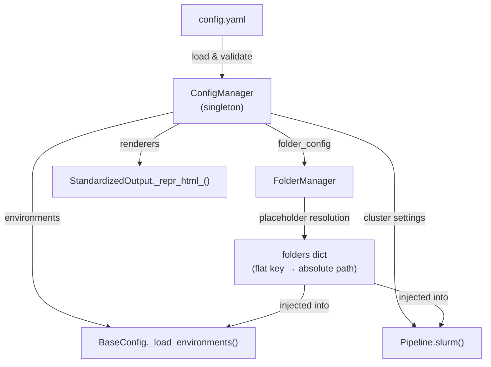

This page provides a complete reference for every section of BioPipelines' `config.yaml`, the mechanism by which folder paths are resolved, and how the `ConfigManager` singleton connects the configuration file to tool environments and SLURM infrastructure. Understanding this file is essential for adapting BioPipelines to any compute environment — from a shared HPC cluster to a local workstation or Google Colab.

## Configuration Architecture

The configuration system follows a three-layer architecture: a **YAML file** declares all paths and settings, a **singleton `ConfigManager`** loads and validates it at runtime, and a **`FolderManager`** resolves the inter-dependent placeholder references into concrete absolute paths. Tools never read `config.yaml` directly — they receive a flat `folders` dictionary and an environment name through `BaseConfig`.



## File Location and Selection Logic

`ConfigManager._get_config_path()` determines which configuration file to load using a priority system. On Google Colab, it first checks for `colab.yaml` in the repository root; if that exists, it is used instead of `config.yaml`. On all other environments, `config.yaml` is the sole configuration file. Both files reside at the repository root level.

Sources: [config_manager.py](biopipelines/config_manager.py#L40-L63)

## Top-Level Sections

`config.yaml` contains six top-level sections. Only `folders` is strictly required — `ConfigManager` raises `ValueError` if it is missing. The remaining sections provide environment mappings, cluster settings, container paths, GNINA-specific runtime configuration, and Jupyter renderer mappings.

| Section | Required | Purpose |
|---------|----------|---------|
| `folders` | Yes | All filesystem path definitions with placeholder syntax |
| `environments` | No | Maps each `TOOL_NAME` to its conda/mamba environment |
| `cluster` | No | HPC deployment settings (email, env_manager, modules) |
| `containers` | No | Singularity/Apptainer image paths per tool |
| `gnina` | No | CUDA module and library path overrides for GNINA |
| `renderers` | No | Jupyter notebook display configuration per stream/table format |

Sources: [config.yaml](config.yaml#L1-L10), [config_manager.py](biopipelines/config_manager.py#L89-L93)

## The `folders` Section

This is the core configuration section. It defines all filesystem paths used across the entire pipeline system using an ordered placeholder resolution scheme.

### Placeholder Syntax

Paths use angle-bracket placeholders to reference other folder keys. For example, `<home>` references the value of `folders.base.home`. At runtime, two special placeholders are injected before resolution begins: `<username>` resolves to the current system user (via `getpass.getuser()`), and `<cwd>` resolves to the repository root directory (parent of `biopipelines/` package).

Sources: [folders.py](biopipelines/folders.py#L79-L91), [config.yaml](config.yaml#L15-L18)

### Resolution Order

`FolderManager` processes subsections in a strict order defined by `SECTION_ORDER`. Placeholders can only reference keys that were defined in an *earlier* section or in the same section (if the referenced key appears earlier within that section). The resolution order is:

1. **base** — fundamental paths (home, data, scratch, group, user, biopipelines, biopipelines_output)
2. **infrastructure** — shared resources (HelpScripts, PDBs, Ligands, Sequences, Tables, cache, containers)
3. **repositories** — tool installation directories (RFdiffusion, Boltz, AlphaFold, etc.)
4. **cache** — shared database/cache paths (BoltzCache, ColabFoldDatabases, MMseqs2Databases)
5. **derived** — computed paths (currently none in default config, reserved for user extensions)
6. **server** — runtime service paths (MMseqs2Server)

The `_resolve_path` method iteratively substitutes `<placeholder>` patterns up to 10 times per path to handle chained references like `<user>` → `<group>/<username>` → `<shares/locbp.chem.uzh>/<username>`, raising `FolderResolutionError` on circular references.

Sources: [folders.py](biopipelines/folders.py#L30-L34), [folders.py](biopipelines/folders.py#L93-L147)

### Runtime-Derived Paths

After config sections are resolved, `FolderManager._setup_runtime_paths()` creates four additional keys that depend on the pipeline's `project` and `job` arguments. These are not configurable via `config.yaml` — they are computed automatically:

| Key | Value |
|-----|-------|
| `project` | `<biopipelines_output>/<project>` |
| `output` | `<project>/<job>_NNN` (auto-incremented) |
| `runtime` | `<output>/RunTime` |
| `logs` | `<output>/Logs` |

Additionally, `job_id` is extracted from the output folder basename (the `NNN` suffix). When `local_output=True`, the `biopipelines_output` key is overridden to point to `./tests/` in the current working directory.

Sources: [folders.py](biopipelines/folders.py#L149-L181)

### Default Configuration Reference

The following table documents every key in the default `folders` section, its template expression, and what it provides:

**base**

| Key | Template | Description |
|-----|----------|-------------|
| `home` | `/home/<username>` | User home directory |
| `data` | `<home>/data` | Local data storage for tool installations |
| `scratch` | `/scratch/<username>` | Temporary scratch storage |
| `group` | `/shares/locbp.chem.uzh` | Shared group storage |
| `user` | `<group>/<username>` | User directory on shared storage |
| `biopipelines` | `<cwd>` | Repository root |
| `biopipelines_output` | `<user>/BioPipelines` | Top-level output directory |

**infrastructure**

| Key | Template | Description |
|-----|----------|-------------|
| `HelpScripts` | `<biopipelines>/HelpScripts` | Helper Python/Bash scripts |
| `PDBs` | `<biopipelines>/PDBs` | Local PDB structure files |
| `Ligands` | `<biopipelines>/Ligands` | Local ligand files |
| `Sequences` | `<biopipelines>/Sequences` | Local sequence files |
| `Tables` | `<biopipelines>/Tables` | Local table (CSV/JSON) files |
| `cache` | `<group>/cache` | Shared cache directory |
| `containers` | `<group>/containers` | Singularity/Apptainer images |

**repositories**

| Key | Template | Tool |
|-----|----------|------|
| `RFdiffusion` | `<data>/RFdiffusion` | RFdiffusion |
| `RFdiffusionAllAtom` | `<data>/rf_diffusion_all_atom` | RFdiffusion All-Atom |
| `RFdiffusion3` | `<data>/rfdiffusion3` | RFdiffusion 3 |
| `ProteinMPNN` | `<data>/ProteinMPNN` | ProteinMPNN |
| `LigandMPNN` | `<data>/LigandMPNN` | LigandMPNN |
| `AlphaFold` | `<data>/localcolabfold` | AlphaFold (LocalColabFold) |
| `Boltz` | `<data>/boltz` | Boltz |
| `BoltzGen` | `<data>/boltzgen` | BoltzGen |
| `GhostFold` | `<data>/ghostfold` | GhostFold |
| `MMseqs2` | `<data>/mmseqs` | MMseqs2 |
| `ModelForge` | `<data>/modelforge` | ModelForge |
| `Gnina` | `<data>/gnina` | GNINA |

**cache**

| Key | Template | Description |
|-----|----------|-------------|
| `BoltzCache` | `<cache>/Boltz` | Boltz model cache |
| `BoltzGenCache` | `<cache>/BoltzGen` | BoltzGen model cache |
| `ColabFoldDatabases` | `<group>/models/colabfold_databases` | AlphaFold MSA databases |
| `MMseqs2Databases` | `<group>/models/mmseqs2_databases/gpu` | MMseqs2 search databases |

Sources: [config.yaml](config.yaml#L12-L49)

## The `environments` Section

This section maps each tool's `TOOL_NAME` to a conda/mamba environment name. When `BaseConfig.__init__` runs, it calls `_load_environments()`, which queries `ConfigManager.get_environment(self.TOOL_NAME)` to determine which environment to activate at script generation time. The lookup supports three forms per tool:

- **A string** (most common): `"Boltz2Env"` — single environment
- **A list**: `["dynamicbind", "relax"]` — multiple environments accessible via `activate_environment(index=N)`
- **Absent or `null`**: defaults to `"biopipelines"` in non-pip mode, or empty list in pip mode (e.g., Google Colab)

Sources: [base_config.py](biopipelines/base_config.py#L195-L225), [config.yaml](config.yaml#L52-L105)

### Environment Reference by Category

| Category | Tool | Environment |
|----------|------|-------------|
| Structure Generation | RFdiffusion | `SE3nv` |
| Structure Generation | RFdiffusionAllAtom | `SE3nv` |
| Structure Generation | RFdiffusion3 | `foundry` |
| Structure Generation | BoltzGen / Merge / Import | `boltzgen` |
| Sequence Design | ProteinMPNN | `SE3nv` |
| Sequence Design | LigandMPNN | `ligandmpnn_env` |
| Sequence Design | MutationComposer / Mutagenesis | `MutationEnv` |
| Sequence Design | Fuse / StitchSequences / DNAEncoder | `biopipelines` |
| Structure Prediction | AlphaFold | `biopipelines` |
| Structure Prediction | GhostFold | `ghostfold` |
| Structure Prediction | Boltz2 | `Boltz2Env` |
| Structure Prediction | RF3 | `modelforge` |
| Flexibility | CABSflex | `CABSflex` |
| Analysis | Gnina / Distance / DistanceSelector | `biopipelines` |
| Analysis | ConformationalChange / Contacts / PoseChange / SASA | `ProteinEnv` |
| Analysis | MutationProfiler / SequenceMetricCorrelation / BayesianAdjuster | `MutationEnv` |
| Analysis | PoseBusters | `posebusters` |
| Data Management | Panda / ExtractMetrics | `biopipelines` |
| Data Management | Selection | `ProteinEnv` |
| Utilities | Load / MMseqs2 / CompoundLibrary / PDB / Sequence / Plot | `biopipelines` |
| Utilities | PyMOL | `ProteinEnv` |

Sources: [config.yaml](config.yaml#L52-L105)

## The `cluster` Section

This section controls HPC cluster deployment behavior and is consumed by `Pipeline.slurm()`, `ConfigManager.get_shell_hook_command()`, and related methods.

| Key | Type | Default | Description |
|-----|------|---------|-------------|
| `emails` | dict | `{}` | Maps Unix usernames to email addresses for SLURM notifications. Used with `Pipeline.slurm(email="auto")`. |
| `env_manager` | string | `mamba` | Environment manager command. Must be `"mamba"`, `"conda"`, or `"pip"`. Controls shell hook initialization (`eval "$(mamba shell.bash hook)"`) and activation commands. |
| `container_executor` | string | `apptainer` | Container runtime binary. Must be `"apptainer"` or `"singularity"`. |
| `slurm_modules` | list of strings | `["miniforge3", "apptainer"]` | Module commands loaded at the top of SLURM scripts via `module load ...`. Set to `[]` if your system has no module system. |

> [!TIP]
> The `env_manager` setting affects every generated script. When set to `"pip"`, `activate_environment()` returns a no-op comment and no shell hook is sourced — this is how Google Colab notebooks bypass environment management entirely. When set to `"conda"` or `"mamba"`, the appropriate shell hook and `activate` command are injected into every tool's script section.

Sources: [config.yaml](config.yaml#L112-L128), [config_manager.py](biopipelines/config_manager.py#L155-L211)

## The `containers` Section

This section maps tool names to Singularity/Apptainer container image paths. When a container is configured for a tool, the pipeline uses it instead of the conda environment during script generation. Paths support the same `<placeholder>` syntax as the `folders` section and are resolved after all folder keys are available.

```yaml
containers:
  # Uncomment and adjust to enable containerized execution:
  # RFdiffusionAllAtom: "<RFdiffusionAllAtom>/rf_se3_diffusion.sif"
```

The `FolderManager._resolve_containers()` method processes this section after folder resolution. Container paths are then injected into the pipeline's `folders` dictionary with a `container:` prefix (e.g., `container:RFdiffusionAllAtom`).

Sources: [config.yaml](config.yaml#L131-L133), [folders.py](biopipelines/folders.py#L101-L108), [pipeline.py](biopipelines/pipeline.py#L86-L88)

## The `gnina` Section

GNINA requires CUDA-specific modules and library paths that vary between HPC environments. This dedicated section stores those settings outside the generic `cluster` configuration.

| Key | Type | Description |
|-----|------|-------------|
| `modules` | list of strings | CUDA/cuDNN modules to load in the GNINA script section (e.g., `["cuda/12.6.3", "cudnn/9.8.0.87-12"]`) |
| `ld_library_path` | string | Value for `LD_LIBRARY_PATH` in the GNINA execution environment |

Sources: [config.yaml](config.yaml#L136-L139)

## The `renderers` Section

This section controls how tool outputs are displayed as rich HTML in Jupyter notebooks. It is consumed by `StandardizedOutput._repr_html_()` through `ConfigManager.get_renderers_config()`.

### Stream Renderers

Stream renderers are matched by a priority lookup: the stream's **name** is checked first, then its **file extension**, and finally the `_default` fallback.

| Key | Renderer Script | Handles |
|-----|----------------|---------|
| `_metadata` | `Renderers/streams.py` | Internal metadata streams |
| `pdb` | `Renderers/structures.py` | PDB structure files |
| `cif` | `Renderers/structures.py` | mmCIF structure files |
| `pdb\|cif` | `Renderers/structures.py` | Mixed structure streams |
| `png` / `jpg` / `jpeg` / `svg` / `gif` / `bmp` / `tiff` / `webp` | `Renderers/images.py` | Image files |
| `plots` | `Renderers/plots.py` | Matplotlib plot objects |
| `fasta` / `fa` | `Renderers/fasta.py` | FASTA sequence files |
| `_default` | `Renderers/streams.py` | Any unmatched stream format |

### Table Renderers

| Key | Renderer Script | Handles |
|-----|----------------|---------|
| `_default` | `Renderers/tables.py` | All table DataFrames |

Sources: [config.yaml](config.yaml#L142-L188), [base_config.py](biopipelines/base_config.py#L1489-L1528)

## Tool-Level Configuration: Constructor Parameters

Beyond `config.yaml`, every tool accepts configuration parameters through its constructor. These are stored in `BaseConfig.params` during `__init__` and drive the tool's `generate_script()` output. The following table covers the common parameters inherited from `BaseConfig.__init__`:

| Parameter | Type | Default | Description |
|-----------|------|---------|-------------|
| `name` | string | `""` | Custom job name override. Propagates to SLURM `--job-name` and output file naming. |
| `pipeline` | Pipeline | `None` | Pipeline reference (set automatically in context-manager mode). |
| `resources` | dict | `{}` | Tool-specific resource overrides (`gpu`, `memory`, `time`, plus SLURM options). |
| `dependencies` | list | `[]` | Explicit dependency references to other tool configs. |

### Example: Boltz2 Constructor Parameters

Each tool defines its own specialized parameters beyond the base set. Boltz2, for instance, exposes over 20 parameters covering input sources, prediction behavior, template constraints, and post-processing options:

| Parameter | Type | Default | Description |
|-----------|------|---------|-------------|
| `config` | string | `None` | Pre-built configuration string |
| `proteins` | DataStream | `None` | Input protein structures |
| `ligands` | str/DataStream | `None` | Input ligand structures |
| `affinity` | bool | `True` | Compute binding affinity scores |
| `output_format` | string | `"pdb"` | Output structure format |
| `msa_server` | string | `"public"` | MSA generation server |
| `recycling_steps` | int | `None` | Override default recycling steps |
| `diffusion_samples` | int | `None` | Override default diffusion samples |
| `use_potentials` | bool | `False` | Enable potential-guided sampling |
| `template` | string | `None` | Template PDB path for constrained prediction |
| `pocket_residues` | list | `None` | Residue IDs defining the binding pocket |

Sources: [boltz2.py](biopipelines/boltz2.py#L106-L139), [base_config.py](biopipelines/base_config.py#L162-L193)

## Pipeline-Level Configuration

The `Pipeline` constructor and its context-manager convenience functions provide runtime configuration that controls execution mode, resource allocation, and output naming.

### Pipeline Constructor

| Parameter | Type | Default | Description |
|-----------|------|---------|-------------|
| `project` | string | — | Project name (top-level output folder) |
| `job` | string | — | Job name (auto-appends `_NNN` for uniqueness) |
| `description` | string | `"Description missing"` | Human-readable description |
| `on_the_fly` | bool/None | auto-detect | Execute tools immediately in Jupyter; auto-detects notebook environment |
| `local_output` | bool/None | follows `on_the_fly` | Write output to `./tests/` instead of configured path |

### Context-Manager Convenience Functions

These functions must be called inside a `with Pipeline(...)` block:

| Function | Parameters | Effect |
|----------|-----------|--------|
| `Resources(**kwargs)` | `gpu`, `memory`, `time`, plus SLURM options | Sets resource requirements for all subsequent tools until next `Resources()` call |
| `Suffix(suffix)` | `suffix: str` | Appends a suffix to tool folder names (e.g., `"001"`) |
| `Save()` | — | Saves pipeline script without submitting to SLURM |
| `Dependencies(job_ids)` | `job_ids: str or list` | Adds external SLURM job dependencies |

### GPU Specification Reference

The `gpu` parameter in `Resources()` accepts multiple formats that map to different SBATCH configurations:

| Value | SBATCH Effect |
|-------|---------------|
| `None` / `""` / `"none"` | No GPU allocation |
| `"T4"` / `"L4"` / `"V100"` / `"A100"` / `"H100"` / `"H200"` | `#SBATCH --gpus=<model>:1` |
| `"24GB"` / `"32GB"` / `"80GB"` / `"96GB"` | `#SBATCH --gpus=1` + memory constraint |
| `"32GB\|80GB\|96GB"` | OR-constraint combining multiple memory tiers |
| `"high-memory"` | Constraint: `GPUMEM32GB\|GPUMEM80GB\|GPUMEM96GB` |
| `"gpu"` / `"any"` | `#SBATCH --gpus=1` (no model constraint) |
| `"!L4"` | Excludes L4: `GPUMEM32GB\|GPUMEM80GB\|GPUMEM96GB` |

Sources: [pipeline.py](biopipelines/pipeline.py#L50-L66), [pipeline.py](biopipelines/pipeline.py#L1421-L1541), [pipeline.py](biopipelines/pipeline.py#L660-L683)

## Path Descriptors: Lazy Evaluation in Tool Classes

Tools declare file paths as class-level `Path` descriptors that compute lazily — the path expression is only evaluated when first accessed, after `output_folder` and `folders` have been set by the pipeline. This pattern prevents errors from accessing paths before pipeline context is established.

```python
from biopipelines.file_paths import Path

class Boltz2(BaseConfig):
    # These resolve lazily after pipeline registration
    apo_config_folder = Path(lambda self: os.path.join(self.output_folder, "ApoConfig"))
    main_table = Path(lambda self: os.path.join(self.output_folder, "rfdiffusion_results.csv"))
    helper_script = Path(lambda self: os.path.join(self.folders["HelpScripts"], "pipe_boltz_config.py"))
```

The `Path` descriptor stores the result after first computation, so repeated access returns the cached value. This is used extensively across all tool classes — Boltz2 alone declares over 20 path descriptors for config files, output files, and helper scripts.

Sources: [file_paths.py](biopipelines/file_paths.py#L12-L41), [base_config.py](biopipelines/base_config.py#L45-L47), [boltz2.py](biopipelines/boltz2.py#L70-L104)

## Configuration Management API

The `ConfigManager` singleton exposes a programmatic API for accessing and manipulating the configuration at runtime. It also provides class methods for downloading and updating the config from the remote repository.

### Key Instance Methods

| Method | Returns | Description |
|--------|---------|-------------|
| `get_folder_config()` | `Dict[str, Any]` | Full `folders` section dictionary |
| `get_environment(tool_name)` | `Optional[str]` | Environment name for a specific tool |
| `get_all_environments()` | `Dict[str, Optional[str]]` | All tool → environment mappings |
| `get_env_manager()` | `str` | `"mamba"`, `"conda"`, or `"pip"` |
| `get_container_executor()` | `str` | `"apptainer"` or `"singularity"` |
| `get_container(tool_name)` | `Optional[str]` | Container path for a tool |
| `get_slurm_modules()` | `List[str]` | Module load list for SLURM scripts |
| `get_emails()` | `Dict[str, str]` | Username → email mapping |
| `get_shell_hook_command()` | `str` | Shell initialization command |
| `get_activate_command(env_name)` | `str` | Environment activation command |
| `get_module_load_line()` | `str` | Full `module load ...` line |
| `get_renderers_config()` | `Dict[str, Any]` | Stream and table renderer mappings |
| `reload()` | `None` | Re-reads `config.yaml` from disk |

### Key Class Methods

| Method | Description |
|--------|-------------|
| `ConfigManager.pull_config(force=False)` | Downloads config from GitHub; raises `FileExistsError` if exists and `force=False` |
| `ConfigManager.repull_config(backup=True)` | Backs up existing config and re-downloads |
| `ConfigManager.create_user_config()` | Auto-called when no config is found; attempts download |

> [!TIP]
> The `reload()` method is useful during interactive sessions. After editing `config.yaml`, calling `reload_config()` (the module-level convenience wrapper) forces the singleton to re-read the file, so subsequent tool instantiations pick up the changes without restarting the Python kernel.

Sources: [config_manager.py](biopipelines/config_manager.py#L18-L337)

## Validation Rules

`ConfigManager._load_config()` enforces structural validation when loading `config.yaml`:

1. **Required sections**: The top-level `folders` key must exist, otherwise a `ValueError` is raised.
2. **Required folder subsections**: Within `folders`, the keys `base`, `infrastructure`, and `repositories` must all be present.
3. **YAML syntax**: Any YAML parsing error is caught and re-raised as `ValueError` with a descriptive message.
4. **Placeholder resolution**: `FolderManager` raises `FolderResolutionError` if any `<placeholder>` references a key that does not exist in the accumulated folder dictionary, or if circular references are detected (exceeding 10 iterations).

Sources: [config_manager.py](biopipelines/config_manager.py#L89-L107), [folders.py](biopipelines/folders.py#L110-L147)

## Next Steps

- **[BaseConfig: Tool Abstraction Layer](8-baseconfig-tool-abstraction-layer)** for how tools consume the configuration described on this page
- **[SLURM Cluster Integration](17-slurm-cluster-integration)** for end-to-end cluster deployment workflows using `Pipeline.slurm()`
- **[Custom Tool Development Guide](21-custom-tool-development-guide)** for defining new tools that integrate with the `Path` descriptor and environment system
- **[Google Colab Notebooks Guide](4-google-colab-notebooks-guide)** for how `colab.yaml` and `pip` mode simplify configuration on Colab