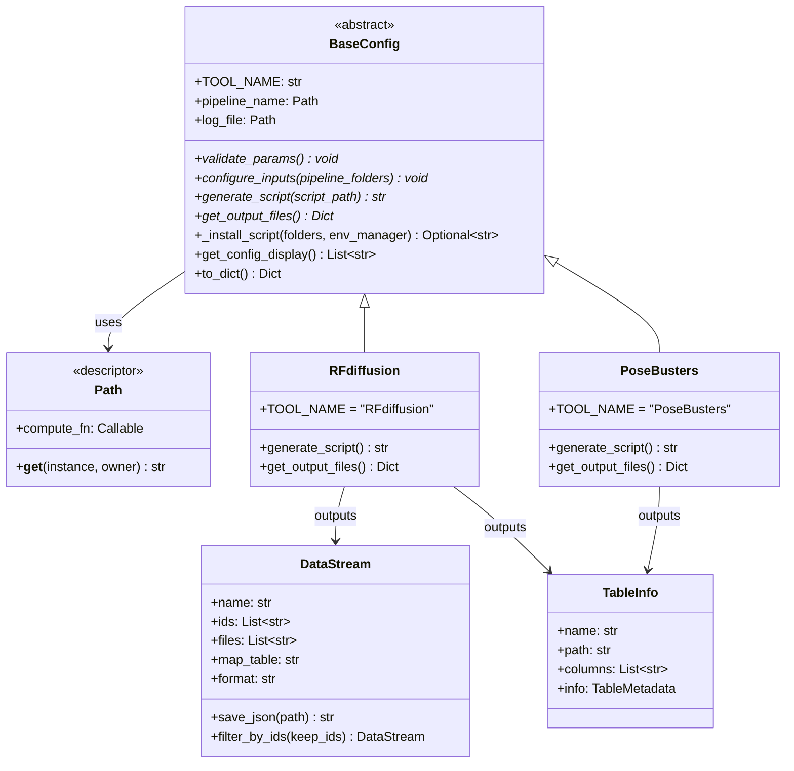
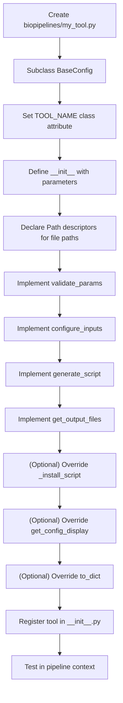

This guide provides a complete reference for implementing new tools within the biopipelines framework. Every tool—whether it wraps an external binary, orchestrates a Python workflow, or performs pure data transformation—follows the same contract: subclass `BaseConfig`, implement four abstract methods, and declare outputs as `DataStream` and `TableInfo` objects. The framework handles pipeline registration, environment switching, script assembly, SLURM submission, and Jupyter rendering automatically.

## The Tool Contract: BaseConfig Anatomy

`BaseConfig` is the abstract root for every pipeline tool defined in [biopipelines/base_config.py](biopipelines/base_config.py#L34-L40). It establishes the lifecycle that all concrete tools must fulfill, from parameter validation through bash script generation to output declaration.



The framework distinguishes two phases in every tool's lifecycle. The **configuration phase** runs in the Python process where you construct your pipeline: it validates parameters, resolves upstream dependencies, and declares expected outputs. The **execution phase** runs later on compute nodes via generated bash scripts: it activates conda environments, invokes external tools, and writes result tables and map files. Your tool class participates in both phases through different methods.

## Required Implementation: The Four Abstract Methods

Every tool must implement four abstract methods defined in `BaseConfig`. These form the minimal viable contract.

### `validate_params(self)`

Called during `__init__` ([base_config.py#L283-L285](biopipelines/base_config.py#L283-L285)). Validate all tool-specific parameters and raise `ValueError` with a descriptive message on failure. This runs before the tool is registered with any pipeline, ensuring early failure on misconfiguration.

```python
def validate_params(self):
    """Validate MyTool parameters."""
    if not self.structures_stream or len(self.structures_stream) == 0:
        raise ValueError("structures cannot be empty")
    if self.threshold < 0 or self.threshold > 1:
        raise ValueError("threshold must be between 0 and 1")
```

### `configure_inputs(self, pipeline_folders: Dict[str, str])`

Called by the pipeline after registration ([base_config.py#L341-L349](biopipelines/base_config.py#L341-L349)). Receives the resolved folder paths from `config.yaml` (e.g., `folders["HelpScripts"]`, `folders["data"]`). Store this reference—it's needed by `Path` descriptors and `generate_script`.

```python
def configure_inputs(self, pipeline_folders: Dict[str, str]):
    """Configure input structures."""
    self.folders = pipeline_folders
```

### `generate_script(self, script_path: str) -> str`

The most substantial method. Produces a bash script that will execute on the compute node ([base_config.py#L351-L362](biopipelines/base_config.py#L351-L362)). The canonical structure wraps your logic between the framework's completion-check header and footer, with environment activation in between.

### `get_output_files(self) -> Dict[str, List[str]]`

Declares what your tool produces ([base_config.py#L364-L372](biopipelines/base_config.py#L364-L372)). The return dictionary uses string keys for output streams (typically `"structures"`) and a `"tables"` key containing a dict of `TableInfo` objects, plus an `"output_folder"` key. This metadata drives downstream tool chaining and Jupyter rendering.

```python
def get_output_files(self) -> Dict[str, Any]:
    tables = {
        "my_results": TableInfo(
            name="my_results",
            path=self.results_csv,
            columns=["id", "score", "status"],
            description="MyTool analysis results",
            count=len(self.structures_stream)
        )
    }
    return {
        "structures": structures_datastream,
        "tables": tables,
        "output_folder": self.output_folder
    }
```

## Step-by-Step Tool Construction

The following flowchart shows the complete development process from file creation to pipeline integration.



### Step 1: Class Skeleton and `TOOL_NAME`

Create a new file in `biopipelines/` and subclass `BaseConfig`. The `TOOL_NAME` class attribute is the only required class-level declaration—it identifies the tool in folder naming (`NNN_ToolName/`), log files, and SLURM job names ([base_config.py#L42-L44](biopipelines/base_config.py#L42-L44)).

```python
from .base_config import BaseConfig, TableInfo
from .file_paths import Path
from .datastream import DataStream

class MyTool(BaseConfig):
    """One-line description of what the tool does."""
    
    TOOL_NAME = "MyTool"
```

### Step 2: Lazy Path Descriptors

The `Path` descriptor from [file_paths.py](biopipelines/file_paths.py#L12-L21) defers path computation until the `output_folder` and `folders` are available (set during `configure_inputs` via `set_pipeline_context`). Declare all file paths your tool needs—output files, helper scripts, intermediate configs—as class-level `Path` attributes.

```python
class MyTool(BaseConfig):
    TOOL_NAME = "MyTool"
    
    # Lazy path descriptors — resolved after configure_inputs
    results_csv = Path(lambda self: os.path.join(self.output_folder, "results.csv"))
    config_json = Path(lambda self: os.path.join(self.output_folder, "mytool_config.json"))
    helper_py = Path(lambda self: os.path.join(self.folders["HelpScripts"], "pipe_mytool.py"))
```

The `Path` descriptor is a Python descriptor that caches the computed path on first access. Its implementation in [file_paths.py#L22-L41](biopipelines/file_paths.py#L22-L41) stores the result on the instance, so subsequent accesses are O(1). This is critical because `output_folder` is not known at class definition time—it's injected by the pipeline when the tool is registered.

### Step 3: Constructor and Input Resolution

Your `__init__` should accept tool-specific parameters, resolve any `StandardizedOutput` or `DataStream` inputs to concrete `DataStream` objects, store the resolved state, and call `super().__init__(**kwargs)` last. The superclass constructor triggers `validate_params` and `_load_environments` ([base_config.py#L162-L193](biopipelines/base_config.py#L162-L193)).

The pattern for resolving upstream inputs is consistent across all existing tools. If a parameter accepts `Union[DataStream, StandardizedOutput]`, extract the appropriate stream from `StandardizedOutput` using its named attributes:

```python
def __init__(self,
             structures: Union[DataStream, StandardizedOutput],
             cutoff: float = 5.0,
             mode: str = "strict",
             **kwargs):
    # Resolve upstream input
    if isinstance(structures, StandardizedOutput):
        self.structures_stream = structures.streams.structures
    elif isinstance(structures, DataStream):
        self.structures_stream = structures
    else:
        raise ValueError(
            f"structures must be DataStream or StandardizedOutput, "
            f"got {type(structures)}"
        )
    
    self.cutoff = cutoff
    self.mode = mode
    super().__init__(**kwargs)
```

> [!TIP]
> Always call `super().__init__(**kwargs)` **last** in your constructor. The base class calls `validate_params()`, which requires all instance attributes to be set. Placing `super().__init__()` before attribute assignment will cause `AttributeError` in validation.

### Step 4: Script Generation

The `generate_script` method produces a complete bash script. The framework provides two helpers—`generate_completion_check_header()` and `generate_completion_check_footer()`—that wrap your logic in idempotency guards, preventing redundant execution on job resubmission ([base_config.py#L499-L555](biopipelines/base_config.py#L499-L555)).

The canonical script structure follows a consistent pattern visible in every tool implementation ([posebusters.py#L187-L195](biopipelines/posebusters.py#L187-L195), [rfdiffusion.py#L368-L383](biopipelines/rfdiffusion.py#L368-L383)):

```python
def generate_script(self, script_path: str) -> str:
    os.makedirs(self.output_folder, exist_ok=True)
    
    # 1. Serialize input DataStreams to JSON for runtime resolution
    self.structures_stream.save_json(self.input_json)
    
    script_content = "#!/bin/bash\n"
    script_content += "# MyTool execution script\n"
    
    # 2. Completion check header (skips if already done)
    script_content += self.generate_completion_check_header()
    
    # 3. Activate conda environment
    script_content += self.activate_environment()
    
    # 4. Write config JSON for the HelpScript to read
    config_data = {
        "structures_json": self.input_json,
        "cutoff": self.cutoff,
        "mode": self.mode,
        "output_csv": self.results_csv,
    }
    with open(self.config_json, 'w') as f:
        json.dump(config_data, f, indent=2)
    
    # 5. Tool-specific execution
    script_content += self._generate_run_section()
    
    # 6. Completion check footer (creates status file)
    script_content += self.generate_completion_check_footer()
    
    return script_content
```

> [!TIP]
> Always call `os.makedirs(self.output_folder, exist_ok=True)` at the top of `generate_script`. The output folder may not exist yet—especially during on-the-fly execution—and your serialized JSON configs must be written before the bash script runs.

### Step 5: Output Declaration via `get_output_files`

This method is called after `configure_inputs`, so all `Path` descriptors are resolvable. It must return a dictionary whose shape determines how downstream tools and the Jupyter renderer interact with your output ([posebusters.py#L236-L267](biopipelines/posebusters.py#L236-L267), [rfdiffusion.py#L445-L491](biopipelines/rfdiffusion.py#L445-L491)).

The return dictionary supports these optional keys:

| Key | Type | Description |
|-----|------|-------------|
| `"structures"` | `DataStream` | Output structure stream (PDB, CIF, SDF, etc.) |
| `"sequences"` | `DataStream` | Output sequence stream (FASTA, inline) |
| `"tables"` | `Dict[str, TableInfo]` | Named analysis tables with column metadata |
| `"output_folder"` | `str` | Path to this tool's output directory |

For tools that produce structures with pattern-based IDs (e.g., `["design_<0..9>"]`), use the `create_map_table` helper to generate the required `structures_map.csv`:

```python
def get_output_files(self) -> Dict[str, Any]:
    from .datastream import create_map_table
    from . import id_patterns
    
    # Pattern-based output IDs
    n = self.num_outputs
    structure_ids = [f"{self.pipeline_name}_<0..{n-1}>"]
    file_template = [os.path.join(self.output_folder, "<id>.pdb")]
    
    structures_map = os.path.join(self.output_folder, "structures_map.csv")
    create_map_table(
        structures_map,
        structure_ids,
        files=file_template
    )
    
    structures = DataStream(
        name="structures",
        ids=structure_ids,
        files=file_template,
        map_table=structures_map,
        format="pdb"
    )
    
    tables = {
        "results": TableInfo(
            name="results",
            path=self.results_csv,
            columns=["id", "score", "rank", "status"],
            description="MyTool generation results",
            count=n
        )
    }
    
    return {
        "structures": structures,
        "tables": tables,
        "output_folder": self.output_folder
    }
```

## Optional Overrides: Installation, Display, and Serialization

### Installation via `_install_script`

Override the classmethod `_install_script` to provide bash commands for setting up your tool's environment ([base_config.py#L61-L80](biopipelines/base_config.py#L61-L80)). Users call `MyTool.install()` within a pipeline context, which wraps your script in an `_Installer` step ([base_config.py#L693-L731](biopipelines/base_config.py#L693-L731)). The `force_reinstall` parameter lets users bypass idempotency checks.

```python
@classmethod
def _install_script(cls, folders, env_manager="mamba", force_reinstall=False, **kwargs):
    skip = "" if force_reinstall else """if {env_manager} env list 2>/dev/null | grep -q "mytool"; then
    echo "MyTool already installed, skipping."
    exit 0
fi
"""
    return f"""echo "=== Installing MyTool ==="
{skip}{env_manager} create -n mytool python=3.10 -y
{env_manager} activate mytool
pip install mytool-package

echo "=== MyTool installation complete ==="
"""
```

### Display Configuration via `get_config_display`

Override this method to add tool-specific lines to the pipeline summary output ([base_config.py#L466-L474](biopipelines/base_config.py#L466-L474)). Always call `super().get_config_display()` first, then append your lines.

```python
def get_config_display(self) -> List[str]:
    config_lines = super().get_config_display()
    config_lines.extend([
        f"STRUCTURES: {len(self.structures_stream)} files",
        f"CUTOFF: {self.cutoff}",
        f"MODE: {self.mode}",
    ])
    return config_lines
```

### Serialization via `to_dict`

Override `to_dict` to persist tool-specific parameters alongside the base configuration ([base_config.py#L483-L493](biopipelines/base_config.py#L483-L493)). This supports pipeline reproducibility and debugging.

```python
def to_dict(self) -> Dict[str, Any]:
    base_dict = super().to_dict()
    base_dict.update({
        "tool_params": {
            "cutoff": self.cutoff,
            "mode": self.mode,
        }
    })
    return base_dict
```

## HelpScripts: The Runtime Bridge

Most tools delegate their runtime logic to Python helper scripts in `HelpScripts/`. These scripts receive configuration via JSON files and perform the actual computation—file I/O, metric extraction, format conversion. The tool class serializes a config JSON in `generate_script`, then the bash script invokes the helper:

```
python {helper_py} --config {config_json}
```

This separation is architectural: the tool class operates in the configuration phase (pure Python, no heavy dependencies), while the HelpScript operates in the execution phase (full environment, arbitrary compute). The `Resolve.stream_item()` and `Resolve.stream_ids()` shell functions, available in every generated bash script, handle DataStream deserialization at runtime—translating JSON stream definitions into concrete file paths.

To create a new HelpScript, place it in `HelpScripts/pipe_mytool.py` and follow the `--config` pattern. Reference its path from your tool class using a `Path` descriptor:

```python
helper_py = Path(lambda self: os.path.join(self.folders["HelpScripts"], "pipe_mytool.py"))
```

## Complete Example: A Metric Extraction Tool

The following example demonstrates a tool that computes RMSD between structure pairs—an analysis tool with no external binary dependency, only a HelpScript.

```python
import os, json
from typing import Dict, List, Any, Optional, Union

from .base_config import BaseConfig, TableInfo
from .file_paths import Path
from .datastream import DataStream


class RMSDAnalyzer(BaseConfig):
    """Compute pairwise RMSD between predicted and reference structures."""

    TOOL_NAME = "RMSDAnalyzer"

    @classmethod
    def _install_script(cls, folders, env_manager="mamba",
                        force_reinstall=False, **kwargs):
        # No external tools needed — biopipelines env suffices
        return None

    # Lazy path descriptors
    results_csv = Path(lambda self: os.path.join(self.output_folder, "rmsd.csv"))
    config_json = Path(lambda self: os.path.join(self.output_folder, "rmsd_config.json"))
    rmsd_py = Path(lambda self: os.path.join(
        self.folders["HelpScripts"], "pipe_rmsd.py"))

    def __init__(self,
                 predicted: Union[DataStream, 'StandardizedOutput'],
                 reference: Union[DataStream, 'StandardizedOutput'],
                 method: str = "ca",
                 **kwargs):
        if isinstance(predicted, StandardizedOutput):
            self.predicted_stream = predicted.streams.structures
        elif isinstance(predicted, DataStream):
            self.predicted_stream = predicted
        else:
            raise ValueError(
                f"predicted must be DataStream or StandardizedOutput")

        if isinstance(reference, StandardizedOutput):
            self.reference_stream = reference.streams.structures
        elif isinstance(reference, DataStream):
            self.reference_stream = reference
        else:
            raise ValueError(
                f"reference must be DataStream or StandardizedOutput")

        self.method = method
        super().__init__(**kwargs)

    def validate_params(self):
        if self.method not in ("ca", "all", "bb"):
            raise ValueError(
                f"method must be 'ca', 'all', or 'bb', got '{self.method}'")
        if len(self.predicted_stream) != len(self.reference_stream):
            raise ValueError(
                "predicted and reference must have the same number of items")

    def configure_inputs(self, pipeline_folders: Dict[str, str]):
        self.folders = pipeline_folders

    def get_config_display(self) -> List[str]:
        lines = super().get_config_display()
        lines.extend([
            f"PREDICTED: {len(self.predicted_stream)} structures",
            f"REFERENCE: {len(self.reference_stream)} structures",
            f"METHOD: {self.method}",
        ])
        return lines

    def generate_script(self, script_path: str) -> str:
        os.makedirs(self.output_folder, exist_ok=True)

        self.predicted_stream.save_json(
            os.path.join(self.output_folder, "predicted.json"))
        self.reference_stream.save_json(
            os.path.join(self.output_folder, "reference.json"))

        config = {
            "predicted_json": os.path.join(
                self.output_folder, "predicted.json"),
            "reference_json": os.path.join(
                self.output_folder, "reference.json"),
            "method": self.method,
            "output_csv": self.results_csv,
        }
        with open(self.config_json, 'w') as f:
            json.dump(config, f, indent=2)

        script = "#!/bin/bash\n"
        script += self.generate_completion_check_header()
        script += self.activate_environment()
        script += f'python "{self.rmsd_py}" --config "{self.config_json}"\n'
        script += self.generate_completion_check_footer()
        return script

    def get_output_files(self) -> Dict[str, Any]:
        tables = {
            "rmsd": TableInfo(
                name="rmsd",
                path=self.results_csv,
                columns=["id", "predicted", "reference", "rmsd", "method"],
                description=f"RMSD analysis ({self.method})",
                count=len(self.predicted_stream),
            )
        }
        return {
            "tables": tables,
            "output_folder": self.output_folder,
        }

    def to_dict(self) -> Dict[str, Any]:
        d = super().to_dict()
        d["tool_params"] = {"method": self.method}
        return d
```

## Tool Registration and Use

After creating your tool file, register it in `biopipelines/__init__.py` so it's importable. Then use it within any pipeline context—auto-registration via `__new__` means simply constructing the tool inside a `with Pipeline(...)` block is sufficient ([base_config.py#L117-L160](biopipelines/base_config.py#L117-L160), [pipeline.py#L277-L345](biopipelines/pipeline.py#L277-L345)):

```python
from biopipelines import Pipeline, RMSDAnalyzer, Boltz2, AlphaFold

with Pipeline("rmsd_analysis", "test", "Compare predictions") as p:
    sequences = Sequence(seq="MKWVTFISLLFLFSSAYSRGVFRRDAHKSEVAHRFKDLGEENFKALVLIAFAQYLQQCPFEDHVKLVNEVTEFAKTCVADESAENCDKSLHTLFGDKLCTVATLRETYGEMADCCAKQEPERNECFLQHKDDNPNLPRLVRPEVDVMCTAFHDNEETFLKKYLYEIARRHPYFYAPELLYYANKYNGVFQECCQAEDKGACLLPKIETMREKVLTSARQRLRCASIQKFGERALKAWSVARLSQKFPKAEFVEVTKLVTDLTKVHKECCHGDLLECADDRADLAKYICDNQDTISSKLKECCDKPLLEKSHCIAEVEKDAIPENLPPLTADFAEDKDVCKNYQEAKDAFLGSFLYEYSRRHPEYAVSVLLRLAKEYEATLEECCAKDDPHACYSTVFDKLKHLVDEPQNLIKQNCDQFEKLGEYGFQNALIVRYTRKVPQVSTPTLVEVSRSLGKVGTRCCTKPESERMPCTEDYLSLILNRLCVLHEKTPVSEKVTKCCTESLVNRRPCFSALTPDETYVPKAFDEKLFTFHADICTLPDTEKQIKKQTALVELLKHKPKATEEQLKTVMENFVAFVDKCCAADDKEACFAVEGPKLVVSTQTALA")

    predicted = Boltz2(proteins=sequences, num_designs=5)
    reference = AlphaFold(proteins=sequences)
    
    results = RMSDAnalyzer(predicted=predicted, reference=reference, method="ca")
    
    # Access results
    print(results.tables.rmsd.info.path)  # Table path
```

## Checklist: From Concept to Production

| Step | Requirement | Verified By |
|------|-------------|-------------|
| 1 | Subclass `BaseConfig` | `class MyTool(BaseConfig)` |
| 2 | Set `TOOL_NAME` | Class attribute string |
| 3 | Declare `Path` descriptors | All file paths are lazy |
| 4 | Resolve `StandardizedOutput` → `DataStream` | In `__init__` |
| 5 | Call `super().__init__(**kwargs)` last | Triggers validation |
| 6 | Implement `validate_params` | Raises `ValueError` on bad input |
| 7 | Implement `configure_inputs` | Stores `self.folders` |
| 8 | Implement `generate_script` | Header + env + logic + footer |
| 9 | Implement `get_output_files` | Returns streams + tables dict |
| 10 | Create HelpScript | In `HelpScripts/pipe_mytool.py` |
| 11 | Register in `__init__.py` | Importable from `biopipelines` |
| 12 | Test in pipeline context | Auto-registration works |

For deeper understanding of the mechanisms this guide builds upon, see [BaseConfig: Tool Abstraction Layer](8-baseconfig-tool-abstraction-layer), [Two-Phase Execution Model](9-two-phase-execution-model), and [DataStream: Unified I/O Container](7-datastream-unified-i-o-container). For SLURM resource configuration relevant to your tool's compute requirements, see [SLURM Cluster Integration](17-slurm-cluster-integration).