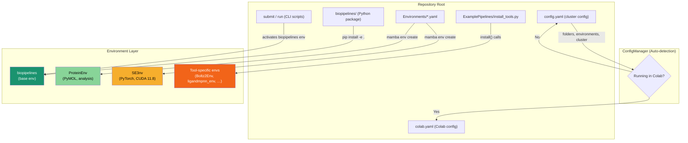

This page walks you through setting up BioPipelines from a fresh clone to a fully operational environment — whether you work on an HPC cluster with SLURM, a local Jupyter installation, or Google Colab. BioPipelines uses a **two-layer environment model**: a lightweight base package for the framework itself, and tool-specific environments that are created on demand when you first use each computational tool.


## Prerequisites

Before you begin, make sure your system meets these requirements. BioPipelines targets **Linux** as its primary platform for both cluster and local use, with **Google Colab** as a secondary fully-supported environment.

| Requirement | Details | Verified In |
|---|---|---|
| **Python** | >= 3.10, < 3.13 | [pyproject.toml](pyproject.toml#L10) |
| **Environment manager** | Mamba (recommended) or Conda — Miniforge/Mambaforge preferred | [config.yaml](config.yaml#L155) |
| **Git** | For cloning the repository and tool submodules | [submit](submit#L1) |
| **GPU** (optional) | NVIDIA GPU with CUDA drivers for deep learning tools (RFdiffusion, AlphaFold, Boltz2) | [SE3nv.yaml](Environments/SE3nv.yaml) |
| **SLURM** (optional) | Only needed for cluster job submission | [submit](submit#L1) |

## Architecture Overview

The following diagram illustrates how BioPipelines organizes its installation across the framework package, configuration, environment files, and tool-specific environments:



The **ConfigManager** ([biopipelines/config_manager.py](biopipelines/config_manager.py#L61)) acts as a singleton that auto-detects your platform. On Google Colab it loads `colab.yaml`; everywhere else it loads `config.yaml`. This determines where tools are installed, which environments they use, and how SLURM jobs are configured.

## Step 1: Clone the Repository

```bash
git clone https://github.com/locbp-uzh/biopipelines.git
cd biopipelines
```

The repository root contains the `config.yaml` (or `colab.yaml`), the `Environments/` directory with environment specifications, and the `submit`/`run` shell scripts at the top level. Your pipeline scripts will live inside this directory or reference it via an absolute path.

Sources: [README.md](README.md#L1-L82), [config.yaml](config.yaml#L1-L188)

## Step 2: Install the Base BioPipelines Package

The base package provides the framework itself — pipeline orchestration, tool abstractions, data flow management, and configuration handling. It requires no GPU and has minimal dependencies.

```bash
# Create the base conda environment
mamba env create -f Environments/biopipelines.yaml
mamba activate biopipelines

# Install the biopipelines package in editable mode
pip install -e .
```

The `biopipelines.yaml` environment ([Environments/biopipelines.yaml](Environments/biopipelines.yaml#L1-L26)) includes: **pandas**, **numpy**, **pyyaml 6.0**, **requests**, **biopython**, **rdkit**, **openbabel**, **ipykernel**, and **openpyxl**. The `pip install -e .` command registers the CLI entry points defined in [pyproject.toml](pyproject.toml#L24-L31):

| CLI Command | Entry Point | Purpose |
|---|---|---|
| `bp-submit` / `biopipelines-submit` | `biopipelines.cli:submit` | Generate pipeline + submit to SLURM |
| `bp-run` / `biopipelines-run` | `biopipelines.cli:run` | Generate pipeline + run locally |
| `bp-config` / `biopipelines-config` | `biopipelines.cli:config` | Manage configuration |
| `bp-otf` / `biopipelines-otf` | `biopipelines.cli:otf` | On-the-fly SLURM execution with output streaming |

> [!TIP]
> The `submit` and `run` bash scripts at the repository root are thin wrappers that read your `config.yaml` to determine the environment manager, load SLURM modules, activate the `biopipelines` environment, and then execute your pipeline script. You can use either the bash scripts (`./submit pipeline.py`) or the installed CLI commands (`bp-submit pipeline.py`) — they are functionally equivalent.

Sources: [Environments/biopipelines.yaml](Environments/biopipelines.yaml#L1-L26), [pyproject.toml](pyproject.toml#L1-L37), [submit](submit#L20-L85), [run](run#L20-L68)

## Step 3: Configure `config.yaml` for Your System

The `config.yaml` at the repository root is the central configuration file. It defines **folder paths** (where tools are installed, where output goes), **environment mappings** (which conda env each tool uses), and **cluster settings** (SLURM modules, environment manager, container executor). You must customize at least the **folders** section for your system.

### Folder Paths

The folder system uses a **placeholder resolution chain**: `base → infrastructure → shared_overrides → repositories → cache → server`. The `<username>` and `<cwd>` placeholders are injected at runtime from the current user and working directory ([config.yaml](config.yaml#L1-L188)).

```yaml
folders:
  base:
    home: "/home/<username>"
    data: "<home>/data"
    scratch: "/scratch/<username>"
    group: "/shares/locbp.chem.uzh"      # ← Change to your group path
    user: "<group>/<username>"
    biopipelines: "<cwd>"                # ← Auto-resolved to repo root
    biopipelines_output: "<user>/BioPipelines"
```

Key paths you should review:

| Path Key | Purpose | Typical Customization |
|---|---|---|
| `base.data` | Where tool repositories are cloned | Point to your data storage |
| `base.scratch` | Temporary files during pipeline runs | Your scratch directory |
| `base.group` | Shared resources (cache, containers) | Your research group path |
| `repositories.*` | Per-tool installation directories | Only if you move defaults |

### Cluster Settings

The `cluster` section controls environment manager choice and SLURM behavior ([config.yaml](config.yaml#L148-L167)):

```yaml
cluster:
  env_manager: "mamba"          # "mamba" or "conda"
  container_executor: "apptainer"  # "apptainer" or "singularity"
  slurm_modules:                # Module load commands for SLURM scripts
    - "miniforge3"
    - "apptainer"
```

If you are not on an SLURM cluster, you can set `slurm_modules: []` and use the `./run` script or Jupyter notebooks for local execution.

Sources: [config.yaml](config.yaml#L1-L188), [biopipelines/config_manager.py](biopipelines/config_manager.py#L88-L132)

## Step 4: Install Computational Tools

BioPipelines provides an **automated installation pipeline** that clones tool repositories and creates their conda environments as SLURM jobs. This is the recommended approach for first-time setup on a cluster.

### Option A: Automated Tool Installation (Recommended)

The `install_tools.py` script ([ExamplePipelines/install_tools.py](ExamplePipelines/install_tools.py#L1-L52)) uses BioPipelines' own pipeline system to install tools. Each `Tool.install()` call adds an installation step that, when submitted, runs the tool's internal installation script (git clone, environment creation, model download).

```python
# ExamplePipelines/install_tools.py
from biopipelines.pipeline import *
from biopipelines.rfdiffusion import RFdiffusion
from biopipelines.protein_mpnn import ProteinMPNN
from biopipelines.alphafold import AlphaFold
from biopipelines.boltz2 import Boltz2

with Pipeline(project="Setup", job="InstallTools"):
    Resources(time="8:00:00", memory="32GB")
    RFdiffusion.install()       # Creates SE3nv, clones repo, downloads weights
    ProteinMPNN.install()       # Clones repo (uses SE3nv from RFdiffusion)
    AlphaFold.install()         # LocalColabFold installation
    Boltz2.install()            # Creates Boltz2Env
```

Run this on a cluster:
```bash
./submit ExamplePipelines/install_tools.py
```

Or run locally:
```bash
./run ExamplePipelines/install_tools.py
```

Comment out tools you don't need to save time. The `install()` method accepts `force_reinstall=True` to redo the full installation ([biopipelines/base_config.py](biopipelines/base_config.py#L104-L148)).

### Option B: Manual Environment Creation

If you prefer to create environments individually, use the YAML files in `Environments/`:

```bash
# GPU environment for RFdiffusion + ProteinMPNN (heavyweight: PyTorch + CUDA 11.8 + DGL + PyMOL)
mamba env create -f Environments/SE3nv.yaml
mamba activate SE3nv
pip install -r Environments/SE3nv_pip_requirements.txt

# Lightweight analysis environment (PyMOL, pandas, scipy — no PyTorch)
mamba env create -f Environments/ProteinEnv.yaml

# RBS Designer (ViennaRNA)
mamba env create -f Environments/rbs_designer.yaml
```

### Environment Reference

The following table maps every environment defined in the system to its tools and characteristics. The `environments` section in `config.yaml` ([config.yaml](config.yaml#L80-L144)) links each tool to its required environment:

| Environment | YAML File | Tools | Key Dependencies | GPU Required |
|---|---|---|---|---|
| **biopipelines** | [biopipelines.yaml](Environments/biopipelines.yaml) | Load, Fuse, StitchSequences, DNAEncoder, Plot, Panda, PDB, Ligand, Sequence, Distance, DistanceSelector, Gnina, AlphaFold, MMseqs2, CompoundLibrary, BoltzGenMerge, BoltzGenImport | pandas, pyyaml, biopython, rdkit, ipykernel | No |
| **ProteinEnv** | [ProteinEnv.yaml](Environments/ProteinEnv.yaml) | PyMOL, ConformationalChange, Contacts, PoseChange, SASA, Selection | pymol-open-source, scipy, matplotlib | No |
| **SE3nv** | [SE3nv.yaml](Environments/SE3nv.yaml) | RFdiffusion, RFdiffusionAllAtom, ProteinMPNN | pytorch 2.0.1 (CUDA 11.8), DGL, e3nn, pymol | Yes |
| **Boltz2Env** | Created by `Boltz2.install()` | Boltz2 | Boltz-specific packages | Yes |
| **boltzgen** | Created by `BoltzGen.install()` | BoltzGen, BoltzGenMerge, BoltzGenImport | BoltzGen-specific | Yes |
| **ligandmpnn_env** | Created by `LigandMPNN.install()` | LigandMPNN | LigandMPNN-specific | No |
| **MutationEnv** | Created by `MutationProfiler.install()` | MutationComposer, Mutagenesis, MutationProfiler, SequenceMetricCorrelation, BayesianAdjuster | Analysis-specific | No |
| **rbs_designer** | [rbs_designer.yaml](Environments/rbs_designer.yaml) | RBSDesigner | ViennaRNA | No |

> [!TIP]
> When using `./submit` or `./run`, you only need the **biopipelines** environment active. The framework automatically switches to the correct per-tool environment at runtime using the `environments` mapping in `config.yaml`. Each generated SLURM job script or pipeline bash script includes activation commands for the appropriate environment before each tool executes.

Sources: [config.yaml](config.yaml#L80-L144), [ExamplePipelines/install_tools.py](ExamplePipelines/install_tools.py#L1-L52), [Environments/SE3nv.yaml](Environments/SE3nv.yaml), [Environments/ProteinEnv.yaml](Environments/ProteinEnv.yaml), [Environments/rbs_designer.yaml](Environments/rbs_designer.yaml)

## Step 5: Verify Your Installation

After completing the steps above, verify everything is working with a minimal pipeline:

```python
from biopipelines.pipeline import Pipeline, Resources
from biopipelines.pdb import PDB
from biopipelines.sequence import Sequence

with Pipeline(project="Test", job="Setup"):
    pdb = PDB(pdb_id="1UBQ")        # Fetch ubiquitin from RCSB
    seq = Sequence(structures=pdb)  # Extract sequence
```

Run this test in Jupyter (with `on_the_fly=True` for immediate execution):

```python
with Pipeline(project="Test", job="Setup", on_the_fly=True):
    pdb = PDB(pdb_id="1UBQ")
    seq = Sequence(structures=pdb)
```

If this executes without errors, your base installation and configuration are correct. To test GPU tools, run the [ubiquitin example notebook](https://colab.research.google.com/github/locbp-uzh/biopipelines/blob/main/ExamplePipelines/notebooks/ubiquitin_results.ipynb).

Sources: [biopipelines/__init__.py](biopipelines/__init__.py#L1-L124), [biopipelines/pipeline.py](biopipelines/pipeline.py#L1-L60)

## Google Colab Setup

BioPipelines auto-detects Google Colab by checking for the `google.colab` module import ([biopipelines/config_manager.py](biopipelines/config_manager.py#L73-L82)). When running inside Colab, it automatically loads `colab.yaml` instead of `config.yaml`, which pre-configures paths for `/content/` and uses **micromamba** as the environment manager ([colab.yaml](colab.yaml#L1-L136)).

The setup pattern for Colab notebooks is:

```python
# 1. Clone and install (first cell)
!git clone https://github.com/locbp-uzh/biopipelines.git
%cd biopipelines
!pip install -e .

# 2. Run pipeline (subsequent cells)
from biopipelines.pipeline import Pipeline, Resources
from biopipelines.rfdiffusion import RFdiffusion

with Pipeline(project="Test", job="Colab", on_the_fly=True):
    rf = RFdiffusion(...)
```

The provided Colab notebooks in [ExamplePipelines/notebooks/](ExamplePipelines/notebooks/) handle the full setup automatically, including installing micromamba and creating isolated environments per tool. See [Google Colab Notebooks Guide](4-google-colab-notebooks-guide) for the complete walkthrough.

Key differences from cluster setup:

| Aspect | Cluster (config.yaml) | Google Colab (colab.yaml) |
|---|---|---|
| **Environment manager** | `mamba` or `conda` | `micromamba` |
| **Base data path** | `/home/<username>/data` | `/content/data` |
| **Output path** | `<group>/<username>/BioPipelines` | `/content/BioPipelines` |
| **SLURM modules** | System-specific modules | `[]` (none) |
| **Shell scripts** | `./submit` / `./run` | Not used; use `on_the_fly=True` |

Sources: [colab.yaml](colab.yaml#L1-L136), [biopipelines/config_manager.py](biopipelines/config_manager.py#L73-L82)

## Troubleshooting

| Problem | Likely Cause | Solution |
|---|---|---|
| `ERROR: biopipelines environment not found` | Base env not created | Run `mamba env create -f Environments/biopipelines.yaml && mamba activate biopipelines && pip install -e .` as shown in [run](run#L40-L50) |
| `env_manager not found in config.yaml` | Missing or malformed cluster section | Add `env_manager: "mamba"` under `cluster:` in `config.yaml` ([config.yaml](config.yaml#L148)) |
| `config.yaml missing required section: folders` | Config file corrupted or incomplete | Run `from biopipelines.config_manager import ConfigManager; ConfigManager.pull_config(force=True)` to re-download ([biopipelines/config_manager.py](biopipelines/config_manager.py#L266-L296)) |
| `ModuleNotFoundError: No module named 'biopipelines'` | Package not installed in active env | Ensure you ran `pip install -e .` while the `biopipelines` conda env is activated |
| Tool fails with CUDA error | Wrong environment or no GPU | Verify GPU availability with `nvidia-smi`; ensure the tool is using its correct environment from the mapping table above |
| Paths not resolving on cluster | `<username>` placeholder not replaced | The `submit`/`run` scripts and `ConfigManager` inject `<username>` at runtime — if using custom scripts, call `ConfigManager()` which handles resolution automatically |

## Summary and Next Steps

After completing these steps, you have: (1) the BioPipelines framework installed as a Python package, (2) a customized `config.yaml` pointing to your filesystem, and (3) tool environments created for the computational tools you need. The framework handles environment switching transparently at runtime, so you never need to manually activate tool-specific environments.

To continue your journey through BioPipelines:

- **[Quick Start](2-quick-start)** — Write and run your first complete pipeline end-to-end
- **[Google Colab Notebooks Guide](4-google-colab-notebooks-guide)** — Detailed Colab setup with pre-built example notebooks
- **[Architecture Overview](5-architecture-overview)** — Understand how the framework orchestrates tools under the hood
- **[Configuration Reference](20-configuration-reference)** — Full documentation of every `config.yaml` option