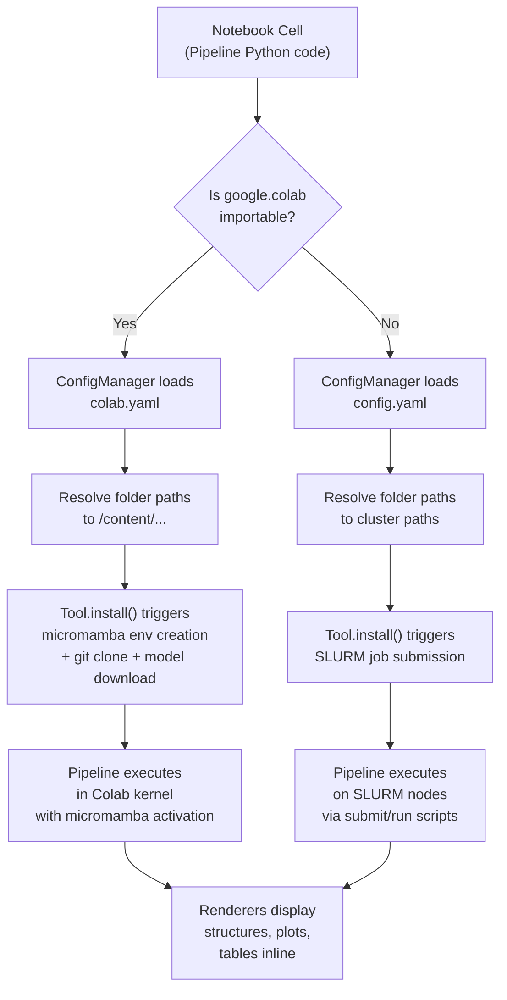

Google Colab provides a free, GPU-equipped cloud environment that lets you run BioPipelines workflows entirely in the browser — no local installation or HPC cluster required. This guide explains how Colab integration works under the hood, walks you through the universal setup sequence shared by all notebooks, and catalogs every available example notebook with its tool dependencies and biological context.

## How BioPipelines Detects Google Colab

The entire Colab adaptation hinges on a single auto-detection mechanism inside `ConfigManager._get_config_path()`. When the configuration manager loads, it attempts to import `google.colab`. If the import succeeds, it searches the repository root for a file called `colab.yaml` and uses it as the active configuration. If the import fails (meaning you are on a local machine or HPC cluster), it falls back to the standard `config.yaml` instead. This means **no manual environment variable or command-line flag is needed** — cloning the repo into a Colab notebook is sufficient for the framework to reconfigure itself.

Sources: [config_manager.py](/biopipelines/config_manager.py#L41-L63)

## Colab vs. Cluster: Configuration Differences

The two configuration files share identical `environments` and `renderers` sections, but diverge in three critical areas that reflect the constraints of a cloud notebook environment versus an on-premises HPC cluster:

| Aspect | `config.yaml` (Cluster) | `colab.yaml` (Colab) |
|---|---|---|
| **Home directory** | `/home/<username>` | `/root` |
| **Data root** | `<home>/data` | `/content/data` |
| **Scratch space** | `/scratch/<username>` | `/content/scratch` |
| **Output directory** | `<user>/BioPipelines` | `/content/BioPipelines` |
| **Cache** | Group shared storage | `/content/cache` |
| **Environment manager** | `mamba` | `micromamba` |
| **SLURM modules** | `["miniforge3", "apptainer"]` | `[]` (disabled) |
| **Email notifications** | Per-user mapping | `{}` (empty) |
| **GNINA CUDA config** | Custom modules & LD paths | Not configured |

The choice of **micromamba** over mamba is deliberate: micromamba is a lightweight, C++-only binary that installs in seconds without requiring a full conda installation — ideal for the ephemeral Colab runtime. The empty `slurm_modules` list ensures that no cluster-specific module commands are injected into shell scripts when running inside Colab.

Sources: [colab.yaml](/colab.yaml#L1-L136), [config.yaml](/config.yaml#L1-L188)

## Architecture: Colab Execution Flow

The following diagram illustrates how a notebook cell progresses from raw Python code through environment management to a rendered output — all within a single Colab runtime.



Sources: [config_manager.py](/biopipelines/config_manager.py#L55-L59), [colab.yaml](/colab.yaml#L127-L136), [config.yaml](/config.yaml#L130-L153)

## The Universal Setup Sequence

Every Colab notebook follows an identical three-cell bootstrap pattern. Understanding what each cell does — and why it is structured that way — will let you adapt any notebook to your own workflow.

### Cell 1: Install BioPipelines and Micromamba

This cell performs four operations in rapid succession. First, it clones the repository into `/content/biopipelines`. Second, it installs the `biopipelines` Python package in editable mode with the `[all]` extra, which pulls `rdkit` alongside core dependencies like `pandas`, `pyyaml`, `biopython`, `ipykernel`, and `py3Dmol`. Third, it downloads the micromamba binary — the fast, standalone conda alternative — and places it at `/usr/local/bin/micromamba`. Fourth, it creates the base `biopipelines` conda environment defined in `Environments/biopipelines.yaml`, which includes `ipykernel` for Jupyter integration and `rdkit` with `openbabel` for chemistry tooling.

```python
# Cell 1: Install BioPipelines and micromamba
!git clone https://github.com/locbp-uzh/biopipelines
%cd biopipelines
!pip install -e ".[all]"
!wget -q https://github.com/mamba-org/micromamba-releases/releases/latest/download/micromamba-linux-64 \
    -O /usr/local/bin/micromamba && chmod +x /usr/local/bin/micromamba
!micromamba create -f Environments/biopipelines.yaml -y
```

The `[all]` extra is important because `rdkit` is listed as an optional dependency in `pyproject.toml`, yet it is required by tools like `CompoundLibrary`, `Gnina`, and `PoseBusters` that handle molecular structures.

Sources: [pyproject.toml](/pyproject.toml#L6-L23), [Environments/biopipelines.yaml](/Environments/biopipelines.yaml#L1-L26)

### Cell 2: Install Required Tools

BioPipelines uses a declarative installation system where each tool class exposes a `_install_script()` method via `BaseConfig.install()`. Inside a `Pipeline` context, calling `Tool.install()` adds an installation step that clones external repositories (RFdiffusion, ProteinMPNN, etc.), creates isolated micromamba environments, and downloads model weights. On Colab, these steps execute directly in the notebook kernel rather than as SLURM jobs.

```python
# Cell 2: Install tools
from biopipelines.pipeline import *
from biopipelines.protein_mpnn import ProteinMPNN
from biopipelines.alphafold import AlphaFold

with Pipeline(project="Setup", job="InstallTools"):
    RFdiffusion.install(weights=[])   # SE3nv environment only, skip large weights
    ProteinMPNN.install()
    AlphaFold.install()
```

The `install()` classmethod accepts a `force_reinstall` flag (default `False`) so that re-running the cell after a runtime restart skips tools that are already present. Individual tools also accept specific keyword arguments — for example, `RFdiffusion.install(weights=[])` creates the shared `SE3nv` conda environment needed by ProteinMPNN but skips the ~4 GB diffusion weights download when you only need sequence design tools.

Sources: [base_config.py](/biopipelines/base_config.py#L61-L115), [install_tools.py](/ExamplePipelines/install_tools.py#L1-L52)

### Cell 3+: Pipeline Code

The remaining cells contain the actual scientific workflow. These cells are **functionally identical** to their cluster counterparts in `ExamplePipelines/*.py` — the same `Pipeline` context, the same tool constructors, the same `Bundle`/`Each` combinatorics. The only difference is execution environment: on Colab, everything runs synchronously in the notebook kernel; on a cluster, steps are dispatched to SLURM via the `submit` and `run` scripts.

> [!TIP]
> The pipeline code in Colab notebooks is a direct copy of the corresponding `.py` script in `ExamplePipelines/`. This means any pipeline that works on the cluster can be pasted into a Colab notebook and will work unchanged — the auto-detection in `ConfigManager` handles all environment differences transparently.

## Available Notebooks

The repository provides six example notebooks, each paired with a pre-executed `_results` version that contains rendered outputs and an "Open in Colab" badge. The pipeline notebooks are interactive templates; the results notebooks serve as proof-of-concept and documentation of expected outputs.


### Notebook Overview Table

| Notebook | Biological Task | Key Tools | GPU Required | Approx. Runtime |
|---|---|---|---|---|
| **ubiquitin** | Inverse folding + validation | ProteinMPNN, AlphaFold2, DNAEncoder, Panda | Yes (AlphaFold2) | ~20 min |
| **kinase_LID_redesign** | Backbone design of a kinase domain | RFdiffusion, ProteinMPNN, AlphaFold2, PyMOL | Yes (RFdiffusion + AF2) | ~30 min |
| **boltz2** | Structure prediction (multi-modal inputs) | Boltz2, CompoundLibrary | Yes (Boltz2) | ~15 min |
| **compound_screening** | SAR screening against protein–DNA | Boltz2, CompoundLibrary, Panda, Plot | Yes (Boltz2) | ~20 min |
| **FRET** | Linker optimization for biosensor | Fuse, Boltz2, Distance, Panda, Plot | Yes (Boltz2) | ~25 min |
| **iterative_binding_optimization** | Directed evolution loop (5 cycles) | Boltz2, LigandMPNN, MutationProfiler, Panda | Yes (Boltz2) | ~60 min |

Sources: [ExamplePipelines/notebooks/ubiquitin.ipynb](/ExamplePipelines/notebooks/ubiquitin.ipynb), [ExamplePipelines/notebooks/kinase_LID_redesign.ipynb](/ExamplePipelines/notebooks/kinase_LID_redesign.ipynb), [ExamplePipelines/notebooks/boltz2.ipynb](/ExamplePipelines/notebooks/boltz2.ipynb), [ExamplePipelines/notebooks/compound_screening.ipynb](/ExamplePipelines/notebooks/compound_screening.ipynb), [ExamplePipelines/notebooks/FRET.ipynb](/ExamplePipelines/notebooks/FRET.ipynb), [ExamplePipelines/notebooks/iterative_binding_optimization.ipynb](/ExamplePipelines/notebooks/iterative_binding_optimization.ipynb)

### Ubiquitin: Inverse Folding

This notebook demonstrates the classic inverse folding workflow. Starting from ubiquitin (PDB `4LCD`, chain E), ProteinMPNN generates 10 sequence variants using its soluble model. AlphaFold2 refolds each variant, and a `Panda` filter retains only sequences with RMSD < 1.5 Å and pLDDT > 80. Passing sequences are then codon-optimised for *E. coli* expression using DNAEncoder.

The results notebook displays inline 3D structure renderings and a confidence table with RMSD and pLDDT columns — the same renderers used on the cluster, now running in the browser via `py3Dmol`.

Sources: [ubiquitin.ipynb](/ExamplePipelines/notebooks/ubiquitin.ipynb)

### Kinase LID Redesign: De Novo Backbone Design

This is the most computationally intensive notebook, combining RFdiffusion for backbone generation with ProteinMPNN for sequence design and AlphaFold2 for validation. It redesigns the LID domain of adenylate kinase (PDB `4AKE`) using an RFdiffusion contig specification that preserves residues 1–117 and 161–214 while generating a 50–70 residue replacement loop. The pipeline then designs sequences on the new backbones, refolds with AlphaFold2, and filters by RMSD on the fixed scaffold regions.

This notebook requires the `SE3nv` environment (created by `RFdiffusion.install()`) and takes the longest to set up due to the RFdiffusion weight download.

Sources: [kinase_LID_redesign.ipynb](/ExamplePipelines/notebooks/kinase_LID_redesign.ipynb)

### Boltz2: Multi-Modal Structure Prediction

The Boltz2 showcase is the most comprehensive single-tool notebook, demonstrating nine distinct input configurations in sequence: direct sequence input, PDB structure input, recycled MSAs, single ligand input, compound library screening, and four combinatorics patterns using `Bundle` and `Each`. It serves as both a tutorial for Boltz2's capabilities and a reference for BioPipelines' combinatorial input system.

Each cell displays a single Boltz2 prediction with its 3D output, making it easy to compare how different inputs affect the predicted structure.

Sources: [boltz2.ipynb](/ExamplePipelines/notebooks/boltz2.ipynb)

### Compound Library Screening

This notebook screens a ChemDraw compound library (supplied as a `.cdxml` file) against the Trp repressor–DNA complex. Boltz2 co-folds each compound with the protein dimer and dsDNA, then predicted affinities are merged with substituent metadata from the compound library. A scatter plot visualizes affinity by substituent group, demonstrating how BioPipelines integrates chemical informatics with structure prediction.

Sources: [compound_screening.ipynb](/ExamplePipelines/notebooks/compound_screening.ipynb)

### FRET Biosensor Design

This notebook optimizes linker lengths for a calcium-responsive FRET biosensor (EBFP–CaM–EYFP fusion). It uses `Fuse` with `linker_lengths=["0-3", "0-3"]` to generate variants with GSG linkers of varying length, then predicts both apo and calcium-bound (holo) structures with Boltz2. Chromophore distances are computed with `Distance`, converted to FRET efficiencies using the Förster equation, and visualized with bar charts showing apo vs. holo efficiency and the calcium-induced ΔFRET.

Sources: [FRET.ipynb](/ExamplePipelines/notebooks/FRET.ipynb)

### Iterative Binding Optimization

This notebook implements a directed evolution loop: starting from the NocT protein (PDB `5OT9`) with Histopine as ligand, it runs 5 cycles of pocket residue identification, LigandMPNN variant generation (1000 sequences/cycle), mutation frequency profiling, and Boltz2 binding affinity evaluation. Each cycle keeps only the best candidate, demonstrating how BioPipelines can express iterative optimization loops with standard Python `for` syntax inside a single `Pipeline` context.

Sources: [iterative_binding_optimization.ipynb](/ExamplePipelines/notebooks/iterative_binding_optimization.ipynb)

## Colab-Specific Dependencies

BioPipelines includes a dedicated requirements file for the `SE3nv` environment on Colab. While the cluster uses a full conda environment specification, the Colab version leverages the fact that PyTorch, numpy, and scipy are pre-installed in Colab's base runtime, listing only the additional packages that `RFdiffusion` and `ProteinMPNN` need beyond what Colab already provides.

The base `biopipelines` environment (`Environments/biopipelines.yaml`) explicitly includes `ipykernel`, which is critical for Colab: it enables the Jupyter kernel to communicate with the notebook frontend, and it is loaded by tools that need the `biopipelines` conda environment when running pipeline steps.

Sources: [SE3nv_colab_requirements.txt](/Environments/SE3nv_colab_requirements.txt#L1-L26), [Environments/biopipelines.yaml](/Environments/biopipelines.yaml#L13-L25)

## Troubleshooting Common Colab Issues

| Problem | Cause | Solution |
|---|---|---|
| **Runtime disconnect during tool install** | Colab sessions timeout after ~90 min of inactivity or ~12 h total | Use "Connect to hosted runtime" with a Colab Pro/Pro+ session for longer runtimes; save outputs with `download()` frequently |
| **`ContentTooShortError` on Boltz2 weight download** | Interrupted network transfer leaves corrupt checkpoint files | Delete cached files: `!find ~/.boltz -name "*.ckpt" -delete` and rerun |
| **CUDA out of memory** | Boltz2 or RFdiffusion exceeds T4 GPU memory (16 GB) | Reduce `num_designs` or `num_sequences`; use a runtime with an A100 GPU if available |
| **micromamba not found after restart** | Colab runtime reset clears `/usr/local/bin` | Re-run Cell 1 — the install cell is idempotent |
| **`google.colab` import fails but colab.yaml is needed** | Custom Jupyter environment that is not Colab | Manually set environment or copy `colab.yaml` to `config.yaml` |

Sources: [boltz2.ipynb](/ExamplePipelines/notebooks/boltz2.ipynb), [colab.yaml](/colab.yaml#L1-L5)

> [!TIP]
> Colab runtimes are ephemeral. Any downloaded model weights, created environments, or generated outputs are lost when the runtime disconnects. For long-running iterative pipelines (like the binding optimization notebook), consider downloading intermediate results to your local machine at each cycle using the `download()` method available on pipeline outputs.

## Next Steps

Now that you understand how Colab notebooks work within BioPipelines, the following pages will deepen your understanding of the underlying systems:

- [Quick Start](2-quick-start) — Step-by-step setup instructions for your first pipeline, whether on Colab or locally
- [Architecture Overview](5-architecture-overview) — How the Pipeline engine, DataStream, and BaseConfig work together
- [Pipeline Orchestration Engine](6-pipeline-orchestration-engine) — Deep dive into the `Pipeline` context manager and tool auto-registration
- [Two-Phase Execution Model](9-two-phase-execution-model) — How the framework separates configuration from execution, enabling both interactive and batch modes