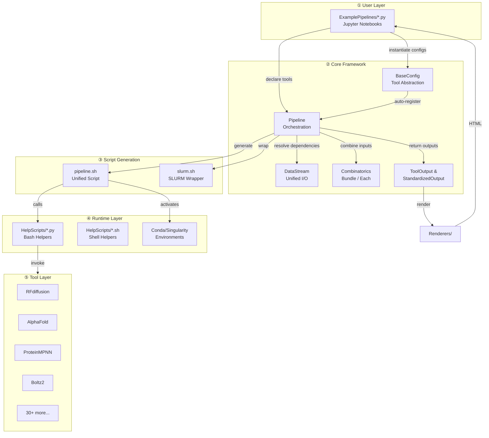
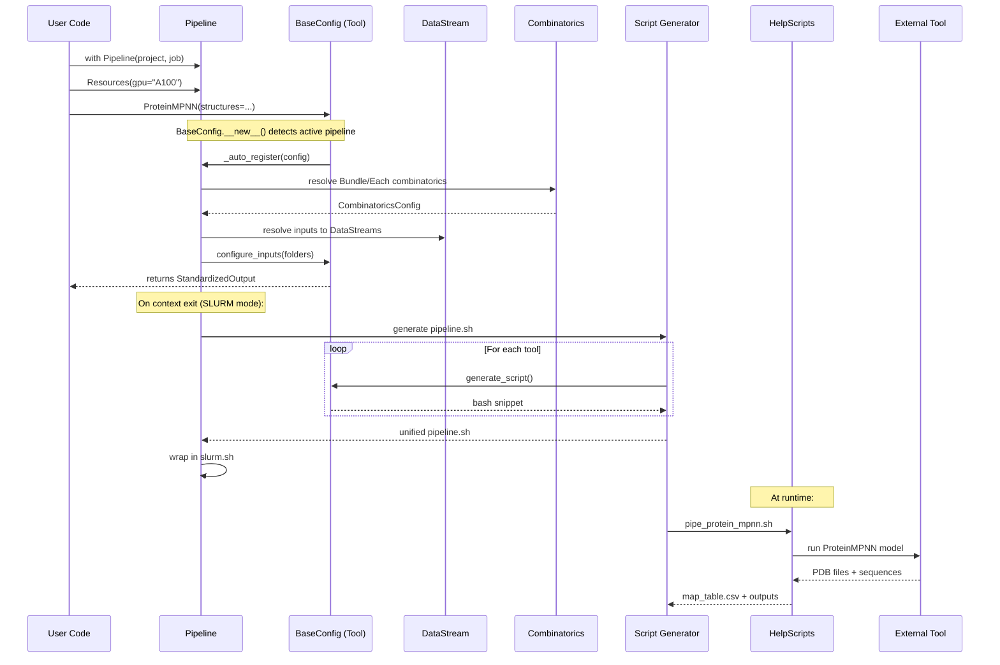

BioPipelines is a Python framework that transforms declarative protein modeling workflows into executable artifacts — bash scripts for SLURM clusters, or real-time executions in Jupyter notebooks. Rather than computing results directly, it generates scripts and predicts output file paths, letting the underlying bioinformatics tools (AlphaFold, RFdiffusion, ProteinMPNN, etc.) run in their native environments. This overview maps the major subsystems and explains how they connect.


## High-Level Architecture

The framework is organized into five concentric layers, each with a clear responsibility boundary. The diagram below shows how a user-defined pipeline flows from Python declaration through script generation and into cluster or notebook execution.



## Repository Layout

The physical directory structure mirrors this layered architecture. Below is an annotated view of the top-level project tree showing the purpose of each directory.

```
biopipelines/
├── biopipelines/           # ② Core Framework — all Python modules
│   ├── pipeline.py         #   Pipeline orchestration engine
│   ├── base_config.py      #   BaseConfig, ToolOutput, StandardizedOutput
│   ├── datastream.py       #   DataStream unified I/O container
│   ├── combinatorics.py    #   Bundle / Each input combination logic
│   ├── id_patterns.py      #   Pattern-based ID expansion engine
│   ├── datastream_resolver.py  # Universal input → DataStream converter
│   ├── cli.py              #   CLI entry points (submit, run, otf, config)
│   ├── config_manager.py   #   config.yaml resolution
│   ├── folders.py          #   Folder layout management
│   ├── load.py             #   Load — reuse previous pipeline outputs
│   └── <tool>.py           #   30+ tool configuration modules
│
├── HelpScripts/            # ④ Runtime Layer — bash helpers invoked at runtime
│   ├── pipe_*.py           #   Python data transformation helpers
│   ├── pipe_*.sh           #   Shell utility helpers
│   ├── resolve_*.py        #   Path and stream resolution
│   └── resolve_*.sh        #   Stream item resolution
│
├── Renderers/              # ⑤ Visualization — Jupyter notebook display
│   ├── structures.py       #   PDB/CIF structure viewers
│   ├── tables.py           #   CSV/JSON table formatters
│   ├── plots.py            #   Matplotlib plot embedders
│   ├── images.py           #   Image file embedders
│   ├── fasta.py            #   Sequence display
│   └── streams.py          #   Generic stream metadata display
│
├── ExamplePipelines/       # ① User Layer — ready-to-run pipeline examples
│   ├── *.py                #   Cluster-executable scripts
│   └── notebooks/          #   Jupyter/Colab interactive notebooks
│
├── Environments/           # ③ Environment specs — conda/singularity configs
│   ├── *.yaml              #   Per-tool environment definitions
│   └── *_requirements.txt  #   Pip requirements for Colab
│
├── config.yaml             #   Central configuration (folders, envs, cluster)
├── mkdocs.yml              #   Documentation site definition
└── pyproject.toml          #   Python package metadata
```

Sources: [biopipelines/__init__.py](biopipelines/__init__.py#L1-L124), [config.yaml](config.yaml#L1-L188)

## The Five Architectural Layers

### 1. User Layer — Pipeline Declaration

Users interact with BioPipelines by writing Python scripts or Jupyter notebooks that instantiate tool configurations inside a `Pipeline` context manager. Tools are auto-registered into the active pipeline through a `ContextVar` mechanism — simply constructing a tool within the `with` block is sufficient. The ubiquitin pipeline below demonstrates the typical pattern: load a structure, design sequences with ProteinMPNN, predict folds with AlphaFold, analyze conformational changes, and filter results with Panda.

Sources: [ExamplePipelines/ubiquitin.py](ExamplePipelines/ubiquitin.py#L1-L44)

```python
with Pipeline(project="Ubiquitin", job="InverseFolding"):
    Resources(gpu="A100", time="4:00:00", memory="16GB")
    ubiquitin = PDB("4LCD", chain="E")
    sequences = ProteinMPNN(structures=ubiquitin, num_sequences=10, soluble_model=True)
    folded = AlphaFold(proteins=sequences)
    conf_change = ConformationalChange(reference_structures=ubiquitin, target_structures=folded)
    filtered_sequences = Panda(
        tables=[folded.tables.confidence, conf_change.tables.changes],
        operations=[Panda.merge(), Panda.filter("RMSD < 1.5 and plddt > 80")],
        pool=sequences
    )
```

Each tool returns a `StandardizedOutput` object that provides dot-notation access to output streams (`streams.structures`), tables (`tables.confidence`), and in-notebook visualization. This is the only interface users need to learn.

Sources: [ExamplePipelines/ubiquitin.py](ExamplePipelines/ubiquitin.py#L15-L44), [biopipelines/base_config.py](biopipelines/base_config.py#L1052-L1100)

### 2. Core Framework — The Central Nervous System

The core framework is where pipeline semantics are defined. It consists of four tightly-coupled subsystems:

**Pipeline Orchestration Engine** ([`pipeline.py`](biopipelines/pipeline.py#L42-L1541)) manages the lifecycle of a workflow. It uses `contextvars.ContextVar` to track the active pipeline, enabling tool auto-registration when a `BaseConfig` subclass is instantiated. The pipeline accumulates tools in execution order, assigns numbered output folders (`001_ToolName/`, `002_ToolName/`), and provides module-level convenience functions — `Resources()`, `Suffix()`, `Save()`, `Dependencies()` — that operate on the active context.

Sources: [biopipelines/pipeline.py](biopipelines/pipeline.py#L39-L42), [biopipelines/pipeline.py](biopipelines/pipeline.py#L1421-L1510)

**BaseConfig** ([`base_config.py`](biopipelines/base_config.py#L34-L693)) is the abstract base class that every tool extends. It defines the tool contract through four abstract methods: `validate_params()`, `configure_inputs()`, `generate_script()`, and `get_output_files()`. When instantiated inside a pipeline context, `BaseConfig.__new__()` detects the active pipeline and calls `_auto_register()`, which sets up folder structure, configures input resolution, and — in on-the-fly mode — immediately executes the tool's generated bash script. The `__new__` return-type override also intercepts the constructor to return a `StandardizedOutput` instead of the raw config object, giving users direct access to output streams and tables.

Sources: [biopipelines/base_config.py](biopipelines/base_config.py#L117-L162), [biopipelines/base_config.py](biopipelines/base_config.py#L283-L372)

**DataStream** ([`datastream.py`](biopipelines/datastream.py#L24-L428)) is the unified I/O container flowing between tools. It wraps any data type — structures, sequences, compounds, MSAs — with a consistent interface regardless of storage format (PDB files, SMILES strings, CSV tables). Its key innovation is **pattern-based ID expansion**: instead of storing 50 explicit IDs like `["design_0", "design_1", ..., "design_49"]`, a DataStream can store a single pattern `"design_<0..49>"` that lazily expands to 50 IDs when needed. Lazy brackets (`[_<N><S A L K>]`) further support runtime-dependent expansions that cannot be resolved at configuration time.

Sources: [biopipelines/datastream.py](biopipelines/datastream.py#L24-L136), [biopipelines/id_patterns.py](biopipelines/id_patterns.py#L5-L20)

**Combinatorics** ([`combinatorics.py`](biopipelines/combinatorics.py#L37-L65)) controls how multiple inputs are combined. `Each` (the default) produces cartesian products across input axes, while `Bundle` groups elements together as a single entity. Mixed modes are supported: `Tool(input1=outputA, input2=Bundle(outputB))` produces `a1+(b1+b2), a2+(b1+b2)`.

Sources: [biopipelines/combinatorics.py](biopipelines/combinatorics.py#L5-L29)

### 3. Script Generation — From Python to Bash

When a pipeline exits its context manager (in SLURM mode), it generates two artifacts: a **unified pipeline script** (`pipeline.sh`) containing all tool scripts concatenated with proper environment activation, and a **SLURM wrapper** (`slurm.sh`) that sets up cluster resources and submits the pipeline script as a job array.

Sources: [biopipelines/pipeline.py](biopipelines/pipeline.py#L481-L540), [biopipelines/pipeline.py](biopipelines/pipeline.py#L610-L660)

The pipeline script generation follows a specific sequence: for each tool in order, it first resolves all previous tools' expected outputs (so downstream dependency resolution works), then configures the current tool's inputs, generates its bash script via `generate_script()`, and collects expected output paths. Tools delegate actual computation to HelpScripts — the tool's `generate_script()` method constructs a bash snippet that activates the correct conda environment and calls the appropriate HelpScript with configuration arguments.

Sources: [biopipelines/pipeline.py](biopipelines/pipeline.py#L481-L540), [biopipelines/base_config.py](biopipelines/base_config.py#L351-L363)

The SLURM wrapper supports multi-batch pipelines: each `Resources()` call starts a new batch, and the wrapper generates separate SLURM scripts with `--dependency` chains so batch *N+1* only starts after batch *N* completes. GPU constraints, memory limits, and wall time are all injected via `#SBATCH` directives.

Sources: [biopipelines/pipeline.py](biopipelines/pipeline.py#L610-L760)

### 4. Runtime Layer — HelpScripts and Environments

The **HelpScripts** directory contains ~70 Python and shell scripts that execute at runtime. Each `pipe_*.py` helper performs a specific data transformation: `pipe_pdb.py` handles structure file operations, `pipe_msa.py` manages multiple sequence alignments, `pipe_compound_library.py` processes small-molecule data, and so on. These scripts receive their configuration via JSON files written by the core framework, keeping the interface clean and stateless.

**Environments** are managed per-tool through `config.yaml`'s `environments` section. Each tool declares its required conda environment (e.g., `RFdiffusion: "SE3nv"`, `AlphaFold: "biopipelines"`), and the pipeline script generates proper `mamba activate` / `conda activate` calls between tool steps. For containerized tools, Singularity/Apptainer images are configured via the `containers` section with `container_executor: "apptainer"`.

Sources: [config.yaml](config.yaml#L74-L150), [config.yaml](config.yaml#L165-L175)

### 5. Visualization Layer — Jupyter Renderers

In notebook environments, tool outputs automatically render as rich HTML through the `StandardizedOutput._repr_html_()` method. This dispatches to renderer scripts in the `Renderers/` directory based on stream format and name. The lookup order is: stream name → format → `_default`. For example, a PDB structure stream renders via `Renderers/structures.py`, while CSV tables use `Renderers/tables.py`. This system is configured in `config.yaml`'s `renderers` section.

Sources: [biopipelines/base_config.py](biopipelines/base_config.py#L1521-L1529), [config.yaml](config.yaml#L177-L188)

## Two Execution Modes

The framework supports two fundamentally different execution paths, unified behind the same declarative API.

| Aspect | SLURM Mode | On-the-Fly Mode |
|--------|-----------|-----------------|
| **Trigger** | `biopipelines-submit script.py` | Jupyter notebook or `BIOPIPELINES_OTF=1` |
| **Detection** | Default when not in a notebook | `_detect_notebook()` checks for IPython shell |
| **Tool execution** | Deferred — script generated, then submitted | Immediate — bash script runs on `Pipeline.add()` |
| **Pipeline context** | Cleared on `__exit__` | Persisted across notebook cells |
| **SLURM submission** | Automatic on context exit | Skipped entirely |
| **Output access** | After job completes on cluster | Immediately after each tool cell |
| **Auto-resources** | Raises error if `Resources()` not called | Auto-initializes with defaults |

Sources: [biopipelines/pipeline.py](biopipelines/pipeline.py#L62-L100), [biopipelines/pipeline.py](biopipelines/pipeline.py#L142-L193)

The on-the-fly mode works by streaming `subprocess.Popen` stdout/stderr in real-time, so users see tool progress directly in their notebook. The pipeline context remains active after `__exit__` so that tools defined in later cells can still auto-register into the same pipeline.

Sources: [biopipelines/pipeline.py](biopipelines/pipeline.py#L347-L410)

## Configuration System

The central `config.yaml` file serves as the single source of truth for deployment-specific settings. It defines four concern groups:

**Folders** use a layered resolution system with placeholder syntax (`<key>` references another key). Resolution order is: `base → infrastructure → repositories → cache → server`. Runtime placeholders like `<username>`, `<cwd>`, and `<shared_user>` are injected at execution time, making the same config work across users and machines.

Sources: [config.yaml](config.yaml#L1-L70)

**Environments** map each tool to its conda environment name. Tools that manage their own environment switching (e.g., tools requiring multiple environments in sequence) set this to `null`. The `cluster` section configures the environment manager (`mamba` or `conda`), container executor, and SLURM module load commands.

Sources: [config.yaml](config.yaml#L73-L98), [config.yaml](config.yaml#L159-L175)

## Tool Ecosystem

The framework ships with 30+ integrated tools spanning the computational protein design workflow. Tools are organized into functional categories:

| Category | Tools | Purpose |
|----------|-------|---------|
| **Structure Generation** | RFdiffusion, RFdiffusionAllAtom, RFdiffusion3, BoltzGen | De novo protein backbone and all-atom design |
| **Sequence Design** | ProteinMPNN, LigandMPNN, MutationComposer, StitchSequences | Inverse folding and sequence optimization |
| **Structure Prediction** | AlphaFold, Boltz2, GhostFold | 3D structure prediction from sequence |
| **Analysis & Filtering** | Distance, Contacts, ConformationalChange, Panda, PoseBusters | Structural comparison, quality filtering |
| **Small Molecules** | Gnina, CompoundLibrary, Ligand | Docking, compound screening, ligand handling |
| **Utilities** | Load, PDB, Sequence, PyMOL, Plot, MMseqs2 | I/O, visualization, sequence search |

Every tool follows the `BaseConfig` contract and plugs into the pipeline through the same auto-registration mechanism. The `Load` tool deserves special mention: it allows reusing outputs from previous pipeline runs by loading serialized `StandardizedOutput` metadata, enabling incremental pipeline development without re-executing expensive upstream steps.

Sources: [biopipelines/__init__.py](biopipelines/__init__.py#L27-L48), [biopipelines/load.py](biopipelines/load.py#L30-L57)

> [!TIP]
> **Auto-registration is the key mechanism**: When `BaseConfig.__new__()` is called inside an active pipeline context, it automatically registers the tool — no explicit `pipeline.add()` call is needed. This is why simply writing `sequences = ProteinMPNN(structures=ubiquitin)` within a `with Pipeline(...)` block is sufficient. The constructor returns a `StandardizedOutput` instead of the raw config, providing immediate access to `sequences.streams.structures` and `sequences.tables`.

> [!TIP]
> **Pattern-based IDs are the scalability mechanism**: Tools generating hundreds or thousands of outputs use pattern syntax (`design_<0..499>`) instead of explicit ID lists. This keeps configuration files small and enables O(1) single-item access via `expand_at()` without materializing the full ID list. Lazy bracket patterns (`[_<N><S A L K>]`) defer expansion to runtime, supporting mutations and combinatorial designs that cannot be predicted at configuration time.

## Data Flow Summary

Putting it all together, here is the complete data flow from user code to results:



## Where to Go Next

This overview provides the architectural map. The following pages explore each subsystem in depth:

- **[Pipeline Orchestration Engine](6-pipeline-orchestration-engine)** — deep dive into the `Pipeline` class, context management, and auto-registration
- **[DataStream: Unified I/O Container](7-datastream-unified-i-o-container)** — pattern syntax, lazy expansion, and the map_table system
- **[BaseConfig: Tool Abstraction Layer](8-baseconfig-tool-abstraction-layer)** — the tool contract, `__new__` interception, and environment management
- **[Two-Phase Execution Model](9-two-phase-execution-model)** — configuration time vs. runtime, and how the framework bridges them
- **[Configuration Reference](20-configuration-reference)** — complete `config.yaml` reference with all placeholders and options
- **[Custom Tool Development Guide](21-custom-tool-development-guide)** — how to implement and integrate a new tool

For a hands-on introduction, see [Quick Start](2-quick-start) and [Installation and Environment Setup](3-installation-and-environment-setup).