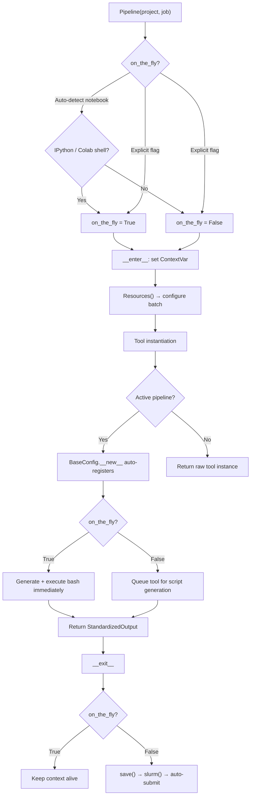
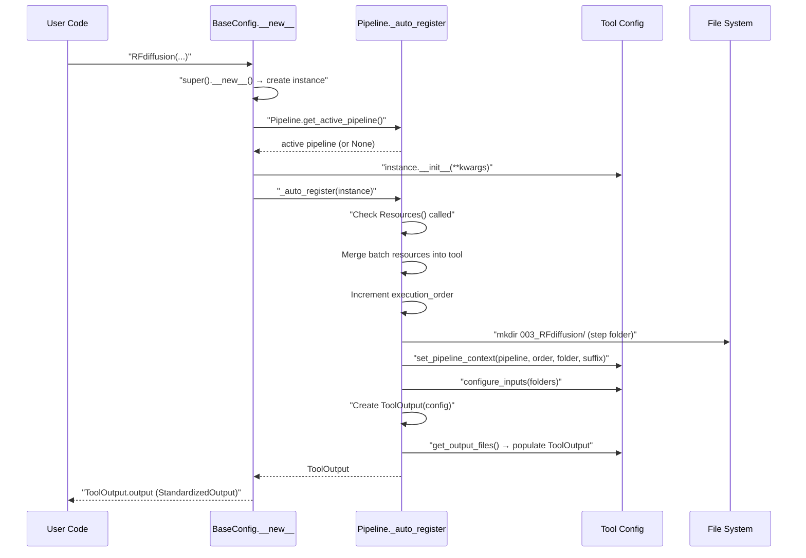
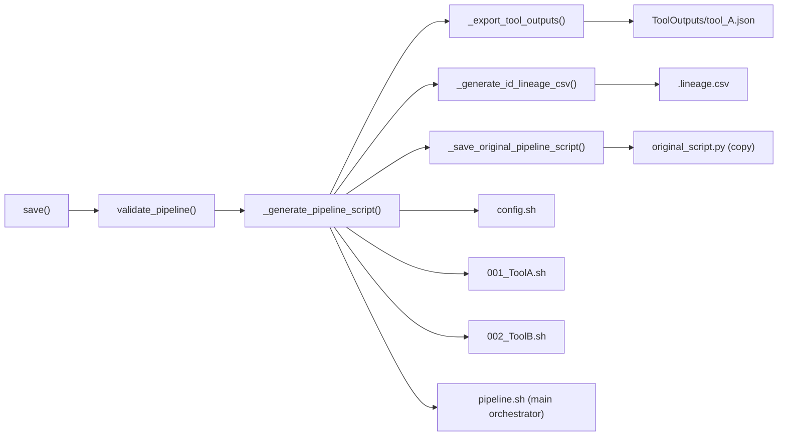
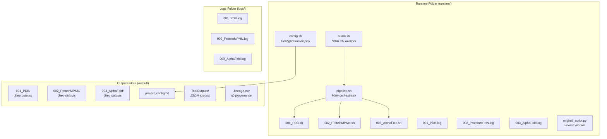

The Pipeline class is the central nervous system of BioPipelines — a declarative workflow builder that transforms sequential tool configurations into executable bash scripts or interactive notebook sessions. It manages tool sequencing, resource allocation, dependency resolution, and SLURM integration through a clean context-manager API that abstracts away the complexity of multi-environment scientific computing.

## The Two Execution Paradigms

Every pipeline operates in one of two modes, determined at construction time. Understanding this distinction is essential because it controls the entire lifecycle: how tools are registered, how scripts are generated, and how results propagate.

**SLURM mode** (the default for `.py` scripts) defers all execution. Tools are registered during the `with` block, their bash scripts are generated when the context exits, and a SLURM submission script is produced that chains them together. No computation happens locally — the pipeline is entirely a specification. **On-the-fly mode** (auto-detected in Jupyter notebooks, or forced via `on_the_fly=True`) executes each tool immediately upon registration. The bash script is generated, run via `subprocess.Popen` with line-buffered streaming, and results are available in the next notebook cell. This mode skips SLURM submission entirely on context exit, keeping the pipeline context alive for multi-cell workflows.

Sources: [pipeline.py](biopipelines/pipeline.py#L50-L78), [pipeline.py](biopipelines/pipeline.py#L120-L140)



The mode detection happens in `Pipeline.__init__` through a two-level check: first, the `BIOPIPELINES_OTF` environment variable; then, a stack inspection via `_detect_notebook()` that checks for IPython's `ZMQInteractiveShell` or Google Colab's shell module. This allows the same pipeline script to behave correctly whether executed from a terminal (SLURM), a local Jupyter instance, or Google Colab.

> [!TIP]
> The `BIOPIPELINES_OTF=1` environment variable overrides automatic notebook detection. This is the mechanism used by the `bp-otf` CLI command to force on-the-fly execution when submitting a Python pipeline directly to a SLURM interactive session via `sbatch`, giving you notebook-style feedback on a compute node.

## Context Manager and Auto-Registration

The pipeline's ergonomics rest on a **context variable** (`contextvars.ContextVar`) that tracks the currently active pipeline. When a tool class (any subclass of `BaseConfig`) is instantiated inside a `with Pipeline(...)` block, `BaseConfig.__new__` intercepts the construction, detects the active pipeline, fully initializes the instance, calls `Pipeline._auto_register()`, and returns a `StandardizedOutput` instead of the tool instance itself. This is what enables the chaining syntax where a tool's output feeds directly into the next tool's constructor.

Sources: [pipeline.py](biopipelines/pipeline.py#L39-L40), [pipeline.py](biopipelines/pipeline.py#L142-L191), [base_config.py](biopipelines/base_config.py#L117-L160)

The `__exit__` method diverges sharply between modes. In SLURM mode, it validates the pipeline, calls `save()` to generate bash scripts, then calls `slurm()` to produce the SBATCH wrapper — unless `Save()` was explicitly called, which sets `_explicit_save_called = True` to suppress auto-submission. In on-the-fly mode, `__exit__` simply returns without clearing the context variable, so the pipeline remains active across notebook cell boundaries.

Sources: [pipeline.py](biopipelines/pipeline.py#L163-L191)

## Tool Registration Lifecycle

When a tool enters the pipeline (whether via `pipeline.add()` or auto-registration), a deterministic sequence unfolds that establishes the tool's identity within the workflow. Understanding this sequence is critical for custom tool development because each phase sets up data that subsequent phases depend on.

Sources: [pipeline.py](biopipelines/pipeline.py#L277-L345), [pipeline.py](biopipelines/pipeline.py#L217-L276)



**Batch resource merging** occurs first: the resources from the current batch (set by `Resources()`) are merged into the tool's own `resources` dict. Tool-level resources don't override batch-level ones — batch resources take precedence. **Step folder creation** follows: a numbered directory like `003_RFdiffusion/` is created inside the output folder, with an optional suffix appended when `Suffix()` has been called. The `execution_order` counter is monotonically increasing and determines the step number. **Pipeline context binding** (`set_pipeline_context`) attaches the pipeline reference, execution order, output folder path, and current suffix to the tool config. **Input configuration** (`configure_inputs`) resolves DataStream inputs — expanding patterns, resolving dependencies from upstream tools, and building map tables. Finally, **output population** queries `get_output_files()` to pre-compute expected output paths and populate the `ToolOutput` wrapper.

> [!TIP]
> The `execution_order` counter is a single integer shared across all batches. If you have two `Resources()` calls and add 3 tools in batch 1 and 2 tools in batch 2, the step folders will be numbered 001, 002, 003, 004, 005 — not reset per batch. This ensures globally unique folder names and a clear chronological ordering.

## Module-Level Convenience API

Inside a `with Pipeline(...)` block, four module-level functions provide a declarative shorthand for common pipeline operations. Each function resolves the active pipeline from the context variable and delegates to the corresponding instance method. Using these functions instead of the `pipeline.` prefix is the idiomatic style for BioPipelines scripts.

Sources: [pipeline.py](biopipelines/pipeline.py#L1420-L1541)

| Function | Delegates To | Purpose | Required Before Tools? |
|---|---|---|---|
| `Resources(gpu, memory, time, **slurm)` | `pipeline.resources()` | Configure batch resources, start new batch | **Yes** — first call mandatory |
| `Suffix(suffix)` | `pipeline.set_suffix()` | Append suffix to subsequent tool folder names | No |
| `Save()` | `pipeline.save()` | Generate scripts without SLURM submission | No |
| `Dependencies(job_ids)` | `pipeline.set_dependencies()` | Set external SLURM job IDs to wait for | No (before first `Resources()`) |

Calling any of these outside a pipeline context raises a `RuntimeError` with a message indicating the correct usage pattern.

## Batch Resource Management

The `resources()` method implements a **batch resource model** where each call to `Resources()` opens a new batch. Tools added after a `Resources()` call belong to that batch and inherit its compute constraints. This design supports heterogeneous workflows where different pipeline stages require vastly different hardware — for example, GPU-heavy structure generation followed by CPU-only sequence analysis.

Sources: [pipeline.py](biopipelines/pipeline.py#L913-L986)

The first batch initializes with provided values or sensible defaults (memory: `15GB`, time: `24:00:00`, gpu: `None`). Subsequent batches **inherit** any unspecified parameter from the previous batch, allowing incremental changes:

```python
Resources(gpu="A100", memory="64GB", time="48:00:00")  # Batch 0: full spec
rfdaa = RFdiffusionAllAtom(...)                          # Belongs to batch 0

Resources(gpu="none")                                    # Batch 1: inherits memory=64GB, time=48:00:00
alphafold = AlphaFold(...)                                # Belongs to batch 1
```

The GPU specification supports a rich vocabulary for cluster resource negotiation:

| GPU Spec | SBATCH Directive | Behavior |
|---|---|---|
| `"A100"`, `"H100"`, etc. | `--gpus=<model>:1` | Request specific GPU model |
| `"32GB"`, `"80GB"` | `--gpus=1 --constraint=GPUMEM<n>` | Select by VRAM via constraint |
| `"32GB\|80GB\|96GB"` | `--gpus=1 --constraint="GPUMEM32GB\|GPUMEM80GB\|GPUMEM96GB"` | Accept any of listed VRAM tiers |
| `"high-memory"` | `--gpus=1 --constraint="GPUMEM32GB\|GPUMEM80GB\|GPUMEM96GB"` | Shorthand for high-VRAM GPUs |
| `"gpu"` or `"any"` | `--gpus=1` | Any available GPU |
| `"!L4"` | `--gpus=1 --constraint=~GPUL4` | Exclude specific model |
| `"none"` or `None` | *(no GPU directive)* | CPU-only allocation |
| `cpus=32, nodes=1` | `--cpus-per-task=32 --nodes=1` | Additional SBATCH params via `**slurm_options` |

Sources: [pipeline.py](biopipelines/pipeline.py#L660-L683)

## Script Generation Pipeline

When `save()` is called (explicitly or automatically on context exit), the pipeline enters its script generation phase. This is a multi-step process that produces a coordinated set of bash scripts, configuration exports, and metadata files inside the runtime folder.

Sources: [pipeline.py](biopipelines/pipeline.py#L436-L479), [pipeline.py](biopipelines/pipeline.py#L481-L607)



The `_generate_pipeline_script()` method performs a **two-pass dependency resolution**: first, it iterates through all tools and ensures every upstream tool's outputs are populated (calling `get_output_files()` on predecessors before calling `configure_inputs()` on dependents). Then it generates individual bash scripts for each tool and assembles the main `pipeline.sh` orchestrator. Each tool script handles its own environment activation internally, so the main script is a simple sequential chain of `bash 001_ToolA.sh 2>&1 | tee logs/001_ToolA.log` calls.

Sources: [pipeline.py](biopipelines/pipeline.py#L481-L607)

The generated `pipeline.sh` script includes a header that initializes the shell hook for the configured environment manager (mamba or conda), runs the configuration display script (`config.sh`) with output captured to a config text file, and then chains tool scripts sequentially. Each tool script is written as a standalone bash file with execute permissions (`0o755`).

Sources: [pipeline.py](biopipelines/pipeline.py#L544-L607)

## SLURM Script Generation

The `slurm()` method translates the pipeline's batch structure into SLURM submission scripts. Single-batch pipelines produce one `slurm.sh`; multi-batch pipelines produce one SLURM script per batch plus a chain submission script that handles inter-batch dependencies using `<JOBID>` placeholders.

Sources: [pipeline.py](biopipelines/pipeline.py#L610-L658), [pipeline.py](biopipelines/pipeline.py#L714-L756), [pipeline.py](biopipelines/pipeline.py#L757-L828)

For multi-batch pipelines, batch 2+ SLURM scripts include `#SBATCH --dependency=afterok:<JOBID>`, which is resolved at submission time by the chain script. External dependencies (set via `Dependencies()`) are applied to batch 1's SLURM script. Email notifications are auto-detected from `config.yaml`'s `cluster.emails` mapping using the current Unix username.

Sources: [pipeline.py](biopipelines/pipeline.py#L630-L648), [pipeline.py](biopipelines/pipeline.py#L708-L712)

## On-the-Fly Execution

In on-the-fly mode, `_execute_tool_on_the_fly()` generates the tool's bash script to the runtime folder, then runs it immediately via `subprocess.Popen` with line-buffered stdout/stderr streaming. Output appears in real-time in the notebook or terminal. The process exit code is checked — non-zero exits raise a `RuntimeError` with the log path. After successful execution, the ID lineage CSV is regenerated to reflect the new outputs.

Sources: [pipeline.py](biopipelines/pipeline.py#L347-L408)

This mechanism is what makes interactive exploration possible: you can run a structural generation tool in one cell, inspect the results, then decide what to do next in the following cell — all within the same pipeline context. The pipeline accumulates tools, scripts, and outputs across cell boundaries without any explicit state management.

## Output Export and Provenance

After script generation, the pipeline performs three provenance-preserving operations. **Tool output export** (`_export_tool_outputs`) serializes each tool's complete output structure — including streams, tables, configuration parameters, and execution metadata — to JSON files in a `ToolOutputs/` directory. This enables the `Load` tool to reuse outputs from previous pipeline runs without re-executing.

Sources: [pipeline.py](biopipelines/pipeline.py#L1016-L1108)

**ID lineage tracking** (`_generate_id_lineage_csv`) produces a `.lineage.csv` file that maps each output ID back to its input IDs, establishing a complete provenance chain across the entire pipeline. This is consumed at runtime by `biopipelines_io.lookup_table_value()` to resolve cross-stage references — for example, when a downstream tool needs to look up a metric from an upstream tool's table using the current item's original input ID.

Sources: [pipeline.py](biopipelines/pipeline.py#L1108-L1352), [biopipelines_io.py](biopipelines/biopipelines_io.py#L540-L619)

**Script archiving** (`_save_original_pipeline_script`) uses Python's `inspect` module to walk the call stack, locate the original `.py` file that created the pipeline, and copy it into the runtime folder. This provides a self-contained snapshot for reproducibility — every runtime folder contains both the generated bash scripts and the Python source that produced them.

Sources: [pipeline.py](biopipelines/pipeline.py#L1361-L1417)

## Complete Pipeline Anatomy

The following diagram shows the full structural anatomy of a pipeline's output directory after `save()` has been called, illustrating how each artifact corresponds to a phase of the orchestration engine.



## Putting It All Together: A Concrete Pipeline

This example from the ubiquitin inverse-folding pipeline demonstrates every major concept in a single, readable workflow. Each tool instantiation returns a `StandardizedOutput` via auto-registration, and downstream tools consume those outputs as typed inputs.

Sources: [ubiquitin.py](ExamplePipelines/ubiquitin.py#L1-L44)

```python
from biopipelines.pipeline import *
from biopipelines.protein_mpnn import ProteinMPNN
from biopipelines.alphafold import AlphaFold
from biopipelines.conformational_change import ConformationalChange
from biopipelines.panda import Panda
from biopipelines.dna_encoder import DNAEncoder

with Pipeline(project="Ubiquitin", job="InverseFolding"):
    Resources(gpu="A100", time="4:00:00", memory="16GB")

    # Step 1: Load PDB structure
    ubiquitin = PDB("4LCD", chain="E")

    # Step 2: Generate sequence designs (auto-registered, outputs → sequences)
    sequences = ProteinMPNN(structures=ubiquitin,
                            num_sequences=10,
                            soluble_model=True)

    # Step 3: Predict structures for designed sequences
    folded = AlphaFold(proteins=sequences)

    # Step 4: Cross-stage table references in filter
    filtered_sequences = Panda(
        tables=[folded.tables.confidence,        # Table reference from step 3
                conf_change.tables.changes],      # Table reference from another tool
        operations=[Panda.merge(),
                    Panda.filter("RMSD < 1.5 and plddt > 80")],
        pool=sequences                           # DataStream from step 2
    )
```

The pipeline produces numbered step folders (`001_PDB/`, `002_ProteinMPNN/`, `003_AlphaFold/`, ...), generates per-tool bash scripts with environment switching, assembles the main orchestrator, and creates a single SLURM script that submits the entire workflow with one `sbatch` command.

---

This page covered the Pipeline class itself — the orchestration backbone. The data flowing between tools is encapsulated in `DataStream`, the tool abstraction layer is `BaseConfig`, and the generated scripts follow a two-phase execution model. For how tools are configured and validated, see [BaseConfig: Tool Abstraction Layer](8-baseconfig-tool-abstraction-layer). For the data container that carries information between pipeline stages, see [DataStream: Unified I/O Container](7-datastream-unified-i-o-container). For a deeper look at how the generated bash scripts actually execute, see [Two-Phase Execution Model](9-two-phase-execution-model).