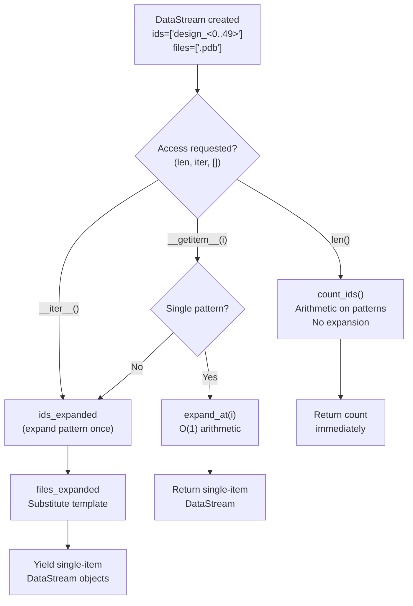
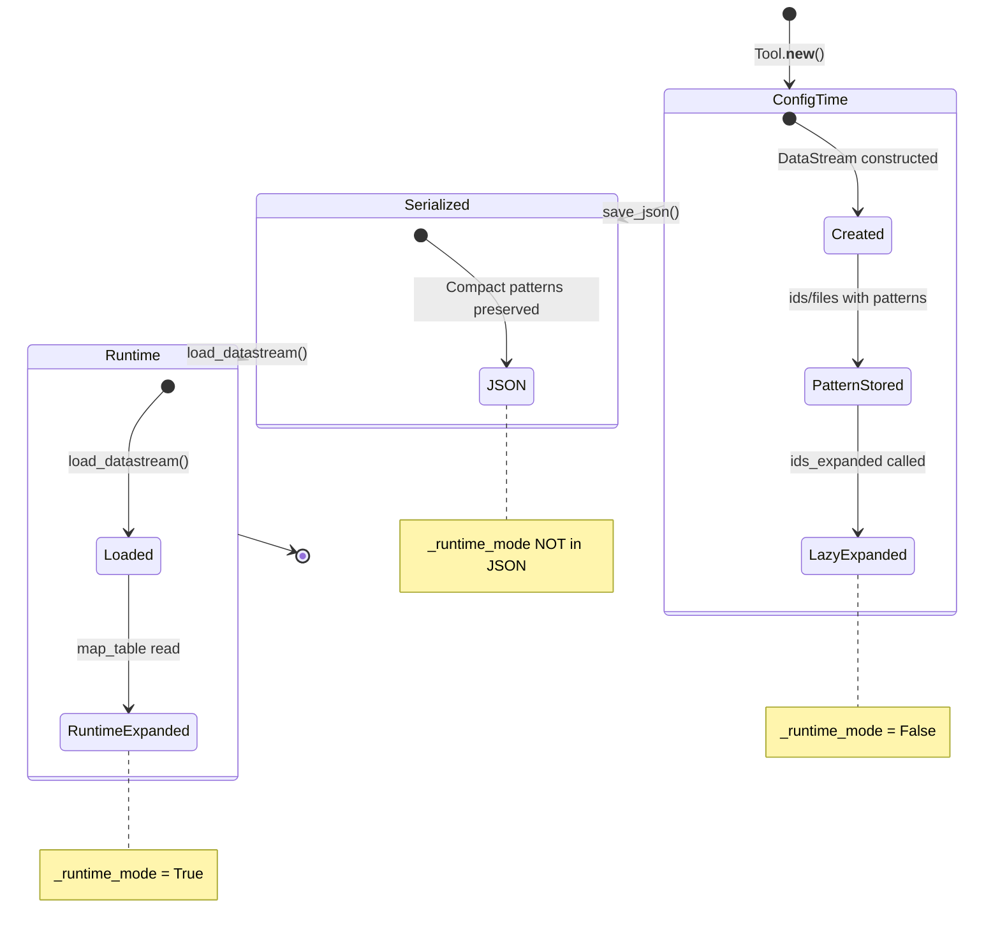

Every piece of data that moves between tools in biopipelines — structures, sequences, compounds, MSAs — travels inside a single abstraction: the **DataStream**. Rather than forcing each tool to negotiate its own file formats, ID conventions, and metadata protocols, DataStream provides a uniform container that tools both consume and produce. This page dissects its internal architecture, from the compact pattern syntax that lets a pipeline express 50,000 designs as a single string, to the two-phase expansion model that keeps configuration time fast while deferring runtime resolution to the moment it's actually needed.

## The Design Problem

A typical protein design pipeline threads data through half a dozen specialized tools — a structure loader, a sequence designer like ProteinMPNN, a structure predictor like AlphaFold, a conformer checker, a filtering engine. Each tool speaks a different data language: PDB files on disk, SMILES strings in a CSV, FASTA sequences in memory, per-structure confidence tables. Without a unifying container, every tool-to-tool handoff requires custom glue code, and adding a new tool means rewriting serialization logic for every upstream tool it connects to. DataStream eliminates this by standardizing both the *shape* of the data (a list of identified items, each optionally backed by a file or an inline value) and the *metadata envelope* around it (a map table, a format tag, and arbitrary tool-specific metadata).

Sources: [datastream.py](biopipelines/datastream.py#L5-L11)

## DataStream Anatomy

At its core, a `DataStream` is a Python `@dataclass` with six public fields and four private caches:

```python
@dataclass
class DataStream:
    name: str = ""
    ids: List[str] = field(default_factory=list)
    files: List[str] = field(default_factory=list)
    map_table: str = ""
    format: str = "pdb"
    metadata: Dict[str, Any] = field(default_factory=dict)

    # Internal caches (not serialized, not compared)
    _ids_expanded: Optional[List[str]] = field(default=None, repr=False, compare=False)
    _files_expanded: Optional[List[str]] = field(default=None, repr=False, compare=False)
    _map_data: Optional[pd.DataFrame] = field(default=None, repr=False, compare=False)
    _runtime_mode: bool = field(default=False, repr=False, compare=False)
```

The six public fields form a consistent contract that every tool can rely on:

| Field | Purpose | Example |
|-------|---------|---------|
| `name` | Semantic label for the stream | `"structures"`, `"sequences"`, `"compounds"` |
| `ids` | Identifiers for each item; may contain patterns | `["5HG6_<0..49>"]`, `["prot_0", "prot_1"]` |
| `files` | File paths; may contain `<id>` template or globs | `["<id>.pdb"]`, `["/path/a.pdb", "/path/b.pdb"]` |
| `map_table` | Path to CSV mapping ids → files/values + metadata | `"/output/structures_map.csv"` |
| `format` | Data format tag | `"pdb"`, `"cif"`, `"fasta"`, `"smiles"`, `"sdf"` |
| `metadata` | Tool-specific key-value pairs | `{"_filtered": True}` |

The four private caches support **lazy evaluation**: expansion results and loaded CSV data are computed once on first access, then reused. The `_runtime_mode` flag distinguishes between configuration-time validation (permissive) and runtime execution (strict).

Sources: [datastream.py](biopipelines/datastream.py#L24-L81)

### Storage Modes

DataStream supports two fundamentally different storage strategies, determined by the `format` field:

**File-based formats** — `pdb`, `cif`, `sdf`, `fasta` — store each item as a file on disk. The `files` list maps 1:1 with `ids_expanded` (or uses the `<id>` template shorthand). Tools read the file to access the data. This is the default and most common mode.

**Value-based formats** — `smiles`, `ccd`, `sequence` — store each item as an inline string in the `map_table` CSV's `value` column. The `files` list is empty. This avoids creating thousands of tiny single-line files for data that is natively textual. The `is_file_based()` method encapsulates this distinction:

```python
def is_file_based(self) -> bool:
    value_based_formats = {'smiles', 'ccd', 'sequence'}
    return self.format.lower() not in value_based_formats
```

Sources: [datastream.py](biopipelines/datastream.py#L392-L401)

### Map Table Contract

Every `map_table` CSV contains at minimum three columns: `id`, `file`, and `value`. For file-based streams, `file` is populated and `value` is empty; for value-based streams, `value` is populated and `file` is empty. Beyond these mandatory columns, the map table can carry arbitrary additional columns — tool metrics, provenance links, filtering flags — making it the single source of truth for an item's complete metadata. The `create_map_table()` factory function handles expansion of pattern-based IDs/files and supports automatic provenance tracking via `parent_ids` and `suffix_pattern` parameters.

Sources: [datastream.py](biopipelines/datastream.py#L430-L561)

## Pattern-Based ID Compactness

The most architecturally distinctive feature of DataStream is its **pattern syntax for IDs**, defined in the companion `id_patterns` module. This syntax allows pipelines to compactly represent large collections without materializing every element upfront.

### Deterministic Patterns

Three slot types are supported, using angle-bracket notation:

| Pattern | Expansion | Count |
|---------|-----------|-------|
| `<0..49>` | Numeric range (inclusive) | 50 |
| `<A B C>` | Explicit set (space-separated) | 3 |
| `<0..2>_<A B>` | Multi-slot: Cartesian product | 6 |

These combine with literal prefixes and suffixes through string interpolation, and multi-slot patterns produce the full Cartesian product:

```
design_<0..2>_<A B>  →  design_0_A, design_0_B, design_1_A, design_1_B, design_2_A, design_2_B
```

### Lazy (Runtime-Dependent) Patterns

When an ID cannot be fully determined at configuration time — for example, the number of mutations a saturation mutagenesis step will produce depends on the reference structure — a **bracket segment** `[...]` marks the unknown portion:

```
prot_<0..4>[_<N><S A L K>]
```

The `<0..4>` part is deterministic (expands to 5 IDs at config time), while the `[_<N><S A L K>]` bracket segment cannot be resolved until the tool actually runs. The `is_lazy` property detects these, and the `ids_expanded` property handles them differently based on `_runtime_mode`: at config time, only the deterministic prefix is expanded; at runtime, the fully expanded IDs are read from the map_table written by the execution script.

Sources: [id_patterns.py](biopipelines/id_patterns.py#L5-L17), [id_patterns.py](biopipelines/id_patterns.py#L36-L43), [id_patterns.py](biopipelines/id_patterns.py#L58-L73)

### O(1) Indexing Without Full Expansion

For single-slot deterministic patterns, the `expand_at()` function computes the expanded ID at a given index without materializing the entire list. For a pattern like `design_<0..4999>`, asking for index 2497 performs a single arithmetic operation rather than allocating a 5,000-element list. This optimization flows through `__getitem__`, which delegates to `expand_at` when the DataStream contains a single pattern:

```python
if len(self.ids) == 1 and self.has_patterns():
    item_id = id_patterns.expand_at(self.ids[0], index)
else:
    item_id = self.ids_expanded[index]
```

Sources: [id_patterns.py](biopipelines/id_patterns.py#L243-L277), [datastream.py](biopipelines/datastream.py#L223-L231)

> [!TIP]
> The `len()` of a DataStream uses `count_ids()` which performs arithmetic counting on patterns without expansion. A stream with `ids=["design_<0..9999>"]` reports length 10,000 in O(n_slots) time, not O(n_items). This makes `len()` safe to call in tight loops during configuration.

## Lazy Expansion Architecture

DataStream employs a multi-layered lazy evaluation strategy that defers expensive computations until they are actually needed:



The cache invalidation model is straightforward: caches (`_ids_expanded`, `_files_expanded`) start as `None` and are set on first access. Since `DataStream` is a mutable dataclass, if a tool modifies `ids` or `files` directly, it should call `_invalidate_caches()` — though in practice, tools create new DataStream instances rather than mutating existing ones.

Sources: [datastream.py](biopipelines/datastream.py#L99-L158)

## Iteration and Indexing

A DataStream is both **iterable** and **indexable**, yielding single-item DataStreams:

```python
# Iteration — yields DataStream with one ID each
for structure in structures:
    # structure.ids == ["design_0"], structure.files == ["/path/design_0.pdb"]
    tool = AlphaFold(proteins=structure)

# Indexing — same contract
first = structures[0]          # DataStream with ids=["design_0"]
batch = structures[10:20]      # DataStream with 10 IDs
```

Each yielded child DataStream preserves the parent's `name`, `format`, `map_table`, and `_runtime_mode`, ensuring that downstream tools can access provenance metadata regardless of how they received the data. The `filter_by_ids()` method creates a new DataStream containing only a specified subset, stamping `_filtered: True` and `_original_count` into metadata.

Sources: [datastream.py](biopipelines/datastream.py#L170-L250), [datastream.py](biopipelines/datastream.py#L305-L334)

## DataStreamResolver: Universal Input Acceptance

Tools receive DataStreams from diverse sources: other tools' outputs, raw file lists, user-provided dictionaries, or string paths. The `DataStreamResolver` class in `datastream_resolver.py` normalizes all of these into a canonical DataStream through type-based dispatch:

```mermaid
flowchart LR
    A["Tool input"] --> B{type?}
    B -->|DataStream| C["Pass through\n(no-op)"]
    B -->|List[str]| D["_resolve_file_list\nExtract IDs from basenames"]
    B -->|str| E["_resolve_string\nSingle file → single-item DS"]
    B -->|Dict| F["_resolve_dict\nids + files/values → DS"]
    B -->|None| G["ValueError\n(explicit failure, no fallbacks)"]
    D --> H["create_map_table"]
    E --> H
    F --> H
    H --> I["DataStream"]
    C --> I
```

Critically, the resolver requires the caller to specify the `format` parameter — there is no auto-detection or format guessing. This "explicit over implicit" design prevents silent data corruption when, for example, a `.dat` file could be interpreted as either PDB or SMILES.

Sources: [datastream_resolver.py](biopipelines/datastream_resolver.py#L18-L90)

## Runtime I/O Layer

At execution time (when the generated bash script runs on the cluster), DataStreams are consumed by `pipe_*.py` helper scripts. The `biopipelines_io` module provides the runtime API, operating on DataStreams loaded from JSON files:

| Function | Purpose | Return Type |
|----------|---------|-------------|
| `load_datastream(source)` | Load from JSON path or dict; sets `_runtime_mode=True` | `DataStream` |
| `iterate_files(ds)` | Yield `(id, file_path)` pairs; handles globs and templates | `Iterator[Tuple[str, str]]` |
| `iterate_values(ds, columns)` | Yield `(id, value_dict)` pairs from map_table | `Iterator[Tuple[str, Dict]]` |
| `resolve_file(ds, item_id)` | Get file for a single ID with best-match fallback | `str` |
| `get_value(ds, item_id, column)` | Read a specific column from map_table for an ID | `Any` |
| `get_all_values(ds, item_id)` | Read all columns from map_table for an ID | `Dict[str, Any]` |

The file-matching algorithm in `_find_best_match` uses a four-priority cascade: exact basename match → basename starts with `item_id_` or `item_id-` → `item_id` contained in basename → first file fallback. This handles common cases like PDB files named `protein_1_model1.pdb` when looking for ID `protein_1`.

Sources: [biopipelines_io.py](biopipelines/biopipelines_io.py#L75-L258), [biopipelines_io.py](biopipelines/biopipelines_io.py#L147-L189)

### The Resolve Class: Bridging to Bash

Some configuration parameters need to reference DataStream contents at SLURM submission time (before the tool script runs). The `Resolve` class generates inline bash expressions that evaluate on the cluster:

```python
Resolve.stream_item("/path/structures.json", "design_0")
# → '$(resolve_stream_item "/path/structures.json" "design_0")'

Resolve.stream_ids("/path/structures.json")
# → '$(python "/path/resolve_stream_ids.py" "/path/structures.json")'
```

These are consumed by the script generator in [Pipeline](9-two-phase-execution-model) to embed runtime-resolved values directly in bash scripts. This is the mechanism that makes lazy patterns work end-to-end: the bash script expands the IDs at execution time, then the Python pipe script processes them.

Sources: [biopipelines_io.py](biopipelines/biopipelines_io.py#L858-L914)

## Serialization and Lifecycle

A DataStream lives through three distinct phases, each with its own serialization boundary:



**Config time**: Tools construct DataStreams with pattern-based IDs. Caches are empty. Validation is relaxed (pattern mismatch is skipped). The `_runtime_mode` flag is `False`.

**Serialization**: `save_json()` writes only the six public fields to JSON. Internal caches and `_runtime_mode` are deliberately excluded. Patterns stay compact — a stream with 50,000 items serializes as `{"ids": ["design_<0..49999>"], ...}`.

**Runtime**: `load_datastream()` reconstructs the DataStream from JSON and sets `_runtime_mode = True`. Lazy patterns now read their fully expanded IDs from the map_table. Missing files raise errors instead of being silently ignored.

Sources: [datastream.py](biopipelines/datastream.py#L336-L385), [biopipelines_io.py](biopipelines/biopipelines_io.py#L75-L144)

> [!TIP]
> The `to_dict()` / `from_dict()` round-trip preserves patterns perfectly. Use `save_json()` for disk persistence and `from_dict()` for in-memory reconstruction. The `from_dict()` method silently ignores legacy keys like `files_contain_wildcards` for backward compatibility.

## Integration with the Output Hierarchy

DataStream objects do not float in isolation. They are assembled into the output hierarchy that tools expose to downstream consumers:

```
ToolOutput.tool_output.streams.structures    → StreamContainer
ToolOutput.tool_output.streams.sequences    → StreamContainer
ToolOutput.tool_output.tables.confidence    → TableInfo
```

The `StreamContainer` class wraps a `Dict[str, DataStream]` and provides both dictionary-style (`streams["structures"]`) and dot-notation access (`streams.structures`). The `StandardizedOutput` constructor scans its `output_files` dict for DataStream instances and automatically populates the `streams` attribute, so every tool's output uniformly exposes its data streams through the same interface.

When a tool output is passed as input to another tool (e.g., `AlphaFold(proteins=sequences)`), the `DataStreamResolver` detects the `StandardizedOutput`, unwraps it via `resolve_input_to_datastream()`, and extracts the appropriate named stream. This is the mechanism that enables the fluid chaining visible in example pipelines.

Sources: [base_config.py](biopipelines/base_config.py#L1001-L1049), [base_config.py](biopipelines/base_config.py#L1052-L1097), [datastream_resolver.py](biopipelines/datastream_resolver.py#L186-L245)

## Practical Usage Patterns

### File-Based Structure Stream

The most common pattern. A tool like ProteinMPNN produces PDB files, each identified by a design index:

```python
structures = DataStream(
    name="structures",
    ids=["design_<0..49>"],           # 50 designs, one pattern string
    files=["/output/<id>.pdb"],       # <id> template → expanded at access time
    map_table="/output/structures_map.csv",
    format="pdb"
)

print(len(structures))                # 50 — arithmetic, no expansion
print(structures[0].ids[0])           # "design_0" — O(1) via expand_at
for s in structures:                  # yields 50 single-item DataStreams
    pass                               # s.ids == ["design_N"], s.files == ["/output/design_N.pdb"]
```

### Value-Based Compound Stream

Compound libraries store SMILES inline in the map_table, avoiding thousands of one-line files:

```python
compounds = DataStream(
    name="compounds",
    ids=["lig_1", "lig_2", "lig_3"],
    files=[],                          # no files — values are in the map_table
    map_table="/output/compounds_map.csv",
    format="smiles"
)

# map_table contents:
# id,  file,  value
# lig_1,  ,  CC(=O)OC1=CC=CC=C1C(=O)O
# lig_2,  ,  CN1C=NC2=C1C(=O)N(C(=O)N2C)C
```

### Lazy Pattern with Runtime Resolution

When the number of outputs depends on input data that isn't available at config time:

```python
mutations = DataStream(
    name="structures",
    ids=["prot_0[_<N><S A L K>]", "prot_1[_<N><S A L K>]"],   # lazy bracket segments
    files=["/output/<id>.pdb"],
    format="pdb"
)

# Config time: len() counts only deterministic prefix → 2
# Runtime: map_table contains the fully expanded IDs (prot_0_N, prot_0_S, ...)
```

Sources: [datastream.py](biopipelines/datastream.py#L45-L67), [datastream.py](biopipelines/datastream.py#L117-L136)

## DataStream Quick Reference

### Construction Methods

| Method | Description |
|--------|-------------|
| `DataStream(name, ids, files, ...)` | Direct constructor with full field control |
| `DataStream.empty(name, format)` | Create an empty stream |
| `DataStream.from_dict(data)` | Deserialize from dictionary |
| `create_map_table(path, ids, ...)` | Factory for the backing CSV |

### Access Methods

| Method / Property | Returns | Notes |
|-------------------|---------|-------|
| `ids_expanded` | `List[str]` | Lazy expansion with caching |
| `files_expanded` | `List[str]` | Template substitution and glob handling |
| `len(ds)` | `int` | Arithmetic counting (no expansion for patterns) |
| `ds[i]` | `DataStream` | Single-item stream; O(1) for single patterns |
| `ds[start:end]` | `DataStream` | Slice into a new multi-item stream |
| `get_file(item_id)` | `Optional[str]` | Lookup file by ID |
| `get_value(item_id, column)` | `Optional[str]` | Lookup map_table column by ID |
| `filter_by_ids(keep_ids)` | `DataStream` | New stream with only specified IDs |

### Validation and Introspection

| Method / Property | Returns | Notes |
|-------------------|---------|-------|
| `has_patterns()` | `bool` | Any ID contains `<..>` slot |
| `is_lazy` | `bool` | Any ID contains `[...]` bracket |
| `is_file_based()` | `bool` | True for pdb/cif/sdf/fasta; False for smiles/ccd |
| `__bool__()` | `bool` | Truthy if has any items |
| `__str__()` / `__repr__()` | `str` | Human-readable summaries |

Sources: [datastream.py](biopipelines/datastream.py#L83-L427)

## What's Next

Understanding DataStream in isolation reveals a carefully designed container, but its full power emerges only in context. The following pages explore how DataStream connects to the rest of the framework:

- [Pipeline Orchestration Engine](6-pipeline-orchestration-engine) — how the Pipeline context auto-registers tools and wires their DataStream outputs to downstream inputs
- [Two-Phase Execution Model](9-two-phase-execution-model) — how DataStreams cross the config-to-runtime boundary via JSON serialization and the Resolve class
- [Bundle and Each Input Patterns](14-bundle-and-each-input-patterns) — how Bundle/Each wrappers control whether a DataStream is passed whole or split into per-item streams
- [Pattern-Based ID Expansion](15-pattern-based-id-expansion) — deep dive into the Cartesian product mechanics and provenance tracking
- [HelpScripts Runtime Layer](18-helpscripts-runtime-layer) — how `pipe_*.py` scripts consume DataStreams at execution time