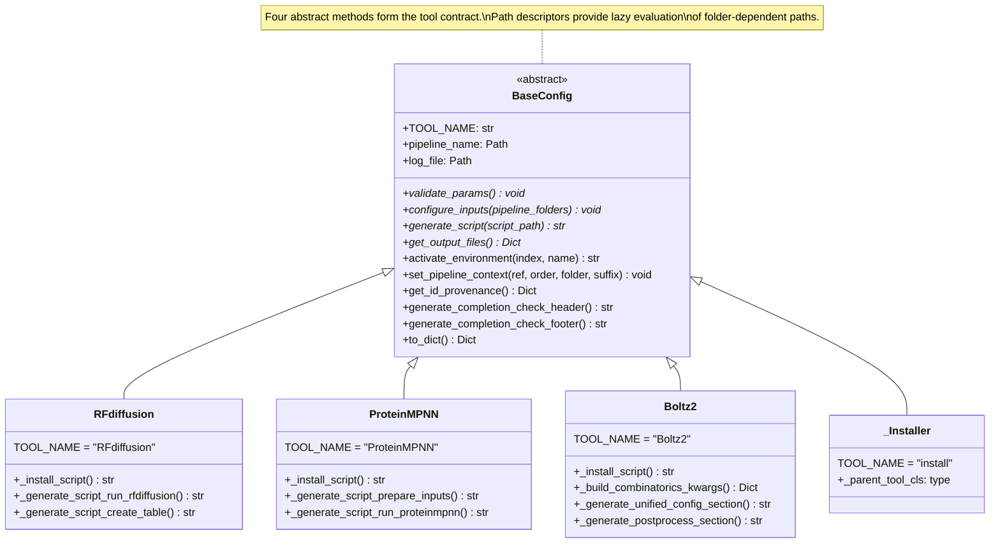
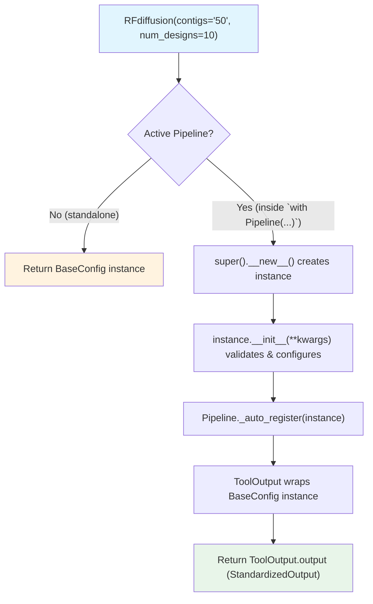

BaseConfig is the architectural spine of every modeling tool in biopipelines. It defines the contract that all tools—from RFdiffusion to Boltz2—must fulfill, while simultaneously providing a sophisticated runtime dispatch mechanism that transforms constructor calls into pipeline-registered operations. Understanding BaseConfig is the prerequisite for understanding how the framework's [Pipeline Orchestration Engine](6-pipeline-orchestration-engine) translates declarative tool configurations into executable SLURM jobs, and for authoring new integrations in the [Custom Tool Development Guide](21-custom-tool-development-guide).

## Architectural Role and Inheritance Contract

At its core, BaseConfig is an abstract class that enforces a four-method contract on every tool subclass: `validate_params`, `configure_inputs`, `generate_script`, and `get_output_files` ([base_config.py#L283-L372](biopipelines/base_config.py#L283-L372)). This contract maps directly onto the [Two-Phase Execution Model](9-two-phase-execution-model)—validation and input configuration occur during the *configuration phase*, while script generation and output declaration serve the *execution phase*. Every concrete tool in the framework inherits from BaseConfig and implements these four hooks with domain-specific logic.



The class also defines two common `Path` descriptors at the class level—`pipeline_name` and `log_file` ([base_config.py#L46-L47](biopipelines/base_config.py#L46-L47))—that are available to every subclass without override. These leverage the `Path` descriptor from [file_paths.py](biopipelines/file_paths.py), which defers computation until the `output_folder` is set during pipeline registration, solving the bootstrap ordering problem where paths depend on state that doesn't yet exist at class definition time.

> [!TIP]
> The `Path` descriptor uses Python's descriptor protocol (`__set_name__`, `__get__`, `__set__`) to intercept attribute access. When a tool declares `main_table = Path(lambda self: os.path.join(self.output_folder, "results.csv"))`, the lambda is not evaluated until the attribute is first read. This means path definitions can reference `self.output_folder` and `self.folders` safely—even though those attributes are `""` and `{}` at class definition time, they are populated before any script generation occurs.

## Constructor Dispatch and Pipeline Auto-Registration

The most architecturally significant behavior in BaseConfig is its `__new__` method ([base_config.py#L117-L160](biopipelines/base_config.py#L117-L160)), which intercepts every tool instantiation. When a tool is constructed inside an active `Pipeline` context manager, `__new__` creates the instance, calls `__init__`, then passes the instance to `Pipeline._auto_register()`, ultimately returning a `StandardizedOutput` rather than the tool instance itself.



This dispatch mechanism is what enables the framework's clean declarative syntax. Inside a pipeline, writing `rfdaa = RFdiffusionAllAtom(...)` does not assign a config object—it assigns a `StandardizedOutput` that downstream tools can consume directly. The `@overload` decorator on `__new__` ([base_config.py#L50-L59](biopipelines/base_config.py#L50-L59)) provides a type hint that tells IDEs the constructor returns the concrete tool type, preserving autocomplete for constructor parameters even though the actual runtime return type differs.

## Instance Lifecycle and State Machine

Every BaseConfig instance tracks its progression through a well-defined state machine, managed by a combination of constructor initialization and pipeline callbacks. The `__init__` method ([base_config.py#L162-L193](biopipelines/base_config.py#L162-L193)) establishes the initial state: it loads environments from config, stores all constructor kwargs in `self.params`, sets `self.configured = False` and `self.executed = False`, then immediately calls `validate_params()`. The `set_pipeline_context` method ([base_config.py#L437-L443](biopipelines/base_config.py#L437-L443)) transitions the instance to the configured state by assigning `output_folder`, `execution_order`, and `suffix`.

| Attribute | Set By | Timing | Purpose |
|-----------|--------|--------|---------|
| `self.environments` | `_load_environments()` | `__init__` | Conda/mamba env names from config.yaml |
| `self.configured` | `set_pipeline_context()` | Pipeline registration | Enables path-dependent operations |
| `self.output_folder` | `set_pipeline_context()` | Pipeline registration | Root path for all tool outputs |
| `self.execution_order` | `set_pipeline_context()` | Pipeline registration | Step index in pipeline (NNN_ToolName) |
| `self.executed` | Pipeline runtime | After SLURM job completes | Tracks completion state |

## The Four Abstract Methods

### `validate_params()`

Called during `__init__`, this method must raise exceptions if constructor arguments are invalid. Subclasses typically check for type correctness, value ranges, and mutual exclusivity constraints. For example, `RFdiffusion.validate_params()` ([rfdiffusion.py#L329-L341](biopipelines/rfdiffusion.py#L329-L341)) validates contig syntax and ensures required inputs are present.

### `configure_inputs(pipeline_folders)`

Called by the pipeline during the configuration phase. Receives the resolved folder dictionary from config.yaml and populates `self.folders`. Tools use this to resolve all `Path` descriptors and to trace upstream dependencies via `resolve_dependency_outputs()` ([base_config.py#L445-L460](biopipelines/base_config.py#L445-L460)).

### `generate_script(script_path)`

Produces the complete bash script that SLURM will execute. Tools typically compose this from multiple private helper methods—for instance, `Boltz2.generate_script()` ([boltz2.py#L373-L466](biopipelines/boltz2.py#L373-L466)) delegates to `_generate_unified_config_section()`, `_generate_msa_recycling_section()`, and `_generate_postprocess_section()`. The framework wraps the tool's script content with `generate_completion_check_header()` and `generate_completion_check_footer()`, which together implement the completion-status protocol using sentinel files like `1_RFdiffusion_COMPLETED`.

### `get_output_files()`

Declares what the tool will produce after successful execution. Returns a `Dict[str, Any]` where keys are semantic names and values are either `DataStream` objects, `TableInfo` objects, or `IndexedTableContainer` instances. This dictionary becomes the backbone of `StandardizedOutput` and drives downstream tool chaining.

## Environment Management

BaseConfig abstracts environment activation through `_load_environments()` ([base_config.py#L195-L225](biopipelines/base_config.py#L195-L225)) and `activate_environment()` ([base_config.py#L227-L280](biopipelines/base_config.py#L227-L280)). The system supports three configurations: a single environment string, a list of environments (for tools like Boltz2 that use multiple conda envs), or pip mode where no activation is needed.

| Config Pattern | `config.yaml` Entry | Activation Behavior |
|---|---|---|
| Single env | `RFdiffusion: SE3nv` | `activate_environment(0)` activates SE3nv |
| Multi-env | `DynamicBind: [dynamicbind, relax]` | `activate_environment(0)` / `activate_environment(1)` |
| Pip mode | `env_manager: pip` (no tool entry) | Returns no-op comment |
| Default fallback | No entry for tool | Falls back to `biopipelines` env |

The `activate_environment()` method sources `resolve_stream_item.sh` from HelpScripts for runtime file resolution, then emits diagnostic output (current env, Python path, version) to aid debugging in SLURM logs ([base_config.py#L270-L280](biopipelines/base_config.py#L270-L280)).

## Installation Protocol

The `_Installer` inner class ([base_config.py#L693-L731](biopipelines/base_config.py#L693-L731)) and the `install()` classmethod ([base_config.py#L82-L115](biopipelines/base_config.py#L82-L115)) provide a declarative installation mechanism. Tools override `_install_script()` to return bash commands that clone repositories and create conda environments. The `install()` method wraps this in an `_Installer` instance that auto-registers with the pipeline like any other tool, producing an installation SLURM job that runs before the tool itself.

```python
# Inside a pipeline context
with Pipeline("my_design") as p:
    RFdiffusion.install()                      # Skip if already installed
    RFdiffusion.install(force_reinstall=True)  # Always reinstall
    rfd = RFdiffusion(contigs="50", num_designs=10)
```

The `_install_script()` method receives the resolved `folders` dictionary and `env_manager` string, enabling installation scripts to reference the same folder layout the tool will use at runtime ([base_config.py#L61-L80](biopipelines/base_config.py#L61-L80)).

## Completion Checking Protocol

BaseConfig generates bash script bookends that implement a robust completion protocol. `generate_completion_check_header()` ([base_config.py#L499-L523](biopipelines/base_config.py#L499-L523)) emits a guard clause that checks for `NNN_ToolName_COMPLETED` or `NNN_ToolName_WARNING` sentinel files and exits immediately if found—this is the mechanism that makes pipeline steps idempotent across resubmissions.

The footer ([base_config.py#L526-L649](biopipelines/base_config.py#L526-L649)) serializes the tool's expected output structure into `.expected_outputs.json` at *configuration time*, then invokes `pipe_check_completion.py` at *execution time* to verify outputs match expectations and create the sentinel file. The serialization logic handles nested `TableInfo`, `IndexedTableContainer`, and `DataStream` objects through recursive `make_json_safe()` conversion.

## Provenance Tracking

The `get_id_provenance()` method ([base_config.py#L374-L423](biopipelines/base_config.py#L374-L423)) reads each output stream's `map_table` CSV and extracts columns suffixed with `.id` (e.g., `structures.id`) to build child→parent ID mappings. This enables the [Table Reference and Provenance](16-table-reference-and-provenance) system to trace any output ID back through the chain of tools that produced it. The method deduplicates across streams sharing the same map_table and skips axes already resolved.

## Output Containers: StandardizedOutput and ToolOutput

When a tool is auto-registered, the `__new__` dispatch ultimately returns a `StandardizedOutput` ([base_config.py#L1052-L1420](biopipelines/base_config.py#L1052-L1420))—the primary interface through which developers interact with tool results. `StandardizedOutput` provides three access paradigms:

1. **Stream access**: `output.streams.structures` returns a `StreamContainer` that exposes `DataStream` objects by name
2. **Table access**: `output.tables.main` returns a `TableContainer` entry with `TableInfo` metadata and column reference access
3. **Iteration**: `for item in output:` yields single-ID `StandardizedOutput` objects when all streams share the same IDs ([base_config.py#L1148-L1196](biopipelines/base_config.py#L1148-L1196))

`ToolOutput` ([base_config.py#L1693-L1833](biopipelines/base_config.py#L1693-L1833)) wraps the raw `BaseConfig` instance and exposes both `.output` (full `StandardizedOutput`) and `.o` (shorthand) properties, along with convenience accessors like `.output_pdbs`, `.output_sequences`, and `.tables` for IDE-autocomplete-friendly column reference chaining.

> [!TIP]
> The `StandardizedOutput._repr_html_()` method ([base_config.py#L1521-L1644](biopipelines/base_config.py#L1521-L1644)) dispatches Jupyter notebook rendering to external scripts configured in `config.yaml` under the `renderers` section. This means tool outputs display as rich, formatted HTML tables in notebooks without any import-time coupling between the tool module and the renderer system.

## Serialization and Inspection

Every tool can serialize its configuration via `to_dict()` ([base_config.py#L483-L492](biopipelines/base_config.py#L483-L492)) and `save_config()` ([base_config.py#L494-L497](biopipelines/base_config.py#L494-L497)), producing JSON that captures tool name, job name, environments, resource requirements, and execution order. The `get_config_display()` method ([base_config.py#L466-L481](biopipelines/base_config.py#L466-L481)) returns human-readable configuration lines that the pipeline prints during the configuration phase, allowing subclasses to surface tool-specific parameters.

## What to Read Next

Having understood the abstraction layer, the natural progression is to see how BaseConfig instances are orchestrated: [Pipeline Orchestration Engine](6-pipeline-orchestration-engine) explains the registration and scheduling mechanism, while [Two-Phase Execution Model](9-two-phase-execution-model) details how the four abstract methods map to configuration-time vs. execution-time behaviors. For practical implementation guidance, the [Custom Tool Development Guide](21-custom-tool-development-guide) demonstrates how to subclass BaseConfig with a complete working example, and the [Configuration Reference](20-configuration-reference) covers the `config.yaml` entries that drive environment management and folder resolution.