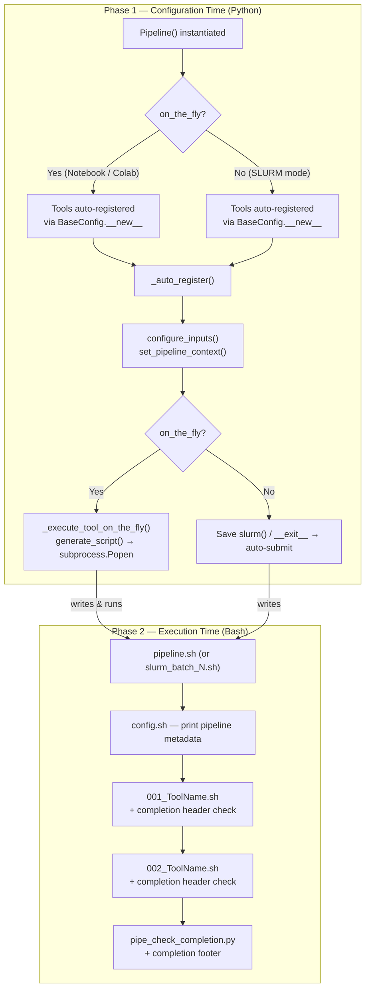

Every BioPipelines workflow traverses a strict two-phase lifecycle: a **configuration phase** that runs in Python and produces no scientific output, followed by an **execution phase** that runs in Bash and performs the actual computations. Understanding this boundary is essential for debugging, extending, and reasoning about pipeline behavior. This page dissects both phases, their handoff mechanism, and the divergent paths they take depending on execution mode.

## Architectural Overview

The two-phase model decouples *what* to run from *where* to run it. During configuration, the framework resolves all dependencies, generates concrete file paths, and emits self-contained Bash scripts. During execution, those scripts activate the correct environments and invoke the underlying tools — entirely independent of the Python runtime that produced them.

## Phase 1: Configuration Time

Configuration time is the Python execution of your pipeline script. No scientific tools run during this phase. The framework performs four distinct operations: context activation, tool registration, script generation, and dispatch.

### Context Activation and Mode Detection

The `Pipeline` constructor determines the execution mode through a cascading detection strategy. First, it checks the `BIOPIPELINES_OTF` environment variable; if unset, it inspects the call stack for an IPython or Colab shell via `_detect_notebook()` ([biopipelines/pipeline.py](biopipelines/pipeline.py#L85-L90)). This result is stored as `self.on_the_fly` and governs every subsequent behavior difference between the two modes.

When `on_the_fly` is `True`, the constructor immediately sets itself as the globally active pipeline via the module-level `contextvars.ContextVar` ([biopipelines/pipeline.py](biopipelines/pipeline.py#L139-L140)). This allows tools instantiated in subsequent Jupyter cells — outside any `with` block — to auto-register against the correct pipeline. In SLURM mode, activation only occurs upon entering the `with` statement ([biopipelines/pipeline.py](biopipelines/pipeline.py#L142-L161)).

### Tool Registration via `__new__` Interception

The critical mechanism that makes the declarative API work is `BaseConfig.__new__` ([biopipelines/base_config.py](biopipelines/base_config.py#L117-L160)). When a tool like `RFdiffusion(...)` is instantiated inside a Pipeline context, `__new__` intercepts the construction:

1. It calls `super().__new__()` to create the raw instance.
2. It immediately invokes `instance.__init__(*args, **kwargs)` to fully configure the tool.
3. It calls `active_pipeline._auto_register(instance)` to integrate the tool.
4. **It returns `tool_output.output`** (a `StandardizedOutput`) instead of the `BaseConfig` instance.

This is why `rfd = RFdiffusion(...)` yields a `StandardizedOutput` — the actual `BaseConfig` is consumed internally by the pipeline and never exposed to user code. Downstream tools receive these `StandardizedOutput` objects as inputs, and the pipeline resolves their backing data paths during script generation.

### The `_auto_register` Path

`_auto_register` ([biopipelines/pipeline.py](biopipelines/pipeline.py#L277-L345)) is the unified registration method regardless of execution mode. It performs:

- **Resource merging**: Copies the current batch's resource specifications (`gpu`, `memory`, `time`) into the tool's resource dict.
- **Folder creation**: Assigns a step-numbered output folder (e.g., `003_Boltz2`) under the pipeline's output directory, creating it immediately.
- **Context binding**: Calls `tool_config.set_pipeline_context()` to inject the pipeline reference, execution order, and output folder.
- **Input resolution**: Calls `tool_config.configure_inputs(self.folders)` to resolve all path descriptors against the concrete folder layout.
- **Output bookkeeping**: Creates a `ToolOutput` wrapper and populates it with expected output files from `get_output_files()`.

After registration, the path diverges. In on-the-fly mode, `_execute_tool_on_the_fly()` is called immediately ([biopipelines/pipeline.py](biopipelines/pipeline.py#L341-L343)). In SLURM mode, nothing further happens until the context exits.

### Script Generation

Each `BaseConfig` subclass implements `generate_script(script_path)` ([biopipelines/base_config.py](biopipelines/base_config.py#L351-L363)), an abstract method that returns a complete Bash script as a string. This script is self-contained: it activates the correct environment, invokes the tool with resolved paths, and includes completion-check scaffolding.

In **SLURM mode**, `_generate_pipeline_script()` ([biopipelines/pipeline.py](biopipelines/pipeline.py#L481-L608)) iterates over all registered tools, calls `generate_script()` for each, writes individual step scripts to the `RunTime/` directory, and assembles a master `pipeline.sh` that chains them sequentially via `tee` to both a log file and the tool's output folder `.log`.

In **on-the-fly mode**, `_execute_tool_on_the_fly()` ([biopipelines/pipeline.py](biopipelines/pipeline.py#L347-L408)) generates the same script but executes it immediately via `subprocess.Popen`, streaming stdout/stderr line-by-line to both the terminal and log files.

> [!TIP]
> The completion check mechanism is embedded at generation time, not execution time. `generate_completion_check_header()` writes a sentinel check (`_COMPLETED` file) into the script, and `generate_completion_check_footer()` invokes `pipe_check_completion.py` to validate outputs. This makes every generated script **idempotent** — re-running it after successful completion is a no-op, which is critical for SLURM job preemption recovery.

## Phase 2: Execution Time

Execution time is the Bash runtime of the generated scripts. At this point, the Python framework is no longer involved (except indirectly through helper scripts invoked from Bash).

### Script Structure

The generated `pipeline.sh` follows a consistent pattern:

| Section | Purpose | Source |
|---------|---------|--------|
| Environment initialization | Shell hook for mamba/conda | `ConfigManager.get_shell_hook_command()` |
| Configuration display | Echo pipeline metadata + per-tool params | `_generate_pipeline_script()` config block ([biopipelines/pipeline.py](biopipelines/pipeline.py#L514-L556)) |
| Per-tool execution | `<step>.sh 2>&1 \| tee <log> <folder_log>` | Loop over `self.tools` ([biopipelines/pipeline.py](biopipelines/pipeline.py#L559-L598)) |
| Completion footer | "Job done" + output path | Static finalization ([biopipelines/pipeline.py](biopipelines/pipeline.py#L600-L608)) |

Each individual tool script (`001_ToolName.sh`) wraps the actual computation with:

- **Header**: Checks for a `001_ToolName_COMPLETED` sentinel file; exits immediately if found ([biopipelines/base_config.py](biopipelines/base_config.py#L499-L524)).
- **Body**: Environment activation, tool invocation with resolved paths.
- **Footer**: Calls `pipe_check_completion.py` to validate expected outputs and create the sentinel file ([biopipelines/base_config.py](biopipelines/base_config.py#L526-L649)).

### Completion Sentinel Protocol

The sentinel file protocol provides **crash resilience** for SLURM environments. When a tool script starts, it checks for `{parent_dir}/{step}_{ToolName}_COMPLETED`. If the file exists, the script exits immediately with code 0. On successful completion, `pipe_check_completion.py` validates all expected output files against a manifest written at configuration time (`.expected_outputs.json`) and creates the sentinel. A `_WARNING` variant is created when outputs are partially missing ([biopipelines/base_config.py](biopipelines/base_config.py#L516-L524)).

This means that if a SLURM job is preempted mid-tool and requeued, the completed tools skip cleanly and only the interrupted tool restarts.

### Dispatch Mechanisms

The framework provides three dispatch paths from configuration to execution:

**`./submit`** ([submit](submit#L1-L200)) — Runs the Python pipeline script, extracts generated `RunTime/` directories from stdout, and submits the resulting SLURM scripts via `sbatch`. For multi-batch pipelines, it replaces `<JOBID>` placeholders sequentially to create inter-batch dependencies.

**`./run`** ([run](run#L1-L200)) — Identical to `submit` but executes the generated `pipeline.sh` scripts directly via `bash`, with no SLURM involvement. Multi-batch pipelines execute sequentially.

**On-the-fly** ([biopipelines/pipeline.py](biopipelines/pipeline.py#L347-L408)) — No external dispatch script. Each tool executes immediately upon registration via `subprocess.Popen` with line-buffered streaming. This is the default mode in Jupyter notebooks and Colab.

## Execution Mode Comparison

| Aspect | SLURM Mode | On-the-Fly Mode |
|--------|-----------|-----------------|
| **Activation trigger** | `on_the_fly=False` (auto-detected for `.py` scripts) | `on_the_fly=True` (auto-detected for `.ipynb` or `BIOPIPELINES_OTF=1`) |
| **Context lifetime** | Scoped to `with` block; cleared on `__exit__` | Persists across notebook cells until replaced |
| **Script persistence** | All scripts saved to `RunTime/`; master `pipeline.sh` generated | Individual step scripts saved to `RunTime/` per tool |
| **Execution timing** | Deferred until `sbatch` dispatch | Immediate via `subprocess.Popen` |
| **Auto-submission** | `__exit__` calls `self.slurm()` unless `Save()` was explicit ([biopipelines/pipeline.py](biopipelines/pipeline.py#L183-L191)) | None — each tool runs as it is registered |
| **Resource requirements** | Enforced via SBATCH directives per batch | Informational only — no resource enforcement |
| **Completion checks** | Full sentinel protocol (critical for preemption) | Full sentinel protocol (useful for cell re-execution) |
| **Error handling** | Non-zero exit propagates to SLURM job failure | `RuntimeError` raised in the calling cell |
| **Typical use case** | Cluster production runs, long-running jobs | Interactive exploration, prototyping, Colab notebooks |

## Configuration-to-Execution Handoff: The Folder Contract

The two phases communicate exclusively through the **filesystem**. During configuration, `FolderManager` creates a deterministic directory structure under the project's output root. Tool scripts reference these paths as literal strings baked into the generated Bash. The key folders are:

| Folder | Created During | Consumed During |
|--------|---------------|-----------------|
| `RunTime/` | Configuration — stores generated `.sh` scripts | Execution — scripts run from here |
| `Logs/` | Configuration — directory created | Execution — `tee` writes `.log` files |
| `{step}_{ToolName}/` | Configuration — output folder created | Execution — tool writes results here |
| `tool_outputs/` | Configuration — `_export_tool_outputs()` writes JSON | Later pipelines — `Load` tool reads these |

Because all paths are resolved to absolute filesystem locations before any Bash script is emitted, the execution phase requires no knowledge of the Python framework. This clean separation is what makes the `./run` and `./submit` bash dispatchers possible: they run the Python script purely as a **code generator**, then hand off the resulting scripts to the appropriate executor.

> [!TIP]
> The `_save_original_pipeline_script()` method ([biopipelines/pipeline.py](biopipelines/pipeline.py#L476)) copies the user's Python pipeline script into `RunTime/` alongside the generated Bash scripts. This creates a self-contained reproducibility artifact — the exact Python code that produced the execution scripts is preserved alongside them, enabling full pipeline reconstruction from the runtime directory alone.

## See Also

- [Pipeline Orchestration Engine](6-pipeline-orchestration-engine) — for the full `Pipeline` class API and lifecycle management
- [BaseConfig: Tool Abstraction Layer](8-baseconfig-tool-abstraction-layer) — for `generate_script()`, `configure_inputs()`, and the completion check protocol
- [DataStream: Unified I/O Container](7-datastream-unified-i-o-container) — for how `StandardizedOutput` bridges the configuration-to-execution boundary
- [SLURM Cluster Integration](17-slurm-cluster-integration) — for batch boundaries, resource directives, and multi-batch dependency chains