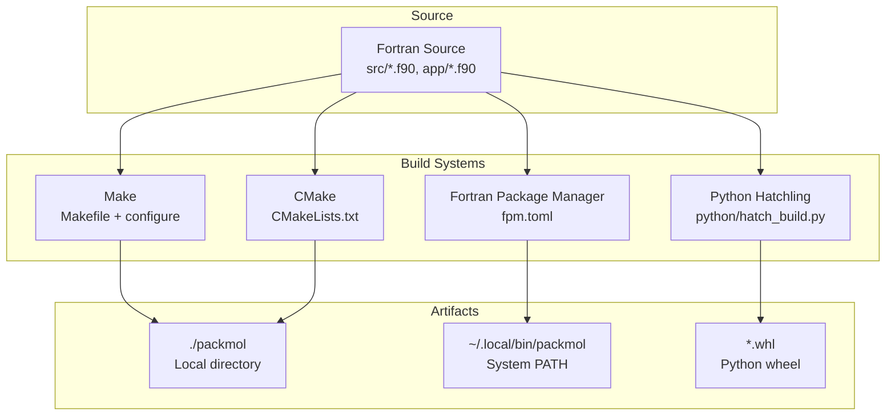
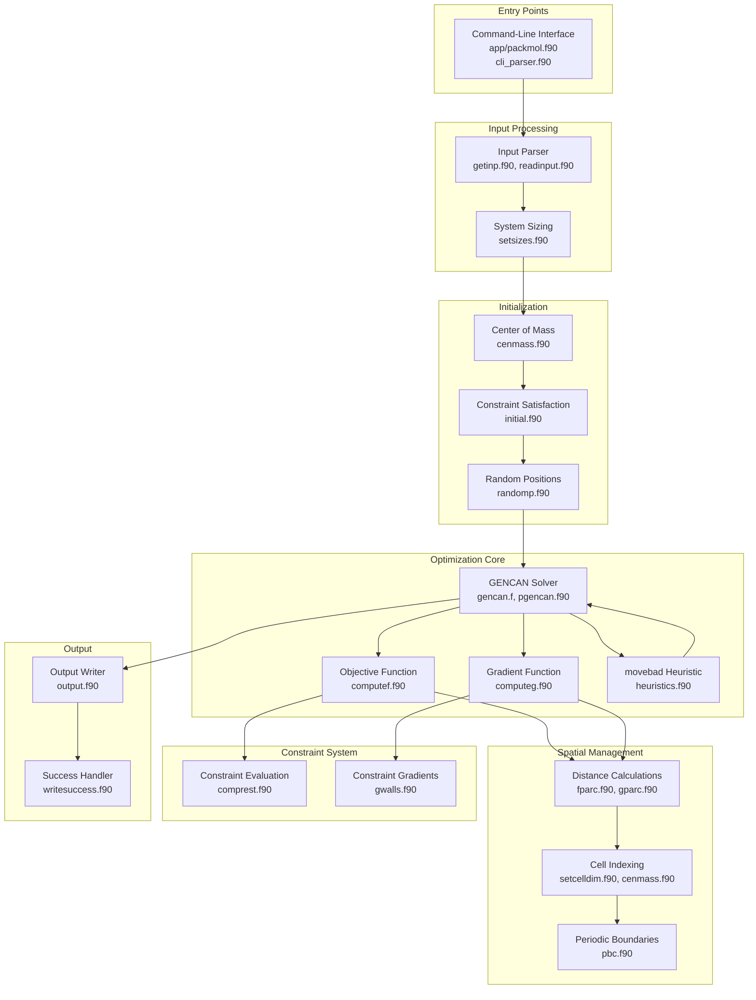
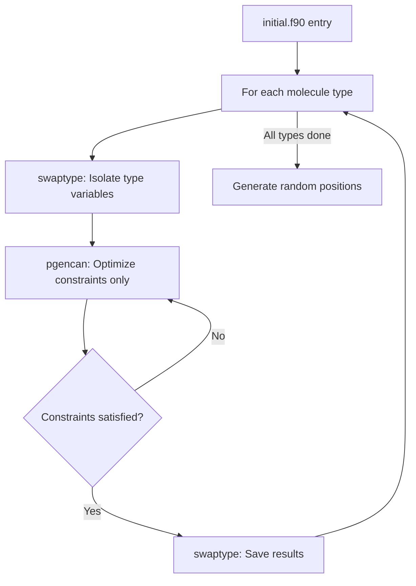
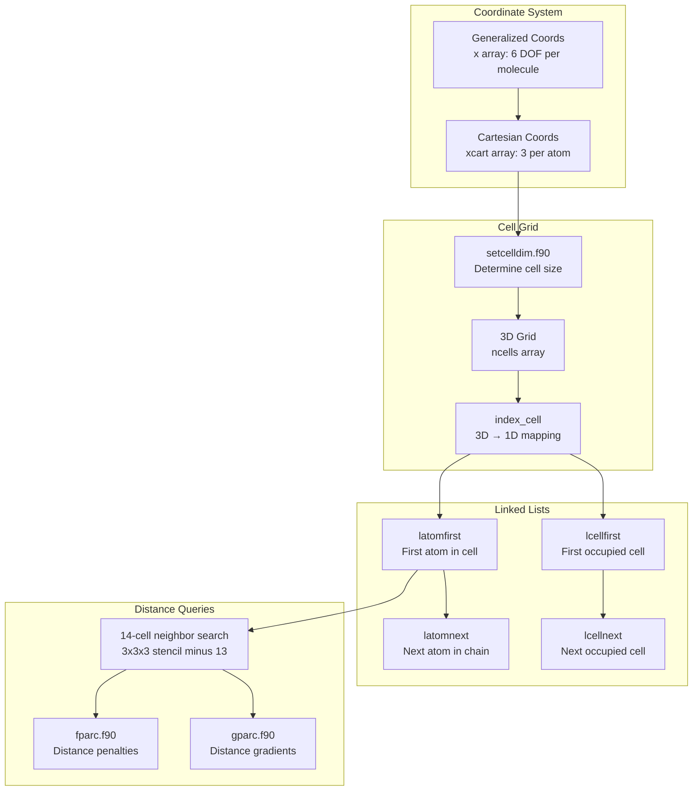

# Overview

<details>
<summary>Relevant source files</summary>

The following files were used as context for generating this wiki page:

- [CHANGELOG.md](CHANGELOG.md)
- [README.md](README.md)
- [fpm.toml](fpm.toml)
- [pyproject.toml](pyproject.toml)
- [src/title.f90](src/title.f90)
- [testing/input_files/solvprotein.inp](testing/input_files/solvprotein.inp)
- [testing/structure_files/protein.pdb](testing/structure_files/protein.pdb)
- [update_version.sh](update_version.sh)

</details>


This page provides a high-level introduction to Packmol and its architecture. It describes Packmol's purpose as a molecular packing tool and presents the major architectural components and execution flow.

For detailed installation instructions, see [Installation and Setup](#2). For usage and input file format, see [User Guide](#3). For deep dives into specific subsystems, see [Architecture and Implementation](#4).

## What is Packmol

Packmol is a software tool that creates initial atomic configurations for molecular dynamics simulations by packing molecules into defined spatial regions. The primary goal is to generate starting configurations where molecules are positioned such that short-range repulsive interactions do not immediately disrupt the simulation.

The software accepts:
- Molecular structure files (PDB, Tinker XYZ, standard XYZ formats)
- Spatial constraints defining where each molecule type should be placed
- Packing parameters (tolerance, number of molecules per type)

And produces:
- Packed molecular configurations with user-specified spatial distributions
- Optimized positions that minimize atom-atom overlap penalties
- Output files in PDB, Tinker XYZ, or standard XYZ format

**Version**: 21.1.3

**Primary Use Cases**:
- Solvating proteins in water boxes
- Creating lipid bilayers with specific geometries
- Building complex heterogeneous systems (mixtures, interfaces)
- Generating ordered structures (lamellar, spherical, tubular arrangements)

Sources: [README.md:1-20](), [src/title.f90:13-16]()

## Distribution Model

Packmol is distributed through three primary channels, all built from the same Fortran codebase:

| Distribution Channel | Package Manager | Target Users | Key Feature |
|---------------------|-----------------|--------------|-------------|
| Python Package Index | `pip install packmol` | Python users | Pre-compiled wheels, CLI wrapper |
| Julia Package | `Packmol.jl` | Julia users | Cross-platform binaries via BinaryBuilder |
| Native Binary | Manual compilation | Traditional users | Direct Fortran compilation |

The Python distribution embeds a compiled Fortran binary inside the wheel package and provides a Python CLI wrapper at `python/packmol/cli.py` that handles platform-specific execution differences (Unix: `os.execv`, Windows: `subprocess.run`).

Sources: [README.md:22-43](), [pyproject.toml:1-44]()

## Build System Architecture

Packmol supports four independent build systems, all producing functionally identical executables:



**Build System Details**:

- **Make**: Traditional Unix build system, requires `./configure` followed by `make`. Produces executable in project root.
- **CMake**: Cross-platform build system generator. Requires `cmake` configuration step, then `cmake --build`.
- **FPM**: Modern Fortran build tool. Command `fpm install --profile release` compiles and installs to `~/.local/bin`.
- **Hatchling**: Python build backend. The custom hook at `python/hatch_build.py` invokes `make` during wheel construction.

For detailed build instructions, see [Building from Source](#2.1).

Sources: [README.md:44-84](), [fpm.toml:1-20](), [pyproject.toml:29-37]()

## High-Level System Architecture



This architecture follows a three-phase execution model:

1. **Input Processing**: Parse input file, determine system size, load molecular structures
2. **Optimization**: Two-phase optimization (constraint satisfaction followed by full optimization)
3. **Output Generation**: Write final configuration in requested format

For detailed execution flow, see [Program Execution Flow](#4.2).

Sources: High-level diagrams provided in context

## Core Execution Phases

### Phase 1: Input Processing and Initialization

The program begins at `app/packmol.f90`, which orchestrates the following sequence:

1. **Title Display**: `src/title.f90` prints version information (21.1.3)
2. **Command-Line Parsing**: `cli_parser.f90` processes `-i` and `-o` flags
3. **Input File Parsing**: `getinp.f90` reads the `.inp` file, parsing structure definitions and constraints
4. **System Sizing**: `setsizes.f90` determines array dimensions based on number of molecules and atoms
5. **Center of Mass Calculation**: `cenmass.f90` computes molecular centers and reference coordinates

For input file format details, see [Input File Format](#3.1).

Sources: [src/title.f90:1-20](), High-level diagram 2

### Phase 2: Constraint Satisfaction (initial.f90)

Before full optimization, `initial.f90` performs per-molecule-type constraint satisfaction:



The `swaptype` mechanism temporarily reorders the coordinate array to focus optimization on a single molecule type, ensuring each type satisfies its geometric constraints independently before considering inter-molecular distances.

For detailed explanation, see [System Initialization](#4.3).

Sources: High-level diagram 2

### Phase 3: Main Optimization Loop

The main optimization uses the GENCAN (Gradient-based Projected Gradient with Active Set) solver:

**Key Components**:

| Component | File | Purpose |
|-----------|------|---------|
| Solver | `gencan.f`, `pgencan.f90` | Box-constrained optimization |
| Objective | `computef.f90` | Sum of distance penalties + constraint penalties |
| Gradient | `computeg.f90` | Derivatives of objective function |
| Distance | `fparc.f90`, `gparc.f90` | Pairwise atom interactions |
| Constraints | `comprest.f90`, `gwalls.f90` | Geometric constraint evaluation |
| Heuristics | `heuristics.f90` | `movebad` local search for escaping minima |

**Optimization Variables**: The coordinate array `x` stores generalized coordinates for each molecule:
- 3 center-of-mass coordinates (xcm, ycm, zcm)
- 3 Euler angles for rotation (beta, gamma, theta)

**Objective Function**: Computed in `computef.f90`:
```
f(x) = Σ penalty(distance_ij) + Σ penalty(constraint_violation)
```

For detailed optimization mechanics, see [Optimization Engine (GENCAN)](#4.4) and [Objective Function Evaluation](#4.6).

Sources: High-level diagrams 1, 2

## Spatial Acceleration System

Packmol uses cell-based spatial indexing to achieve O(N) scaling for distance calculations instead of O(N²):



**Cell Indexing Strategy**:
- Space is divided into cubic cells with side length ≈ interaction cutoff distance
- Four linked-list arrays enable efficient iteration:
  - `latomfirst[cell]`: Index of first atom in cell
  - `latomnext[atom]`: Index of next atom in same cell
  - `lcellfirst`: Index of first non-empty cell
  - `lcellnext[cell]`: Index of next non-empty cell

**Neighbor Search**: Only 14 cells are checked per atom (self + forward neighbors in 3×3×3 stencil) to avoid double-counting pairs.

For detailed spatial management, see [Spatial Management System](#4.5).

Sources: High-level diagram 4

## Constraint System

Packmol supports a rich set of geometric constraints defined in input files:

**Constraint Types**:
- **inside/outside cube**: Axis-aligned box constraint
- **inside/outside box**: Rotated box constraint
- **inside/outside sphere**: Spherical region
- **inside/outside cylinder**: Cylindrical region
- **above/below plane**: Half-space constraint
- **over plane**: Constrain center-of-mass above plane
- **constrain_rotation**: Fix Euler angles

**Evaluation**:
- `comprest.f90`: Evaluates constraint violations, returns penalty values
- `gwalls.f90`: Computes gradients of constraint penalties
- Constraints apply to either individual atoms or molecular centers of mass

**Penalty Function**: Constraints contribute to objective function when violated, with quadratic penalty increasing as violation magnitude increases.

For constraint details, see [Spatial Constraints](#3.2) and [Constraint System Implementation](#7.2).

Sources: High-level diagram 2, [testing/input_files/solvprotein.inp:1-35]()

## Output Generation

After optimization converges or reaches maximum iterations:

1. **output.f90**: Writes final configuration
   - Supports PDB, Tinker XYZ, or standard XYZ format
   - Includes CRYST1 record for PBC systems
   - Handles residue numbering schemes

2. **writesuccess.f90**: Prints success message and statistics
   - Reports final objective function value
   - Shows constraint violations if any
   - Displays total optimization time

3. **checkpoint.f90**: Saves partial results if max iterations reached
   - Allows restart from intermediate configuration

For output format details, see [Output File Formats](#3.4).

Sources: High-level diagrams 1, 2

## Version Management

The version number (21.1.3) is maintained consistently across multiple files:

| File | Line | Purpose |
|------|------|---------|
| `src/title.f90` | 16 | Displayed at runtime |
| `fpm.toml` | 2 | Fortran Package Manager metadata |
| `pyproject.toml` | 3 | Python package metadata |

The `update_version.sh` script synchronizes version numbers across all three files using `sed` transformations.

For release process details, see [Version Management](#6.2).

Sources: [src/title.f90:13-16](), [fpm.toml:2](), [pyproject.toml:3](), [update_version.sh:1-46]()

## Testing Infrastructure

Packmol employs a comprehensive testing strategy:

**Test Types**:
1. **Julia Validation Tests** (`testing/runtests.jl`): Parse output PDB files and verify minimum distances using CellListMap.jl
2. **Shell CLI Tests** (`testing/test_cli.sh`): Validate CLI interface by testing multiple invocation methods
3. **Error Handling Tests** (`testing/test_failed.sh`): Ensure proper error reporting for invalid inputs

**Test Coverage**:
- Basic systems (water boxes, simple mixtures)
- Periodic boundary conditions with various configurations
- Complex biological systems (protein solvation, lipid bilayers)
- Edge cases and intentional failure scenarios

**CI/CD**: GitHub Actions orchestrates testing on Ubuntu and macOS platforms with multiple compilers.

For testing details, see [Testing and Validation](#5).

Sources: High-level diagram 5, [testing/input_files/solvprotein.inp:1-35]()

## Key Fortran Modules and Files

The following table maps major subsystems to their primary implementation files:

| Subsystem | Primary Files | Purpose |
|-----------|---------------|---------|
| Entry Point | `app/packmol.f90` | Main program |
| Input Parser | `getinp.f90`, `readinput.f90` | Parse `.inp` files |
| Initialization | `initial.f90`, `cenmass.f90` | Setup and constraint satisfaction |
| Optimization | `gencan.f`, `pgencan.f90` | GENCAN solver |
| Objective/Gradient | `computef.f90`, `computeg.f90` | Function evaluation |
| Distance Calculations | `fparc.f90`, `gparc.f90` | Pairwise interactions |
| Constraints | `comprest.f90`, `gwalls.f90` | Geometric constraints |
| Spatial Indexing | `setcelldim.f90`, `cenmass.f90` | Cell grid management |
| Periodic Boundaries | `pbc.f90` | PBC handling |
| Heuristics | `heuristics.f90` | Local search (movebad) |
| Output | `output.f90`, `writesuccess.f90` | Write results |
| CLI | `cli_parser.f90` | Command-line argument parsing |
| Coordinate Transform | `eulerrmat.f90`, `compcart.f90` | Rotation matrices |

Sources: High-level diagrams 1, 2, 3, 4

---