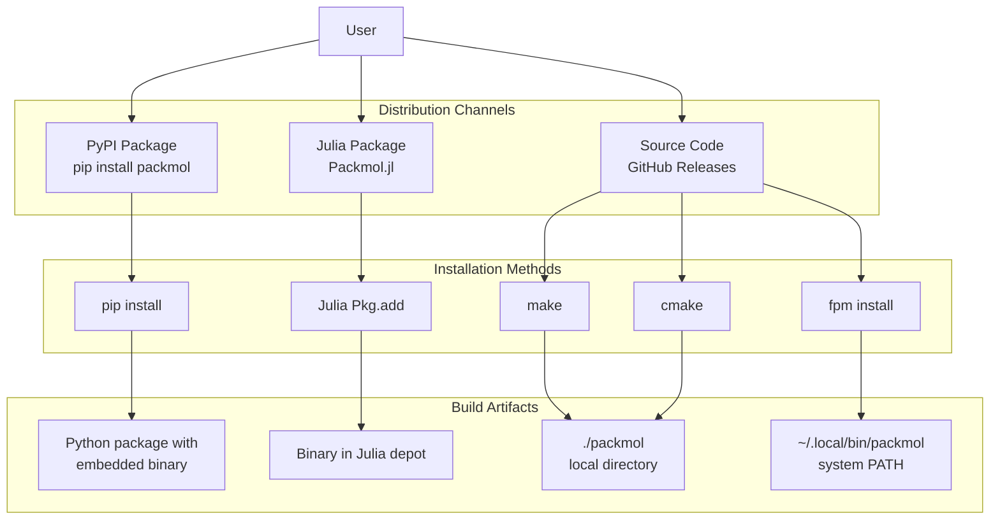
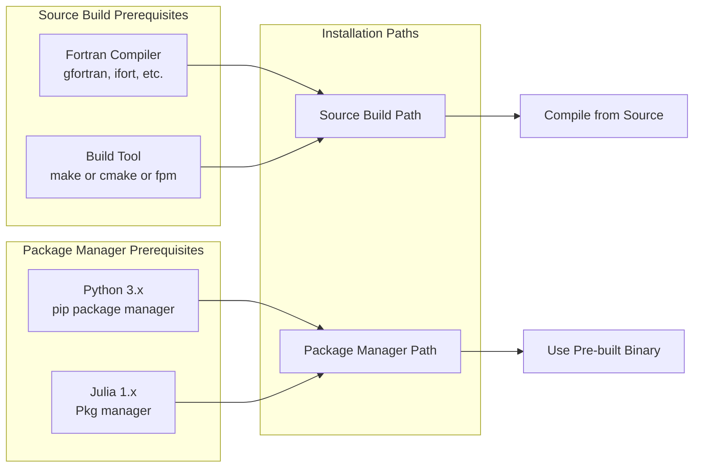
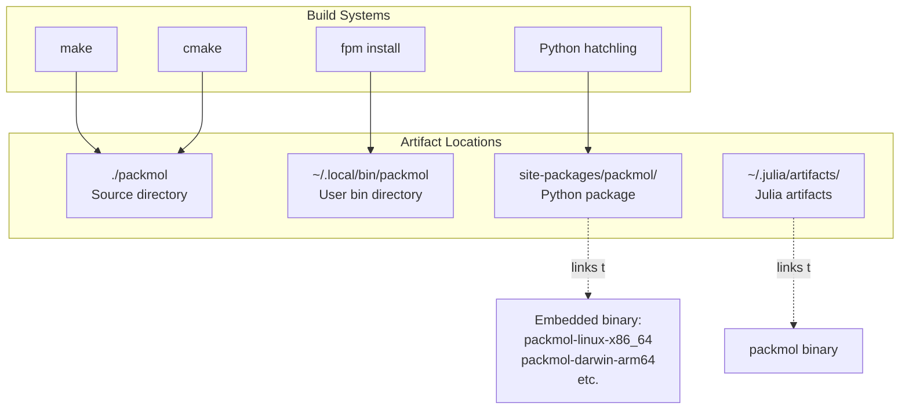
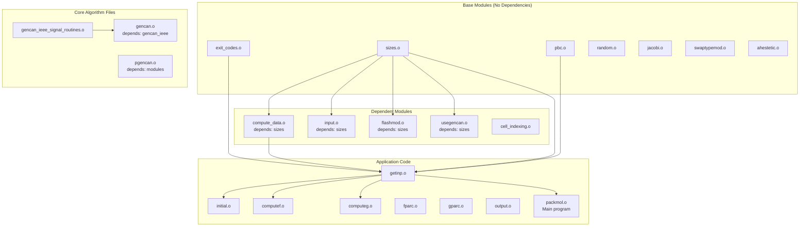

# Installation and Setup

<details>
<summary>Relevant source files</summary>

The following files were used as context for generating this wiki page:

- [Makefile](Makefile)
- [README.md](README.md)

</details>


This document provides an overview of the various methods for installing Packmol on your system. Packmol offers multiple installation paths to accommodate different user needs: pre-built binaries via package managers (Python pip, Julia), or source compilation using traditional build tools (Make, CMake, Fortran Package Manager).

For detailed instructions on specific installation methods, see:
- [Building from Source](#2.1) - Compilation with Make, CMake, or FPM
- [Python Package Installation](#2.2) - Installation via pip with embedded binary
- [Julia Package Integration](#2.3) - Using Packmol through Packmol.jl

For information about the build system architecture itself, see [Build System Architecture](#4.1).

---

## Overview of Installation Methods

Packmol supports four distinct installation paths, each with different characteristics and use cases:



**Sources:** [README.md:23-84](), [Makefile:1-216]()

### Installation Method Comparison

| Method | Prerequisites | Produces | Best For |
|--------|--------------|----------|----------|
| **pip install** | Python 3.x | Pre-compiled binary in Python package | Users who want zero-configuration installation |
| **Julia Package** | Julia 1.x | Binary managed by Julia artifacts | Julia users, multi-platform support |
| **make** | gfortran or compatible Fortran compiler | `./packmol` in source directory | Traditional Unix workflows, custom optimization |
| **CMake** | CMake 3.x, Fortran compiler | `./packmol` in build directory | Cross-platform builds, IDE integration |
| **fpm** | Fortran Package Manager | `~/.local/bin/packmol` in PATH | Modern Fortran development, automatic compiler detection |

**Sources:** [README.md:22-84]()

---

## Prerequisites by Installation Method

The prerequisites vary significantly depending on which installation method you choose:



**Sources:** [README.md:22-84](), [Makefile:17]()

### Fortran Compiler Requirements

For source builds, Packmol requires a Fortran compiler that supports Fortran 90/95. The default configuration uses `gfortran`:

- **Default compiler path**: `/usr/bin/gfortran` [Makefile:17]()
- **Compiler flags**: `-O3 -march=native -funroll-loops` [Makefile:21]()
- **Alternative compilers**: Any Fortran 90/95 compatible compiler (ifort, gfortran, etc.)

The `configure` script can automatically detect available Fortran compilers on your system [README.md:63]().

### Python Package Requirements

The Python distribution requires only Python 3.x with pip. The package includes a pre-compiled binary, so no Fortran compiler is needed [README.md:31-42]().

### Julia Package Requirements

The Julia interface requires Julia 1.x. The Packmol.jl package handles binary distribution automatically through Julia's artifact system [README.md:23-29]().

---

## Quick Start Guide

This section provides minimal commands to get Packmol installed quickly. For detailed instructions and troubleshooting, see the dedicated sub-pages.

### Python Installation (Recommended for Most Users)

```bash
pip install packmol
```

Or using `uv` for CLI-only usage:

```bash
uvx packmol < input.inp
```

For details, see [Python Package Installation](#2.2).

**Sources:** [README.md:31-42]()

### Julia Installation (Recommended for Julia Users)

```julia
using Pkg
Pkg.add("Packmol")
```

For details, see [Julia Package Integration](#2.3).

**Sources:** [README.md:23-29]()

### Source Compilation with Make

```bash
# Download and extract source
tar -xzvf packmol-XX.X.X.tar.gz
cd packmol

# Configure and build
./configure
make

# Binary created as ./packmol
```

For details, see [Building from Source](#2.1).

**Sources:** [README.md:44-67](), [Makefile:93-102]()

### Source Compilation with FPM

```bash
# Install fpm first (if needed)
# See https://fpm.fortran-lang.org/en/install/index.html

# Build and install
cd packmol
fpm install --profile release

# Binary installed to ~/.local/bin/packmol
```

For details, see [Building from Source](#2.1).

**Sources:** [README.md:69-83]()

---

## Build Artifacts and File Locations

The location of the compiled Packmol binary depends on the installation method:



**Sources:** [README.md:67,79](), [Makefile:98]()

### Make and CMake Build Artifacts

When building with `make` or `cmake`, the executable is created in the source directory:

- **Executable name**: `packmol`
- **Location**: Root of source directory
- **Path configuration**: User must manually add directory to `PATH`

The Makefile removes intermediate files (`.o` and `.mod`) after successful build [Makefile:99]().

**Sources:** [Makefile:93-102]()

### FPM Build Artifacts

When using Fortran Package Manager:

- **Executable name**: `packmol`
- **Default location**: `~/.local/bin/packmol` (Linux/macOS)
- **Path configuration**: Automatically in `PATH` if `~/.local/bin` is configured
- **Compiler selection**: Automatic detection, override with `FPM_FC` environment variable

**Sources:** [README.md:69-83]()

### Python Package Structure

The Python package embeds the Fortran binary:

```
site-packages/packmol/
├── __init__.py
├── cli.py                    # Python wrapper
├── packmol-linux-x86_64      # Linux binary
├── packmol-darwin-arm64      # macOS ARM binary
├── packmol-darwin-x86_64     # macOS Intel binary
└── packmol.exe               # Windows binary
```

The `cli.py` module selects the appropriate binary for the platform at runtime.

For details on Python packaging, see [Python Distribution](#6.1).

**Sources:** [README.md:31-42]()

---

## Verifying Installation

After installation, verify that Packmol is working correctly:

### Command-Line Verification

```bash
# Check that packmol is in PATH
which packmol

# Run with version/help flag
packmol --version  # or --help
```

### Test with Simple Input

Create a minimal test input file `test.inp`:

```
tolerance 2.0
filetype pdb
output test_output.pdb

structure water.pdb
  number 10
  inside box 0. 0. 0. 20. 20. 20.
end structure
```

Run Packmol:

```bash
packmol < test.inp
```

Successful execution should produce:
- Output message containing `Success!` [src/writesuccess.f90]()
- Generated output file `test_output.pdb`

### Python Package Verification

```python
import subprocess
subprocess.run(['packmol', '--version'])
```

For comprehensive testing procedures, see [Testing and Validation](#5).

**Sources:** [README.md:17-19]()

---

## Module Dependencies and Build Order

Packmol's Fortran modules have specific dependency relationships that determine compilation order:



**Sources:** [Makefile:50-89,120-141]()

The Makefile defines the module compilation order [Makefile:120-141]():

1. **Base modules** with no dependencies: `exit_codes`, `sizes`, `pbc`, `swaptypemod`, `ahestetic`
2. **Dependent modules**: `compute_data`, `input`, `flashmod`, `usegencan`, `cell_indexing`
3. **Algorithm modules**: `gencan_ieee_signal_routines`, `gencan`, `pgencan`
4. **Application code**: All other `.f90` files

The variable `modules` defined at [Makefile:120-121]() lists the dependencies that most source files require.

---

## Build Variants

The Makefile supports multiple build configurations for different use cases:

| Target | Flags | Purpose |
|--------|-------|---------|
| `all` (default) | `-O3 -march=native -funroll-loops` | Optimized production build |
| `devel` | `-Wall -fcheck=bounds -g -fbacktrace -ffpe-trap=...` | Development with runtime checks |
| `perf` | `-g -pg` | Performance profiling with gprof |
| `static` | `-O3 --fast-math -static` | Statically linked binary |

**Sources:** [Makefile:32-46]()

### Development Build

```bash
make devel
```

Compiles with:
- Bounds checking enabled [Makefile:36]()
- Floating-point exception trapping [Makefile:36]()
- Debugging symbols [Makefile:36]()
- Backtraces on errors [Makefile:36]()

### Performance Profiling Build

```bash
make perf
```

Enables profiling flags for use with `gprof` [Makefile:39-42]().

### Static Build

```bash
make static
```

Creates a statically-linked executable that includes all libraries [Makefile:43-46]().

**Sources:** [Makefile:32-46,106-116]()

---

## Cleaning Build Artifacts

The Makefile provides two cleaning targets:

```bash
# Remove intermediate files (.o, .mod)
make clean

# Remove all build files including executable
make cleanall
```

The `clean` target removes object files and module files [Makefile:209-210]().

The `cleanall` target additionally removes the `packmol` executable [Makefile:214-215]().

**Sources:** [Makefile:209-216]()

---

## Compiler Configuration

### Default Compiler

The default Fortran compiler is specified at [Makefile:17]():

```makefile
FORTRAN=/usr/bin/gfortran
```

### Automatic Compiler Detection

The `configure` script can automatically detect available Fortran compilers [README.md:63]():

```bash
./configure
```

Or specify a compiler explicitly:

```bash
./configure /usr/bin/ifort
```

### FPM Compiler Selection

When using FPM, the compiler is automatically detected. Override with the `FPM_FC` environment variable [README.md:82-83]():

```bash
export FPM_FC=ifort
fpm install --profile release
```

**Sources:** [README.md:60-83](), [Makefile:17]()

---

## Platform-Specific Notes

### Linux

All installation methods work on Linux. The default compiler path assumes `gfortran` is available at `/usr/bin/gfortran` [Makefile:17]().

### macOS

- Requires Xcode Command Line Tools for source builds
- Python wheels available for both Intel (x86_64) and Apple Silicon (arm64)
- FPM installation works on both architectures

### Windows

- Python wheel provides Windows binary (`.exe`)
- Source compilation requires MinGW or similar Fortran compiler
- CMake recommended for Windows source builds

**Sources:** [README.md:31-84]()

---

## Next Steps

After installing Packmol, proceed to:
- [User Guide](#3) - Learn how to use Packmol
- [Input File Format](#3.1) - Understand input file syntax
- [Command-Line Interface](#3.5) - Learn command-line options

For developers:
- [Build System Architecture](#4.1) - Understand the build infrastructure
- [Program Execution Flow](#4.2) - Understand how Packmol works internally

**Sources:** [README.md:1-97]()

---