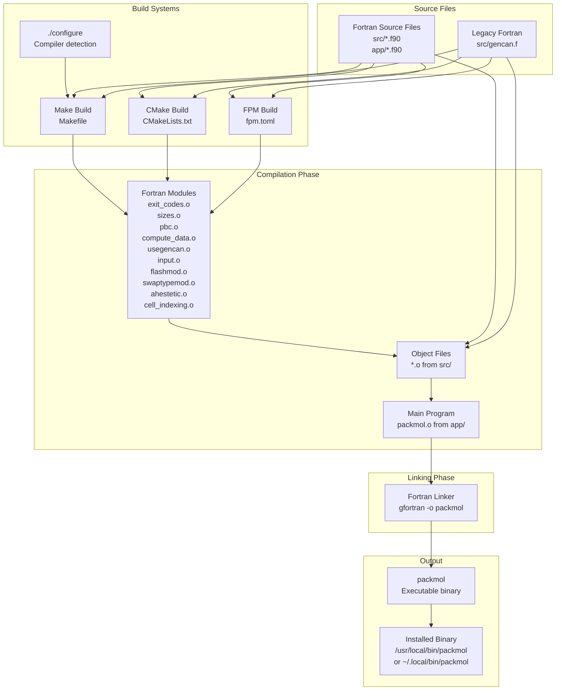
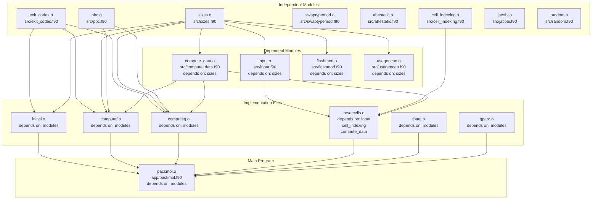

# Building from Source

<details>
<summary>Relevant source files</summary>

The following files were used as context for generating this wiki page:

- [CMakeLists.txt](CMakeLists.txt)
- [Makefile](Makefile)
- [src/cell_indexing.f90](src/cell_indexing.f90)
- [src/resetcells.f90](src/resetcells.f90)
- [testing/input_files/water_box.inp](testing/input_files/water_box.inp)

</details>


## Purpose and Scope

This document provides detailed instructions for compiling Packmol from source code using one of three supported build systems: Make, CMake, or Fortran Package Manager (FPM). For information about the Python package installation (which includes pre-compiled binaries), see [Python Package Installation](#2.2). For architectural details about how the build systems work internally, see [Build System Architecture](#4.1).

## Prerequisites

Packmol is written in Fortran and requires a Fortran compiler. The following compilers are supported:

- **GNU Fortran (gfortran)**: The default and recommended compiler
- **Intel Fortran Compiler (ifort)**: Compatible with manual configuration
- **Other Fortran 90+ compilers**: May work with appropriate flag adjustments

The build systems require:
- **Make**: Standard on Unix-like systems (Linux, macOS)
- **CMake**: Version 3.5 or higher (optional, for CMake builds)
- **FPM**: Fortran Package Manager (optional, for FPM builds)

## Building with Make

The Makefile-based build is the primary and most tested method for compiling Packmol.

### Basic Compilation

To compile with default settings:

```bash
make
```

This will:
1. Use `/usr/bin/gfortran` as the compiler [Makefile:17]()
2. Apply optimization flags: `-O3 -march=native -funroll-loops` [Makefile:21]()
3. Produce an executable named `packmol` in the current directory [Makefile:98]()

### Auto-detecting the Compiler

The repository includes a `configure` script that can automatically detect available Fortran compilers:

```bash
./configure
make
```

### Custom Compiler

To use a specific Fortran compiler, edit the `FORTRAN` variable in the Makefile [Makefile:17]() or override it on the command line:

```bash
make FORTRAN=/path/to/your/fortran/compiler
```

### Build Targets

The Makefile provides several build targets:

| Target | Purpose | Flags | Use Case |
|--------|---------|-------|----------|
| `all` (default) | Production build | `-O3 -march=native -funroll-loops` | Normal usage |
| `devel` | Development build | `-Wall -fcheck=bounds -g -fbacktrace -ffpe-trap=...` | Debugging |
| `perf` | Performance profiling | `-g -pg` | Profiling with gprof |
| `static` | Static linking | `-O3 --fast-math -static` | Standalone binary |
| `clean` | Remove objects | N/A | Cleanup build files |
| `cleanall` | Remove all artifacts | N/A | Complete cleanup |

**Development Build**: Enables runtime checks and debugging symbols:
```bash
make devel
```

**Static Build**: Creates a standalone executable with no dynamic dependencies:
```bash
make static
```

**Performance Profiling**: Enables profiling instrumentation:
```bash
make perf
```

Sources: [Makefile:35-46](), [Makefile:93-116](), [Makefile:209-215]()

## Building with CMake

CMake provides a cross-platform alternative to the traditional Makefile.

### Basic CMake Build

```bash
mkdir build
cd build
cmake ..
cmake --build .
```

### Installation

To install the compiled binary to a system location:

```bash
cmake --install .
```

By default, this installs to `/usr/local/bin` or the platform-appropriate location [CMakeLists.txt:60]().

### Build Type Configuration

CMake defaults to Release mode [CMakeLists.txt:5-7](), but you can specify other build types:

```bash
cmake -DCMAKE_BUILD_TYPE=Debug ..
cmake --build .
```

Available build types:
- `Release`: Optimized build (default)
- `Debug`: Debug symbols, no optimization
- `RelWithDebInfo`: Optimization with debug info
- `MinSizeRel`: Optimize for size

### Compiler Selection

To use a specific Fortran compiler with CMake:

```bash
cmake -DCMAKE_Fortran_COMPILER=/path/to/compiler ..
cmake --build .
```

Sources: [CMakeLists.txt:1-61]()

## Building with Fortran Package Manager

FPM (Fortran Package Manager) provides a modern, dependency-aware build system.

### Basic FPM Build

```bash
fpm build
```

### Installation

To install to `~/.local/bin`:

```bash
fpm install
```

FPM automatically:
- Detects available Fortran compilers
- Determines module dependencies
- Handles parallel compilation
- Manages build artifacts in the `build/` directory

## Build Process Overview

The following diagram shows how each build system processes source files to produce the final executable:



Sources: [Makefile:1-216](), [CMakeLists.txt:1-61]()

## Module Compilation Order

Packmol's Fortran modules must be compiled in dependency order. The Makefile explicitly manages these dependencies to ensure modules are available when needed by dependent source files:



Sources: [Makefile:120-141](), [Makefile:146-205](), [src/resetcells.f90:11-12](), [src/cell_indexing.f90:1-4]()

The Makefile defines the `modules` variable [Makefile:120-121]() that lists all core modules. These must be compiled before any implementation files that use them [Makefile:146-205]().

## Compilation Details

### Source File Organization

The source code is organized into two directories:
- `src/`: Contains library routines and modules (45+ files)
- `app/`: Contains the main program [app/packmol.f90]()

### Object File List

The complete list of object files required for linking is defined in [Makefile:50-89](). Key components include:

| Category | Object Files | Purpose |
|----------|--------------|---------|
| **Core Engine** | `packmol.o`, `initial.o`, `computef.o`, `computeg.o` | Main program and optimization |
| **Input/Output** | `getinp.o`, `output.o`, `cli_parser.o`, `checkpoint.o` | File parsing and writing |
| **Optimization** | `gencan.o`, `pgencan.o`, `usegencan.o` | GENCAN solver interface |
| **Spatial Management** | `cell_indexing.o`, `resetcells.o`, `fparc.o`, `gparc.o` | Cell indexing and distance calculations |
| **Constraints** | `gwalls.o`, `comprest.o`, `restmol.o` | Constraint evaluation |
| **Utilities** | `cenmass.o`, `swaptype.o`, `random.o`, `flashsort.o` | Helper functions |
| **Modules** | `sizes.o`, `pbc.o`, `compute_data.o`, `input.o` | Shared data structures |

Sources: [Makefile:50-89]()

### Compiler Flag Details

The Makefile uses different flag sets depending on the build target:

**Production Build** [Makefile:21]():
- `-O3`: Maximum optimization
- `-march=native`: Optimize for CPU architecture
- `-funroll-loops`: Aggressive loop unrolling

**Development Build** [Makefile:36]():
- `-Wall`: All warnings
- `-fcheck=bounds`: Array bounds checking
- `-g`: Debug symbols
- `-fbacktrace`: Stack trace on error
- `-ffpe-trap=zero,overflow,underflow`: Trap floating-point exceptions

**Special Handling**: The GENCAN solver ([src/gencan.f]()) and IEEE signal routines are compiled with slightly different flags [Makefile:32-37](), [Makefile:204-205]() to handle floating-point operations correctly.

Sources: [Makefile:21](), [Makefile:32-46](), [Makefile:202-205]()

## Verifying the Build

After compilation, verify the executable works correctly:

```bash
./packmol < testing/input_files/water_box.inp
```

This should:
1. Read the input file [testing/input_files/water_box.inp]()
2. Process 1000 water molecules [testing/input_files/water_box.inp:10]()
3. Pack them inside a box constraint [testing/input_files/water_box.inp:11]()
4. Generate `output.pdb` [testing/input_files/water_box.inp:7]()
5. Display "Success!" message if packing succeeds

For comprehensive testing, see [Testing and Validation](#5).

Sources: [testing/input_files/water_box.inp:1-15]()

## Troubleshooting

### Compiler Not Found

If the compiler is not found, either:
- Run `./configure` to auto-detect
- Manually specify: `make FORTRAN=/path/to/gfortran`
- Install gfortran: `apt-get install gfortran` (Debian/Ubuntu) or `brew install gcc` (macOS)

### Module Dependency Errors

If you see errors about missing modules:
- Ensure you're using `make` (not manually compiling files)
- Verify you haven't modified the Makefile's dependency order [Makefile:120-205]()
- Run `make clean` before rebuilding

### Optimization Issues

If the optimized build has problems:
- Try the development build: `make devel`
- Remove `-march=native` if targeting different CPUs
- Use `-O2` instead of `-O3` for more conservative optimization

### Static Linking Fails

Static linking may fail on some systems due to missing static libraries:
- Install static versions of system libraries
- Use the default dynamic linking instead
- Build in a container with static libraries available

## Summary

Packmol provides three build systems (Make, CMake, FPM) that all produce the same `packmol` executable from approximately 55 Fortran source files. The Make-based build is the most mature and configurable, supporting various optimization levels and debugging modes. CMake offers better cross-platform support and standardized installation paths. FPM provides modern dependency management. All three methods follow the same general process: compile Fortran modules first [Makefile:120-141](), then implementation files [Makefile:146-205](), and finally link everything into a single executable [Makefile:98]().

---