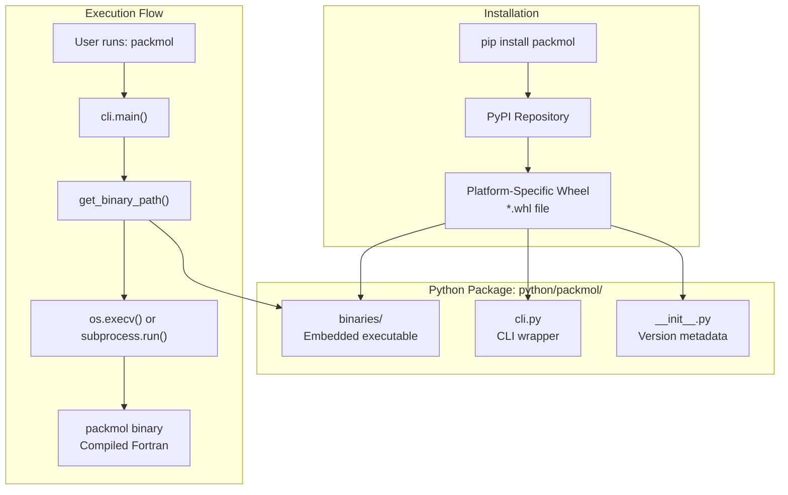
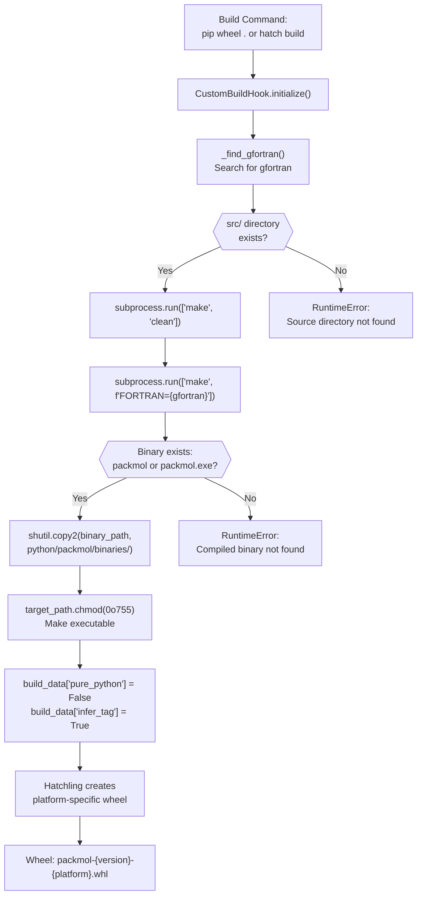
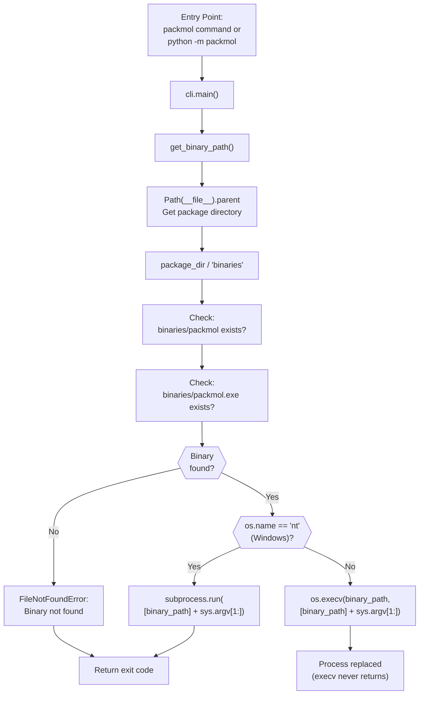

# Python Package Installation

<details>
<summary>Relevant source files</summary>

The following files were used as context for generating this wiki page:

- [.gitignore](.gitignore)
- [README.md](README.md)
- [python/hatch_build.py](python/hatch_build.py)
- [python/packmol/__init__.py](python/packmol/__init__.py)
- [python/packmol/binaries/.gitignore](python/packmol/binaries/.gitignore)
- [python/packmol/cli.py](python/packmol/cli.py)

</details>


## Purpose and Scope

This page documents how to install and use Packmol through the Python Package Index (PyPI) distribution. The Python package provides a pre-compiled binary with a lightweight CLI wrapper that makes Packmol available as a `packmol` command after installation via `pip`.

This installation method is recommended for users who want a simple, cross-platform installation without manually compiling Fortran code. For building from source with Make, CMake, or FPM, see [Building from Source](#2.1). For Julia-based installation, see [Julia Package Integration](#2.3).

**Sources:** [README.md:31-42]()

---

## Installation

### Standard Installation

Install Packmol from PyPI using pip:

```bash
pip install packmol
```

This downloads a platform-specific wheel containing the pre-compiled `packmol` binary and installs it into your Python environment.

### Using uv for Direct Execution

For single-use execution without installation, use [uv](https://docs.astral.sh/uv/):

```bash
uvx packmol < inp.pack
```

This executes Packmol directly from a temporary environment managed by `uv`.

**Sources:** [README.md:31-42]()

---

## Package Architecture

The Python distribution uses a hybrid architecture that combines Fortran compilation with Python packaging infrastructure. The Fortran executable is embedded within the Python package and wrapped by a thin CLI layer.

### Package Structure

```
python/
├── packmol/
│   ├── __init__.py          # Package initialization, version metadata
│   ├── cli.py               # CLI wrapper, binary execution
│   └── binaries/            # Compiled packmol executable
│       ├── .gitignore       # Excludes binaries from git
│       └── packmol          # Platform-specific binary (created during build)
└── hatch_build.py           # Custom build hook for compilation
```

### High-Level Architecture Diagram



**Sources:** [python/packmol/__init__.py:1-8](), [python/packmol/cli.py:1-69](), [python/packmol/binaries/.gitignore:1-2]()

---

## Build Process

The Python package uses a custom Hatchling build hook to compile the Fortran source code during wheel creation. This produces platform-specific wheels containing native binaries.

### Build Hook: hatch_build.py

The `CustomBuildHook` class in [python/hatch_build.py:12-111]() implements the `BuildHookInterface` and executes during package building:

| Build Stage | Function | Description |
|-------------|----------|-------------|
| **Compiler Discovery** | `_find_gfortran()` | Searches for `gfortran` in system PATH and common Homebrew locations |
| **Compilation** | `initialize()` | Invokes `make FORTRAN={gfortran}` to compile Fortran source |
| **Binary Copy** | `initialize()` | Copies compiled binary to `python/packmol/binaries/` |
| **Metadata Update** | `initialize()` | Marks wheel as platform-specific via `build_data["pure_python"] = False` |

### Build Process Flow Diagram



**Sources:** [python/hatch_build.py:1-111]()

### Compiler Discovery Logic

The `_find_gfortran()` method [python/hatch_build.py:79-110]() searches for a suitable Fortran compiler in this order:

1. `gfortran` in system PATH
2. Versioned `gfortran-{20..11}` in system PATH (searches descending from version 20)
3. Homebrew paths on macOS: `/opt/homebrew/bin/gfortran`, `/usr/local/bin/gfortran`

If no compiler is found, the build fails with a `RuntimeError`.

**Sources:** [python/hatch_build.py:79-110]()

---

## CLI Wrapper Implementation

The CLI wrapper [python/packmol/cli.py:1-69]() provides a transparent interface to the embedded Fortran binary, handling platform differences and binary location.

### CLI Execution Flow



**Sources:** [python/packmol/cli.py:1-69]()

### Binary Location Logic

The `get_binary_path()` function [python/packmol/cli.py:9-35]() implements platform-aware binary discovery:

```python
# Simplified logic from cli.py:18-30
binaries_dir = Path(__file__).parent / "binaries"

binary_candidates = [
    binaries_dir / "packmol",      # Unix/Linux/macOS
    binaries_dir / "packmol.exe",  # Windows
]

for binary_path in binary_candidates:
    if binary_path.exists():
        return binary_path
```

This checks for both Unix (`packmol`) and Windows (`packmol.exe`) naming conventions.

**Sources:** [python/packmol/cli.py:9-35]()

### Platform-Specific Execution

The `main()` function [python/packmol/cli.py:38-64]() uses different execution strategies based on the operating system:

| Platform | Method | Behavior |
|----------|--------|----------|
| **Unix/Linux/macOS** | `os.execv()` | Replaces the current Python process with the Fortran binary |
| **Windows** | `subprocess.run()` | Spawns a child process and waits for completion |

The `os.execv()` approach on Unix systems is more efficient as it avoids an extra process layer.

**Sources:** [python/packmol/cli.py:38-64]()

---

## Package Metadata and Versioning

The package initialization file [python/packmol/__init__.py:1-8]() dynamically retrieves version information from package metadata:

```python
import importlib.metadata

__version__ = importlib.metadata.version("packmol")
```

This uses Python's standard `importlib.metadata` to read version from the package's metadata rather than hardcoding it. The version is managed through the build system configuration.

**Sources:** [python/packmol/__init__.py:1-8]()

---

## Platform-Specific Wheel Distribution

The build hook marks wheels as platform-specific by setting `build_data["pure_python"] = False` [python/hatch_build.py:76](), which causes Hatchling to include platform tags in the wheel filename:

```
packmol-{version}-py3-none-linux_x86_64.whl
packmol-{version}-py3-none-macosx_10_9_x86_64.whl
packmol-{version}-py3-none-win_amd64.whl
```

Each wheel contains a binary compiled specifically for that platform's architecture and operating system.

**Sources:** [python/hatch_build.py:76-77]()

---

## Usage Examples

After installation, Packmol can be invoked from the command line like a native binary:

```bash
# Standard input redirection
packmol < input.inp

# Using -i flag for input file
packmol -i input.inp

# Using -i and -o flags
packmol -i input.inp -o output.pdb
```

All command-line arguments and input/output redirection work identically to the native Fortran binary. For full CLI documentation, see [Command-Line Interface](#3.5).

**Sources:** [python/packmol/cli.py:38-64](), [README.md:17-19]()

---

## Relationship to Other Build Systems

The Python distribution is one of four parallel build systems for Packmol:

| Build System | Target Audience | Binary Location | Distribution |
|--------------|----------------|-----------------|--------------|
| **Makefile** | Traditional Unix users | `./packmol` | Manual compilation |
| **CMake** | Cross-platform builds | `./packmol` | Manual compilation |
| **FPM** | Modern Fortran developers | `~/.local/bin/packmol` | Local installation |
| **Python/Hatchling** | Python ecosystem users | `python/packmol/binaries/` | PyPI distribution |

All systems compile the same Fortran source files from `src/` and `app/`, but the Python system uniquely embeds the binary within a Python package structure for PyPI distribution. For details on other build systems, see [Build System Architecture](#4.1).

**Sources:** [README.md:21-84](), [python/hatch_build.py:1-111]()

---