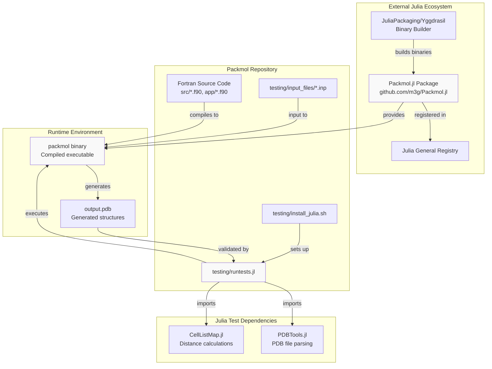
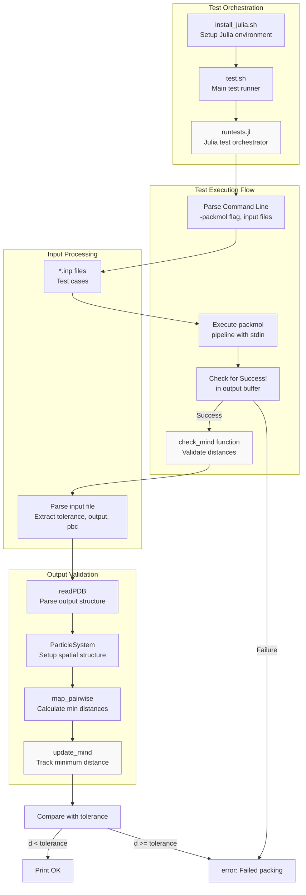
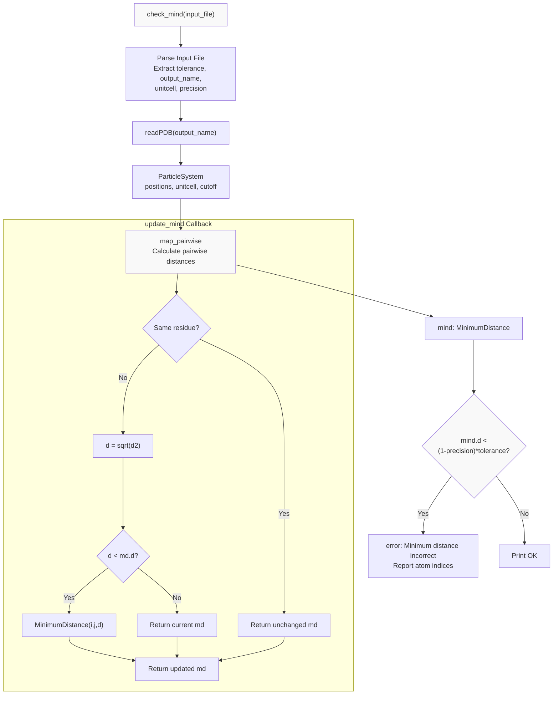
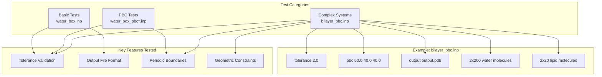

# Julia Package Integration

<details>
<summary>Relevant source files</summary>

The following files were used as context for generating this wiki page:

- [README.md](README.md)
- [testing/input_files/bilayer_pbc.inp](testing/input_files/bilayer_pbc.inp)
- [testing/input_files/water_box_pbc2.inp](testing/input_files/water_box_pbc2.inp)
- [testing/runtests.jl](testing/runtests.jl)

</details>


## Purpose and Scope

This document describes the integration between Packmol and the Julia programming language ecosystem, covering both the external Packmol.jl package wrapper and the Julia-based testing infrastructure contained within this repository. For information about other installation methods, see [Building from Source](#2.1) and [Python Package Installation](#2.2). For details about the testing architecture, see [Julia Test Suite](#5.1).

## Overview

Packmol integrates with Julia through two distinct mechanisms:

1. **Packmol.jl Package**: An external Julia wrapper package that provides pre-built binaries for all major platforms
2. **Julia Test Infrastructure**: Testing scripts within this repository that validate Packmol output using Julia packages



**Sources:** [README.md:23-29]()

## Packmol.jl External Package

### Purpose and Benefits

The Packmol.jl package (https://github.com/m3g/Packmol.jl) serves as a cross-platform binary distribution wrapper. It provides:

- **Pre-built binaries** for Linux, macOS, and Windows
- **Automatic installation** via Julia's package manager
- **No compilation required** for end users
- **Consistent versions** across platforms

This is particularly useful for users who are not familiar with Fortran compilation or who work on platforms where compilers are difficult to configure.

### Installation Process

Users install Packmol through the Julia package manager:

```julia
using Pkg
Pkg.add("Packmol")
```

The package system automatically downloads the appropriate pre-compiled binary for the user's platform and makes it available as a Julia-callable executable.

**Sources:** [README.md:23-29]()

## Julia Testing Infrastructure

### Architecture Overview

The repository contains a comprehensive Julia-based testing system in the `testing/` directory. This infrastructure validates that Packmol successfully generates molecular configurations with correct minimum distances.



**Sources:** [testing/runtests.jl:1-109]()

### Test Runner Implementation

The main test script [testing/runtests.jl]() implements a complete validation pipeline:

| Component | Purpose | Key Functions |
|-----------|---------|---------------|
| Environment Setup | Activate test environment and load dependencies | Lines 1-4 |
| MinimumDistance Struct | Track closest atom pair | Lines 20-24 |
| Reducer Functions | Support parallel minimum finding | Lines 30-32 |
| check_mind Function | Validate output against tolerance | Lines 34-78 |
| Test Execution Loop | Run all test cases | Lines 81-106 |

### Command-Line Interface

The test runner accepts flexible command-line arguments:

```bash
julia runtests.jl -packmol /path/to/packmol input1.inp input2.inp ...
```

**Arguments:**
- `-packmol <path>`: Optional path to packmol executable (defaults to `../packmol`)
- Remaining arguments: List of input files to test
- Special case: `-packmol nothing` skips execution and validates existing output files

**Sources:** [testing/runtests.jl:13-18](), [testing/runtests.jl:81-106]()

## Minimum Distance Validation

### Validation Algorithm

The `check_mind` function [testing/runtests.jl:34-78]() implements a sophisticated validation algorithm:



**Sources:** [testing/runtests.jl:34-78](), [testing/runtests.jl:25-29]()

### Key Validation Features

#### Input File Parsing

The validation extracts critical parameters from the input file:

| Keyword | Purpose | Parsing |
|---------|---------|---------|
| `tolerance` | Minimum allowed distance | [testing/runtests.jl:43]() |
| `output` | Output filename | [testing/runtests.jl:44]() |
| `precision` | Tolerance precision factor | [testing/runtests.jl:45]() |
| `pbc` | Periodic boundary conditions | [testing/runtests.jl:46-54]() |

#### Periodic Boundary Condition Support

The PBC parsing handles two formats:

- **Simple format**: `pbc Lx Ly Lz` (3 values for box dimensions)
- **Extended format**: `pbc x1 y1 z1 x2 y2 z2` (6 values, calculates differences)

**Sources:** [testing/runtests.jl:46-54]()

#### Distance Calculation with CellListMap

The validation leverages CellListMap.jl for efficient O(N) distance calculations:

```
ParticleSystem(
    positions = coor.(pdb),
    unitcell = unitcell,
    cutoff = tolerance * 1.5,
    output = MinimumDistance(0, 0, +Inf)
)
```

The cutoff is set to `tolerance * 1.5` to ensure all potentially violating pairs are detected, even with periodic wrapping.

**Sources:** [testing/runtests.jl:60-66]()

### Custom Reducer Pattern

The validation implements CellListMap's reducer pattern for parallel-safe minimum tracking:

| Function | Purpose | Implementation |
|----------|---------|---------------|
| `update_mind` | Compare distances and update minimum | [testing/runtests.jl:25-29]() |
| `reducer` | Combine results from parallel threads | [testing/runtests.jl:30]() |
| `copy_output` | Duplicate result structure | [testing/runtests.jl:31]() |
| `reset_output` | Initialize for new calculation | [testing/runtests.jl:32]() |

The `update_mind` function specifically checks `residue(pdb[i]) == residue(pdb[j])` [testing/runtests.jl:26]() to skip intra-molecular distances, since Packmol's tolerance only applies to inter-molecular separations.

**Sources:** [testing/runtests.jl:20-32]()

## Test Case Coverage

### Input File Structure

The testing infrastructure includes various test cases demonstrating different scenarios:



**Sources:** [testing/input_files/bilayer_pbc.inp:1-40](), [testing/input_files/water_box_pbc2.inp:1-20]()

### Example Test Case Analysis

The bilayer test [testing/input_files/bilayer_pbc.inp]() demonstrates:

- **Tolerance**: 2.0 Å minimum separation
- **PBC Box**: 50.0 × 40.0 × 40.0 ų
- **Molecules**: 400 water molecules and 40 lipids
- **Constraints**: Planar constraints position lipids in bilayer configuration
- **Validation**: Ensures 2.0 Å separation across periodic boundaries

**Sources:** [testing/input_files/bilayer_pbc.inp:5-8]()

## Error Reporting

### Distance Violation Messages

When validation fails, the error message provides detailed diagnostic information:

```
Packing reported success, but minimum distance is not correct for $input_file
Obtained minimum-distance = $(mind.d) for tolerance $tolerance and precision $precision.
Atoms: $(mind.i) and $(mind.j) - VMD: index $(mind.i-1) $(mind.j-1)
```

Note that VMD indices are 0-based, so the error message converts Julia's 1-based indices by subtracting 1.

**Sources:** [testing/runtests.jl:68-74]()

## Integration with CI/CD

The Julia test infrastructure integrates with the GitHub Actions CI/CD pipeline (see [Continuous Integration](#5.3)). The CI system:

1. Installs Julia via `testing/install_julia.sh`
2. Executes `testing/test.sh` which calls `runtests.jl`
3. Runs tests against multiple platforms (Ubuntu, macOS)
4. Validates all test cases before allowing releases

This ensures every commit maintains correctness guarantees verified by the Julia validation layer.

**Sources:** [testing/runtests.jl:1-4]()

## Dependencies

### Julia Packages

The test infrastructure requires:

| Package | Version | Purpose |
|---------|---------|---------|
| PDBTools.jl | Latest | Parse PDB format output files |
| CellListMap.jl | Latest | Efficient O(N) minimum distance calculations |

These are automatically installed via `Pkg.instantiate()` [testing/runtests.jl:2]().

### Environment Activation

The test script creates an isolated Julia environment:

```julia
import Pkg
Pkg.activate(@__DIR__)
Pkg.instantiate()
```

This ensures reproducible testing with pinned dependency versions.

**Sources:** [testing/runtests.jl:1-4]()

## Usage Patterns

### Running Individual Tests

Execute a single test case:

```bash
cd testing
julia runtests.jl ./input_files/water_box.inp
```

### Running Multiple Tests

Test multiple configurations:

```bash
julia runtests.jl input_files/water_box.inp input_files/bilayer_pbc.inp
```

### Testing Custom Packmol Binary

Specify a custom packmol executable:

```bash
julia runtests.jl -packmol ~/my_build/packmol input_files/*.inp
```

### Validation-Only Mode

Skip execution and validate existing output:

```bash
julia runtests.jl -packmol nothing input_files/water_box.inp
```

**Sources:** [testing/runtests.jl:81-106]()

---