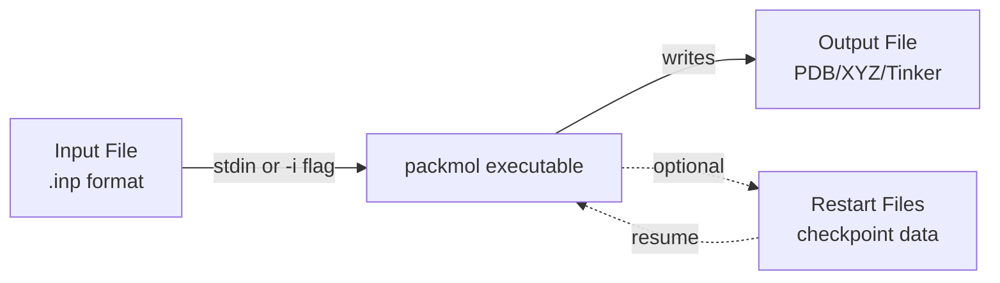
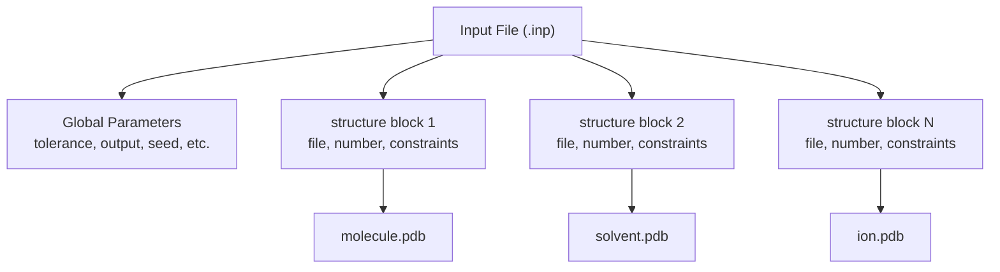
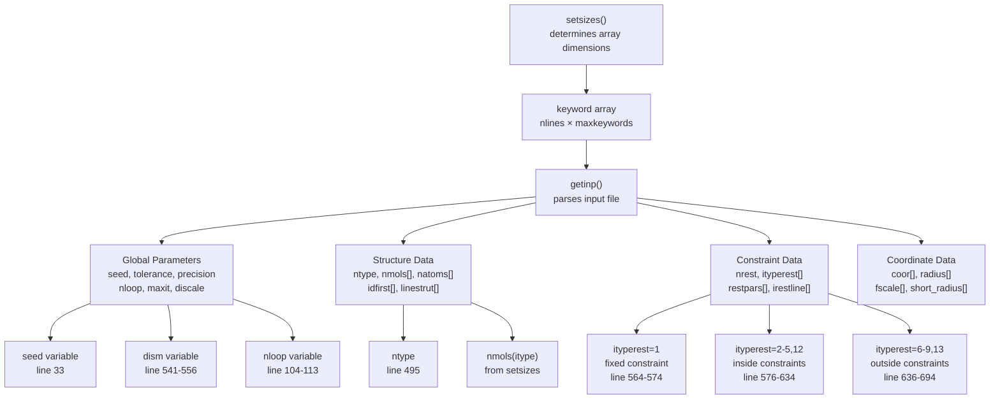
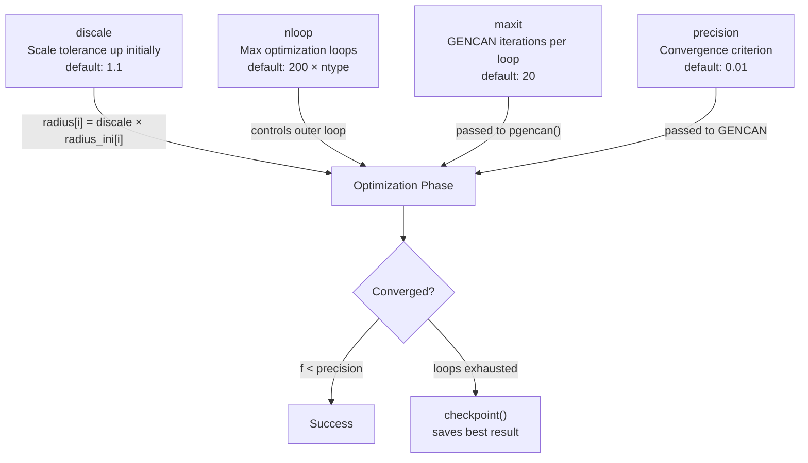
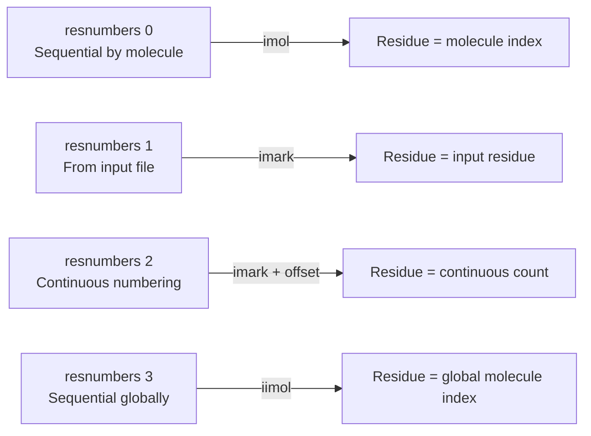
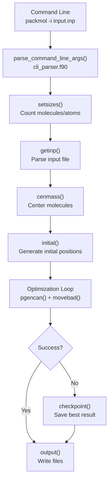
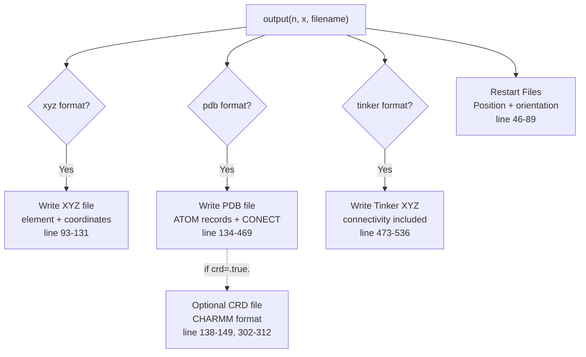

# User Guide

<details>
<summary>Relevant source files</summary>

The following files were used as context for generating this wiki page:

- [app/packmol.f90](app/packmol.f90)
- [src/checkpoint.f90](src/checkpoint.f90)
- [src/getinp.f90](src/getinp.f90)
- [src/input.f90](src/input.f90)
- [src/output.f90](src/output.f90)
- [testing/input_files/solvprotein.inp](testing/input_files/solvprotein.inp)
- [testing/structure_files/protein.pdb](testing/structure_files/protein.pdb)

</details>


## Purpose and Scope

This page provides a comprehensive guide for using Packmol to generate initial molecular configurations. It covers the basic workflow, input file structure, command-line usage, and common use cases. For detailed specifications, see:

- [Input File Format](#3.1) - Complete keyword reference
- [Spatial Constraints](#3.2) - Geometric constraint types
- [Periodic Boundary Conditions](#3.3) - PBC usage
- [Output File Formats](#3.4) - Output format details
- [Command-Line Interface](#3.5) - CLI options

For architectural details and algorithm implementation, see [Architecture and Implementation](#4).

---

## Basic Workflow

Packmol operates through a simple three-step process:



**Diagram: Basic Packmol Workflow**

**Typical execution:**
```bash
# Method 1: stdin redirection
packmol < input.inp

# Method 2: using -i flag
packmol -i input.inp

# Method 3: specifying output
packmol -i input.inp -o output.pdb
```

Sources: [app/packmol.f90:34-87](), [src/getinp.f90:9-935]()

---

## Input File Structure

Every Packmol input file follows a structured format with global parameters and structure blocks:



**Diagram: Input File Structure**

### Minimal Example

```
# Global parameters
tolerance 2.0
output output.pdb

# First molecule type
structure water.pdb
  number 500
  inside box 0. 0. 0. 40. 40. 40.
end structure

# Second molecule type
structure protein.pdb
  number 1
  fixed 20. 20. 20. 0. 0. 0.
  centerofmass
end structure
```

Sources: [src/getinp.f90:62-249](), [testing/input_files/solvprotein.inp:1-35]()

---

## Input File Parsing Flow

The following diagram shows how Packmol processes the input file and maps keywords to internal data structures:



**Diagram: Input Parsing to Data Structures**

Sources: [src/getinp.f90:9-935](), [src/input.f90:9-82]()

---

## Common Use Cases

### Use Case 1: Solvating a Protein

Place a protein at the center and surround it with water molecules and ions:

```
tolerance 2.0
output solvated_protein.pdb

# Fixed protein at center
structure protein.pdb
  number 1
  fixed 0. 0. 0. 0. 0. 0.
  centerofmass
  resnumbers 0
end structure

# Water molecules in sphere
structure water.pdb
  number 1000
  inside sphere 0. 0. 0. 50.
  resnumbers 2
end structure

# Chloride ions
structure CLA.pdb
  number 20
  inside sphere 0. 0. 0. 50.
  resnumbers 2
end structure

# Sodium ions
structure SOD.pdb
  number 30
  inside sphere 0. 0. 0. 50.
  resnumbers 2
end structure

seed -1
avoid_overlap no
```

**Key Parameters:**
- `fixed 0. 0. 0. 0. 0. 0.` - Position (x,y,z) and Euler angles (β,γ,θ)
- `centerofmass` - Use center of mass for positioning
- `resnumbers 0` - One residue per molecule
- `resnumbers 2` - Continuous residue numbering
- `seed -1` - Random seed from system time

Sources: [testing/input_files/solvprotein.inp:1-35](), [src/getinp.f90:68-71](), [src/getinp.f90:564-574]()

### Use Case 2: Building a Lipid Bilayer

Create two layers of lipid molecules:

```
tolerance 2.0
output bilayer.pdb

# Upper leaflet
structure lipid.pdb
  number 100
  inside box 0. 0. 20. 50. 50. 30.
  constrain_rotation x 0. 0.
  constrain_rotation y 0. 0.
end structure

# Lower leaflet  
structure lipid.pdb
  number 100
  inside box 0. 0. -30. 50. 50. -20.
  constrain_rotation x 180. 180.
  constrain_rotation y 0. 0.
end structure
```

**Key Parameters:**
- `constrain_rotation x 0. 0.` - Restrict rotation about x-axis to 0° (± range)
- `constrain_rotation y 0. 0.` - Restrict rotation about y-axis to 0°
- Separate boxes for upper and lower leaflets

Sources: [app/packmol.f90:636-691](), [src/getinp.f90:199-248]()

### Use Case 3: Periodic Box with PBC

Create a system with periodic boundary conditions:

```
tolerance 2.0
output box_pbc.pdb

pbc 60. 60. 60.

structure solvent.pdb
  number 500
  inside box 0. 0. 0. 60. 60. 60.
end structure
```

**Alternative syntax (explicit min/max):**
```
pbc 0. 0. 0. 60. 60. 60.
```

- When 3 values given: box from (0,0,0) to (x,y,z)
- When 6 values given: box from (x₁,y₁,z₁) to (x₂,y₂,z₂)
- Automatically adds `inside box` constraint to non-fixed molecules

Sources: [src/getinp.f90:167-198](), [app/packmol.f90:531-546]()

---

## Global Parameters Reference

The following table summarizes commonly used global parameters:

| Parameter | Type | Default | Description |
|-----------|------|---------|-------------|
| `tolerance` | float | required | Minimum distance between atoms (Å) |
| `output` | string | required | Output file name |
| `filetype` | string | auto | File format: `pdb`, `tinker`, `xyz` |
| `seed` | int | 1234567 | RNG seed; `-1` for random |
| `precision` | float | 0.01 | Optimization convergence tolerance |
| `nloop` | int | 200×ntype | Max GENCAN loops (all molecules) |
| `nloop0` | int | 20×ntype | Max loops for initial phase |
| `maxit` | int | 20 | GENCAN iterations per loop |
| `discale` | float | 1.1 | Initial tolerance scale factor |
| `writeout` | int | 10 | Output frequency during optimization |
| `movefrac` | float | 0.05 | Fraction of bad molecules to move |
| `sidemax` | float | 1000.0 | Maximum system dimension |

Sources: [src/getinp.f90:31-61](), [src/input.f90:32-41]()

### Optimization Control Parameters



**Diagram: Optimization Parameter Flow**

Sources: [app/packmol.f90:746-770](), [src/getinp.f90:78-121]()

---

## Structure Block Parameters

Inside each `structure ... end structure` block:

| Parameter | Description |
|-----------|-------------|
| `number N` | Number of molecules to pack |
| `fixed x y z β γ θ` | Fix molecule at position/orientation |
| `centerofmass` | Use center of mass for positioning |
| `radius R` | Override atom radii (tolerance/2) |
| `fscale S` | Scale distance function |
| `short_radius R` | Short-range penalty radius |
| `short_radius_scale S` | Short-range penalty scale |
| `resnumbers 0\|1\|2\|3` | Residue numbering mode |
| `changechains` | Alternate chain identifiers |
| `chain X` | Specific chain identifier |
| `connect yes\|no` | Output connectivity |
| `constrain_rotation x\|y\|z min max` | Rotation constraints (degrees) |
| `maxmove N` | Max molecules in movebad heuristic |
| `nloop N` | Type-specific loop count |
| `restart_from file` | Load initial positions |
| `restart_to file` | Save final positions |

Sources: [src/getinp.f90:277-807](), [app/packmol.f90:282-515]()

### Residue Numbering Modes



**Diagram: Residue Numbering Modes**

Sources: [src/output.f90:265-282](), [src/getinp.f90:809-868]()

---

## Atom-Specific Parameters

Use `atoms` blocks to apply parameters to specific atoms:

```
structure molecule.pdb
  number 100
  inside box 0. 0. 0. 50. 50. 50.
  
  # Apply to specific atoms
  atoms 1 5 10
    radius 1.5
    short_radius 0.8
    inside sphere 25. 25. 25. 20.
  end atoms
  
  # Different constraint for other atoms
  atoms 2 3 4
    outside sphere 25. 25. 25. 15.
  end atoms
end structure
```

The parser handles this in two passes:
1. Set molecule-level parameters for all atoms
2. Override with atom-specific parameters

Sources: [app/packmol.f90:296-515](), [src/getinp.f90:199-248]()

---

## Execution and Output

### Command-Line Invocation



**Diagram: Program Execution Flow**

Sources: [app/packmol.f90:81-115](), [app/packmol.f90:707-1475]()

### Output File Writing

The `output()` subroutine handles three file formats:



**Diagram: Output File Generation**

Sources: [src/output.f90:9-599]()

### Success and Failure Messages

**Success:** Written by `writesuccess.f90` when optimization converges:
```
 Success!
 Final objective function value: .123456E-02
 Maximum violation of target distance: 0.987654
 Maximum violation of the constraints: 0.123456
```

**Checkpoint:** Written by `checkpoint.f90` when optimization doesn't converge:
- Saves best configuration found
- Writes main output file
- Writes `_FORCED` output with constraint satisfaction
- Suggests increasing `nloop` parameter

Sources: [src/checkpoint.f90:12-115]()

---

## Troubleshooting

### Common Issues

| Problem | Solution |
|---------|----------|
| "ERROR: Some restriction is not set correctly" | Check constraint syntax (inside/outside keywords) |
| "ERROR: Overall tolerance not set" | Add `tolerance` keyword to input file |
| "ERROR: Output file not specified" | Add `output` keyword to input file |
| "ERROR: Some molecule has no geometrical restriction" | Every molecule needs at least one constraint |
| Slow convergence | Increase `nloop`, adjust `discale`, or use `packall` |
| Molecules overlap | Decrease `tolerance` or add more specific constraints |
| Non-reproducible results | Set explicit `seed` value |

### Convergence Parameters

To improve convergence:

```
# Increase optimization iterations
nloop 500           # Default: 200 × ntype
maxit 40            # Default: 20

# Adjust initial tolerance scaling
discale 1.5         # Default: 1.1 (larger = easier initial packing)

# Enable movebad heuristic tuning
movefrac 0.1        # Default: 0.05 (fraction to reposition)

# Pack all types together from start
packall             # Skip individual type packing
```

Sources: [src/getinp.f90:100-121](), [src/checkpoint.f90:38-99]()

### Debug Options

```
# Check initial configuration only
check

# Write intermediate bad configurations  
writebad

# Check analytical gradients
chkgrad

# Control output verbosity
writeout 5          # More frequent output
iprint1 2           # GENCAN printing
iprint2 2
```

Sources: [src/getinp.f90:72-166](), [app/packmol.f90:726-733]()

---

## Advanced Features

### Short-Distance Penalties

Use different penalty functions for very short distances:

```
# Global setting
tolerance 2.0
short_tol_dist 1.0      # Activate penalty below 1.0 Å
short_tol_scale 3.0     # Penalty scale factor

# Or per-structure
structure molecule.pdb
  number 100
  short_radius 0.9      # Per-atom short radius
  short_radius_scale 5.0
  inside box 0. 0. 0. 50. 50. 50.
end structure

# Or per-atom
structure molecule.pdb
  number 50
  atoms 1 2 3
    short_radius 0.8
    short_radius_scale 4.0
  end atoms
  inside box 0. 0. 0. 50. 50. 50.
end structure
```

Sources: [src/getinp.f90:739-776](), [app/packmol.f90:457-499]()

### Restart Mechanism

Save and load optimization states:

```
# Save system state
restart_to system_restart.txt

# Load previous state
restart_from system_restart.txt

# Per-type restart files
structure water.pdb
  number 1000
  restart_from water_positions.txt
  restart_to water_final.txt
  inside box 0. 0. 0. 50. 50. 50.
end structure
```

Restart files contain 6 values per molecule: position (x,y,z) and Euler angles (β,γ,θ).

Sources: [src/output.f90:46-89](), [src/getinp.f90:889-928]()

### Hexadecimal Indices

For systems with >99,999 atoms:

```
hexadecimal_indices

# Atom indices written as:
# 99999 → 99999 (decimal)
# 100000 → 186A0 (hexadecimal)
```

Sources: [src/getinp.f90:98-99](), [src/output.f90:159-162](), [src/output.f90:541-563]()

---

Sources: [src/getinp.f90:9-935](), [src/output.f90:9-599](), [app/packmol.f90:34-1564](), [src/input.f90:9-82](), [testing/input_files/solvprotein.inp:1-35](), [src/checkpoint.f90:12-115]()

---