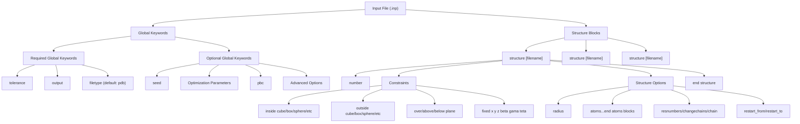
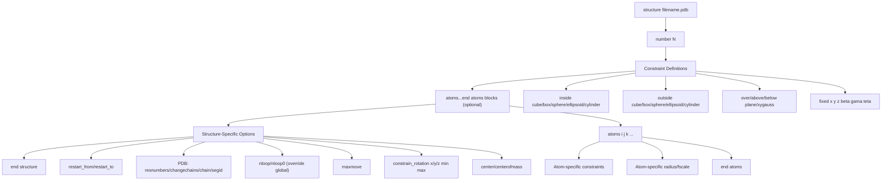
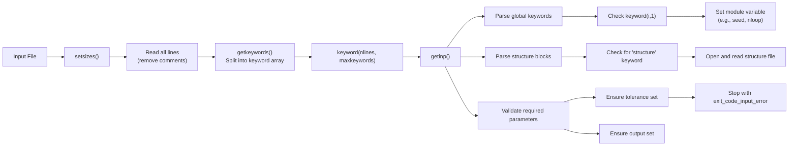

# Input File Format

<details>
<summary>Relevant source files</summary>

The following files were used as context for generating this wiki page:

- [app/packmol.f90](app/packmol.f90)
- [src/checkpoint.f90](src/checkpoint.f90)
- [src/cli_parser.f90](src/cli_parser.f90)
- [src/getinp.f90](src/getinp.f90)
- [src/input.f90](src/input.f90)
- [src/output.f90](src/output.f90)
- [src/setsizes.f90](src/setsizes.f90)
- [testing/input_files/solvprotein.inp](testing/input_files/solvprotein.inp)
- [testing/structure_files/protein.pdb](testing/structure_files/protein.pdb)

</details>


## Purpose and Scope

This page provides a complete specification of Packmol's input file format (`.inp` files). The input file controls all aspects of molecular packing: which molecules to pack, how many copies, where to place them, and optimization parameters. The format is parsed by [src/setsizes.f90]() and [src/getinp.f90]().

For information about command-line execution modes, see [Command-Line Interface](#3.5). For details about specific geometric constraints, see [Spatial Constraints](#3.2). For periodic boundary conditions, see [Periodic Boundary Conditions](#3.3).

---

## Input File Structure Overview



**Diagram: Overall Input File Structure**

The input file consists of global keywords followed by one or more `structure...end structure` blocks. Each structure block specifies a molecule type, how many copies to pack, and where to place them.

Sources: [src/getinp.f90:62-935](), [src/setsizes.f90:143-287](), [testing/input_files/solvprotein.inp:1-35]()

---

## Required Global Keywords

These keywords must appear in every input file (outside structure blocks):

| Keyword | Arguments | Description | Line Reference |
|---------|-----------|-------------|----------------|
| `tolerance` | `<distance>` | Minimum distance between atoms (Å). Sets the packing tolerance. | [src/getinp.f90:543-556]() |
| `output` | `<filename>` | Output file path. Extension determines format if `filetype` not specified. | [src/getinp.f90:259-272]() |
| `filetype` | `pdb`\|`tinker`\|`xyz` | Coordinate file format. Default: `pdb` | [src/setsizes.f90:143-168]() |

**Example:**
```
tolerance 2.0
output mixture.pdb
filetype pdb
```

Sources: [src/getinp.f90:259-272](), [src/getinp.f90:538-556](), [src/setsizes.f90:143-168]()

---

## Optional Global Keywords

### Random Seed and Initial Point

| Keyword | Arguments | Description | Line Reference |
|---------|-----------|-------------|----------------|
| `seed` | `<integer>`\|`-1` | Random seed for initial point generation. Use `-1` for time-based seed. | [src/getinp.f90:68-71]() |
| `randominitialpoint` | (none) | Start with random positions instead of constraint-satisfying positions. | [src/getinp.f90:72-73]() |

### Optimization Parameters

| Keyword | Arguments | Description | Line Reference |
|---------|-----------|-------------|----------------|
| `nloop` | `<integer>` | Maximum GENCAN iterations for full optimization. Default: `200*ntype` | [src/getinp.f90:104-113]() |
| `nloop0` | `<integer>` | Maximum GENCAN iterations for initial constraint satisfaction. Default: `20*ntype` | [src/getinp.f90:109-113]() |
| `maxit` | `<integer>` | Maximum iterations per GENCAN call. Default: `20` | [src/getinp.f90:100-103]() |
| `precision` | `<real>` | Convergence precision for optimization. Default: `0.01` | [src/getinp.f90:78-81]() |
| `discale` | `<real>` | Initial tolerance scale factor. Default: `1.1` | [src/getinp.f90:114-117]() |
| `movefrac` | `<real>` | Fraction of molecules to move in `movebad` heuristic. Default: `0.05` | [src/getinp.f90:82-85]() |
| `movebadrandom` | (none) | Move bad molecules randomly instead of to constraint centroids. | [src/getinp.f90:86-88]() |
| `disable_movebad` | (none) | Disable the `movebad` heuristic entirely. | [src/getinp.f90:89-91]() |

### Short-Range Penalty System

| Keyword | Arguments | Description | Line Reference |
|---------|-----------|-------------|----------------|
| `use_short_tol` | (none) | Enable short-range penalty for all atoms. | [src/getinp.f90:143-145]() |
| `short_tol_dist` | `<distance>` | Distance threshold for short-range penalty. Default: `tolerance/2` | [src/getinp.f90:741-759]() |
| `short_tol_scale` | `<real>` | Scale factor for short-range penalty. Default: `3.0` | [src/getinp.f90:761-776]() |

### Periodic Boundary Conditions

| Keyword | Arguments | Description | Line Reference |
|---------|-----------|-------------|----------------|
| `pbc` | `<xlen> <ylen> <zlen>` | Define cubic PBC box with side lengths. | [src/getinp.f90:167-198]() |
| `pbc` | `<xmin> <ymin> <zmin> <xmax> <ymax> <zmax>` | Define rectangular PBC box with min/max coordinates. | [src/getinp.f90:167-198]() |

See [Periodic Boundary Conditions](#3.3) for detailed documentation.

### Output Control

| Keyword | Arguments | Description | Line Reference |
|---------|-----------|-------------|----------------|
| `writeout` | `<integer>` | Frequency of output file writes during optimization. Default: `10` | [src/getinp.f90:94-97]() |
| `writebad` | (none) | Write intermediate files when molecules violate constraints. | [src/getinp.f90:76-77]() |
| `writecrd` | `<filename>` | Also write output in CHARMM CRD format. | [src/getinp.f90:146-149]() |
| `add_amber_ter` | (none) | Add `TER` records between molecules in PDB output. | [src/getinp.f90:126-128]() |
| `amber_ter_preserve` | (none) | Preserve `TER` records from fixed molecule input files. | [src/getinp.f90:129-131]() |
| `add_box_sides` | `[<padding>]` | Add `CRYST1` record to PDB output with box dimensions. | [src/getinp.f90:150-158]() |
| `hexadecimal_indices` | (none) | Use hexadecimal for atom/residue indices if they exceed decimal limits. | [src/getinp.f90:98-99]() |

### System Control

| Keyword | Arguments | Description | Line Reference |
|---------|-----------|-------------|----------------|
| `sidemax` | `<distance>` | Maximum system dimension for spatial grid setup. Default: `1000.0` | [src/getinp.f90:118-121]() |
| `fbins` | `<real>` | Linked-cell bin parameter for spatial partitioning. Default: `sqrt(3)` | [src/getinp.f90:122-125]() |
| `avoid_overlap` | `yes`\|`no` | Whether to avoid overlap with fixed molecules at initial point. Default: `yes` | [src/getinp.f90:132-139]() |
| `packall` | (none) | Pack all molecule types simultaneously instead of sequentially. | [src/getinp.f90:140-142]() |

### Debugging

| Keyword | Arguments | Description | Line Reference |
|---------|-----------|-------------|----------------|
| `check` | (none) | Check gradient computation (for debugging). | [src/getinp.f90:74-75]() |
| `chkgrad` | (none) | Detailed gradient checking. | [src/getinp.f90:92-93]() |
| `iprint1` | `<integer>` | GENCAN verbosity level 1. Default: `2` | [src/getinp.f90:159-162]() |
| `iprint2` | `<integer>` | GENCAN verbosity level 2. Default: `2` | [src/getinp.f90:163-166]() |

Sources: [src/getinp.f90:62-249]()

---

## Structure Block Format



**Diagram: Structure Block Components**

Each `structure...end structure` block defines one molecule type to pack.

Sources: [src/getinp.f90:274-494](), [src/getinp.f90:789-807]()

### Structure Block Keywords

| Keyword | Arguments | Description | Context | Line Reference |
|---------|-----------|-------------|---------|----------------|
| `structure` | `<filename>` | Begin structure block. Filename contains molecular coordinates. | Block start | [src/getinp.f90:278-281]() |
| `end structure` | (none) | End structure block. | Block end | [src/getinp.f90:65-66]() |
| `number` | `<integer>` | Number of copies of this molecule to pack. Required. | Inside block | [src/setsizes.f90:243-253]() |

**Example:**
```
structure water.pdb
  number 1000
  inside box 0. 0. 0. 40. 40. 40.
end structure
```

Sources: [src/getinp.f90:278-281](), [src/setsizes.f90:196-253]()

---

## Geometric Constraints

```mermaid
graph TD
    CONSTRAINT["Geometric Constraint"] --> SCOPE["Constraint Scope"]
    CONSTRAINT --> TYPE["Constraint Type"]
    
    SCOPE --> ALL["All atoms of molecule"]
    SCOPE --> SPECIFIC["Specific atoms only"]
    
    SPECIFIC --> ATOMS_SYNTAX["atoms i j k ...<br/>constraint<br/>end atoms"]
    
    TYPE --> INSIDE["inside"]
    TYPE --> OUTSIDE["outside"]
    TYPE --> PLANE["over/above/below"]
    TYPE --> FIXED["fixed"]
    
    INSIDE --> IN_CUBE["cube x y z side"]
    INSIDE --> IN_BOX["box xmin ymin zmin xmax ymax zmax"]
    INSIDE --> IN_SPHERE["sphere x y z radius"]
    INSIDE --> IN_ELLIPSOID["ellipsoid x y z a b c"]
    INSIDE --> IN_CYLINDER["cylinder x1 y1 z1 x2 y2 z2 radius length"]
    
    OUTSIDE --> OUT_CUBE["cube x y z side"]
    OUTSIDE --> OUT_BOX["box xmin ymin zmin xmax ymax zmax"]
    OUTSIDE --> OUT_SPHERE["sphere x y z radius"]
    OUTSIDE --> OUT_ELLIPSOID["ellipsoid x y z a b c"]
    OUTSIDE --> OUT_CYLINDER["cylinder x1 y1 z1 x2 y2 z2 radius length"]
    
    PLANE --> PLANE_ABOVE["plane a b c d (above)"]
    PLANE --> PLANE_BELOW["plane a b c d (below)"]
    PLANE --> GAUSS_ABOVE["xygauss a b c d sigmax sigmay (above)"]
    PLANE --> GAUSS_BELOW["xygauss a b c d sigmax sigmay (below)"]
```



**Diagram: Constraint Type Hierarchy**

Sources: [src/getinp.f90:564-737]()

### Constraint Type Reference

| Constraint | Code Type | Syntax | Parameters | Line Reference |
|------------|-----------|--------|------------|----------------|
| Fixed position | `ityperest=1` | `fixed x y z beta gama teta` | Center position + Euler angles (degrees) | [src/getinp.f90:564-574]() |
| Inside cube | `ityperest=2` | `inside cube x y z side` | Cube center + side length | [src/getinp.f90:579-584]() |
| Inside box | `ityperest=3` | `inside box xmin ymin zmin xmax ymax zmax` | Box corners | [src/getinp.f90:585-592]() |
| Inside sphere | `ityperest=4` | `inside sphere x y z radius` | Sphere center + radius | [src/getinp.f90:593-598]() |
| Inside ellipsoid | `ityperest=5` | `inside ellipsoid x y z a b c` | Ellipsoid center + semi-axes | [src/getinp.f90:599-607]() |
| Inside cylinder | `ityperest=12` | `inside cylinder x1 y1 z1 x2 y2 z2 radius length` | Endpoints + radius + length | [src/getinp.f90:608-631]() |
| Outside cube | `ityperest=6` | `outside cube x y z side` | Cube center + side length | [src/getinp.f90:639-644]() |
| Outside box | `ityperest=7` | `outside box xmin ymin zmin xmax ymax zmax` | Box corners | [src/getinp.f90:645-652]() |
| Outside sphere | `ityperest=8` | `outside sphere x y z radius` | Sphere center + radius | [src/getinp.f90:653-658]() |
| Outside ellipsoid | `ityperest=9` | `outside ellipsoid x y z a b c` | Ellipsoid center + semi-axes | [src/getinp.f90:659-667]() |
| Outside cylinder | `ityperest=13` | `outside cylinder x1 y1 z1 x2 y2 z2 radius length` | Endpoints + radius + length | [src/getinp.f90:668-690]() |
| Above plane | `ityperest=10` | `over plane a b c d` or `above plane a b c d` | Plane equation ax+by+cz=d | [src/getinp.f90:696-711]() |
| Below plane | `ityperest=11` | `below plane a b c d` | Plane equation ax+by+cz=d | [src/getinp.f90:714-729]() |
| Above Gaussian | `ityperest=14` | `over xygauss a b c d sigmax sigmay` | Plane + Gaussian width | [src/getinp.f90:705-708]() |
| Below Gaussian | `ityperest=15` | `below xygauss a b c d sigmax sigmay` | Plane + Gaussian width | [src/getinp.f90:724-726]() |

For detailed constraint evaluation, see [Constraint System Implementation](#7.2).

Sources: [src/getinp.f90:564-737]()

### Atom-Specific Constraints

Constraints can be applied to specific atoms within a molecule using `atoms...end atoms` blocks:

```
structure protein.pdb
  number 1
  atoms 100 101 102 103
    inside sphere 10. 10. 10. 5.
  end atoms
  atoms 200 201 202
    outside sphere 10. 10. 10. 3.
  end atoms
end structure
```

Sources: [src/getinp.f90:566-603](), [app/packmol.f90:563-632]()

---

## Radius and Tolerance Control

### Molecule-Level Radius Settings

| Keyword | Arguments | Description | Line Reference |
|---------|-----------|-------------|----------------|
| `radius` | `<distance>` | Override default radius (tolerance/2) for all atoms in this molecule. | [app/packmol.f90:317-330]() |
| `fscale` | `<factor>` | Scale factor for distance penalty function. Default: `1.0` | [app/packmol.f90:334-346]() |
| `short_radius` | `<distance>` | Short-range penalty threshold for this molecule. | [app/packmol.f90:351-364]() |
| `short_radius_scale` | `<factor>` | Scale factor for short-range penalty. | [app/packmol.f90:369-382]() |

### Atom-Specific Radius Settings

These same keywords can be used inside `atoms...end atoms` blocks to set atom-specific values:

```
structure complex.pdb
  number 10
  radius 2.5
  atoms 1 2 3
    radius 3.0
    short_radius 1.5
  end atoms
end structure
```

When atom-specific settings are defined, they override molecule-level settings for those atoms.

Sources: [app/packmol.f90:296-515]()

---

## PDB-Specific Options

These options only apply when `filetype pdb`:

| Keyword | Arguments | Description | Line Reference |
|---------|-----------|-------------|----------------|
| `resnumbers` | `0`\|`1`\|`2`\|`3` | Residue numbering scheme in output. | [src/getinp.f90:825-827]() |
| `changechains` | (none) | Alternate chain identifiers for odd/even molecules. | [src/getinp.f90:822-824]() |
| `chain` | `<character>` | Specific chain identifier for all copies of this molecule. | [src/getinp.f90:833-835]() |
| `segid` | `<string>` | Segment identifier for CRD output. | [src/getinp.f90:836-838]() |
| `connect` | `yes`\|`no` | Whether to write `CONECT` records. Default: `yes` | [src/getinp.f90:828-832]() |

### Residue Numbering Schemes

- `resnumbers 0`: Each molecule gets a unique residue number (1, 2, 3, ...)
- `resnumbers 1`: Use original residue numbers from input file
- `resnumbers 2`: Sequential numbering across all molecules
- `resnumbers 3`: Global molecule index as residue number

Sources: [src/getinp.f90:809-869](), [src/output.f90:270-284]()

---

## Advanced Structure Options

### Restart Files

| Keyword | Arguments | Description | Line Reference |
|---------|-----------|-------------|----------------|
| `restart_from` | `<filename>` | Read initial positions from file (6 values per molecule: x,y,z,beta,gama,teta). | [src/getinp.f90:898-911]() |
| `restart_to` | `<filename>` | Write final positions to file for later reuse. | [src/getinp.f90:913-927]() |

These can appear either inside a structure block (for one molecule type) or globally (for all types).

### Rotation Constraints

| Keyword | Arguments | Description | Line Reference |
|---------|-----------|-------------|----------------|
| `constrain_rotation` | `x`\|`y`\|`z` `<min> <max>` | Constrain rotation about specified axis to angle range (degrees). | [app/packmol.f90:643-690]() |

**Example:**
```
structure rod.pdb
  number 100
  constrain_rotation z 0.0 45.0
  inside box 0. 0. 0. 50. 50. 50.
end structure
```

### Other Options

| Keyword | Arguments | Description | Line Reference |
|---------|-----------|-------------|----------------|
| `center` | (none) | Translate molecule center to constraint region centroid before optimization. | Not directly parsed, see code |
| `centerofmass` | (none) | Same as `center` but explicitly uses center of mass. | Not directly parsed, see code |
| `maxmove` | `<integer>` | Maximum number of molecules of this type to move during optimization. Default: all | [src/getinp.f90:795-797]() |
| `nloop` | `<integer>` | Override global `nloop` for this molecule type. | [src/setsizes.f90:257-269]() |
| `nloop0` | `<integer>` | Override global `nloop0` for this molecule type. | [src/setsizes.f90:273-285]() |

Sources: [src/getinp.f90:789-928](), [app/packmol.f90:636-690]()

---

## File Type Support

### PDB Format

Default format. Reads `ATOM` and `HETATM` records, supports `CONECT` records for connectivity.

**Parsing:** [src/getinp.f90:286-381]()  
**Output:** [src/output.f90:134-469]()

### Tinker XYZ Format

Tinker-style XYZ files include atom types and connectivity.

**Parsing:** [src/getinp.f90:384-467]()  
**Output:** [src/output.f90:473-536]()

### Standard XYZ Format

Simple element + coordinates format (no connectivity).

**Parsing:** [src/getinp.f90:470-489]()  
**Output:** [src/output.f90:93-131]()

---

## Complete Example with Annotations

```
# Global settings
tolerance 2.0              # Required: minimum atom-atom distance
filetype pdb               # Optional: default is pdb
output system.pdb          # Required: output file path
seed 12345                 # Optional: random seed for reproducibility

# Optimization parameters
nloop 500                  # Optional: maximum optimization iterations
precision 0.01             # Optional: convergence threshold
writeout 20                # Optional: write output every 20 iterations

# Periodic boundary conditions
pbc 0.0 0.0 0.0 50.0 50.0 50.0

# Fixed protein structure
structure protein.pdb
  number 1
  fixed 25.0 25.0 25.0 0.0 0.0 0.0  # Center at box center, no rotation
  resnumbers 1             # Keep original residue numbers
  centerofmass
end structure

# Water molecules
structure water.pdb
  number 2000
  inside box 0.0 0.0 0.0 50.0 50.0 50.0
  resnumbers 2             # Sequential numbering
end structure

# Ions confined to central sphere
structure Na.pdb
  number 20
  inside sphere 25.0 25.0 25.0 20.0
  outside sphere 25.0 25.0 25.0 5.0  # Keep away from protein center
end structure

# Lipids with constrained orientation
structure lipid.pdb
  number 100
  constrain_rotation x 0.0 30.0  # Limit rotation about x-axis
  atoms 1 2 3              # Head group atoms
    above plane 0.0 0.0 1.0 20.0  # Force heads above z=20
  end atoms
  radius 2.5               # Override default radius
end structure
```

Sources: [testing/input_files/solvprotein.inp:1-35](), [src/getinp.f90]()

---

## Keyword Parsing Implementation



**Diagram: Keyword Parsing Flow**

The parsing happens in two phases:
1. [src/setsizes.f90:34-137]() reads the input file, removes comments, and splits each line into keywords
2. [src/getinp.f90:9-935]() interprets the keywords and populates module variables

The keyword array is indexed as `keyword(line_number, keyword_position)` where `keyword(i,1)` is the command and `keyword(i,2..n)` are arguments.

Sources: [src/setsizes.f90:9-361](), [src/getinp.f90:9-935]()

---

## Error Handling

Invalid input triggers program termination with specific exit codes:

| Error Condition | Exit Code | Example Location |
|-----------------|-----------|------------------|
| Unrecognized keyword | `exit_code_input_error` | [src/getinp.f90:246-247]() |
| Missing required parameter | `exit_code_input_error` | [src/getinp.f90:553-554]() |
| Invalid constraint specification | `exit_code_input_error` | [src/getinp.f90:732-734]() |
| File not found | `exit_code_input_error` | [src/getinp.f90:296](), [src/getinp.f90:941-950]() |
| Invalid PBC box dimensions | `exit_code_input_error` | [src/getinp.f90:189-194]() |
| Structure without end statement | `exit_code_input_error` | [src/getinp.f90:800-801]() |

Error messages are written to standard output with explanatory text before termination.

Sources: [src/getinp.f90](), [src/exit_codes.f90]()

---

## Module Variables Populated by Input Parsing

The parsed input populates variables in the `input` module:

| Variable | Type | Description | Set By |
|----------|------|-------------|--------|
| `dism` | `double precision` | Distance tolerance | [src/getinp.f90:543-544]() |
| `seed` | `integer` | Random number seed | [src/getinp.f90:68-71]() |
| `xyzout` | `character(strl)` | Output file path | [src/getinp.f90:262-264]() |
| `nloop`, `nloop_all` | `integer` | Optimization iteration limits | [src/getinp.f90:104-521]() |
| `pbc_min`, `pbc_max` | `double precision(3)` | PBC box boundaries | [src/getinp.f90:168-188]() |
| `using_pbc` | `logical` | Whether PBC is active | [src/getinp.f90:187]() |
| `precision` | `double precision` | Convergence tolerance | [src/getinp.f90:78-79]() |
| `short_tol_dist` | `double precision` | Short-range penalty threshold | [src/getinp.f90:742-756]() |
| `short_tol_scale` | `double precision` | Short-range penalty scale | [src/getinp.f90:761-774]() |
| `add_amber_ter` | `logical` | Write TER records | [src/getinp.f90:126-128]() |
| `hexadecimal_indices` | `logical` | Use hex for large indices | [src/getinp.f90:98-99]() |

And in the `compute_data` module:

| Variable | Type | Description | Set By |
|----------|------|-------------|--------|
| `nmols(ntype)` | `integer` | Number of molecules per type | [src/setsizes.f90:244]() |
| `natoms(ntype)` | `integer` | Atoms per molecule type | [src/setsizes.f90:213-228]() |
| `ityperest(maxrest)` | `integer` | Constraint type codes (1-15) | [src/getinp.f90:567-728]() |
| `restpars(maxrest,9)` | `double precision` | Constraint parameters | [src/getinp.f90:568-726]() |
| `iratom(ntotat,mrperatom)` | `integer` | Atom-to-constraint mapping | [app/packmol.f90:596-614]() |
| `radius(ntotat)` | `double precision` | Per-atom radii | [app/packmol.f90:282-515]() |
| `constrain_rot(ntype,3)` | `logical` | Whether rotations are constrained | [app/packmol.f90:637-653]() |

Sources: [src/input.f90:1-82](), [src/compute_data.f90]()

---