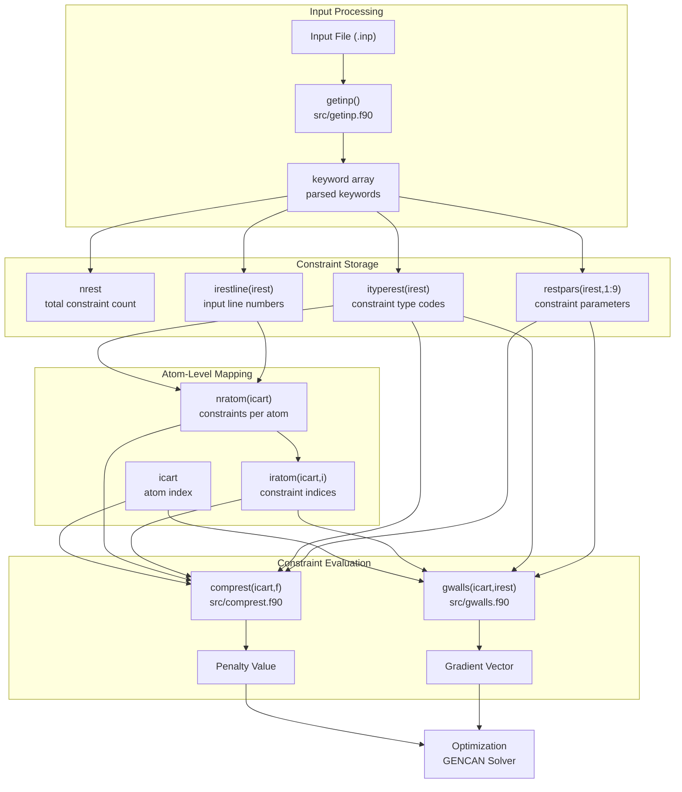
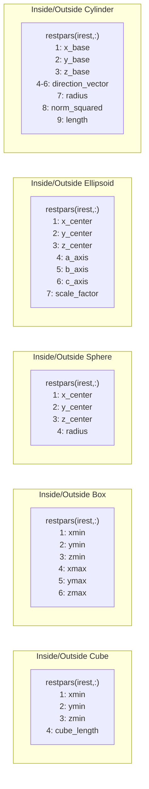
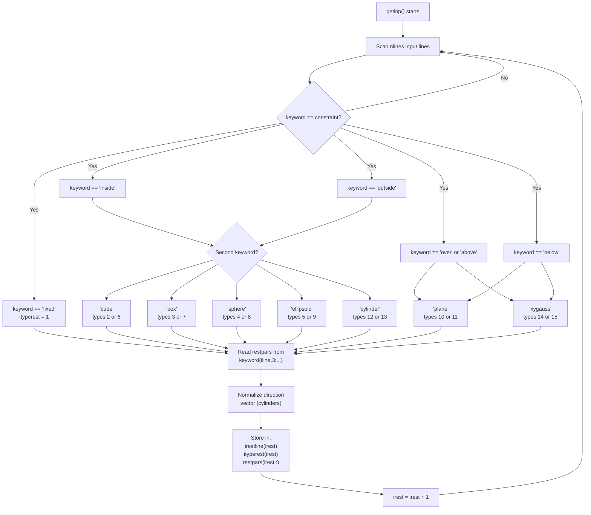
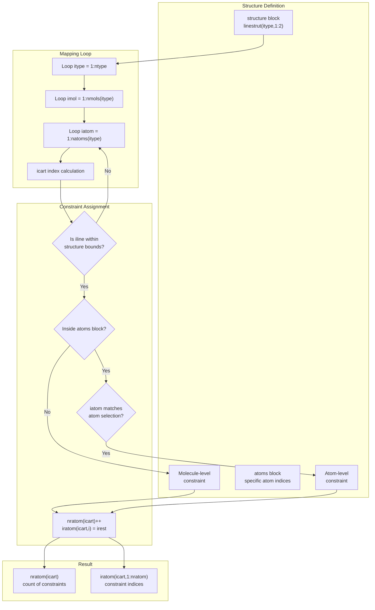
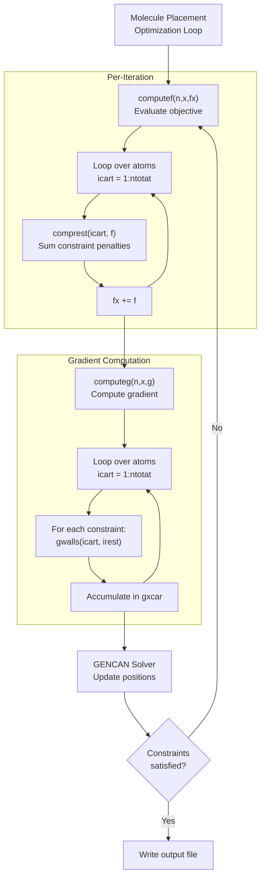

# Spatial Constraints

<details>
<summary>Relevant source files</summary>

The following files were used as context for generating this wiki page:

- [app/packmol.f90](app/packmol.f90)
- [src/checkpoint.f90](src/checkpoint.f90)
- [src/comprest.f90](src/comprest.f90)
- [src/getinp.f90](src/getinp.f90)
- [src/gwalls.f90](src/gwalls.f90)
- [src/input.f90](src/input.f90)
- [src/output.f90](src/output.f90)

</details>


## Purpose and Scope

This document describes Packmol's spatial constraint system, which allows users to define geometric regions where molecules must be placed (`inside`) or excluded from (`outside`). Spatial constraints are specified in the input file and control molecule placement during the optimization process.

For information about periodic boundary conditions, see [Periodic Boundary Conditions](#3.3). For details on the input file format, see [Input File Format](#3.1).

## Overview

Packmol supports multiple types of spatial constraints that restrict molecule placement to specific geometric regions. Each constraint is defined by a shape (cube, box, sphere, ellipsoid, cylinder, plane, or Gaussian surface) and a direction (inside, outside, above, or below). The optimization engine evaluates these constraints as penalty functions that guide the placement algorithm.

**Sources:** [src/getinp.f90:576-730](), [src/comprest.f90:1-215]()

## Constraint System Architecture



**Diagram: Spatial Constraint Data Flow**

This diagram shows how constraints flow from input file parsing through storage to evaluation during optimization.

**Sources:** [src/getinp.f90:558-738](), [app/packmol.f90:548-632](), [src/comprest.f90:11-215](), [src/gwalls.f90:9-327]()

## Constraint Type Codes

Packmol uses numeric type codes (`ityperest`) to identify different constraint types:

| Code | Keyword | Shape | Direction | Description |
|------|---------|-------|-----------|-------------|
| 1 | `fixed` | N/A | N/A | Fixed molecule position and orientation |
| 2 | `inside` | `cube` | Inside | Interior of a cube |
| 3 | `inside` | `box` | Inside | Interior of a rectangular box |
| 4 | `inside` | `sphere` | Inside | Interior of a sphere |
| 5 | `inside` | `ellipsoid` | Inside | Interior of an ellipsoid |
| 6 | `outside` | `cube` | Outside | Exterior of a cube |
| 7 | `outside` | `box` | Outside | Exterior of a rectangular box |
| 8 | `outside` | `sphere` | Outside | Exterior of a sphere |
| 9 | `outside` | `ellipsoid` | Outside | Exterior of an ellipsoid |
| 10 | `over`/`above` | `plane` | Above | Above a plane |
| 11 | `below` | `plane` | Below | Below a plane |
| 12 | `inside` | `cylinder` | Inside | Interior of a cylinder |
| 13 | `outside` | `cylinder` | Outside | Exterior of a cylinder |
| 14 | `over`/`above` | `xygauss` | Above | Above a Gaussian surface on XY plane |
| 15 | `below` | `xygauss` | Below | Below a Gaussian surface on XY plane |

**Sources:** [src/getinp.f90:564-730](), [src/comprest.f90:24-212]()

## Input File Specification

Constraints are specified in the input file within structure blocks. They can be applied to entire molecules or specific atoms.

### Molecule-Level Constraints

```
structure water.pdb
  number 1000
  inside box 0. 0. 0. 50. 50. 50.
end structure
```

### Atom-Level Constraints

```
structure protein.pdb
  number 1
  atoms 1 2 3 4 5
    inside sphere 10. 10. 10. 15.
  end atoms
  atoms 6 7 8
    outside cube 0. 0. 0. 5.
  end atoms
end structure
```

**Sources:** [src/getinp.f90:564-615](), [app/packmol.f90:563-616]()

## Constraint Parameter Storage

The `restpars(irest,1:9)` array stores geometric parameters for each constraint. The meaning of each index depends on the constraint type:



**Diagram: Constraint Parameter Layout**

**Sources:** [src/getinp.f90:568-693](), [src/comprest.f90:18-212]()

## Constraint Parsing Details



**Diagram: Constraint Parsing Flow in getinp()**

**Sources:** [src/getinp.f90:558-737]()

## Atom-to-Constraint Mapping

After parsing all constraints, Packmol maps each atom to the constraints that apply to it. This mapping is stored in the `nratom` and `iratom` arrays.



**Diagram: Atom-to-Constraint Mapping Process**

**Sources:** [app/packmol.f90:550-632]()

## Constraint Evaluation: comprest()

The `comprest()` subroutine evaluates constraint violations for a single atom and returns a penalty value. The penalty is zero when the constraint is satisfied and increases quadratically with the distance from the constraint boundary.

### Evaluation Strategy by Type

**Inside Constraints (types 2-5, 12):** Penalty when atom is outside the region
```fortran
! Example: inside sphere (type 4)
w = (x - x_center)^2 + (y - y_center)^2 + (z - z_center)^2 - radius^2
penalty = scale2 * max(w, 0)^2
```

**Outside Constraints (types 6-9, 13):** Penalty when atom is inside the region
```fortran
! Example: outside sphere (type 8)
w = (x - x_center)^2 + (y - y_center)^2 + (z - z_center)^2 - radius^2
penalty = scale2 * min(w, 0)^2
```

**Above/Below Plane (types 10-11):** Penalty based on signed distance to plane
```fortran
! Example: above plane (type 10)
w = a*x + b*y + c*z - d  ! signed distance
penalty = scale * min(w, 0)^2  ! penalty if below plane
```

**Sources:** [src/comprest.f90:11-215]()

## Constraint Types in Detail

### Fixed Position (type 1)

Fixed molecules are positioned at exact coordinates with specific orientation specified by Euler angles. This is handled specially in the main program, not in `comprest`.

**Input Format:**
```
structure molecule.pdb
  number 1
  fixed x y z alpha beta gamma
end structure
```

**Parameters:**
- `restpars(irest,1:3)`: center of mass coordinates (x, y, z)
- `restpars(irest,4:6)`: Euler angles (alpha, beta, gamma) in degrees

**Sources:** [src/getinp.f90:564-574](), [app/packmol.f90:117-162]()

### Cube Constraints (types 2, 6)

A cube is defined by its minimum corner and side length.

**Input Format:**
```
inside cube xmin ymin zmin length
outside cube xmin ymin zmin length
```

**Evaluation:** For inside cube (type 2), penalty is applied if any coordinate is outside `[xmin, xmin+length]` etc.

**Sources:** [src/getinp.f90:579-584](), [src/comprest.f90:29-44](), [src/gwalls.f90:24-43]()

### Box Constraints (types 3, 7)

A box is defined by minimum and maximum coordinates in each dimension.

**Input Format:**
```
inside box xmin ymin zmin xmax ymax zmax
outside box xmin ymin zmin xmax ymax zmax
```

**Evaluation:** For inside box (type 3), penalty is applied if any coordinate is outside its respective bounds.

**Sources:** [src/getinp.f90:585-592](), [src/comprest.f90:45-59](), [src/gwalls.f90:44-63]()

### Sphere Constraints (types 4, 8)

A sphere is defined by its center and radius.

**Input Format:**
```
inside sphere x_center y_center z_center radius
outside sphere x_center y_center z_center radius
```

**Evaluation Formula:**
```
distance_squared = (x - x_center)² + (y - y_center)² + (z - z_center)²
for inside: penalty if distance_squared > radius²
for outside: penalty if distance_squared < radius²
```

**Sources:** [src/getinp.f90:593-598](), [src/comprest.f90:60-66](), [src/gwalls.f90:63-75]()

### Ellipsoid Constraints (types 5, 9)

An ellipsoid is defined by its center, three semi-axes, and a scale factor.

**Input Format:**
```
inside ellipsoid x_center y_center z_center a b c scale
outside ellipsoid x_center y_center z_center a b c scale
```

**Evaluation Formula:**
```
w = (x - x_center)²/a² + (y - y_center)²/b² + (z - z_center)²/c² - scale²
for inside: penalty if w > 0
for outside: penalty if w < 0
```

**Sources:** [src/getinp.f90:599-607](), [src/comprest.f90:67-74](), [src/gwalls.f90:76-88]()

### Cylinder Constraints (types 12, 13)

A cylinder is defined by a base point, direction vector, radius, and length.

**Input Format:**
```
inside cylinder x y z vx vy vz radius length
outside cylinder x y z vx vy vz radius length
```

**Parameters:**
- `restpars(irest,1:3)`: base point coordinates
- `restpars(irest,4:6)`: direction vector (normalized during parsing)
- `restpars(irest,7)`: radius
- `restpars(irest,8)`: squared norm (computed, used for normalization)
- `restpars(irest,9)`: length along axis

**Evaluation:** Checks both radial distance from axis and axial position within `[0, length]`.

**Sources:** [src/getinp.f90:608-630](), [src/comprest.f90:158-174](), [src/gwalls.f90:202-242]()

### Plane Constraints (types 10, 11)

A plane is defined by its normal vector (a, b, c) and offset d, representing the equation `ax + by + cz = d`.

**Input Format:**
```
above plane a b c d
below plane a b c d
```

**Evaluation:**
```
signed_distance = a*x + b*y + c*z - d
for above: penalty if signed_distance < 0
for below: penalty if signed_distance > 0
```

**Sources:** [src/getinp.f90:696-712](), [src/comprest.f90:144-157](), [src/gwalls.f90:180-201]()

### Gaussian Surface Constraints (types 14, 15)

A Gaussian surface on the XY plane is defined by the equation:
```
z = h * exp(-(x-a)²/(2c²) - (y-b)²/(2d²)) + g
```

**Input Format:**
```
above xygauss a b c d g h
below xygauss a b c d g h
```

**Parameters:**
- `restpars(irest,1:2)`: center coordinates (a, b) on XY plane
- `restpars(irest,3:4)`: standard deviations (c, d) for X and Y
- `restpars(irest,5)`: base height (g)
- `restpars(irest,6)`: amplitude (h)

**Sources:** [src/getinp.f90:703-730](), [src/comprest.f90:192-212](), [src/gwalls.f90:291-323]()

## Gradient Computation: gwalls()

The `gwalls()` subroutine computes the gradient of the constraint penalty with respect to the atom's Cartesian coordinates. These gradients are accumulated in the `gxcar(icart,1:3)` array.

### Gradient Pattern

For quadratic penalties of the form `f = scale * (expression)²`, the gradient follows the chain rule:
```
∂f/∂x = 2 * scale * expression * (∂expression/∂x)
```

### Example: Inside Box

```fortran
! For coordinate violations
if (x < xmin) then
    gxcar(icart,1) = gxcar(icart,1) + scale * 2.0 * (x - xmin)
end if
if (x > xmax) then
    gxcar(icart,1) = gxcar(icart,1) + scale * 2.0 * (x - xmax)
end if
```

**Sources:** [src/gwalls.f90:9-327]()

## Constraint Scaling Factors

Packmol uses two scaling factors for constraint penalties:

| Variable | Value | Used For |
|----------|-------|----------|
| `scale` | 1000.0 | Box/cube constraints (types 2, 3, 6, 7, 10, 11, 14, 15) |
| `scale2` | 100.0 | Sphere/ellipsoid/cylinder constraints (types 4, 5, 8, 9, 12, 13) |

These are defined in the `compute_data` module and ensure constraint violations contribute significantly to the objective function.

**Sources:** [src/comprest.f90:14](), [src/compute_data.f90]()

## Periodic Boundary Conditions Integration

When periodic boundary conditions (PBC) are enabled, Packmol automatically adds an `inside box` constraint to ensure all atoms remain within the PBC box:

```fortran
if (using_pbc) then
    nrest = nrest + 1
    irestline(nrest) = -1  ! special marker for auto-generated constraint
    ityperest(nrest) = 3   ! inside box
    restpars(nrest,1:3) = pbc_min
    restpars(nrest,4:6) = pbc_max
end if
```

This constraint is automatically applied to all non-fixed atoms during the atom-to-constraint mapping phase.

**Sources:** [app/packmol.f90:530-546](), [app/packmol.f90:617-623]()

## Multiple Constraints Per Atom

An atom can have multiple constraints applied simultaneously. The total penalty for an atom is the sum of all individual constraint penalties:

```fortran
f = 0.d0
do iratcount = 1, nratom(icart)
    irest = iratom(icart,iratcount)
    ! Add penalty for constraint irest
    f = f + penalty_for_constraint(irest)
end do
```

During optimization, all constraints must be satisfied for the solution to be valid.

**Sources:** [src/comprest.f90:26-28](), [src/comprest.f90:213-215]()

## Constraint Application Workflow



**Diagram: Constraint Evaluation in Optimization Loop**

**Sources:** [src/computef.f90](), [src/computeg.f90](), [app/packmol.f90:740-850]()

## Special Considerations

### Outside Constraints Implementation

Outside constraints (types 6-9, 13) require special handling. For cubes and boxes, the penalty computation identifies the nearest face and applies a linear penalty (not quadratic) to push atoms away from the interior:

```fortran
! For outside cube/box, find minimum distance to push out
if (inside region) then
    ! Find which face is closest
    xmed = (xmax - xmin) / 2
    if (x <= xmed) a1 = x - xmin  ! distance to left face
    if (x > xmed) a1 = xmax - x   ! distance to right face
    ! Similar for y and z
    f = f + scale * (a1 + a2 + a3)  ! sum of distances
end if
```

**Sources:** [src/comprest.f90:75-101](), [src/gwalls.f90:89-120]()

### Cylinder Direction Vector Normalization

When parsing cylinder constraints, the direction vector is automatically normalized:

```fortran
restpars(irest,8) = vx^2 + vy^2 + vz^2  ! store squared norm
clen = sqrt(restpars(irest,8))
restpars(irest,4:6) = restpars(irest,4:6) / clen  ! normalize
```

This ensures consistent behavior regardless of the input vector magnitude.

**Sources:** [src/getinp.f90:618-630]()

### Constraint Error Checking

The input parser validates constraint specifications and exits with informative error messages if constraints are malformed:

```fortran
if (ioerr /= 0) then
    write(*,*) ' ERROR: Some restriction is not set correctly. '
    stop exit_code_input_error
end if
```

Common errors include invalid numeric values, missing parameters, or unrecognized shape keywords.

**Sources:** [src/getinp.f90:732-735]()

---