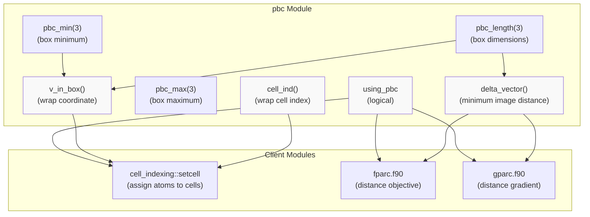
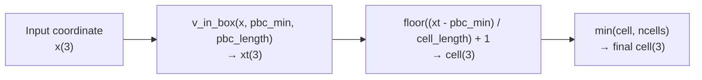
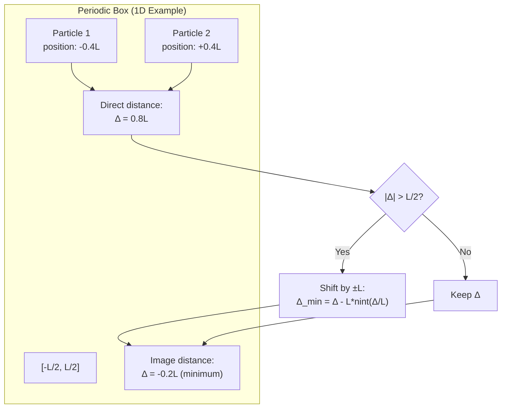
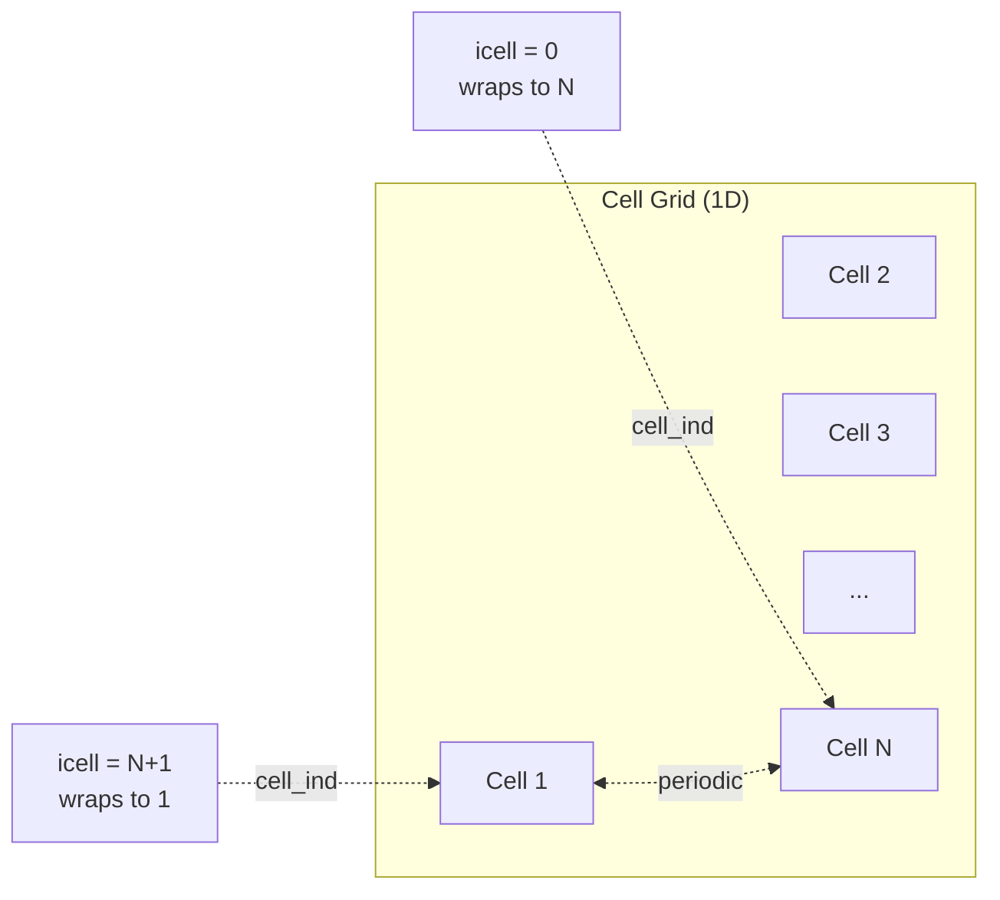
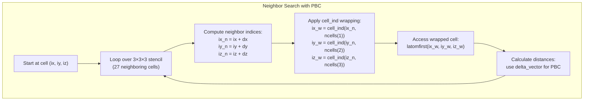
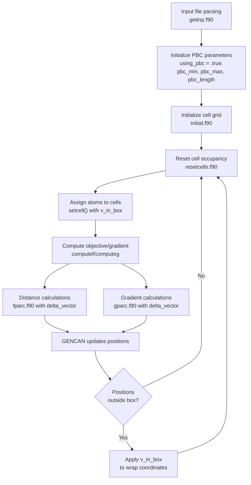
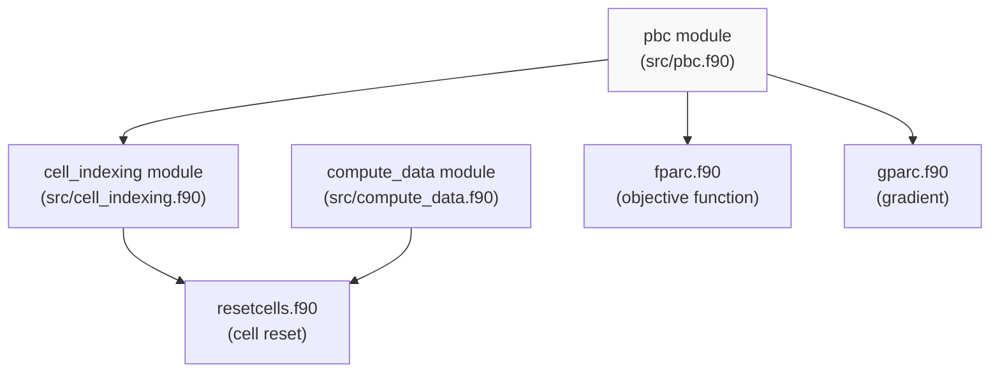

# Periodic Boundary Conditions

<details>
<summary>Relevant source files</summary>

The following files were used as context for generating this wiki page:

- [CMakeLists.txt](CMakeLists.txt)
- [src/cell_indexing.f90](src/cell_indexing.f90)
- [src/pbc.f90](src/pbc.f90)
- [src/resetcells.f90](src/resetcells.f90)
- [testing/input_files/water_box.inp](testing/input_files/water_box.inp)
- [testing/input_files/water_box_pbc.inp](testing/input_files/water_box_pbc.inp)
- [testing/input_files/water_box_pbc_negative_coordinates.inp](testing/input_files/water_box_pbc_negative_coordinates.inp)
- [testing/input_files/water_box_pbc_slab.inp](testing/input_files/water_box_pbc_slab.inp)

</details>


## Purpose and Scope

This page documents Packmol's support for periodic boundary conditions (PBC), which allows molecular systems to be packed in a periodic simulation box. This feature is essential for preparing systems for molecular dynamics simulations with periodic boundary conditions.

This page covers:
- Enabling PBC in input files using the `pbc` keyword
- The PBC implementation in the `pbc` module
- Coordinate wrapping and minimum image convention
- Integration with the spatial cell indexing system

For information about spatial constraints without PBC, see [Spatial Constraints](#3.2). For details on the cell indexing system that PBC integrates with, see [Spatial Management System](#4.5).

**Sources:** [src/pbc.f90](), [testing/input_files/water_box_pbc.inp]()

## Overview

Periodic boundary conditions simulate an infinite system by replicating a finite simulation box in all three dimensions. When a molecule or atom moves out of one side of the box, it reappears on the opposite side. This eliminates surface effects and allows simulation of bulk systems with a finite number of particles.

In Packmol, PBC affects:
- **Distance calculations**: Distances are computed using the minimum image convention
- **Cell indexing**: Cell indices wrap around at box boundaries
- **Coordinate wrapping**: Molecule centers are wrapped into the primary simulation box

The PBC system is controlled by the `using_pbc` flag and defined by box parameters `pbc_min`, `pbc_max`, and `pbc_length`.

**Sources:** [src/pbc.f90:1-31]()

## Enabling PBC in Input Files

### The `pbc` Keyword

PBC is enabled in input files using the `pbc` keyword, which can be specified in two formats:

**Format 1: Box lengths only**
```
pbc Lx Ly Lz
```
This defines a periodic box with dimensions `Lx × Ly × Lz`, with the origin at (0, 0, 0).

**Format 2: Explicit box boundaries**
```
pbc xmin ymin zmin xmax ymax zmax
```
This defines a periodic box from `(xmin, ymin, zmin)` to `(xmax, ymax, zmax)`.

### Example Input Files

| Input File | Box Definition | Description |
|------------|----------------|-------------|
| `water_box_pbc.inp` | `pbc 40. 40. 40.` | Cubic box 40×40×40, origin at (0,0,0) |
| `water_box_pbc_negative_coordinates.inp` | `pbc -20. -20. -20. 20. 20. 20.` | Cubic box 40×40×40, centered at origin |
| `water_box_pbc_slab.inp` | `pbc 40.0 40.0 40.0` with exclusion sphere | PBC with interior void region |

### Combining PBC with Constraints

PBC can be combined with spatial constraints such as `inside` or `outside` directives. For example, creating a slab geometry:

```
pbc 40.0 40.0 40.0
structure water.pdb
  number 1000
  outside sphere 20. 20. 20. 10.0
end structure
```

This creates a periodic box with water molecules everywhere except inside a central sphere, useful for simulating interfaces or porous materials.

**Sources:** [testing/input_files/water_box_pbc.inp:1-18](), [testing/input_files/water_box_pbc_negative_coordinates.inp:1-17](), [testing/input_files/water_box_pbc_slab.inp:1-18]()

## PBC Module Architecture

The PBC functionality is implemented in the `pbc` module, which provides a public interface of three elemental functions and three public variables.

### PBC Module Structure



**Diagram: PBC Module Interface and Dependencies**

The module exports:
- **State Variables**: `using_pbc`, `pbc_min(3)`, `pbc_max(3)`, `pbc_length(3)`
- **Functions**: `v_in_box`, `delta_vector`, `cell_ind`

**Sources:** [src/pbc.f90:5-31]()

## Coordinate Wrapping: `v_in_box`

The `v_in_box` function wraps a single coordinate component into the periodic box using the modulo operation.

### Function Signature

```fortran
elemental double precision function v_in_box(v, pbc_min, pbc_length)
```

### Implementation

[src/pbc.f90:15-18]()

The function uses the modulo operation to compute:
```
v_in_box = pbc_min + modulo((v - pbc_min), pbc_length)
```

This ensures that the wrapped coordinate satisfies:
```
pbc_min ≤ v_in_box < pbc_min + pbc_length
```

### Usage in Cell Indexing

The `setcell` subroutine uses `v_in_box` to wrap atom coordinates before assigning them to cells:

[src/cell_indexing.f90:14-25]()

The wrapping sequence is:
1. Apply `v_in_box` to all three coordinate components
2. Compute cell indices based on wrapped coordinates
3. Apply safeguard for coordinates exactly at `pbc_max`



**Diagram: Coordinate to Cell Index Conversion with PBC**

**Sources:** [src/pbc.f90:15-18](), [src/cell_indexing.f90:14-25]()

## Distance Calculation: `delta_vector`

The `delta_vector` function computes the distance vector between two coordinates using the minimum image convention, which ensures that the shortest distance across periodic boundaries is calculated.

### Function Signature

```fortran
elemental double precision function delta_vector(v1, v2, pbc_length)
```

### Implementation

[src/pbc.f90:20-24]()

The function implements the minimum image convention:
```
delta = v1 - v2
delta = delta - pbc_length * nint(delta / pbc_length)
```

The `nint` (nearest integer) function rounds `delta / pbc_length` to the nearest integer, effectively shifting the distance vector by the appropriate number of box lengths to find the minimum image.

### Minimum Image Convention



**Diagram: Minimum Image Convention in 1D**

### Example Calculation

For a box of length L = 10:
- Particle 1 at x₁ = 9.5
- Particle 2 at x₂ = 0.5
- Direct distance: Δ = 9.5 - 0.5 = 9.0
- Wrapped distance: Δ = 9.0 - 10 × nint(9.0/10) = 9.0 - 10 × 1 = -1.0

The minimum image distance is 1.0 (magnitude), indicating the particles are neighbors across the periodic boundary.

**Sources:** [src/pbc.f90:20-24]()

## Cell Index Wrapping: `cell_ind`

The `cell_ind` function wraps cell indices to account for periodic boundary conditions in the cell grid.

### Function Signature

```fortran
integer function cell_ind(icell, ncells)
```

### Implementation

[src/pbc.f90:26-29]()

The function uses modulo arithmetic to wrap cell indices:
```
cell_ind = modulo(icell - 1 + ncells, ncells) + 1
```

This ensures cell indices are in the range `[1, ncells]`, handling both positive and negative input indices correctly.

### Usage Pattern

When searching neighboring cells in the 3×3×3 stencil around a cell, indices may fall outside the valid range. The `cell_ind` function wraps them back:

```
! Example: neighbor search in x-direction
do ix = cell(1) - 1, cell(1) + 1
   icellx = cell_ind(ix, ncells(1))  ! Wrap if ix < 1 or ix > ncells(1)
   ! ... process neighbor cell
end do
```

### Cell Index Wrapping Illustration



**Diagram: Cell Index Wrapping at Boundaries**

The wrapping ensures that:
- `cell_ind(0, N) = N` (left boundary wraps to right)
- `cell_ind(N+1, N) = 1` (right boundary wraps to left)
- `cell_ind(k, N) = k` for `1 ≤ k ≤ N` (interior cells unchanged)

**Sources:** [src/pbc.f90:26-29]()

## Integration with Spatial Cell Indexing

The PBC module integrates tightly with Packmol's spatial cell indexing system, which partitions the simulation box into a 3D grid for efficient neighbor searching.

### Cell Setup with PBC

When PBC is enabled, the cell grid spans the entire periodic box defined by `pbc_min` and `pbc_max`. The cell length is chosen based on the interaction cutoff radius:

```
cell_length = radius + tolerance
ncells = ceiling((pbc_max - pbc_min) / cell_length)
```

### Cell Assignment with Wrapping

The `setcell` subroutine in [src/cell_indexing.f90:14-25]() demonstrates the integration:

1. **Coordinate Wrapping**: Apply `v_in_box` to wrap coordinates into the periodic box
2. **Cell Index Calculation**: Compute cell indices based on wrapped coordinates
3. **Boundary Safeguard**: Apply `min(cell, ncells)` to handle edge case at `pbc_max`

### PBC-Aware Neighbor Search



**Diagram: Neighbor Search Algorithm with PBC**

The key steps are:
1. Iterate over the 3×3×3 cell stencil centered on the current cell
2. Wrap neighbor cell indices using `cell_ind` to handle periodic boundaries
3. Access the wrapped cell using the linked list structure
4. Calculate atom-atom distances using `delta_vector` for minimum image distances

**Sources:** [src/cell_indexing.f90:14-25](), [src/pbc.f90:26-29]()

## PBC Data Flow

The following diagram shows how PBC information flows through the system during a typical optimization iteration:



**Diagram: PBC Data Flow During Optimization**

Throughout the optimization:
- `v_in_box` keeps molecule centers within the periodic box
- `delta_vector` ensures all distance calculations use minimum image convention
- `cell_ind` enables seamless neighbor searching across periodic boundaries

**Sources:** [src/pbc.f90:5-31](), [src/cell_indexing.f90:14-25](), [src/resetcells.f90:10-42]()

## Comparison: PBC vs Non-PBC Systems

| Aspect | Without PBC | With PBC |
|--------|-------------|----------|
| **Box Definition** | Constraints define packing region | `pbc` keyword defines simulation box |
| **Distance Calculation** | Direct Euclidean distance | Minimum image convention via `delta_vector` |
| **Coordinate Range** | Unbounded (within constraints) | Wrapped to `[pbc_min, pbc_max)` via `v_in_box` |
| **Cell Indexing** | Standard array indexing | Wrapped indexing via `cell_ind` |
| **Neighbor Search** | Boundary cells have fewer neighbors | All cells have full 27-neighbor stencil |
| **Typical Use Case** | Isolated molecules, proteins in solution | Bulk liquids, crystals, membranes |

### Example Comparison

**Non-PBC Input** ([testing/input_files/water_box.inp]()):
```
structure ./structure_files/water.pdb
  number 1000
  inside box -20. -20. -20. 20. 20. 20.
end structure
```

**PBC Input** ([testing/input_files/water_box_pbc.inp]()):
```
pbc 40. 40. 40.
structure ./structure_files/water.pdb
  number 1150
end structure
```

The PBC version can pack more molecules (1150 vs 1000) in the same volume because:
- No surface effects reduce packing efficiency
- All molecules have full coordination environment
- Edge molecules don't preferentially pack toward the center

**Sources:** [testing/input_files/water_box.inp:1-15](), [testing/input_files/water_box_pbc.inp:1-18]()

## Technical Implementation Details

### Elemental Functions

All three PBC functions (`v_in_box`, `delta_vector`, `cell_ind`) are declared as `elemental`, meaning they can operate on scalar or array arguments element-wise. This enables efficient vectorized operations:

```fortran
! Single coordinate wrapping
x_wrapped = v_in_box(x, pbc_min(1), pbc_length(1))

! Vector wrapping (element-wise)
xt(1:3) = v_in_box(x(1:3), pbc_min(1:3), pbc_length(1:3))
```

### Module Dependencies



**Diagram: Module Dependency Graph for PBC**

The `pbc` module has no dependencies, making it a low-level utility module. Higher-level modules import and use its functions for coordinate wrapping, distance calculations, and cell index management.

**Sources:** [src/pbc.f90:1-31](), [src/cell_indexing.f90:1-63](), [src/resetcells.f90:1-43]()

---