# Output File Formats

<details>
<summary>Relevant source files</summary>

The following files were used as context for generating this wiki page:

- [app/packmol.f90](app/packmol.f90)
- [src/checkpoint.f90](src/checkpoint.f90)
- [src/getinp.f90](src/getinp.f90)
- [src/input.f90](src/input.f90)
- [src/output.f90](src/output.f90)

</details>


This page documents the output file formats supported by Packmol and the options available for customizing the generated structure files. For information about input file syntax, see [Input File Format](#3.1). For command-line usage, see [Command-Line Interface](#3.5).

## Purpose and Scope

Packmol generates molecular structure files in multiple formats suitable for molecular dynamics simulation packages. The output generation process is implemented in [src/output.f90]() and controlled by keywords in the input file. This page covers:

- Supported output file formats (PDB, Tinker XYZ, standard XYZ, CHARMM CRD)
- Format-specific options and customization
- Residue numbering schemes
- Connectivity information handling
- Restart file generation

## Supported Output Formats

Packmol supports four primary output formats, controlled by the `filetype` keyword in the input file:

| Format | Keyword | File Extension | Primary Use Case |
|--------|---------|----------------|------------------|
| PDB | `filetype pdb` | `.pdb` | Protein Data Bank format, widely used for biomolecular simulations |
| Tinker XYZ | `filetype tinker` | `.xyz` | Tinker molecular modeling package format with connectivity |
| Standard XYZ | `filetype xyz` | `.xyz` | Simple Cartesian coordinate format |
| CHARMM CRD | `writecrd <file>` | `.crd` | CHARMM coordinate format (supplemental to PDB) |

**Sources:** [src/output.f90:1-599](), [src/getinp.f90:146-149]()

### Format Selection Logic

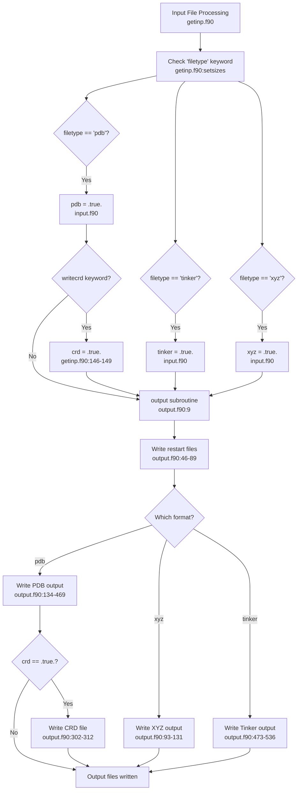

**Sources:** [src/getinp.f90:146-272](), [src/output.f90:9-539](), [src/input.f90:47-50]()

## PDB Format Output

The PDB (Protein Data Bank) format is the most feature-rich output option, supporting multiple customization options.

### PDB File Structure

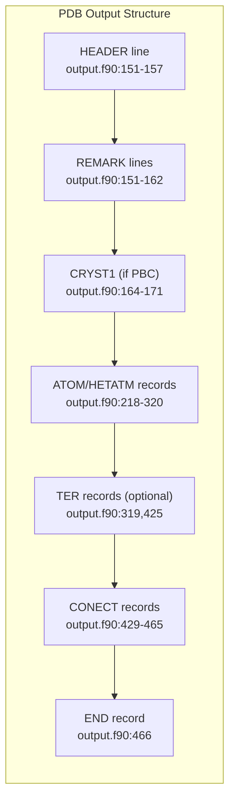

**Sources:** [src/output.f90:134-469]()

### PDB Output Options

The following table summarizes PDB-specific options that can be set in the input file:

| Keyword | Effect | Default | Code Reference |
|---------|--------|---------|----------------|
| `add_amber_ter` | Add TER records between molecules | `false` | [src/getinp.f90:126-128]() |
| `amber_ter_preserve` | Preserve TER records from input files | `false` | [src/getinp.f90:129-131]() |
| `add_box_sides [value]` | Add CRYST1 record with box dimensions | `false` | [src/getinp.f90:150-158]() |
| `hexadecimal_indices` | Use hexadecimal for atom/residue indices >9999/99999 | `false` | [src/getinp.f90:98-99]() |
| `resnumbers <0\|1\|2\|3>` | Residue numbering scheme (per structure) | Auto-detect | [src/getinp.f90:825-827]() |
| `changechains` | Alternate chain IDs for molecules (per structure) | `false` | [src/getinp.f90:822-824]() |
| `chain <char>` | Force specific chain identifier (per structure) | Auto | [src/getinp.f90:833-835]() |
| `connect <yes\|no>` | Include connectivity (CONECT records) | `yes` | [src/getinp.f90:828-832]() |
| `segid <identifier>` | Set segment identifier for CRD format | Empty | [src/getinp.f90:836-838]() |

**Sources:** [src/getinp.f90:126-158](), [src/getinp.f90:812-868]()

### Residue Numbering Schemes

Packmol supports four residue numbering schemes controlled by the `resnumbers` keyword within each `structure...end structure` block:

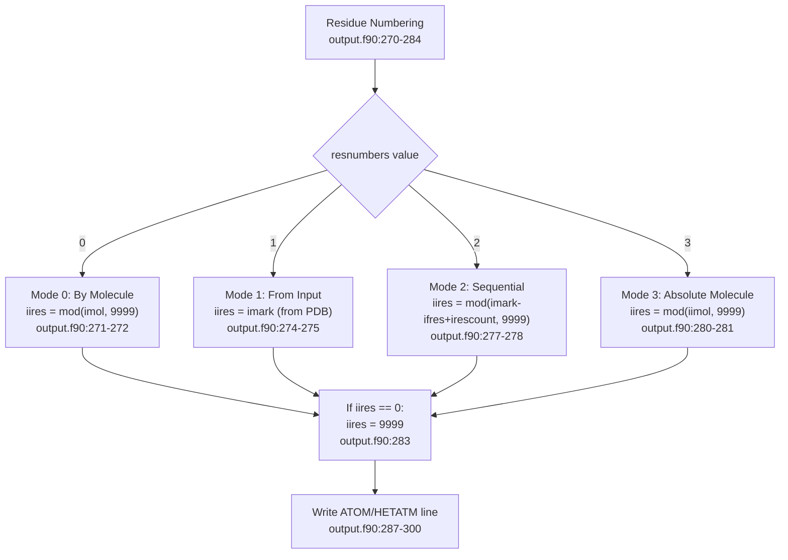

**Sources:** [src/output.f90:270-284](), [src/getinp.f90:849-857]()

### Atom Index Formatting

When atom or residue indices exceed PDB format limits, Packmol can automatically switch to hexadecimal representation:

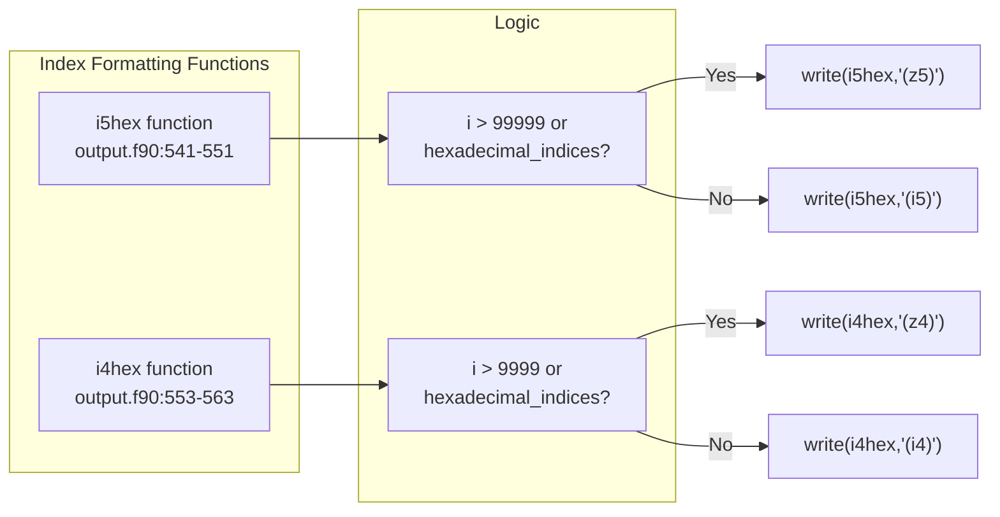

**Sources:** [src/output.f90:541-563](), [src/getinp.f90:98-99]()

### PDB Atom Line Format

The PDB atom line follows the standard PDB format specification with customizable indices:

```
Column  Field        Content
------  -----        -------
1-6     Record type  "ATOM  " or "HETATM"
7-11    Atom serial  Integer (or hex if >99999)
13-16   Atom name    From input PDB
18-21   Residue name From input PDB  
22      Chain ID     From chain/changechains logic
23-26   Residue seq  Integer (or hex if >9999)
27      Insertion    From input PDB
31-38   X coord      Computed position
39-46   Y coord      Computed position
47-54   Z coord      Computed position
55-80   Other fields From input PDB (B-factor, etc.)
```

**Sources:** [src/output.f90:135-137](), [src/output.f90:287-300]()

## Tinker XYZ Format

The Tinker format includes atomic connectivity information required by the Tinker molecular modeling package.

### Tinker Output Structure

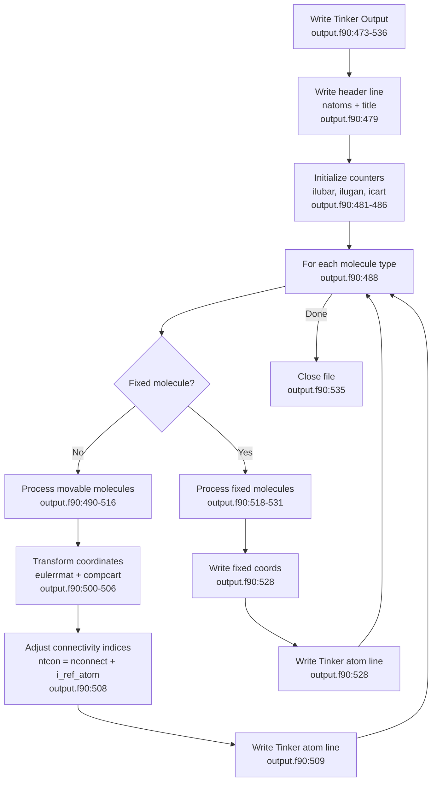

**Sources:** [src/output.f90:473-536]()

### Tinker Atom Line Format

Each atom line in Tinker format contains:

```
Field       Content
-----       -------
Atom index  Sequential integer
Element     3-character element symbol
X, Y, Z     Cartesian coordinates (3 x 10.6 format)
Connects    Up to 9 connectivity indices
```

The connectivity indices are adjusted to reflect the absolute atom numbering in the output file using the formula: `ntcon(k) = nconnect(idatom,k) + i_ref_atom`.

**Sources:** [src/output.f90:475](), [src/output.f90:507-509]()

## Standard XYZ Format

The simplest output format, containing only atom types and Cartesian coordinates.

### XYZ Output Process

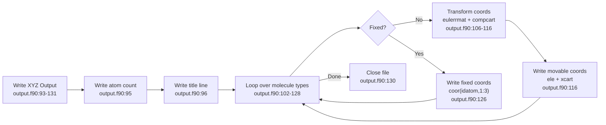

**Sources:** [src/output.f90:93-131]()

### XYZ Line Format

```
Format: element_symbol  x_coord  y_coord  z_coord
Example: C     12.345678    23.456789    34.567890
```

The format string is: `"( tr2,a3,tr2,3(tr2,f14.6) )"` which produces 3-character element symbols followed by three 14.6 floating-point coordinates.

**Sources:** [src/output.f90:116](), [src/output.f90:126]()

## CHARMM CRD Format

The CHARMM CRD format is written as a supplemental output when `writecrd` is specified, always in conjunction with PDB output.

### CRD File Structure

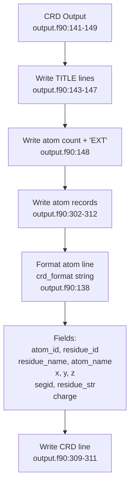

**Sources:** [src/output.f90:138-149](), [src/output.f90:302-312]()

### CRD Format Specification

The CRD format string is: `'(2I10,2X,A8,2X,A8,3F20.10,2X,A8,2X,A8,F20.10)'`

| Field | Format | Description |
|-------|--------|-------------|
| Atom serial | I10 | Atom index (10 digits) |
| Residue serial | I10 | Residue index (10 digits) |
| Residue name | A8 | 8-character residue name |
| Atom name | A8 | 8-character atom name |
| X, Y, Z | 3F20.10 | Coordinates (20.10 format each) |
| Segment ID | A8 | 8-character segment identifier |
| Residue string | A8 | Residue number as string |
| Charge | F20.10 | Atomic charge (written as 0.0) |

The CRD format supports up to 99,999,999 residues before wrapping (vs. 9,999 for PDB).

**Sources:** [src/output.f90:138](), [src/output.f90:302-312](), [src/getinp.f90:883-886]()

## Connectivity Information

Connectivity (CONECT records in PDB, connectivity indices in Tinker) is read from input files and written to output files.

### Connectivity Writing Process

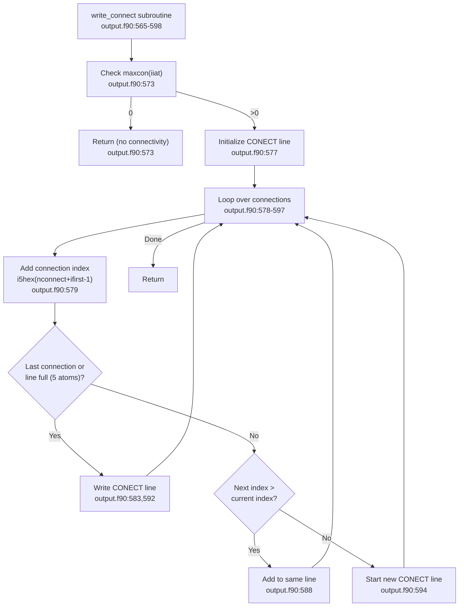

**Sources:** [src/output.f90:565-598]()

### CONECT Record Format

CONECT records follow PDB format specifications:
- Maximum of 4 bonded atoms per line (excluding the central atom)
- Multiple CONECT lines for atoms with >4 bonds
- Indices must be in increasing order
- Uses `i5hex` formatting for hexadecimal support

**Sources:** [src/output.f90:565-598](), [src/output.f90:541-551]()

## Restart Files

Packmol can write restart files containing generalized coordinates (center of mass + Euler angles) for molecular configurations.

### Restart File Structure

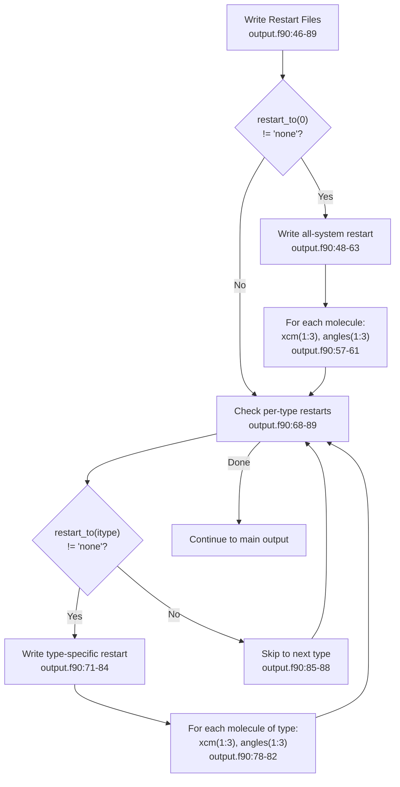

**Sources:** [src/output.f90:46-89]()

### Restart File Format

Each line in a restart file contains 6 floating-point values in scientific notation:

```
x_cm  y_cm  z_cm  beta  gama  teta
```

Where:
- `x_cm, y_cm, z_cm`: Center of mass coordinates
- `beta, gama, teta`: Euler angles (in radians)

Format string: `"(6(tr1,es23.16))"` - 6 values with 23.16 scientific notation

**Sources:** [src/output.f90:58]()

### Restart File Usage

Restart files are specified per structure or globally:

```
# Global restart files
restart_from <input_file>    # Read initial positions
restart_to <output_file>      # Write final positions

# Per-structure restart files  
structure ...
  restart_from <input_file>   # For this structure type only
  restart_to <output_file>    # For this structure type only
end structure
```

Fixed molecules cannot use restart files, as validated during input processing.

**Sources:** [src/getinp.f90:889-928](), [app/packmol.f90:153-158]()

## Coordinate Transformation for Output

All movable molecules undergo coordinate transformation from generalized coordinates to Cartesian coordinates before output.

### Transformation Pipeline

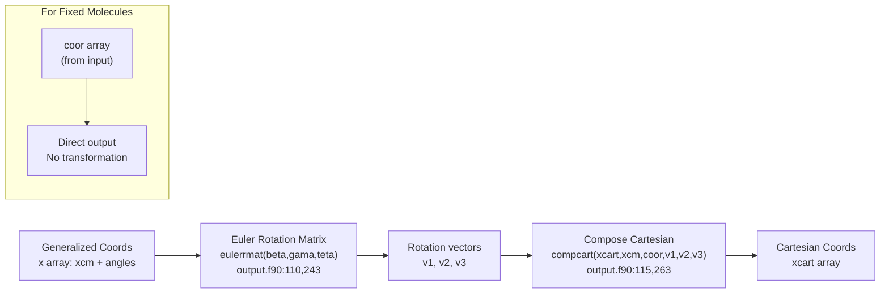

**Sources:** [src/output.f90:106-116](), [src/output.f90:239-263]()

### Variable Indexing

The output subroutine uses several index variables to traverse the coordinate arrays:

| Variable | Purpose | Usage |
|----------|---------|-------|
| `ilubar` | Index into center-of-mass positions (`x(1:3*ntotmol)`) | [output.f90:55,97]() |
| `ilugan` | Index into Euler angles (`x(3*ntotmol+1:6*ntotmol)`) | [output.f90:56,98]() |
| `icart` | Index into Cartesian coordinate array `xcart` | [output.f90:99,113]() |
| `idatom` | Index into reference coordinate array `coor` | [output.f90:111,114]() |
| `i_ref_atom` | Running atom counter for output file | [output.f90:176,262]() |

**Sources:** [src/output.f90:55-99](), [src/output.f90:173-177]()

## Output File Name Specification

The output file name is specified using the `output` keyword in the input file:

```
output <filename>
```

The filename is validated during input processing. If missing or incorrectly specified, Packmol exits with an error.

**Sources:** [src/getinp.f90:258-272]()

### Output Filename Handling

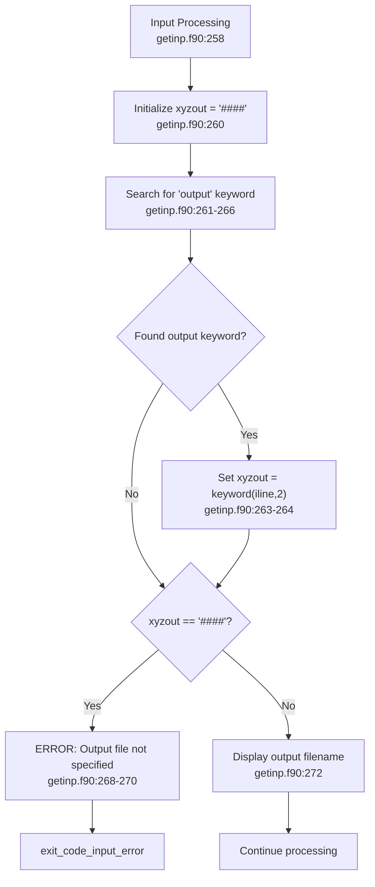

**Sources:** [src/getinp.f90:258-272]()

---