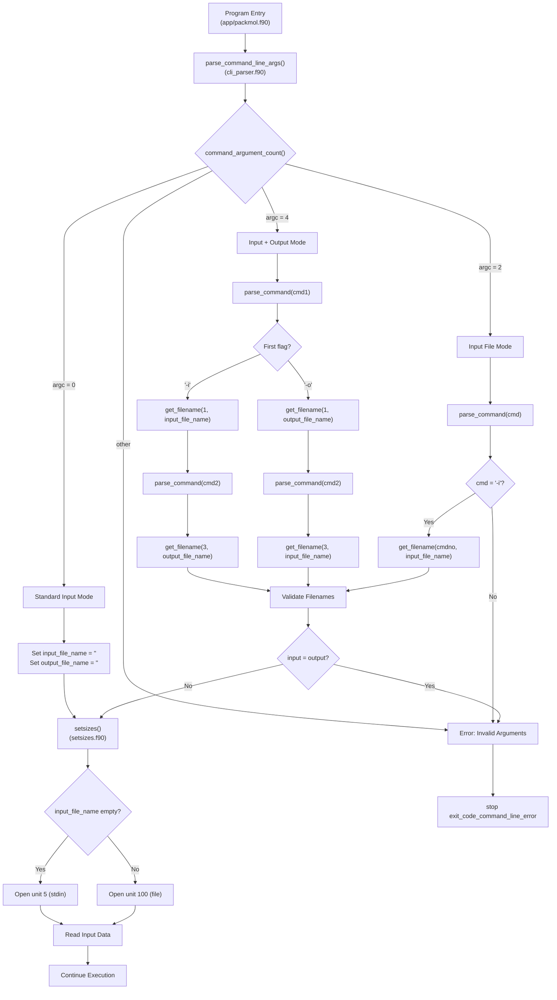
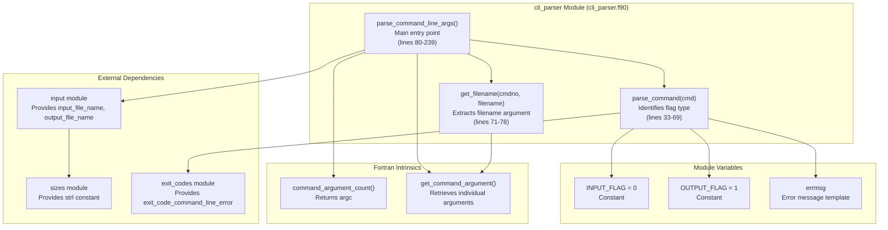
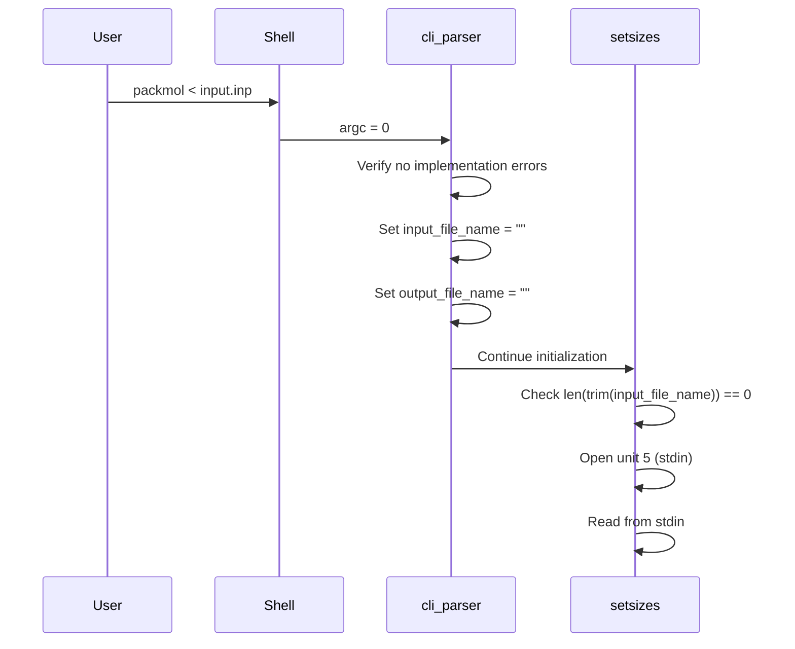
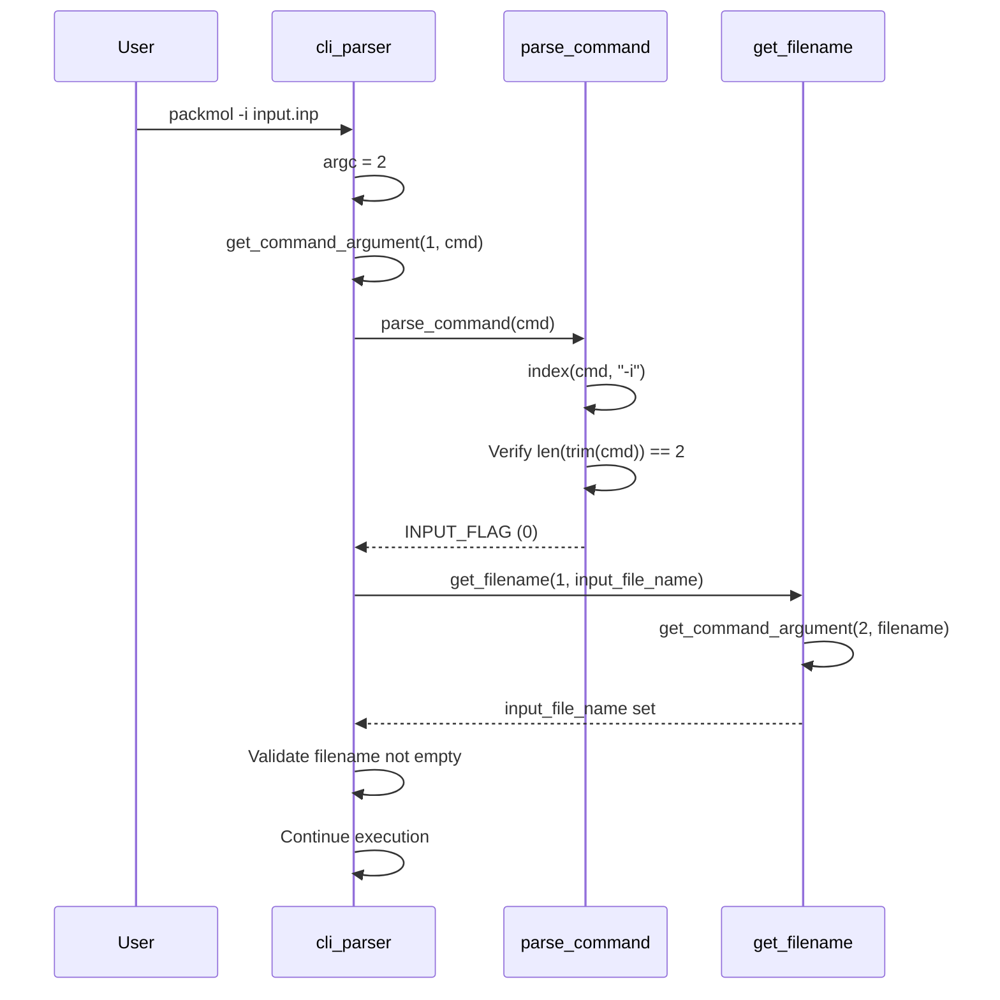
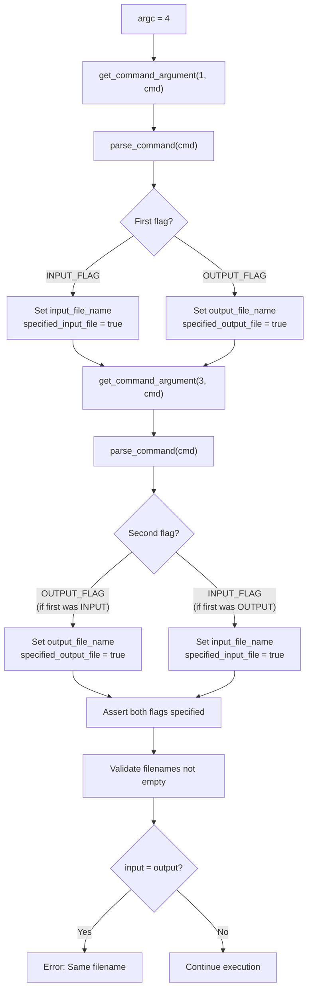
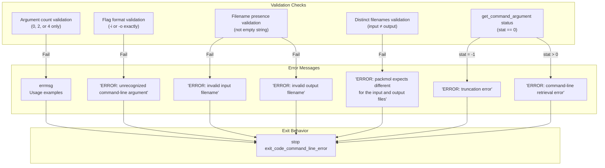
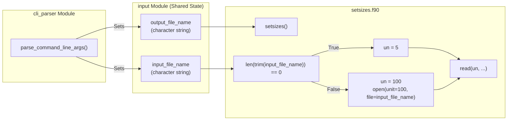
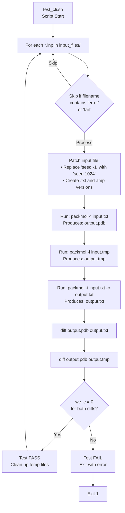

# Command-Line Interface

<details>
<summary>Relevant source files</summary>

The following files were used as context for generating this wiki page:

- [src/cli_parser.f90](src/cli_parser.f90)
- [src/setsizes.f90](src/setsizes.f90)
- [testing/test_cli.sh](testing/test_cli.sh)

</details>


This page documents Packmol's command-line interface, including supported invocation methods, argument parsing implementation, and error handling. The CLI provides three distinct ways to execute Packmol, all of which are validated for consistency through automated testing.

For information about the input file format that the CLI accepts, see [Input File Format](#3.1). For details about output file generation, see [Output File Formats](#3.4). For the overall program execution flow, see [Program Execution Flow](#4.2).

## Purpose and Scope

Packmol's command-line interface serves as the primary entry point for executing the molecular packing program. It handles argument parsing, file path validation, and initialization of input/output streams. The implementation supports both traditional Unix-style input redirection and explicit file specification via command-line flags.

## Supported Invocation Methods

Packmol supports three invocation methods, all of which produce identical results for the same input:

| Method | Syntax | Description |
|--------|--------|-------------|
| Standard Input Redirection | `packmol < input.inp` | Traditional Unix approach; reads from stdin |
| Input File Flag | `packmol -i input.inp` | Explicit input file specification |
| Input and Output Flags | `packmol -i input.inp -o output.pdb` | Explicit specification of both files |

The output file is normally specified within the input file using the `output` keyword. The `-o` flag overrides this specification.

**Sources:** [src/cli_parser.f90:18-26](), [testing/test_cli.sh:1-240]()

## Command-Line Argument Parsing Flow

The following diagram illustrates how command-line arguments are processed from program invocation to input/output stream initialization:



**Sources:** [src/cli_parser.f90:80-239](), [src/setsizes.f90:37-46]()

## CLI Parser Module Architecture

The `cli_parser` module provides the core command-line parsing functionality through a hierarchical function structure:



**Sources:** [src/cli_parser.f90:1-242]()

## Argument Parsing Logic

### Zero Arguments (Standard Input Mode)

When no command-line arguments are provided, Packmol expects input via standard input redirection:



The implementation validates that both `input_file_name` and `output_file_name` are empty strings to detect implementation errors [src/cli_parser.f90:119-127]().

**Sources:** [src/cli_parser.f90:99-128](), [src/setsizes.f90:37-46]()

### Two Arguments (Input File Flag)

When two arguments are provided, the first must be `-i` and the second is the input filename:



The parser ensures the flag is exactly `-i` (no additional characters) and extracts the filename from the subsequent argument [src/cli_parser.f90:129-162]().

**Sources:** [src/cli_parser.f90:129-162](), [src/cli_parser.f90:33-69](), [src/cli_parser.f90:71-78]()

### Four Arguments (Input and Output Flags)

When four arguments are provided, they must be `-i` and `-o` in any order with their respective filenames:



The implementation supports both `-i input.inp -o output.pdb` and `-o output.pdb -i input.inp` orderings [src/cli_parser.f90:163-236]().

**Sources:** [src/cli_parser.f90:163-236]()

## Flag Parsing Implementation

The `parse_command` function identifies and validates command-line flags:

| Check | Description | Error Condition |
|-------|-------------|-----------------|
| Flag presence | Uses `index(cmd, "-i")` and `index(cmd, "-o")` | No match with either flag |
| Exact length | Verifies `len(trim(cmd)) == 2` | Extra characters in flag |
| Flag type | Returns `INPUT_FLAG` or `OUTPUT_FLAG` | Invalid flag characters |

The function returns integer constants `INPUT_FLAG = 0` or `OUTPUT_FLAG = 1` to indicate the flag type [src/cli_parser.f90:16-17]().

**Sources:** [src/cli_parser.f90:33-69]()

## Error Handling and Validation

The CLI parser implements comprehensive error handling:



All errors terminate the program with `exit_code_command_line_error` from the `exit_codes` module [src/cli_parser.f90:10]().

**Sources:** [src/cli_parser.f90:18-26](), [src/cli_parser.f90:89-90](), [src/cli_parser.f90:227-230]()

## Integration with Input System

The CLI parser sets module variables in the `input` module that are later consumed by `setsizes`:



The key decision point is at [src/setsizes.f90:37-46](), where an empty `input_file_name` indicates standard input mode (unit 5), while a non-empty string indicates file mode (unit 100).

**Sources:** [src/cli_parser.f90:11-12](), [src/setsizes.f90:27-46]()

## CLI Testing and Validation

The CLI behavior is validated through `test_cli.sh`, which ensures all three invocation methods produce identical output:



### Test Methodology

The testing script implements several key strategies:

| Strategy | Implementation | Purpose |
|----------|----------------|---------|
| Seed normalization | Replace `seed -1` with `seed 1024` | Ensure deterministic results |
| File extension variants | Create `.txt` and `.tmp` copies | Test different output specifications |
| Binary diff comparison | Use GNU `diff` with `wc -c` | Verify byte-identical outputs |
| Input file filtering | Skip files with "error" or "fail" | Exclude intentional failure cases |

**Sources:** [testing/test_cli.sh:119-237]()

## Platform Considerations

The CLI implementation includes platform-specific considerations:

### macOS Compatibility

The test script detects macOS and uses `awk` instead of `gawk`:

```bash
os=$("$uname")
if [ "Darwin" == "$os" ] ; then
    gawk=$(which awk)
else
    gawk=$(which gawk)
fi
```

This accommodates macOS not shipping with GNU awk by default [testing/test_cli.sh:103-109]().

### Fortran Intrinsic Portability

The CLI parser uses standard Fortran intrinsics that are portable across compilers:

- `command_argument_count()` - Returns number of command-line arguments
- `get_command_argument(number, value, length, status)` - Retrieves specific arguments
- `index(string, substring)` - Finds substring position

**Sources:** [testing/test_cli.sh:103-114](), [src/cli_parser.f90:98-175]()

## Usage Examples

### Standard Input Redirection

```bash
packmol < water_box.inp
```

The input file `water_box.inp` contains the `output` directive specifying where to write results.

### Explicit Input File

```bash
packmol -i water_box.inp
```

Functionally identical to standard input redirection, but more explicit. The output file is still determined from the input file's `output` directive.

### Override Output File

```bash
packmol -i water_box.inp -o custom_output.pdb
```

The `-o` flag overrides any `output` directive in the input file, forcing output to `custom_output.pdb`.

### Invalid Invocations

The following commands produce errors:

```bash
packmol input.inp              # Error: expects 0, 2, or 4 args
packmol -i                     # Error: missing filename
packmol -i input.inp output.pdb # Error: missing -o flag
packmol -i same.txt -o same.txt # Error: input = output
```

**Sources:** [src/cli_parser.f90:18-26](), [testing/test_cli.sh:175-213]()

## Error Message Template

When the CLI parser encounters an error, it displays a standardized error message with usage examples:

```
ERROR: packmol command-line error

Command-line execution examples (you may use any): 

packmol < inputfile.inp

packmol -i inputfile.inp

packmol -i inputfile.inp -o output.pdb
```

This message is defined as a module constant `errmsg` in [src/cli_parser.f90:18-26]() and is displayed for all command-line parsing errors.

**Sources:** [src/cli_parser.f90:18-26]()

---