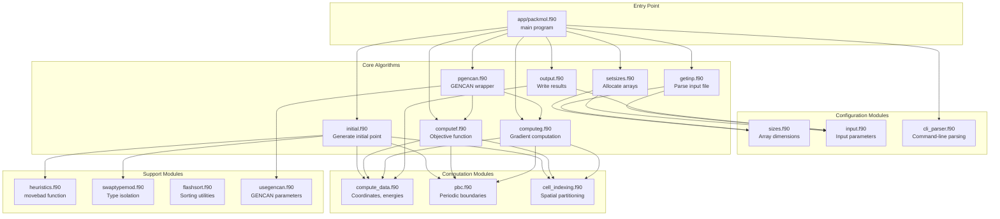
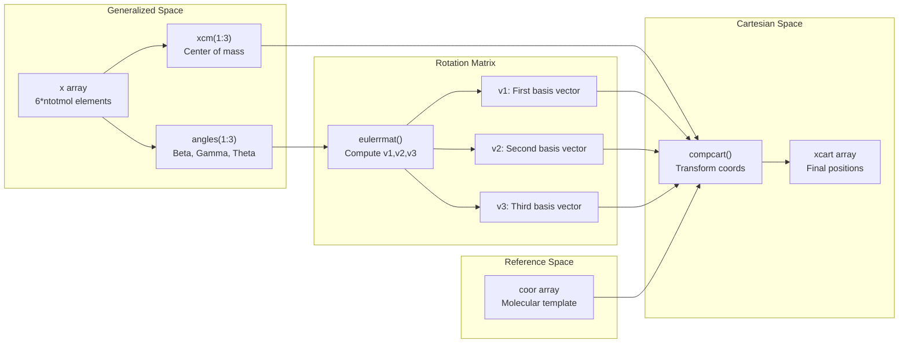
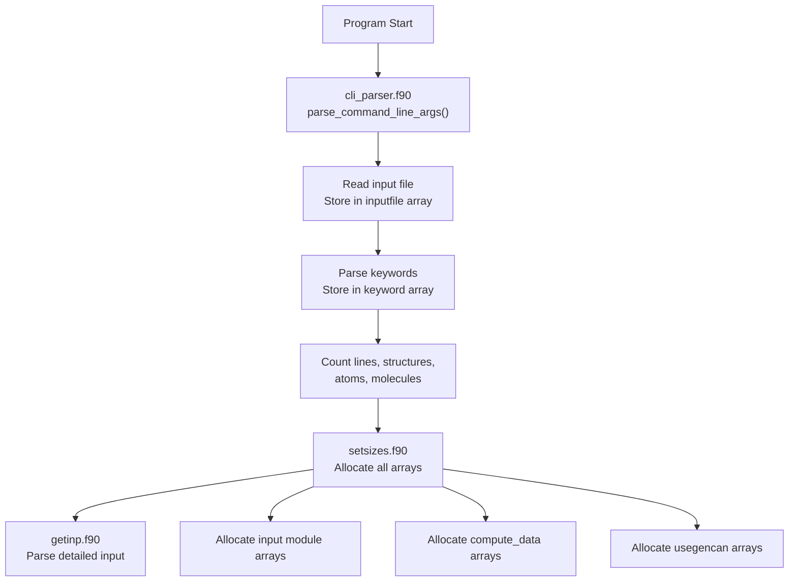
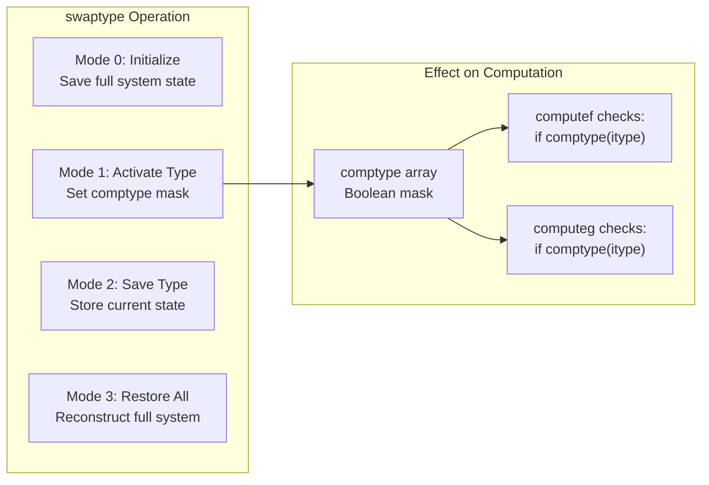
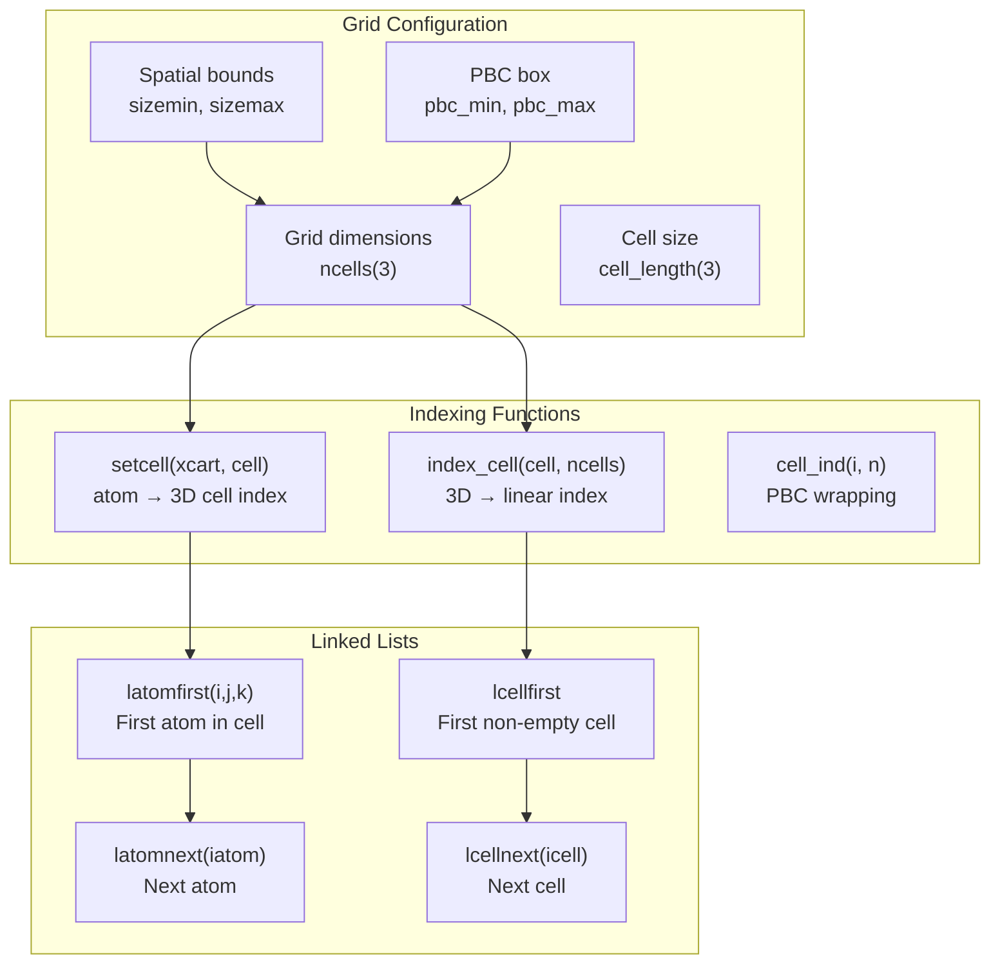
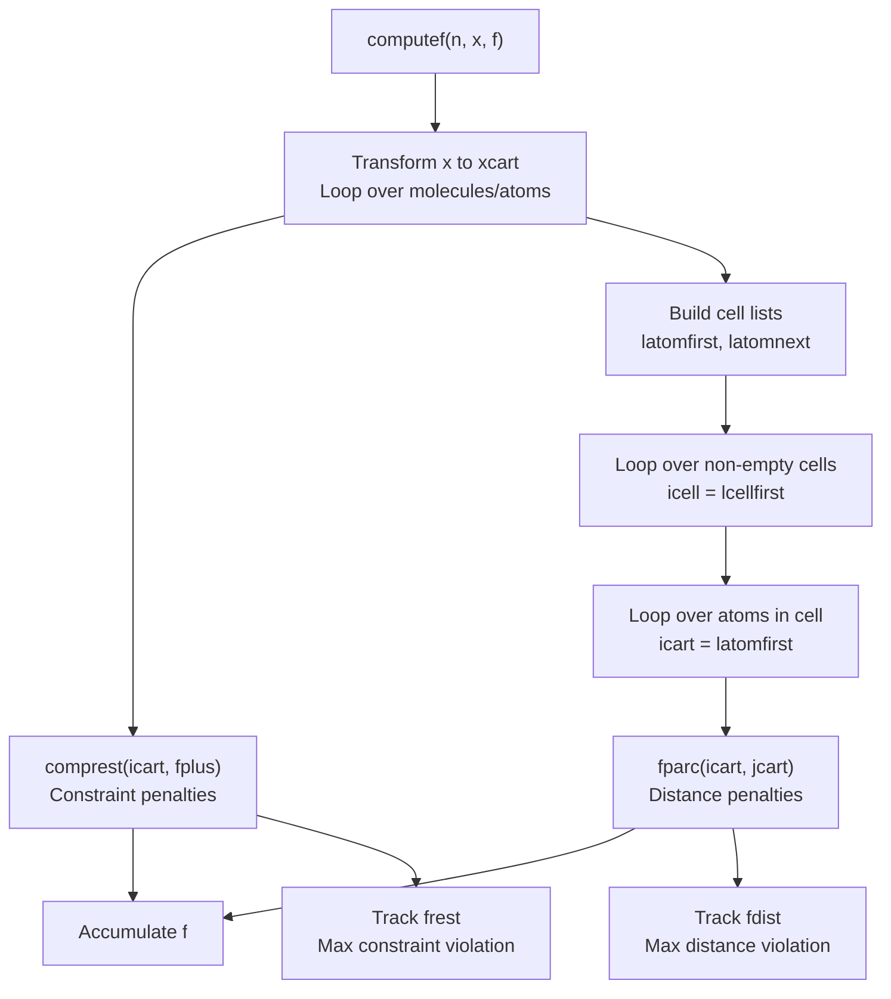
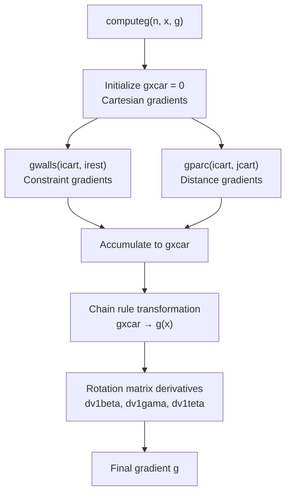
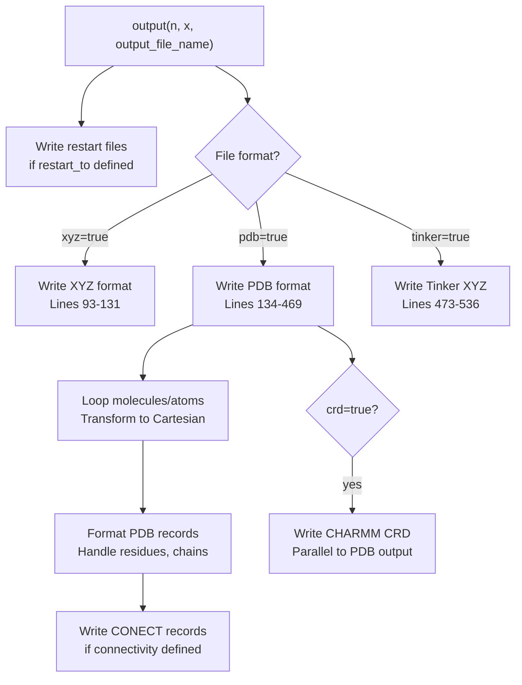

# Architecture and Implementation

Relevant source files

The following files were used as context for generating this wiki page:

- [app/packmol.f90](app/packmol.f90)
- [src/checkpoint.f90](src/checkpoint.f90)
- [src/computef.f90](src/computef.f90)
- [src/computeg.f90](src/computeg.f90)
- [src/getinp.f90](src/getinp.f90)
- [src/initial.f90](src/initial.f90)
- [src/input.f90](src/input.f90)
- [src/output.f90](src/output.f90)

This page provides a comprehensive overview of Packmol's internal architecture, implementation patterns, and core algorithms. It covers the structural organization of the Fortran codebase, the flow of data through the system, and the key computational abstractions that enable efficient molecular packing.

For specific build system details, see [Build System Architecture](#4.1). For step-by-step execution flow, see [Program Execution Flow](#4.2). For optimization algorithms, see [Optimization Engine (GENCAN)](#4.4).

## System Overview

Packmol is implemented as a monolithic Fortran 90/95 application with modular organization through Fortran modules. The architecture follows a pipeline model where input is parsed, an initial configuration is generated, an optimization loop refines the solution, and output is written. The system maintains separation of concerns through distinct modules for input handling, computation, spatial management, and optimization control.

### High-Level Module Architecture

Sources: [app/packmol.f90](), [src/sizes.f90](), [src/input.f90](), [src/compute_data.f90]()

## Core Data Structures

Packmol maintains several primary data structures that flow through the system. The central data arrays are managed through Fortran modules and accessed globally during computation.

### Key Data Arrays

| Array | Module | Purpose | Dimensions |
|-------|--------|---------|------------|
| `x` | Local in main | Generalized coordinates (xcm + angles) | `(n)` where n = ntotmol*6 |
| `xcart` | compute_data | Cartesian atom coordinates | `(ntotat, 3)` |
| `coor` | compute_data | Reference molecular coordinates | `(ntotat, 3)` |
| `radius` | compute_data | Per-atom distance tolerances | `(ntotat)` |
| `latomfirst` | compute_data | Cell head pointers | `(ncells(1), ncells(2), ncells(3))` |
| `latomnext` | compute_data | Atom linked list | `(ntotat)` |
| `idfirst` | compute_data | First atom index per type | `(ntype)` |
| `nmols` | compute_data | Number of molecules per type | `(ntype)` |

Sources: [src/compute_data.f90](), [app/packmol.f90:95]()

### Coordinate Representation System

The system uses three coordinate representations:
1. **Generalized coordinates** (`x` array): 6 values per molecule (3 for center of mass + 3 Euler angles)
2. **Reference coordinates** (`coor` array): Template atomic positions for each molecule type
3. **Cartesian coordinates** (`xcart` array): Final 3D positions of all atoms

The transformation is performed by `eulerrmat()` (computes rotation matrix) and `compcart()` (applies rotation and translation).

Sources: [src/computef.f90:52-72](), [src/computeg.f90:43-66](), [src/eulerrmat.f90](), [src/compcart.f90]()

## Module Dependency Structure

### Size Configuration Flow

Sources: [src/setsizes.f90](), [src/getinp.f90](), [src/cli_parser.f90]()

### Computation Module Dependencies

The computation modules maintain shared state through module variables. Key dependency relationships:

- **compute_data**: Central module containing coordinates, energies, molecular topology
- **pbc**: Periodic boundary condition parameters and helper functions
- **cell_indexing**: Spatial partitioning functions (setcell, index_cell, cell_ind)
- **usegencan**: GENCAN solver parameters and state

Sources: [src/compute_data.f90](), [src/pbc.f90](), [src/cell_indexing.f90]()

## Optimization Architecture

### Two-Phase Strategy

Packmol employs a two-phase optimization strategy implemented in [initial.f90]() and [app/packmol.f90]():

**Phase 1: Constraint Satisfaction** ([initial.f90:167-224]())
- Process each molecule type independently using `swaptype()`
- Optimize only constraint violations (spatial restrictions)
- Use reduced problem size for faster convergence
- Apply `movebad()` heuristic to fix problematic molecules
- Controlled by `nloop0_type` parameter

**Phase 2: Full Optimization** ([app/packmol.f90:740-943]())
- Can pack types separately first, then together (default)
- Or pack all types simultaneously (`packall` option)
- Optimize both distance penalties and constraints
- Use `radscale` to gradually tighten tolerances
- Continue until convergence or maximum iterations

### Type Isolation Mechanism

The `swaptype` mechanism ([swaptypemod.f90]()) allows the optimization to focus on a subset of molecules:
- Saves/restores coordinates for inactive types
- Sets `comptype` boolean mask
- `computef` and `computeg` skip inactive types
- Enables incremental packing without recomputing fixed molecules

Sources: [src/swaptypemod.f90](), [src/computef.f90:45-52](), [src/computeg.f90:48-52]()

## Spatial Management Architecture

### Cell-Based Spatial Indexing

The spatial indexing system achieves O(N) scaling for pairwise interactions:
- Space is divided into a 3D grid where `cell_length ≈ discale * radmax`
- Each cell contains a linked list of atoms (`latomfirst`/`latomnext`)
- Non-empty cells are tracked via linked list (`lcellfirst`/`lcellnext`)
- Neighbor search examines only 14 adjacent cells (forward stencil)

Sources: [src/cell_indexing.f90](), [src/initial.f90:278-289](), [src/computef.f90:83-96]()

### Neighbor Search Pattern

The system searches 14 cells to avoid double-counting:
- Current cell (self interactions)
- 3 face-sharing cells (forward in x, y, z)
- 6 edge-sharing cells (forward diagonal faces)
- 4 vertex-sharing cells (forward diagonal corners)

This is implemented in [computef.f90:115-151]() and [computeg.f90:99-141]() using `cell_ind()` for periodic wrapping.

Sources: [src/computef.f90:115-151](), [src/computeg.f90:99-141]()

## Function Evaluation Architecture

### Objective Function Structure

The objective function has two components:
1. **Constraint penalties** (`comprest`): Penalizes molecules outside spatial constraints
2. **Distance penalties** (`fparc`): Penalizes atoms closer than `radius(i) + radius(j)`

Both are smooth, differentiable functions that increase as violations worsen.

Sources: [src/computef.f90:9-154](), [src/comprest.f90](), [src/fparc.f90]()

### Gradient Computation

Gradient computation follows the coordinate transformation chain:
1. Compute gradients in Cartesian space (`gxcar`)
2. Apply chain rule to transform to generalized coordinates
3. Uses rotation matrix derivatives computed analytically

Sources: [src/computeg.f90:9-244](), [src/gwalls.f90](), [src/gparc.f90]()

## Output Generation

The output system supports multiple file formats through a single interface in [output.f90]():

### Output Flow

Key features:
- **PDB output**: Handles chain assignments, residue numbering, connectivity records
- **Restart files**: Can save/load per-type or full system state
- **CHARMM CRD**: Optional parallel output for CHARMM compatibility
- **Hexadecimal indices**: For systems exceeding 99,999 atoms

Sources: [src/output.f90:9-539]()

## Error Handling and Exit Codes

The system uses structured exit codes defined in [exit_codes.f90]():
- `exit_code_normal = 0`: Success
- `exit_code_input_error = 1`: Invalid input
- `exit_code_open_file = 2`: File I/O error
- `exit_code_failed_to_converge = 3`: Optimization failure

Error handling is immediate with `stop exit_code_*` statements throughout the codebase.

Sources: [src/exit_codes.f90]()

## Related Documentation

For deeper exploration of specific subsystems:
- Build configuration and compilation: [Build System Architecture](#4.1)
- Detailed execution sequence: [Program Execution Flow](#4.2)
- Initial point generation: [System Initialization](#4.3)
- GENCAN integration: [Optimization Engine (GENCAN)](#4.4)
- Cell indexing details: [Spatial Management System](#4.5)
- Energy function details: [Objective Function Evaluation](#4.6)
- Distance calculations: [Atom-to-Atom Interactions](#4.7)
- Coordinate transformations: [Coordinate Transformations](#4.8)

---