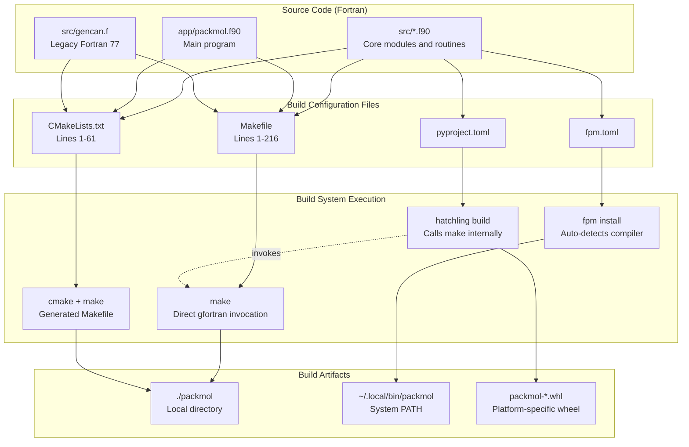
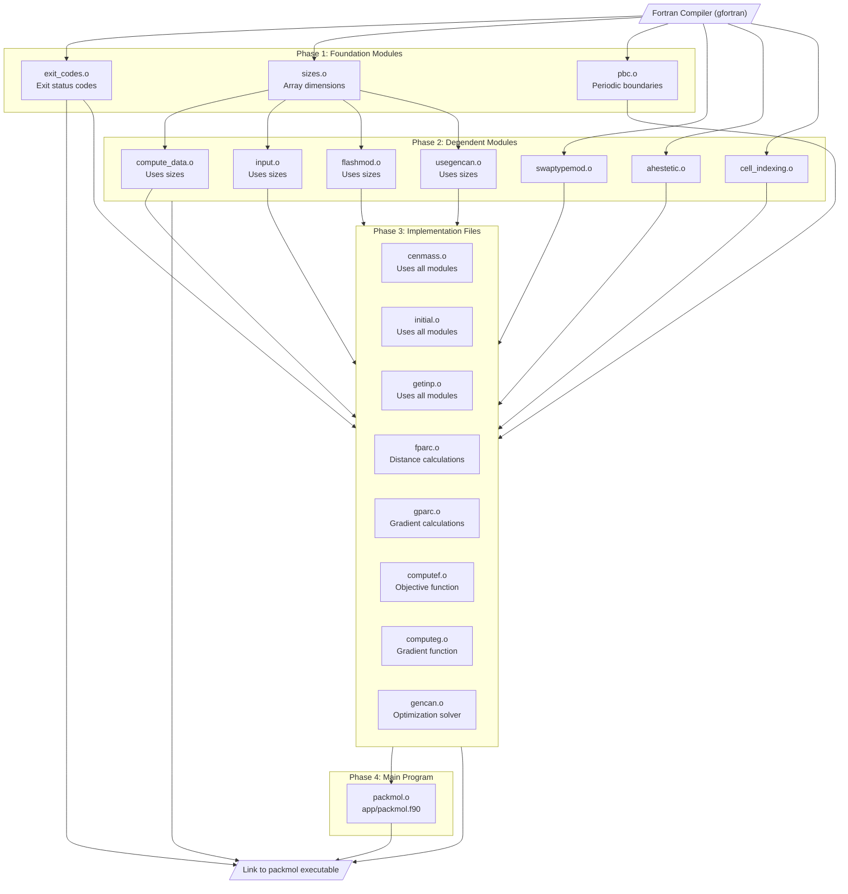
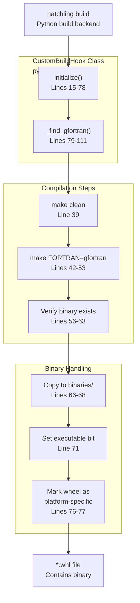
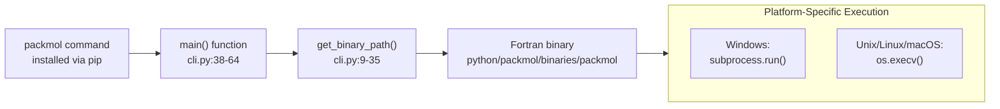
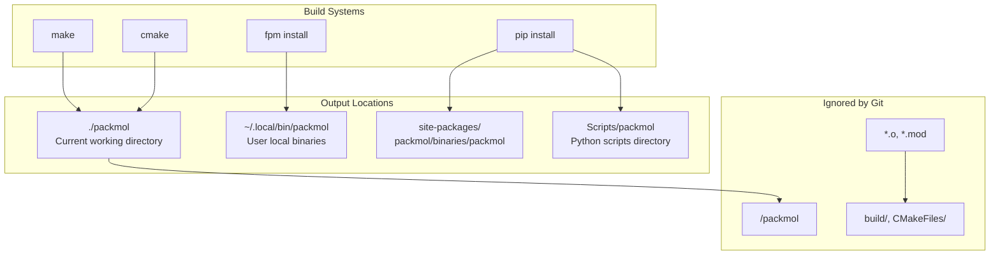
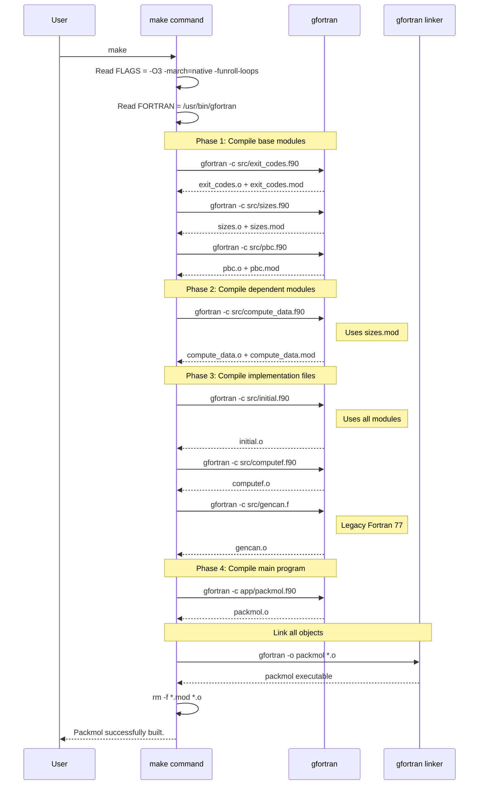

# Build System Architecture

<details>
<summary>Relevant source files</summary>

The following files were used as context for generating this wiki page:

- [.gitignore](.gitignore)
- [CMakeLists.txt](CMakeLists.txt)
- [Makefile](Makefile)
- [python/hatch_build.py](python/hatch_build.py)
- [python/packmol/__init__.py](python/packmol/__init__.py)
- [python/packmol/binaries/.gitignore](python/packmol/binaries/.gitignore)
- [python/packmol/cli.py](python/packmol/cli.py)
- [src/cell_indexing.f90](src/cell_indexing.f90)
- [src/resetcells.f90](src/resetcells.f90)
- [testing/input_files/water_box.inp](testing/input_files/water_box.inp)

</details>


## Purpose and Scope

This document explains Packmol's multi-build-system architecture, which enables the same Fortran source code to be compiled through four independent build systems: Makefile, CMake, Fortran Package Manager, and Python Hatchling. Each build system serves different use cases and distribution channels while maintaining compatibility with the same source code base.

For information about the overall distribution and release process, see [Distribution and Release Process](#6). For details on the testing infrastructure that validates these builds, see [Testing and Validation](#5).

## Build System Overview

Packmol supports four independent build systems that can all produce a working `packmol` executable from the same Fortran source files:

| Build System | Primary Use Case | Output Location | Key Configuration File |
|--------------|------------------|-----------------|------------------------|
| **Makefile** | Traditional Unix development, CI/CD | `./packmol` | [Makefile:1-216]() |
| **CMake** | Cross-platform compatibility | `./packmol` | [CMakeLists.txt:1-61]() |
| **FPM** | Modern Fortran development | `~/.local/bin/packmol` | `fpm.toml` (not shown) |
| **Hatchling** | Python package distribution (PyPI) | Embedded in wheel | [python/hatch_build.py:1-111]() |



**Sources:** [Makefile:1-216](), [CMakeLists.txt:1-61](), [python/hatch_build.py:1-111]()

## Makefile Build System

The Makefile is the primary build system used for development and CI/CD pipelines. It provides direct control over compiler flags and build variants.

### Compilation Targets

The Makefile defines several build targets:

| Target | Purpose | Compiler Flags |
|--------|---------|---------------|
| `all` (default) | Production build | `-O3 -march=native -funroll-loops` |
| `devel` | Development with debugging | `-Wall -fcheck=bounds -g -fbacktrace -ffpe-trap=zero,overflow,underflow` |
| `perf` | Performance profiling | `-g -pg` |
| `static` | Static linking | `-O3 --fast-math -static` |
| `clean` | Remove object files | N/A |
| `cleanall` | Remove all build artifacts | N/A |

**Sources:** [Makefile:21](), [Makefile:35-46](), [Makefile:93-116]()

### Module Compilation Order

The Makefile enforces a strict module compilation order to satisfy Fortran module dependencies:



**Sources:** [Makefile:120-141](), [Makefile:146-205]()

### Compiler Configuration

The Makefile allows compiler customization through the `FORTRAN` variable:

```makefile
FORTRAN=/usr/bin/gfortran
FLAGS= -O3 -march=native -funroll-loops
```

Users can override the compiler at build time:
```bash
make FORTRAN=gfortran-13
```

**Sources:** [Makefile:17](), [Makefile:21]()

### Special Compilation Cases

Two source files require special compilation flags:

1. **gencan.f** - Legacy Fortran 77 optimization solver, compiled with `GENCANFLAGS` to avoid IEEE signaling issues
2. **gencan_ieee_signal_routines.f90** - Compiled with `IEEE_SIGNAL_FLAGS` to handle floating-point exceptions properly

```makefile
gencan_ieee_signal_routines.o : $(SRCDIR)/gencan_ieee_signal_routines.f90
	@$(FORTRAN) $(IEEE_SIGNAL_FLAGS) -c $(SRCDIR)/gencan_ieee_signal_routines.f90
gencan.o : $(SRCDIR)/gencan.f gencan_ieee_signal_routines.o
	@$(FORTRAN) $(GENCANFLAGS) -c $(SRCDIR)/gencan.f
```

**Sources:** [Makefile:32-46](), [Makefile:202-205]()

## CMake Build System

CMake provides a cross-platform build configuration that generates platform-specific Makefiles or build files.

### Build Configuration

The CMakeLists.txt file directly lists all source files in the correct compilation order:

```cmake
add_executable(packmol
       src/exit_codes.f90
       src/cenmass.f90
       src/gencan.f
       # ... 54 total source files
       app/packmol.f90
       src/input.f90
)
```

**Sources:** [CMakeLists.txt:16-57]()

### Build Type Configuration

CMake supports standard build types with compiler-specific flags:

```cmake
if(NOT CMAKE_BUILD_TYPE)
    set(CMAKE_BUILD_TYPE Release)
endif(NOT CMAKE_BUILD_TYPE)

if(CMAKE_Fortran_COMPILER_ID MATCHES GNU)
    add_compile_options(
        -Wall "$<$<CONFIG:Debug>:-Werror>"
    )
endif()
```

**Sources:** [CMakeLists.txt:5-13]()

### Installation

CMake includes an installation directive to place the binary in the system path:

```cmake
install(TARGETS packmol DESTINATION bin)
```

This allows users to run:
```bash
cmake -B build
cmake --build build
cmake --install build --prefix ~/.local
```

**Sources:** [CMakeLists.txt:60]()

## Python Hatchling Build System

The Python distribution uses Hatchling with a custom build hook that compiles the Fortran binary and embeds it in the Python wheel. This enables distribution through PyPI while maintaining the Fortran backend.

### Custom Build Hook Architecture



**Sources:** [python/hatch_build.py:1-111]()

### Compiler Detection

The build hook implements a multi-stage compiler detection strategy:

```python
def _find_gfortran(self) -> str:
    # Try plain gfortran first
    if shutil.which("gfortran"):
        return "gfortran"
    
    # Try versioned gfortran (e.g., gfortran-13, gfortran-14)
    for version in range(20, 10, -1):
        gfortran_versioned = f"gfortran-{version}"
        if shutil.which(gfortran_versioned):
            return gfortran_versioned
    
    # Check common Homebrew paths on macOS
    homebrew_paths = [
        "/opt/homebrew/bin/gfortran",
        "/usr/local/bin/gfortran",
    ]
    for path in homebrew_paths:
        if Path(path).exists():
            return path
```

**Sources:** [python/hatch_build.py:79-111]()

### Binary Embedding Process

The build hook performs these steps during wheel creation:

1. **Clean previous builds**: `make clean` removes stale object files
2. **Compile binary**: Invokes `make FORTRAN={detected_compiler}`
3. **Verify compilation**: Checks that `./packmol` exists
4. **Copy to package**: Moves binary to `python/packmol/binaries/`
5. **Set permissions**: `chmod 0o755` ensures executability
6. **Mark wheel metadata**: Sets `pure_python = False` and `infer_tag = True`

**Sources:** [python/hatch_build.py:37-77]()

### Python CLI Wrapper

The Python package includes a CLI wrapper that locates and executes the embedded binary:



The wrapper handles platform differences:

```python
if os.name == "nt":  # Windows
    result = subprocess.run(
        [str(binary_path)] + sys.argv[1:],
        check=False,
    )
    return result.returncode
else:  # Unix/Linux/macOS
    os.execv(str(binary_path), [str(binary_path)] + sys.argv[1:])
```

**Sources:** [python/packmol/cli.py:38-64]()

## Build Artifacts and Installation Paths

Different build systems produce binaries at different locations:



### Ignored Build Artifacts

The `.gitignore` file specifies which build artifacts are not tracked:

```
build/              # CMake build directory
CMakeFiles/         # CMake metadata
*.mod               # Fortran module files
*.o                 # Object files
/packmol            # Compiled binary in root
CMakeCache.txt      # CMake cache
```

**Sources:** [.gitignore:1-22]()

## Object File Dependencies

The Makefile defines 29 object files that must be compiled in dependency order:

### Module Dependencies Table

| Module File | Object File | Dependencies |
|-------------|-------------|--------------|
| `exit_codes.f90` | `exit_codes.o` | None |
| `sizes.f90` | `sizes.o` | None |
| `pbc.f90` | `pbc.o` | None |
| `compute_data.f90` | `compute_data.o` | `sizes.o` |
| `input.f90` | `input.o` | `sizes.o` |
| `flashmod.f90` | `flashmod.o` | `sizes.o` |
| `usegencan.f90` | `usegencan.o` | `sizes.o` |
| `swaptypemod.f90` | `swaptypemod.o` | None |
| `ahestetic.f90` | `ahestetic.o` | None |
| `cell_indexing.f90` | `cell_indexing.o` | None |

All implementation files (cenmass, initial, getinp, etc.) depend on the complete module set defined in the `modules` variable at [Makefile:120-121]().

**Sources:** [Makefile:50-89](), [Makefile:120-141]()

## Compilation Workflow Example

Here is the complete workflow for a Makefile build:



**Sources:** [Makefile:93-102]()

## Build System Selection Guide

Choose a build system based on your use case:

| Use Case | Recommended Build System | Command |
|----------|-------------------------|---------|
| Quick local development | Makefile | `make` |
| Debugging with bounds checking | Makefile | `make devel` |
| Cross-platform development | CMake | `cmake -B build && cmake --build build` |
| Modern Fortran workflow | FPM | `fpm install` |
| End-user installation | pip | `pip install packmol` |
| Julia integration | Packmol.jl | Downloads pre-built or uses FPM |
| CI/CD testing | Makefile | `make && ./packmol < test.inp` |

**Sources:** [Makefile:1-216](), [CMakeLists.txt:1-61](), [python/hatch_build.py:1-111]()

---