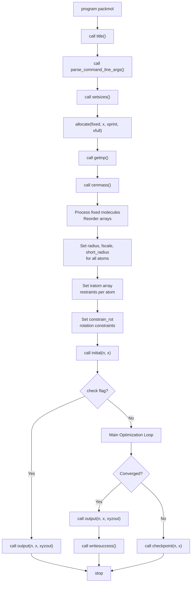
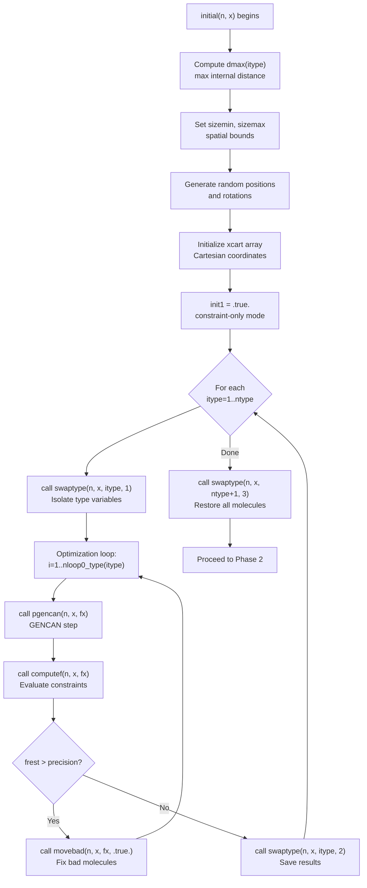
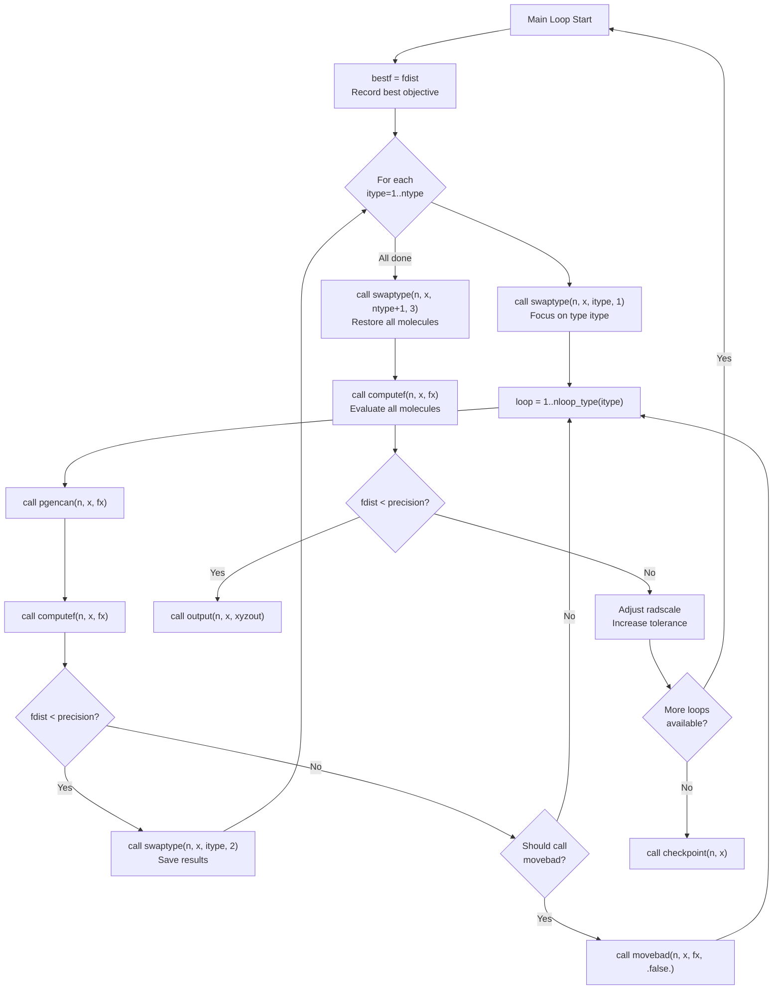

# Program Execution Flow

<details>
<summary>Relevant source files</summary>

The following files were used as context for generating this wiki page:

- [app/packmol.f90](app/packmol.f90)
- [src/checkpoint.f90](src/checkpoint.f90)
- [src/cli_parser.f90](src/cli_parser.f90)
- [src/getinp.f90](src/getinp.f90)
- [src/initial.f90](src/initial.f90)
- [src/input.f90](src/input.f90)
- [src/output.f90](src/output.f90)
- [src/setsizes.f90](src/setsizes.f90)

</details>


## Purpose and Scope

This page provides a step-by-step walkthrough of Packmol's main program execution from startup to output generation. It covers the complete lifecycle: command-line parsing, input file processing, system initialization, optimization loop execution, and output file writing. For detailed information about specific subsystems, see:

- System initialization and constraint satisfaction: [4.3](#4.3)
- GENCAN optimization algorithm: [4.4](#4.4)
- Spatial data structures and cell indexing: [4.5](#4.5)
- Objective function computation: [4.6](#4.6)

## Program Entry Point

The Packmol executable begins in [app/packmol.f90](). The main program follows this sequence:

1. Display program title and version information
2. Parse command-line arguments
3. Allocate arrays based on input file analysis
4. Read and validate input parameters
5. Prepare molecular structures
6. Generate initial molecular positions
7. Execute optimization loop
8. Write output files

Sources: [app/packmol.f90:34-705]()

## High-Level Execution Sequence



Sources: [app/packmol.f90:34-1326]()

## Initialization Phase

### Command-Line Parsing

The `parse_command_line_args()` subroutine handles three invocation modes:

| Mode | Example | Description |
|------|---------|-------------|
| Standard input redirection | `packmol < input.inp` | Input from stdin, output name from file |
| Input file flag | `packmol -i input.inp` | Input file specified, output name from file |
| Both flags | `packmol -i input.inp -o output.pdb` | Both input and output specified |

The parser sets `input_file_name` and `output_file_name` (aliased as `xyzout`) module variables.

Sources: [src/cli_parser.f90:80-239](), [app/packmol.f90:87]()

### Array Sizing and Allocation

The `setsizes()` subroutine performs a two-pass read of the input file:

**Pass 1: Count and Analyze**
- Count input lines (`nlines`)
- Determine maximum keywords per line (`maxkeywords`)
- Count molecule types (`ntype`)
- Count atoms per molecule type (`natoms(itype)`)
- Count molecules per type (`nmols(itype)`)
- Count total restraints (`maxrest`, `mrperatom`)

**Pass 2: Allocate Arrays**
```fortran
! Major array allocations
allocate(inputfile(nlines), keyword(nlines,maxkeywords))
allocate(nratom(ntotat), iratom(ntotat,mrperatom))
allocate(xcart(ntotat,3), coor(ntotat,3))
allocate(radius(ntotat), radius_ini(ntotat), fscale(ntotat))
allocate(ityperest(maxrest), restpars(maxrest,9))
allocate(l(nn), u(nn), g(nn))  ! GENCAN arrays
```

Where `ntotat = sum(nmols(itype) * natoms(itype))` and `nn = ntotmol * 6`.

Sources: [src/setsizes.f90:9-361](), [app/packmol.f90:91-95]()

### Input File Parsing

The `getinp()` subroutine reads all input parameters:

**Global Parameters:**
- `seed` - random number seed
- `tolerance` (stored as `dism`) - minimum distance between atoms
- `precision` - convergence criterion
- `nloop`, `nloop0` - optimization iteration limits
- `discale` - initial tolerance scaling factor
- `pbc` - periodic boundary condition box dimensions

**Per-Structure Parameters:**
- Molecular structure files (PDB, Tinker XYZ, or XYZ format)
- Number of molecules (`nmols(itype)`)
- Spatial constraints (inside/outside cube/box/sphere/cylinder/plane)
- Rotation constraints (`constrain_rotation`)
- Per-atom or per-molecule radius overrides
- Output formatting options (`resnumbers`, `changechains`, `connect`)

**Constraint Processing:**
The input parser assigns each constraint a type code:

| Type Code | Constraint |
|-----------|------------|
| 1 | Fixed position |
| 2 | Inside cube |
| 3 | Inside box |
| 4 | Inside sphere |
| 5 | Inside ellipsoid |
| 6 | Outside cube |
| 7 | Outside box |
| 8 | Outside sphere |
| 9 | Outside ellipsoid |
| 10 | Above plane |
| 11 | Below plane |
| 12 | Inside cylinder |
| 13 | Outside cylinder |

Sources: [src/getinp.f90:9-935](), [app/packmol.f90:104]()

### Molecule Centering

The `cenmass()` subroutine translates each molecule's reference coordinates so its center of mass is at the origin. This simplifies later transformations:

```
for each molecule type:
    xcm = sum(coor(atoms)) / natoms
    coor(atoms) = coor(atoms) - xcm
```

Sources: [app/packmol.f90:108]()

### Fixed Molecule Processing

Lines [app/packmol.f90:115-247]() handle fixed molecules:

1. Identify molecules with `fixed` constraints
2. Apply fixed position and orientation using `eulerfixed()` rotation
3. Reorder molecule type arrays, moving fixed types to the end
4. Update `ntype` to exclude fixed molecules from optimization
5. Set `ntype_with_fixed` to track total types including fixed

This separates movable molecules (indices 1 to `ntype`) from fixed molecules (indices `ntype+1` to `ntype_with_fixed`).

Sources: [app/packmol.f90:115-247]()

### Radius and Constraint Assignment

Lines [app/packmol.f90:280-632]() set per-atom parameters:

**Radius Assignment:**
1. Default: `radius(i) = dism/2.0` for all atoms
2. Per-molecule override: `radius` keyword in structure block
3. Per-atom override: `radius` inside `atoms` block

**Constraint Assignment:**
The `iratom(icart, i)` array stores which constraints apply to each atom:
- `nratom(icart)` = number of constraints for atom `icart`
- `iratom(icart, 1:nratom(icart))` = indices into `ityperest`/`restpars` arrays

Sources: [app/packmol.f90:280-632]()

## Initial Point Generation

The `initial(n,x)` subroutine ([src/initial.f90]()) generates starting coordinates through a two-phase process:

### Phase 1: Constraint-Only Optimization



In Phase 1:
- `init1 = .true.` signals constraint-only mode to `computef()`
- Each molecule type is optimized independently using `swaptype()`
- Only constraint penalties (`frest`) are minimized, distance penalties ignored
- `movebad()` randomly repositions molecules that violate constraints

Sources: [src/initial.f90:10-226]()

### Phase 2: Cell Grid Setup and Restart Handling

After constraint satisfaction:

1. **Rescale Spatial Bounds:** Compute actual min/max coordinates from fitted molecules
2. **Setup Cell Grid:** Calculate `ncells(1:3)` and `cell_length(1:3)` for spatial partitioning
3. **Allocate Cell Arrays:** `latomfirst`, `latomfix`, `lcellnext`, `empty_cell`
4. **Add Fixed Molecules:** Populate `latomfix` array with fixed molecule atoms
5. **Read Restart Files:** If `restart_from(itype)` is set, read coordinates from file
6. **Random Position Generation:** For non-restarted molecules, generate positions that satisfy constraints and avoid overlaps with fixed molecules

The `avoidoverlap` logic ([src/initial.f90:396-424]()) uses cell indexing to check if a random position overlaps with fixed molecules before accepting it.

Sources: [src/initial.f90:227-557]()

## Main Optimization Loop

After initialization, the program enters the main optimization loop in [app/packmol.f90:734-845](). The loop structure depends on the `packall` flag:

### Sequential Packing (packall = .false., default)



**Sequential Packing Details:**

1. **Type Isolation:** `swaptype(n, x, itype, 1)` sets `move(j)` and `comptype(j)` arrays:
   - `move(itype) = .true.`, all others `.false.` - only this type can move
   - `comptype(itype) = .true.`, all others `.false.` - only this type contributes to objective

2. **Convergence Check:** `fdist < precision` checks maximum distance violation

3. **MoveBad Heuristic:** Called periodically to escape local minima by repositioning worst molecules

4. **Saving Results:** `swaptype(n, x, itype, 2)` saves optimized coordinates back to full array

Sources: [app/packmol.f90:761-823]()

### Simultaneous Packing (packall = .true.)

When `packall` is enabled, all molecule types are optimized together:

```fortran
! All types active
do itype = 1, ntype
    move(itype) = .true.
    comptype(itype) = .true.
end do

! Single optimization loop
do loop = 1, nloop_all
    call pgencan(n, x, fx)
    call computef(n, x, fx)
    if (fdist < precision) exit
    call movebad(n, x, fx, .false.)
end do
```

This mode is faster but may be less successful for complex packing problems.

Sources: [app/packmol.f90:734-759]()

## Key Control Variables

| Variable | Type | Purpose |
|----------|------|---------|
| `n` | integer | Total variables (6 * ntotmol) |
| `x(n)` | double | Generalized coordinates: x(1:3*ntotmol) = centers of mass, x(3*ntotmol+1:n) = Euler angles |
| `fx` | double | Current objective function value |
| `fdist` | double | Maximum distance violation |
| `frest` | double | Maximum constraint violation |
| `init1` | logical | If true, only constraint penalties active |
| `move(itype)` | logical | If true, type can move during optimization |
| `comptype(itype)` | logical | If true, type contributes to objective function |
| `bestf` | double | Best objective value seen |
| `xprint(n)` | double | Best coordinates seen |

Sources: [src/compute_data.f90](), [app/packmol.f90]()

## Convergence and Tolerance Management

The program uses a multi-level convergence strategy:

**Tolerance Scaling:**
```fortran
radscale = radscale * 0.9  ! Reduce effective radius
do i = 1, ntotat
    radius(i) = radscale * radius_ini(i)
end do
```

Each time the outer loop completes without convergence, `radscale` decreases by 10%, relaxing the distance constraints.

**Convergence Criteria:**
- **Success:** `fdist < precision` (typically 0.01 Å)
- **Partial Success:** `fdist > precision` but `fdist < bestf` (improved solution)
- **Failure:** Maximum loops exceeded with `fdist > precision`

**Periodic Output:**
Every `writeout` loops (default 10), the program:
1. Computes current objective function
2. If improved, saves to `xprint` and writes temporary output
3. Reports progress to user

Sources: [app/packmol.f90:825-845]()

## Output Generation

On successful convergence, `output(n, x, output_file_name)` writes the final structure:

### Output File Formats

**PDB Format** ([src/output.f90:134-469]()):
- Transforms generalized coordinates to Cartesian using `eulerrmat()` and `compcart()`
- Handles residue numbering modes (0=by molecule, 1=from input, 2=continuous, 3=by molecule index)
- Optionally writes CONECT records for connectivity
- Supports chain assignment and TER records

**Tinker XYZ Format** ([src/output.f90:473-536]()):
- Writes atom count and title
- Outputs element, Cartesian coordinates, and connectivity

**Standard XYZ Format** ([src/output.f90:93-131]()):
- Simple format: atom count, title, element name and coordinates

**Restart Files:**
- If `restart_to(0)` or `restart_to(itype)` set, writes generalized coordinates (cm + angles)
- Format: 6 columns (xcm_x, xcm_y, xcm_z, beta, gamma, theta)

Sources: [src/output.f90:9-539]()

## Non-Convergence Handling

If convergence is not achieved after maximum loops, `checkpoint(n, x)` executes:

1. **Write Best Solution:** Output the best configuration found (`xprint`) to output file
2. **Force Constraint Satisfaction:** Run additional optimization with `init1=.true.` to minimize only constraint violations
3. **Write Forced Solution:** Output forced solution to `*_FORCED` file
4. **Guidance Message:** Inform user about:
   - Trying different random seeds
   - Increasing `nloop` parameter
   - Solution may still be usable for MD after energy minimization

Sources: [src/checkpoint.f90:12-115](), [app/packmol.f90:847-851]()

## Program Termination

**Successful Exit:**
```fortran
call output(n, x, xyzout)
call writesuccess()  ! Prints "Success!" banner
stop  ! Exit code 0
```

**Partial Success Exit:**
```fortran
call checkpoint(n, x)  ! Writes best solution found
stop  ! Exit code 0 (though not optimal)
```

The program uses structured exit codes defined in [src/exit_codes.f90]() for error conditions (input errors, file I/O errors, convergence failures).

Sources: [app/packmol.f90:847-1326]()

---