# System Initialization

<details>
<summary>Relevant source files</summary>

The following files were used as context for generating this wiki page:

- [src/cli_parser.f90](src/cli_parser.f90)
- [src/initial.f90](src/initial.f90)
- [src/setsizes.f90](src/setsizes.f90)

</details>


## Purpose and Scope

This page documents the system initialization phase implemented in the `initial` subroutine, which prepares the molecular packing problem for optimization. Initialization occurs after input parsing ([4.2](#4.2)) and before the main optimization loop ([4.4](#4.4)). The initialization phase consists of:

- Computing molecular geometry parameters (maximum internal distances)
- Establishing spatial bounds for the system
- Performing constraint satisfaction to ensure all molecules can fit within their specified geometric regions
- Setting up the cell-based spatial partitioning system ([4.5](#4.5))
- Generating random initial positions and orientations for molecules

For information about the constraint evaluation algorithms themselves, see [7.2](#7.2). For the cell indexing and spatial acceleration structures, see [4.5](#4.5).

## Initialization Sequence Overview

The initialization phase executes through several distinct stages, coordinated by the `initial` subroutine in [src/initial.f90:10-557]().

```mermaid
flowchart TD
    START["initial(n,x)"] --> INIT_VARS["Initialize Variables<br/>move = false<br/>init1 = false<br/>comptype = true"]
    INIT_VARS --> CALC_DMAX["Calculate dmax(itype)<br/>Maximum internal distance<br/>per molecule type<br/>[56-71]"]
    CALC_DMAX --> CALC_BOUNDS["Calculate Initial Bounds<br/>sizemin, sizemax<br/>±sidemax from origin<br/>[76-85]"]
    CALC_BOUNDS --> RANDOM_GUESS["Generate First Random Guess<br/>x(1:3*ntotmol) = positions<br/>x(3*ntotmol+1:6*ntotmol) = angles<br/>[88-117]"]
    RANDOM_GUESS --> INIT_XCART["Initialize xcart Array<br/>compcart() converts<br/>generalized → Cartesian<br/>[119-165]"]
    INIT_XCART --> CONSTRAINT_PHASE["Constraint Satisfaction Phase<br/>Per-Type Optimization<br/>[167-225]"]
    CONSTRAINT_PHASE --> RESCALE["Rescale Bounds<br/>Based on actual positions<br/>[227-276]"]
    RESCALE --> SETUP_CELLS["Setup Cell Grid<br/>ncells, cell_length<br/>[278-289]"]
    SETUP_CELLS --> ALLOC_CELLS["Allocate Cell Arrays<br/>latomfirst, latomfix<br/>lcellnext, empty_cell<br/>[291-301]"]
    ALLOC_CELLS --> FIXED_MOLS["Add Fixed Molecules<br/>to latomfix arrays<br/>[303-318]"]
    FIXED_MOLS --> RESET_CM["Reset Center of Mass<br/>Compute cm_min, cm_max<br/>[320-337]"]
    RESET_CM --> CHECK_RESTART{"Restart File<br/>Available?"}
    CHECK_RESTART -->|Yes| READ_RESTART["Read restart_from(0)<br/>Return early<br/>[339-359]"]
    CHECK_RESTART -->|No| BUILD_RANDOM["Build Random Initial Point<br/>[361-427]"]
    BUILD_RANDOM --> SET_ANGLES["Set Random Angles<br/>Respecting constraints<br/>[429-458]"]
    SET_ANGLES --> TYPE_RESTART{"Type-Specific<br/>Restart Files?"}
    TYPE_RESTART -->|Yes| READ_TYPE_RESTART["Read restart_from(itype)<br/>[473-510]"]
    TYPE_RESTART -->|No| FINAL_CONSTRAINT["Final Constraint Pass<br/>Per-Type Optimization<br/>[516-550]"]
    READ_TYPE_RESTART --> FINAL_CONSTRAINT
    FINAL_CONSTRAINT --> RETURN["Return"]
    READ_RESTART --> RETURN
```

**Sources:** [src/initial.f90:10-557]()

## Key Data Structures

The initialization phase sets up and populates several critical data structures that are used throughout the optimization process.

### Generalized Coordinates Array (x)

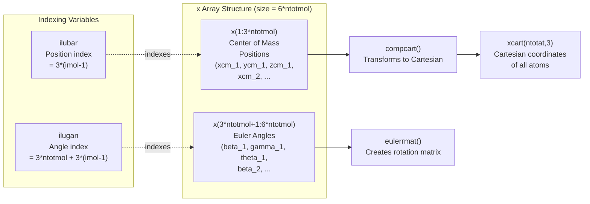

**Sources:** [src/initial.f90:88-117](), [src/initial.f90:121-139]()

### Spatial Bounds and Cell System

| Array | Dimension | Purpose | Initialized At |
|-------|-----------|---------|----------------|
| `dmax(itype)` | `(ntype)` | Maximum internal distance within each molecule type | [56-71]() |
| `sizemin(3)` | `(3)` | Minimum x,y,z coordinates for system bounds | [79](), [231-265]() |
| `sizemax(3)` | `(3)` | Maximum x,y,z coordinates for system bounds | [80](), [231-265]() |
| `ncells(3)` | `(3)` | Number of cells in x,y,z directions | [282]() |
| `cell_length(3)` | `(3)` | Size of each cell in x,y,z directions | [283]() |
| `latomfirst(i,j,k)` | `(ncells(1), ncells(2), ncells(3))` | First atom index in cell (i,j,k) | [292]() |
| `latomfix(i,j,k)` | `(ncells(1), ncells(2), ncells(3))` | First fixed atom index in cell (i,j,k) | [293]() |
| `latomnext(iatom)` | `(ntotat)` | Next atom index in same cell (linked list) | [300]() |

**Sources:** [src/initial.f90:56-71](), [src/initial.f90:76-85](), [src/initial.f90:227-276](), [src/initial.f90:278-318]()

## Two-Pass Constraint Satisfaction Strategy

The initialization phase employs a two-pass strategy for constraint satisfaction, implemented using the `swaptype` mechanism. This ensures molecules can satisfy geometric constraints before considering inter-molecular distances.

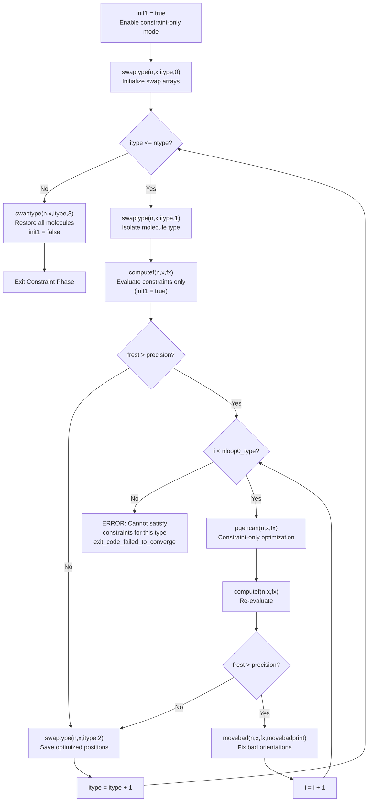

**Sources:** [src/initial.f90:167-225](), [src/initial.f90:516-550]()

### The swaptype Mechanism

The `swaptype` subroutine (defined elsewhere in the codebase) temporarily modifies optimization variables to focus on a single molecule type. The operation modes are:

| Mode | Purpose | Effect |
|------|---------|--------|
| 0 | Initialize | Allocate temporary swap arrays |
| 1 | Focus on type | Set variables for molecules of other types to fixed values; only optimize current type |
| 2 | Save results | Store optimized positions for current type |
| 3 | Restore all | Restore full variable arrays with all molecule types active |

**Sources:** [src/initial.f90:175-183](), [src/initial.f90:206](), [src/initial.f90:500-505](), [src/initial.f90:519-548]()

### First Pass: Constraint Satisfaction Without Distances

The first constraint satisfaction pass (lines 167-225) processes each molecule type sequentially:

1. **Isolate Type**: Call `swaptype(n,x,itype,1)` to focus optimization on molecules of type `itype`
2. **Optimize**: Run `pgencan` (GENCAN with projections) with `init1 = .true.`, which causes `computef` to evaluate only constraint violations (`frest`), ignoring inter-molecular distances
3. **Fix Bad Orientations**: If constraints still violated, call `movebad` to reposition molecules that cannot satisfy constraints
4. **Iterate**: Repeat up to `nloop0_type(itype)` times until `frest <= precision`
5. **Save**: Call `swaptype(n,x,itype,2)` to store optimized positions

This pass ensures that each molecule type can individually satisfy its geometric constraints (e.g., inside/outside cube/sphere) before attempting to pack multiple types together.

**Sources:** [src/initial.f90:167-225]()

### Second Pass: Final Constraint Adjustment

The second constraint satisfaction pass (lines 516-550) occurs after random position generation and has the same structure but different context:

- Executes only for types without restart files (`restart_from(itype) == 'none'`)
- Uses the randomly generated positions from lines 361-427
- Ensures the random positions also satisfy geometric constraints
- Can also terminate if `randini = .true.` (lines 514), skipping this pass entirely

**Sources:** [src/initial.f90:516-550]()

## Cell Grid Initialization

After constraint satisfaction, the system establishes the spatial partitioning grid used for efficient distance calculations during optimization.

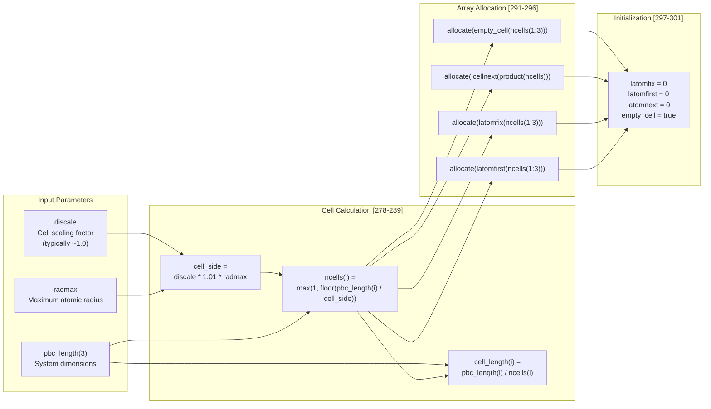

**Sources:** [src/initial.f90:278-301]()

### Fixed Molecule Integration

If fixed molecules are present (`fix = .true.`), they are permanently added to the cell indexing structures:

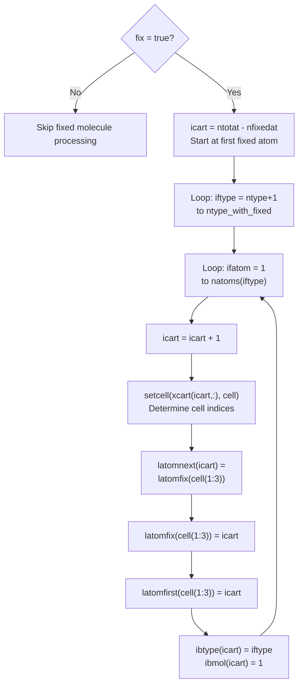

This creates linked lists in the cell structure so that fixed atoms are considered during distance evaluations in the optimization phase.

**Sources:** [src/initial.f90:303-318]()

## Random Position Generation

For molecules without restart files, the system generates random initial positions and orientations with several safeguards.

### Center of Mass Position Generation

The random position generation includes overlap avoidance when `avoidoverlap = .true.` and respects constraint satisfaction:

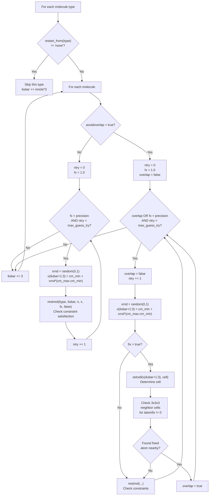

**Key Variables:**
- `cm_min(itype,3)`, `cm_max(itype,3)`: Bounds for center of mass positions, computed from actual molecule positions after constraint satisfaction [src/initial.f90:323-337]()
- `max_guess_try`: Maximum attempts to find valid position (20 for normal mode, 1 for gradient checking) [src/initial.f90:367-375]()
- `scale_rnd_guess`: Scaling factor for random generation (1.0 normally, 1.5 for gradient checking) [src/initial.f90:371-374]()

**Sources:** [src/initial.f90:378-427]()

### Angle Generation

After positions, random Euler angles are generated for each molecule, respecting any rotation constraints:

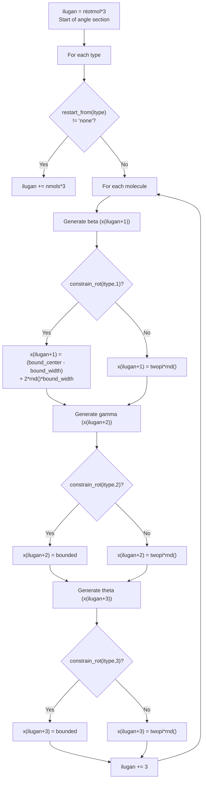

The rotation bounds are specified in the input file via the `constrain_rotation` keyword. If constrained, angles are generated uniformly within the specified bounds; otherwise, they span the full range [0, 2π).

**Sources:** [src/initial.f90:429-458]()

## Restart File Handling

The initialization system supports three restart modes, allowing users to resume from previous runs or provide custom initial configurations.

### Restart Hierarchy

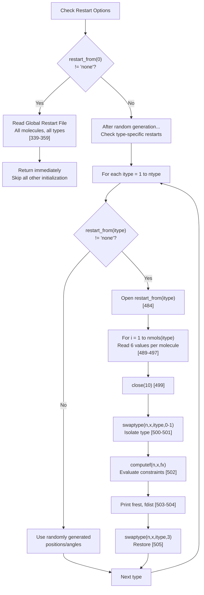

### Restart File Format

All restart files (global and type-specific) use the same format - one line per molecule with 6 space-separated values:

```
xcm_x  xcm_y  xcm_z  beta  gamma  theta
```

Where:
- `xcm_x, xcm_y, xcm_z`: Center of mass coordinates
- `beta, gamma, theta`: Euler angles (in radians)

**Example:**
```
10.5  20.3  15.7  1.234  2.456  0.789
11.2  19.8  16.1  0.567  1.890  2.345
...
```

**Sources:** [src/initial.f90:339-359](), [src/initial.f90:473-510]()

### Restart Validation

Type-specific restart files are validated immediately after reading:

1. The `swaptype` mechanism isolates the restarted type
2. `computef` evaluates constraint violations (`frest`) and minimum distance violations (`fdist`)
3. Results are printed to inform the user about the quality of the restart configuration
4. Variables are restored to include all molecules

This allows users to detect if their restart file contains molecules outside the specified geometric constraints.

**Sources:** [src/initial.f90:500-505]()

## Special Modes and Edge Cases

### Gradient Checking Mode

When `chkgrad = .true.` (enabled via input keyword), initialization behavior changes:

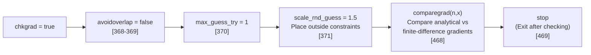

This mode intentionally places molecules outside their constraint regions to verify that gradient calculations correctly identify and penalize constraint violations.

**Sources:** [src/initial.f90:367-470]()

### Boundary Condition Handling

The system handles both periodic and non-periodic boundary conditions during initialization:

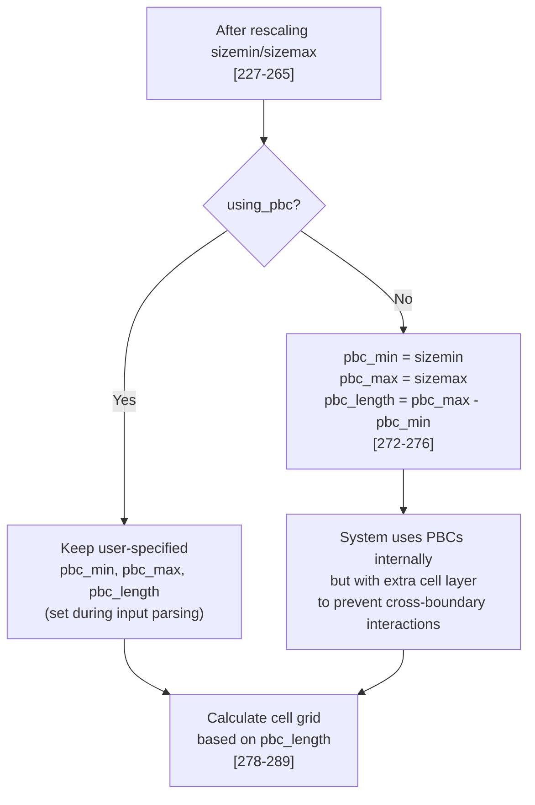

When periodic boundaries are not explicitly specified, the system creates "pseudo-PBCs" sized to the actual molecular distribution plus padding (`1.1 * radmax`). This allows the cell indexing system to work uniformly, but prevents molecules from interacting across the boundaries due to an empty cell layer.

**Sources:** [src/initial.f90:266-276]()

### Fixed Molecule Validation

For fixed molecules, the system validates that all atoms lie within the specified periodic boundary box:

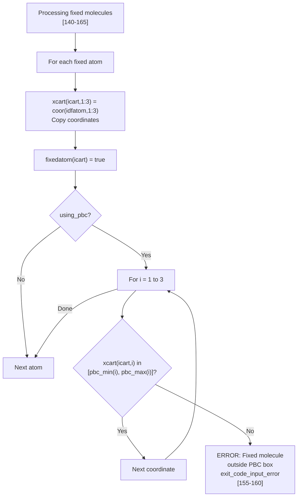

This validation prevents silent failures where fixed molecules would be invisible to the optimization because they're outside the cell grid.

**Sources:** [src/initial.f90:152-162]()

## Performance Considerations

### Cell Size Selection

The cell grid size is critical for optimization performance. The cell side length is set to:

```
cell_side = discale * 1.01 * radmax
```

Where:
- `radmax`: Maximum atomic radius across all atom types
- `discale`: User-specified scaling factor (default ~1.0, can be adjusted via `discale` keyword)
- Factor 1.01: Small safety margin

This ensures that atoms can only interact with atoms in their own cell and the 26 neighboring cells (3×3×3 - 1 = 26 forward neighbors when avoiding double-counting). Larger cells reduce memory but increase the number of distance calculations per cell; smaller cells do the opposite.

**Sources:** [src/initial.f90:280]()

### Constraint Satisfaction Iteration Limits

Each molecule type has a per-type iteration limit `nloop0_type(itype)` for the constraint satisfaction phase (default value set in `setsizes`, can be overridden via `nloop0` keyword in input). If constraints cannot be satisfied within this limit, the program terminates with an error message suggesting:

1. The geometric constraints may be impossible to satisfy
2. Try increasing `nloop0` value (e.g., `nloop0 1000`)

**Sources:** [src/initial.f90:191](), [src/initial.f90:218-222]()

## Summary of Key Functions Called

| Function | Location | Purpose | Called From Initial.f90 |
|----------|----------|---------|-------------------------|
| `tobar()` | Unknown | Initialize progress bar | [52]() |
| `restmol()` | Unknown | Evaluate constraint violations for single molecule | [78](), [394](), [422]() |
| `rnd()` | Unknown | Generate random number | [93](), [98](), [442](), etc. |
| `eulerrmat()` | Unknown | Compute Euler rotation matrix | [130]() |
| `compcart()` | Unknown | Transform generalized → Cartesian coordinates | [135]() |
| `swaptype()` | Unknown | Swap variable arrays to focus on single type | [175-183](), [206](), [500-505](), [519-548]() |
| `computef()` | See [4.6](#4.6) | Evaluate objective function | [190](), [195](), [502](), [533](), [539]() |
| `pgencan()` | See [4.4](#4.4) | Run GENCAN optimization with projections | [194](), [538]() |
| `movebad()` | See [7.1](#7.1) | Reposition badly placed molecules | [199](), [543]() |
| `setcell()` | See [4.5](#4.5) | Determine cell indices from coordinates | [310](), [407]() |
| `cell_ind()` | See [4.5](#4.5) | Apply periodic wrapping to cell indices | [411-413]() |
| `comparegrad()` | Unknown | Compare analytical vs finite-difference gradients | [468]() |

**Sources:** [src/initial.f90:10-557]()

---