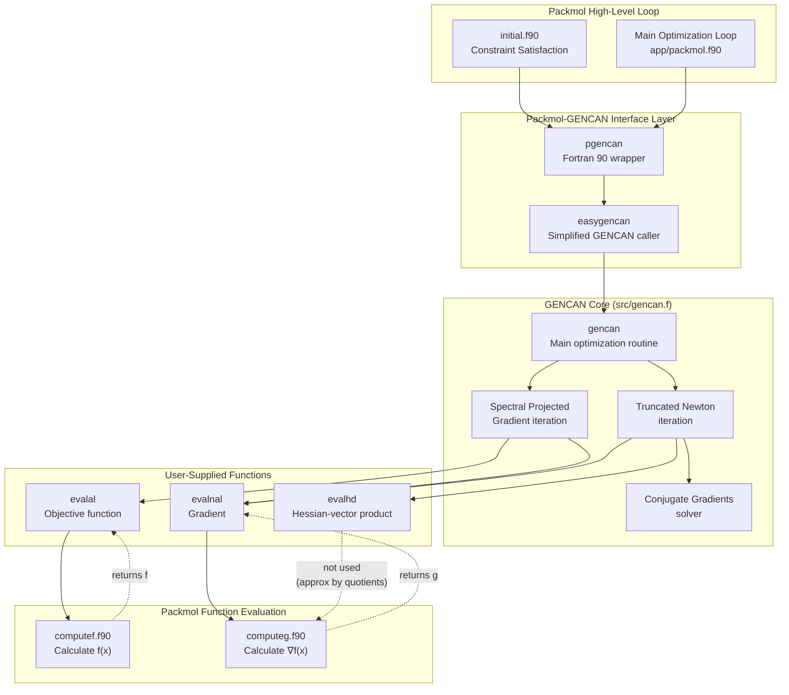
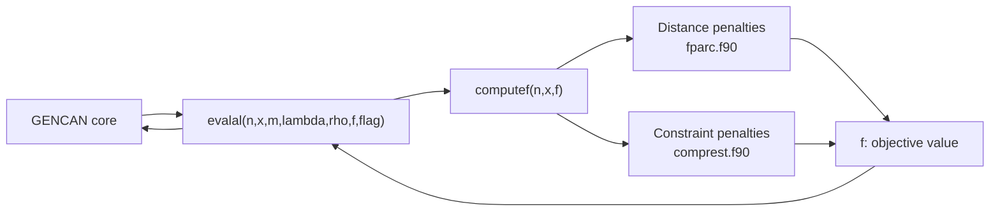
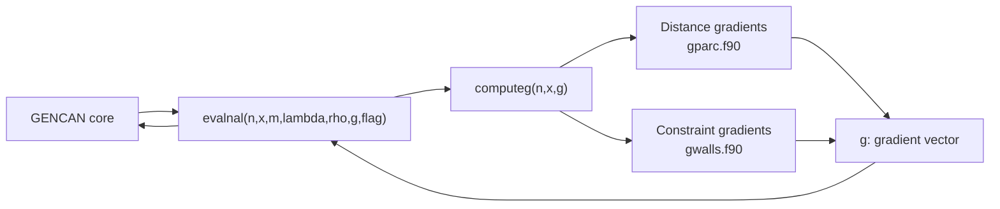
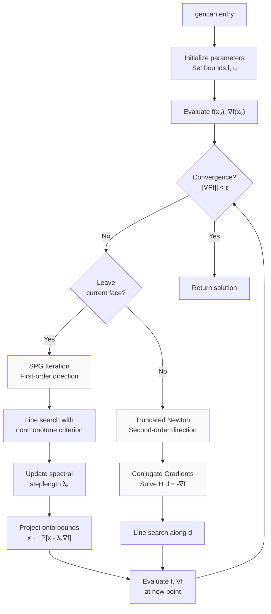
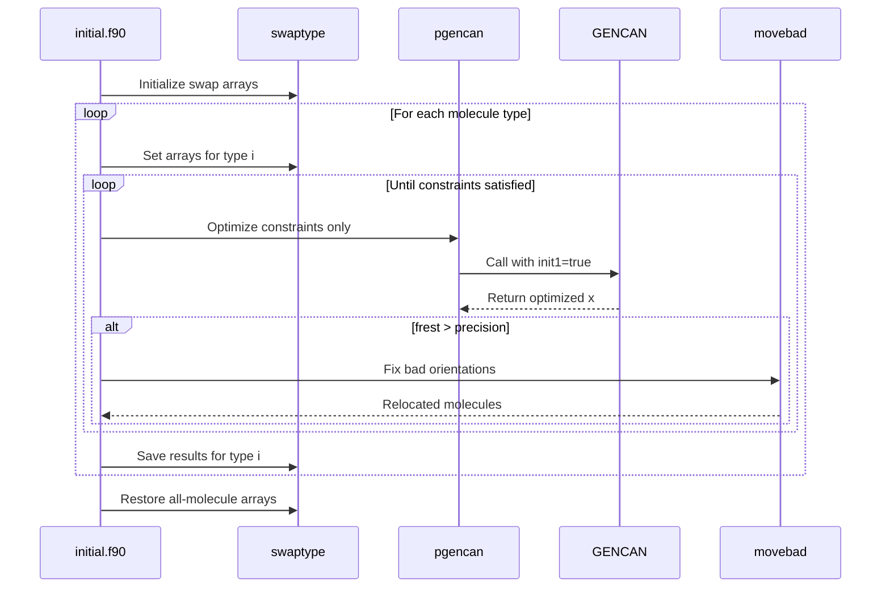
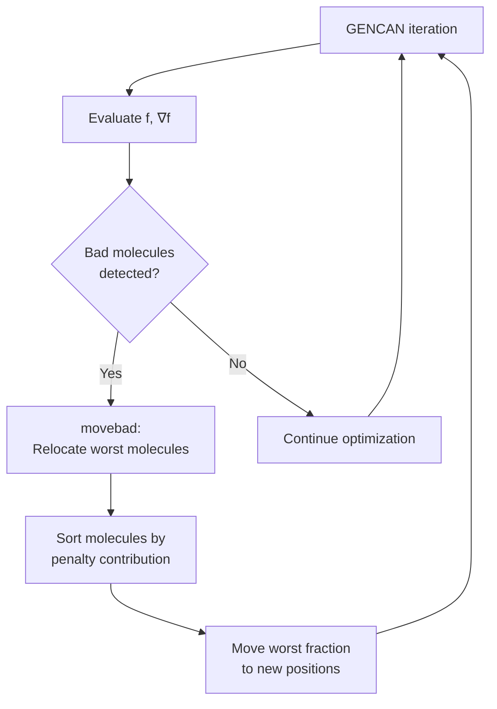

# Optimization Engine (GENCAN)

<details>
<summary>Relevant source files</summary>

The following files were used as context for generating this wiki page:

- [src/ahestetic.f90](src/ahestetic.f90)
- [src/gencan.f](src/gencan.f)
- [src/gencan_ieee_signal_routines.f90](src/gencan_ieee_signal_routines.f90)
- [src/heuristics.f90](src/heuristics.f90)
- [src/initial.f90](src/initial.f90)

</details>


## Purpose and Scope

This document describes the GENCAN optimization solver and its integration into Packmol. GENCAN is a bound-constrained optimization algorithm that forms the core numerical engine for solving the molecular packing problem. For details on how the objective function and gradient are computed, see [Objective Function Evaluation](#4.6). For the overall program execution flow, see [Program Execution Flow](#4.2). For the initialization phase that uses GENCAN, see [System Initialization](#4.3).

## Overview

GENCAN (GENeralized projected gradient method for box-Constrained problems) is a large-scale active-set optimization method that combines:
- **Spectral Projected Gradient (SPG)** for first-order search directions
- **Truncated Newton** for second-order acceleration
- **Active-set strategy** for handling bound constraints efficiently

The solver is implemented in Fortran 77 in [src/gencan.f]() and is accessed through wrapper functions in [src/pgencan.f90](). The method is described in the paper by E. G. Birgin and J. M. Martinez (2002) referenced in [src/gencan.f:786-791]().

Sources: [src/gencan.f:1-3000](), [src/pgencan.f90:1-100]()

## Integration Architecture



**Diagram: GENCAN integration architecture showing call flow from Packmol to GENCAN core**

Sources: [src/initial.f90:194-200](), [src/gencan.f:202-739](), [src/pgencan.f90:1-100]()

## Interface Functions

GENCAN requires three user-supplied subroutines that connect it to the specific problem being solved. In Packmol, these are implemented as thin wrappers around the core function evaluation routines.

### evalal: Objective Function Evaluation



**Diagram: evalal function connects GENCAN to Packmol's objective function**

The `evalal` subroutine is defined in [src/gencan.f:4-57]() and serves as the callback that GENCAN uses to evaluate the objective function. The implementation simply calls `computef`:

```fortran
subroutine evalal(n,x,m,lambda,rho,f,flag)
    flag = 0
    call computef(n,x,f)
end
```

**Parameters:**
- `n`: Number of variables (3 × number of molecules for positions, +3 × number of molecules for orientations)
- `x(n)`: Current point (generalized coordinates)
- `m, lambda(m), rho(m)`: Augmented Lagrangian parameters (unused in Packmol; kept for interface compatibility)
- `f`: Returned objective function value
- `flag`: Error indicator (0 = success)

Sources: [src/gencan.f:4-57](), [src/computef.f90:1-100]()

### evalnal: Gradient Evaluation



**Diagram: evalnal function connects GENCAN to Packmol's gradient computation**

The `evalnal` subroutine is defined in [src/gencan.f:62-115]() and provides gradient information:

```fortran
subroutine evalnal(n,x,m,lambda,rho,g,flag)
    flag = 0
    call computeg(n,x,g)
end
```

**Parameters:**
- `g(n)`: Returned gradient vector ∇f(x)
- Other parameters same as `evalal`

Sources: [src/gencan.f:62-115](), [src/computeg.f90:1-200]()

### evalhd: Hessian-Vector Product

The `evalhd` subroutine [src/gencan.f:125-196]() is implemented as an empty stub in Packmol because GENCAN is configured to approximate Hessian-vector products using incremental quotients (`htvtype = 1` in [src/gencan.f:609]()). This avoids the need to compute or store the full Hessian matrix, which would be prohibitively expensive for large systems.

Sources: [src/gencan.f:125-196](), [src/gencan.f:609]()

## GENCAN Algorithm Structure



**Diagram: GENCAN main algorithm flow showing SPG and Truncated Newton phases**

### Key Algorithm Components

**Active-Set Strategy**: GENCAN maintains an active set of variables at their bounds. When the projected gradient within the current face is sufficiently small, the algorithm switches to Truncated Newton to accelerate convergence. The parameter `eta` controls this switching [src/gencan.f:476]().

**Spectral Projected Gradient**: Uses a spectral steplength computed from:
```
λₖ = (sₖᵀyₖ) / (yₖᵀyₖ)
```
where `sₖ = xₖ - xₖ₋₁` and `yₖ = ∇f(xₖ) - ∇f(xₖ₋₁)`. The steplength is safeguarded to lie in `[lspgmi, lspgma]` [src/gencan.f:477-478]().

**Nonmonotone Line Search**: Accepts steps that satisfy the Armijo condition with respect to the maximum of the last `p` function values rather than just the previous value. This allows temporary increases in function value to escape narrow valleys.

**Truncated Newton Direction**: Computed by approximately solving the Newton system `H d = -∇f` using Conjugate Gradients within a trust region. The trust region can use Euclidean norm (`trtype=0`) or sup-norm (`trtype=1`).

Sources: [src/gencan.f:750-2000](), [src/gencan.f:429-478]()

## Configuration and Parameters

GENCAN is configured through the `easygencan` wrapper [src/gencan.f:202-739]() which sets most parameters to sensible defaults. Key parameters are:

| Parameter | Default | Description | Source |
|-----------|---------|-------------|--------|
| `epsgpsn` | `precision` | Stopping tolerance for sup-norm of projected gradient | [src/gencan.f:304]() |
| `maxit` | Varies by phase | Maximum number of iterations | [src/gencan.f:307]() |
| `maxfc` | Varies | Maximum number of function evaluations | [src/gencan.f:311]() |
| `gtype` | 0 | Gradient type: 0=user-supplied, 1=finite differences | [src/gencan.f:569]() |
| `htvtype` | 1 | Hessian-vector: 0=user-supplied, 1=incremental quotients | [src/gencan.f:609]() |
| `trtype` | 1 | Trust region type: 0=Euclidean, 1=sup-norm | [src/gencan.f:667]() |
| `eta` | 0.9 | Face-leaving parameter | [src/gencan.f:476]() |
| `gamma` | 1.0e-4 | Armijo condition constant | [src/gencan.f:431]() |
| `delmin` | varies | Minimum trust region radius | [src/gencan.f:659]() |

### Packmol-Specific Parameter Settings

In the initialization phase [src/initial.f90:194](), GENCAN is called with:
- `init1 = .true.` flag set to optimize only constraint violations
- Separate optimization for each molecule type using `swaptype`
- Maximum iterations controlled by `nloop0_type(itype)`

In the main optimization loop, different convergence criteria apply based on whether constraints are satisfied (`frest < precision`) or distance penalties dominate (`fdist`).

Sources: [src/gencan.f:202-739](), [src/initial.f90:168-225]()

## Usage Patterns in Packmol

### Constraint Satisfaction Phase



**Diagram: Sequence of GENCAN calls during initialization constraint satisfaction**

During initialization [src/initial.f90:168-225](), GENCAN is used to satisfy geometric constraints for each molecule type independently:

1. **Type-by-type optimization**: The `swaptype` mechanism isolates variables for one molecule type
2. **Constraint-only objective**: With `init1 = .true.`, only constraint penalties contribute to the objective
3. **Iterative refinement**: GENCAN alternates with the `movebad` heuristic to escape local minima
4. **Convergence criterion**: Loop continues until `frest < precision` or maximum iterations reached

Sources: [src/initial.f90:168-225](), [src/swaptype.f90:1-100]()

### Main Optimization Phase

In the main loop [app/packmol.f90:200-400](), GENCAN optimizes the full objective function including both distance penalties and constraint violations:

```fortran
! Main optimization loop
do while (.not. converged)
    call pgencan(n, x, fx)
    call computef(n, x, fx)
    
    if (fdist > precision .or. frest > precision) then
        call movebad(n, x, fx, .true.)
    end if
    
    ! Check convergence
    converged = (fdist < precision .and. frest < precision)
end do
```

**Key differences from initialization:**
- `init1 = .false.` so all penalty terms are active
- All molecule types optimized simultaneously
- Tighter convergence tolerances
- Periodic checkpoint writing if convergence is slow

Sources: [app/packmol.f90:200-400](), [src/computef.f90:1-100]()

## Heuristic Integration

GENCAN is integrated with the `movebad` heuristic [src/heuristics.f90:9-149]() that helps escape local minima:



**Diagram: Integration of movebad heuristic with GENCAN optimization**

The `movebad` routine:
1. Computes per-molecule penalty contributions using `fdist_atom` and `frest_atom`
2. Sorts molecules by total penalty using flashsort [src/heuristics.f90:92]()
3. Relocates the worst `movefrac` fraction (or up to `maxmove` molecules)
4. New positions are either:
   - Random within size bounds if `movebadrandom = true` [src/heuristics.f90:120-122]()
   - Near good molecules if `movebadrandom = false` [src/heuristics.f90:124-126]()

This provides a global search component that complements GENCAN's local optimization.

Sources: [src/heuristics.f90:9-149](), [src/flashsort.f90:1-100]()

## Conjugate Gradients Tuning

GENCAN's Truncated Newton method uses Conjugate Gradients to solve the Newton system. Several helper routines in [src/gencan_ieee_signal_routines.f90]() adjust CG parameters adaptively:

### Adaptive Accuracy

The `gp_ieee_signal1` routine [src/gencan_ieee_signal_routines.f90:1-11]() computes parameters for logarithmic interpolation of CG accuracy between initial and final tolerances:

```fortran
acgeps = log10(cgepsf / cgepsi) / log10(cggpnf / gpsupn)
bcgeps = log10(cgepsi) - acgeps * log10(gpsupn)
```

This ensures tighter CG convergence as the optimization progresses toward the solution.

### Adaptive Iteration Limit

The `gp_ieee_signal2` routine [src/gencan_ieee_signal_routines.f90:13-45]() dynamically sets `cgmaxit` based on problem dimension and progress:

```fortran
kappa = log10(gpsupn / gpsupn0) / log10(epsgpsn / gpsupn0)
cgmaxit = int((1.0 - kappa) * max(1.0, 10.0 * log10(n)) + kappa * n)
cgmaxit = min(20, cgmaxit)  ! L. Martinez modification
```

The `min(20, cgmaxit)` modification [src/gencan_ieee_signal_routines.f90:34]() was added specifically for Packmol to accelerate iterations near the solution.

Sources: [src/gencan_ieee_signal_routines.f90:1-45](), [src/gencan.f:695-711]()

## Performance Characteristics

| Aspect | Characteristic | Implication |
|--------|---------------|-------------|
| **Scalability** | O(n) per iteration (with sparse Hessian approx) | Handles large systems efficiently |
| **Memory** | O(n) working space | Modest memory requirements |
| **Convergence** | Superlinear near solution (Truncated Newton) | Fast final convergence |
| **Robustness** | Global convergence via SPG | Handles difficult landscapes |
| **Function evaluations** | Typically 5-10 per iteration | Dominated by `computef` cost |

The bottleneck in Packmol is usually the objective function evaluation (distance calculations) rather than the optimization algorithm itself, since GENCAN's computational cost per iteration is negligible compared to O(N) or O(N²) distance calculations.

Sources: [src/gencan.f:786-791](), [src/computef.f90:1-500]()

## Error Handling

GENCAN returns an `inform` code indicating the termination condition:

| inform | Meaning | Action |
|--------|---------|--------|
| 0 | Converged (Euclidean norm criterion) | Success |
| 1 | Converged (sup-norm criterion) | Success |
| 2 | Maximum iterations reached | May need more iterations |
| 3 | Maximum function evaluations reached | Increase `maxfc` |
| 4-6 | Other stopping criteria | Check intermediate output |
| <0 | Error in objective/gradient evaluation | Check `flag` in evalal/evalnal |

In Packmol, if GENCAN fails to converge during initialization, an error message is printed [src/initial.f90:209-222]() suggesting:
- Check spatial constraints for feasibility
- Increase `nloop0` parameter
- Verify molecule geometries

Sources: [src/gencan.f:368-379](), [src/initial.f90:208-223]()

---