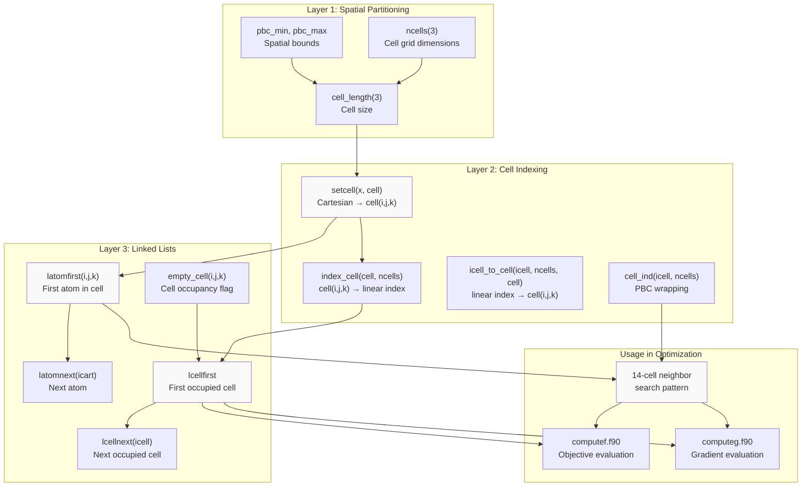
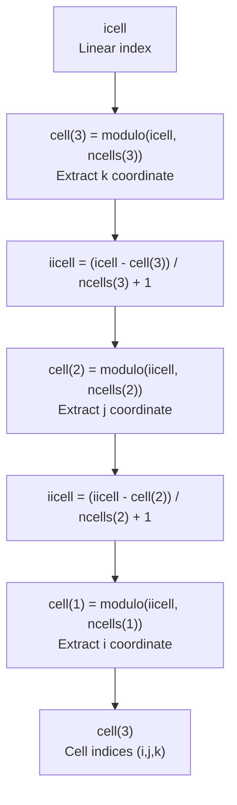
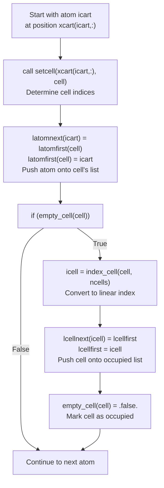
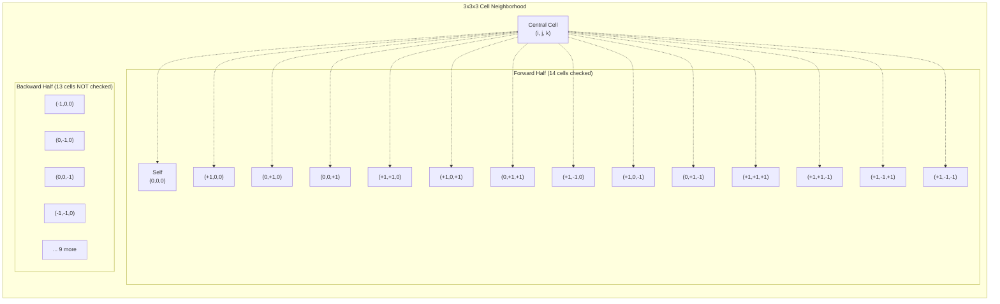
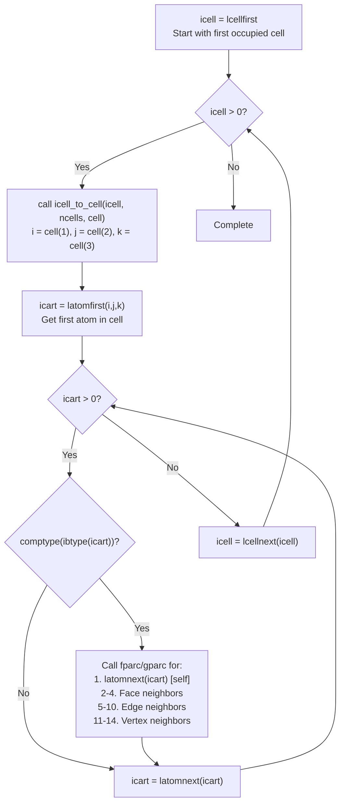
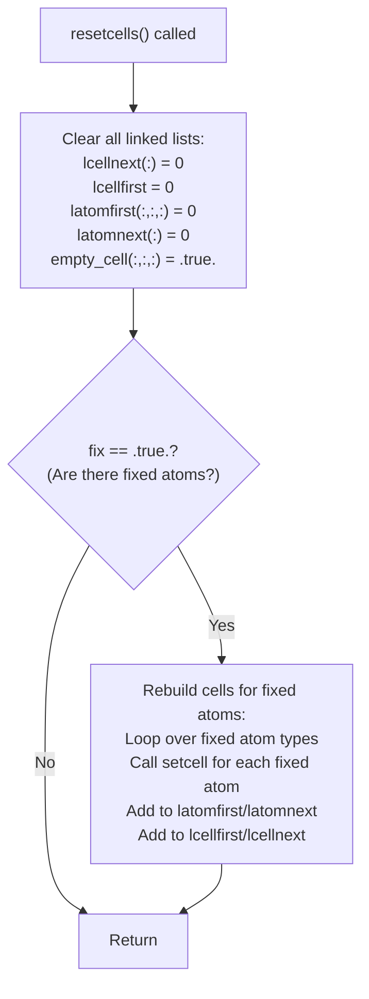
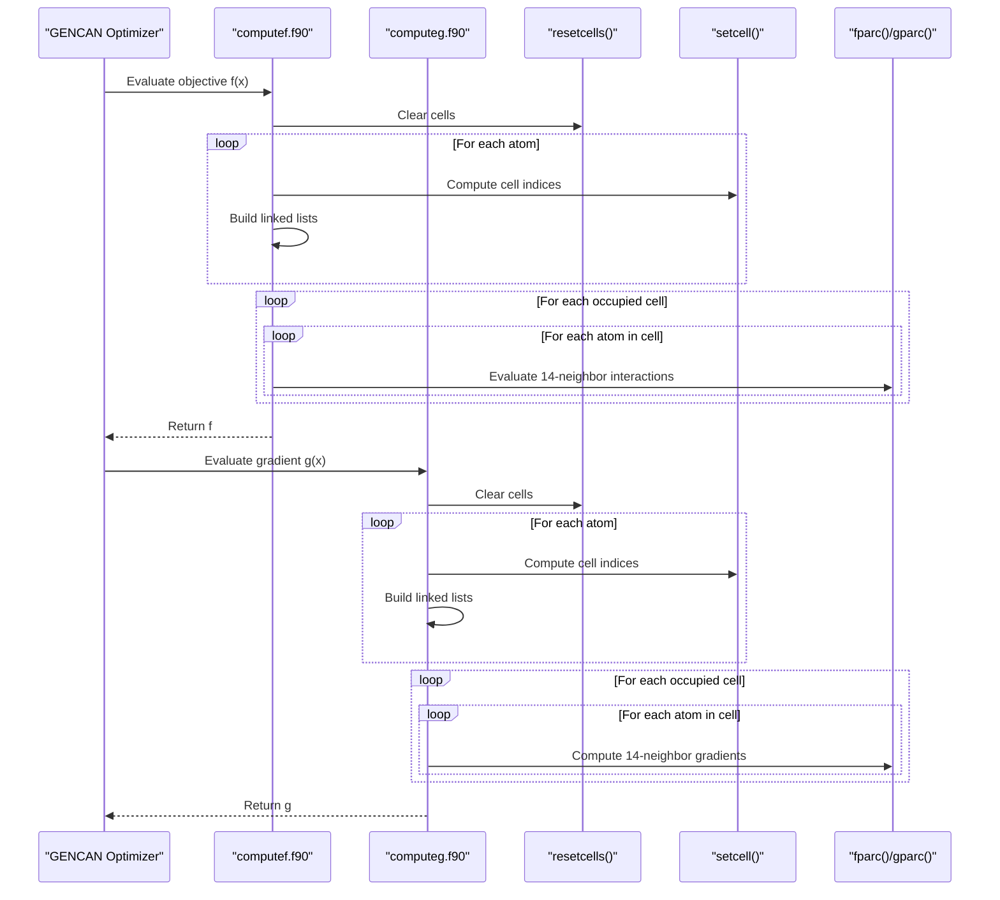
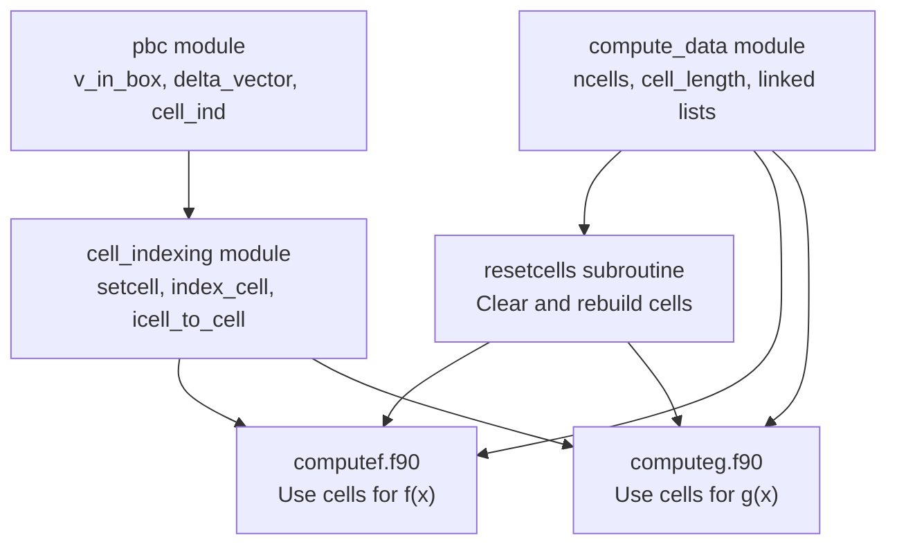

# Spatial Management System

<details>
<summary>Relevant source files</summary>

The following files were used as context for generating this wiki page:

- [CMakeLists.txt](CMakeLists.txt)
- [src/cell_indexing.f90](src/cell_indexing.f90)
- [src/computef.f90](src/computef.f90)
- [src/computeg.f90](src/computeg.f90)
- [src/pbc.f90](src/pbc.f90)
- [src/resetcells.f90](src/resetcells.f90)
- [testing/input_files/water_box.inp](testing/input_files/water_box.inp)
- [testing/input_files/water_box_pbc.inp](testing/input_files/water_box_pbc.inp)

</details>


## Purpose and Scope

The Spatial Management System in Packmol provides efficient O(N) scaling for pairwise atom interactions through cell-based spatial partitioning. This system divides 3D space into a regular grid of cells and maintains linked-list data structures that enable rapid neighbor searches without evaluating all N² atom pairs.

This document covers the cell indexing algorithms, linked-list structures, and periodic boundary condition (PBC) handling. For information about how these spatial queries are used in distance calculations, see [Atom-to-Atom Interactions](#4.7). For details on the coordinate transformation systems used before spatial indexing, see [Coordinate Transformations](#4.8).

**Sources:** [src/computef.f90:1-154](), [src/computeg.f90:1-246](), [src/cell_indexing.f90:1-63]()

## Overview: Spatial Acceleration Architecture

The spatial management system consists of three interconnected layers: spatial partitioning (cell grid), indexing functions (coordinate-to-cell mapping), and linked-list traversal structures. These components work together to reduce pairwise interaction complexity from O(N²) to O(N).



**Sources:** [src/cell_indexing.f90:1-63](), [src/computef.f90:1-154](), [src/computeg.f90:1-246](), [src/pbc.f90:1-32]()

## Cell Grid Structure

### Spatial Bounds and Grid Dimensions

The cell grid is defined by spatial bounds (`pbc_min`, `pbc_max`) and cell dimensions (`ncells`). The cell size (`cell_length`) is determined by the interaction cutoff distance to ensure that atoms only interact with those in neighboring cells.

| Variable | Type | Module | Purpose |
|----------|------|--------|---------|
| `pbc_min(3)` | `double precision` | `pbc` | Minimum coordinates of bounding box |
| `pbc_max(3)` | `double precision` | `pbc` | Maximum coordinates of bounding box |
| `pbc_length(3)` | `double precision` | `pbc` | Box dimensions (max - min) |
| `ncells(3)` | `integer` | `compute_data` | Number of cells in each dimension |
| `cell_length(3)` | `double precision` | `compute_data` | Size of each cell |

The cell grid partitions space so that `cell_length ≈ interaction_cutoff`, ensuring that atoms only need to check neighboring cells for potential interactions.

**Sources:** [src/pbc.f90:1-32](), [src/computef.f90:1-154]()

### Cell Coordinate System

Each cell is identified by 3D indices `cell(1)`, `cell(2)`, `cell(3)` corresponding to i, j, k positions in the grid. The grid satisfies:

```
1 ≤ cell(1) ≤ ncells(1)
1 ≤ cell(2) ≤ ncells(2)
1 ≤ cell(3) ≤ ncells(3)
```

**Sources:** [src/cell_indexing.f90:14-25]()

## Cell Indexing Functions

### setcell: Cartesian to Cell Coordinates

The `setcell` subroutine maps Cartesian coordinates to 3D cell indices. It handles periodic boundary conditions by wrapping coordinates into the simulation box before computing cell indices.


**Implementation:** [src/cell_indexing.f90:14-25]()

```fortran
subroutine setcell(x,cell)
   xt = v_in_box(x, pbc_min, pbc_length)
   cell(:) = floor((xt(:) - pbc_min(:))/cell_length(:)) + 1
   cell(:) = min(cell(:), ncells(:))
end subroutine setcell
```

**Sources:** [src/cell_indexing.f90:14-25]()

### index_cell: 3D to Linear Indexing

The `index_cell` function converts 3D cell coordinates to a linear index for array storage. This enables efficient cell lookup using a single integer index.

**Mapping Formula:**
```
index_cell = (cell(1)-1) * ncells(2) * ncells(3) 
           + (cell(2)-1) * ncells(3) 
           + (cell(3)-1) + 1
```

This row-major ordering stores cells sequentially: all k values for fixed (i,j), then all j values for fixed i, then all i values.

**Implementation:** [src/cell_indexing.f90:57-60]()

**Sources:** [src/cell_indexing.f90:57-60]()

### icell_to_cell: Linear to 3D Indexing

The inverse operation `icell_to_cell` converts a linear index back to 3D cell coordinates. This is used when iterating through the occupied cell linked list.



**Implementation:** [src/cell_indexing.f90:37-55]()

**Sources:** [src/cell_indexing.f90:37-55]()

### cell_ind: PBC Cell Index Wrapping

The `cell_ind` function wraps cell indices for periodic boundary conditions, ensuring indices remain within valid bounds:

```fortran
integer function cell_ind(icell, ncells)
   cell_ind = modulo(icell - 1 + ncells, ncells) + 1
end function cell_ind
```

This is used when accessing neighboring cells that may wrap around box boundaries (e.g., `cell_ind(i+1, ncells(1))` wraps from the last cell to the first).

**Implementation:** [src/pbc.f90:26-29]()

**Sources:** [src/pbc.f90:26-29]()

## Linked List Data Structures

The spatial management system uses four linked-list arrays to enable efficient traversal of atoms and cells:

### Atom Linked Lists

| Array | Type | Dimensions | Purpose |
|-------|------|------------|---------|
| `latomfirst(i,j,k)` | `integer` | `(ncells(1), ncells(2), ncells(3))` | Index of first atom in cell (i,j,k) |
| `latomnext(icart)` | `integer` | `(ntotat)` | Index of next atom in same cell |

These form a singly-linked list for each cell. Starting from `latomfirst(i,j,k)`, follow `latomnext` pointers until reaching 0 (end of list).

**Example traversal pattern:**
```fortran
icart = latomfirst(i,j,k)
do while( icart > 0 )
   ! Process atom icart
   icart = latomnext(icart)
end do
```

**Sources:** [src/computef.f90:82-88](), [src/computeg.f90:74-78]()

### Cell Linked Lists

| Array | Type | Dimensions | Purpose |
|-------|------|------------|---------|
| `lcellfirst` | `integer` | scalar | Linear index of first occupied cell |
| `lcellnext(icell)` | `integer` | `(ncells(1)*ncells(2)*ncells(3))` | Linear index of next occupied cell |
| `empty_cell(i,j,k)` | `logical` | `(ncells(1), ncells(2), ncells(3))` | Cell occupancy flag |

These form a linked list of only occupied cells, avoiding iteration through empty cells (which is critical when the simulation box is large but sparsely populated).

**Example traversal pattern:**
```fortran
icell = lcellfirst
do while( icell > 0 )
   call icell_to_cell(icell, ncells, cell)
   ! Process cell at cell(1), cell(2), cell(3)
   icell = lcellnext(icell)
end do
```

**Sources:** [src/computef.f90:115-151](), [src/computeg.f90:105-142]()

## Linked List Construction

The linked lists are constructed during objective function and gradient evaluation. The construction happens in both `computef.f90` and `computeg.f90` with identical logic:



**Implementation:** [src/computef.f90:83-101](), [src/computeg.f90:74-90]()

**Sources:** [src/computef.f90:83-101](), [src/computeg.f90:74-90]()

## Neighbor Search Algorithm

### 14-Cell Stencil Pattern

To compute pairwise interactions, each atom queries its own cell and 13 neighboring cells in the "forward" direction. This avoids double-counting pairs (atom A checking atom B's cell is equivalent to atom B checking atom A's cell).

The 14 cells consist of:
1. **Self cell** (1 cell)
2. **Face neighbors** (3 forward: +x, +y, +z)
3. **Edge neighbors** (6 forward: combinations of ±1 in two dimensions, +1 in third)
4. **Vertex neighbors** (4 forward: all combinations of +1 and ±1 in three dimensions)

**Neighbor Cell Access Pattern:**

| Category | Offset (Δi, Δj, Δk) | Cell Access in Code |
|----------|---------------------|---------------------|
| Self | (0, 0, 0) | `latomnext(icart)` |
| Faces | (+1, 0, 0) | `latomfirst(cell_ind(i+1,ncells(1)), j, k)` |
| | (0, +1, 0) | `latomfirst(i, cell_ind(j+1,ncells(2)), k)` |
| | (0, 0, +1) | `latomfirst(i, j, cell_ind(k+1,ncells(3)))` |
| Edges | (+1, -1, 0) | `latomfirst(cell_ind(i+1,ncells(1)), cell_ind(j-1,ncells(2)), k)` |
| | (+1, 0, -1) | `latomfirst(cell_ind(i+1,ncells(1)), j, cell_ind(k-1,ncells(3)))` |
| | (0, +1, -1) | `latomfirst(i, cell_ind(j+1,ncells(2)), cell_ind(k-1,ncells(3)))` |
| | (0, +1, +1) | `latomfirst(i, cell_ind(j+1,ncells(2)), cell_ind(k+1,ncells(3)))` |
| | (+1, +1, 0) | `latomfirst(cell_ind(i+1,ncells(1)), cell_ind(j+1,ncells(2)), k)` |
| | (+1, 0, +1) | `latomfirst(cell_ind(i+1,ncells(1)), j, cell_ind(k+1,ncells(3)))` |
| Vertices | (+1, -1, -1) | `latomfirst(cell_ind(i+1,ncells(1)), cell_ind(j-1,ncells(2)), cell_ind(k-1,ncells(3)))` |
| | (+1, -1, +1) | `latomfirst(cell_ind(i+1,ncells(1)), cell_ind(j-1,ncells(2)), cell_ind(k+1,ncells(3)))` |
| | (+1, +1, -1) | `latomfirst(cell_ind(i+1,ncells(1)), cell_ind(j+1,ncells(2)), cell_ind(k-1,ncells(3)))` |
| | (+1, +1, +1) | `latomfirst(cell_ind(i+1,ncells(1)), cell_ind(j+1,ncells(2)), cell_ind(k+1,ncells(3)))` |

**Sources:** [src/computef.f90:127-144](), [src/computeg.f90:117-134]()

### Visual Representation of 3x3x3 Stencil



The "forward half" ensures each atom pair is evaluated exactly once. Since atom pairs are symmetric (distance from A to B equals distance from B to A), checking only forward neighbors avoids redundant calculations.

**Sources:** [src/computef.f90:127-144](), [src/computeg.f90:117-134]()

### Neighbor Search Implementation

The neighbor search is implemented identically in both `computef.f90` (for objective function evaluation) and `computeg.f90` (for gradient evaluation):



**Implementation in computef.f90:** [src/computef.f90:115-151]()

**Implementation in computeg.f90:** [src/computeg.f90:105-142]()

**Sources:** [src/computef.f90:115-151](), [src/computeg.f90:105-142]()

## Periodic Boundary Conditions

### PBC Module Functions

The `pbc` module provides three key functions for handling periodic boundary conditions:

#### v_in_box: Coordinate Wrapping

```fortran
elemental double precision function v_in_box(v, pbc_min, pbc_length)
   v_in_box = pbc_min + modulo((v - pbc_min), pbc_length)
end function v_in_box
```

Wraps a coordinate into the simulation box: `[pbc_min, pbc_min + pbc_length)`. This is used by `setcell` before computing cell indices.

**Implementation:** [src/pbc.f90:15-18]()

#### delta_vector: Minimum Image Distance

```fortran
elemental double precision function delta_vector(v1, v2, pbc_length)
   delta_vector = v1 - v2
   delta_vector = delta_vector - pbc_length * nint(delta_vector / pbc_length)
end function delta_vector
```

Computes the minimum image convention distance between two coordinates. The result is in the range `(-pbc_length/2, pbc_length/2]`.

**Implementation:** [src/pbc.f90:20-24]()

#### cell_ind: Cell Index Wrapping

```fortran
integer function cell_ind(icell, ncells)
   cell_ind = modulo(icell - 1 + ncells, ncells) + 1
end function cell_ind
```

Wraps cell indices to handle neighbor cells across periodic boundaries (e.g., cell index `ncells+1` wraps to `1`).

**Implementation:** [src/pbc.f90:26-29]()

**Sources:** [src/pbc.f90:15-29]()

### PBC Configuration Variables

| Variable | Type | Module | Default | Purpose |
|----------|------|--------|---------|---------|
| `using_pbc` | `logical` | `pbc` | `.false.` | Whether PBC are enabled |
| `pbc_min(3)` | `double precision` | `pbc` | - | Minimum box coordinates |
| `pbc_max(3)` | `double precision` | `pbc` | - | Maximum box coordinates |
| `pbc_length(3)` | `double precision` | `pbc` | - | Box dimensions per axis |

These variables are set during input file parsing when the `pbc` keyword is encountered.

**Sources:** [src/pbc.f90:5-11]()

## Cell Reset Mechanism

The `resetcells` subroutine clears the linked-list structures between optimization iterations. This is necessary because atom positions change, requiring cells to be rebuilt.



**Why reset cells?** During optimization, atoms move continuously. Rather than updating the cell lists incrementally (complex and error-prone), Packmol rebuilds them from scratch each iteration. Fixed atoms (if present) are added first so they participate in interactions but don't move.

**Implementation:** [src/resetcells.f90:10-42]()

**Sources:** [src/resetcells.f90:10-42]()

## Integration with Optimization Loop

The spatial management system is invoked during every objective function and gradient evaluation:



**Key observations:**
- Cells are rebuilt from scratch on every function/gradient evaluation
- The same 14-cell neighbor pattern is used in both `computef` and `computeg`
- The cell system reduces complexity from O(N²) to O(N) by limiting neighbor checks
- PBC wrapping is applied consistently through `cell_ind` and `delta_vector`

**Sources:** [src/computef.f90:1-154](), [src/computeg.f90:1-246](), [src/resetcells.f90:10-42]()

## Performance Characteristics

### Complexity Analysis

| Operation | Without Cells | With Cells | Scaling Factor |
|-----------|---------------|------------|----------------|
| Pairwise interactions | O(N²) | O(N) | N / (density × cell_size³) |
| Cell assignment | - | O(N) | 1 per atom |
| Neighbor search | - | O(1) per atom | 14 cells maximum |
| Memory overhead | - | O(N + C³) | C = grid dimensions |

The cell system transforms the dominant O(N²) pairwise interaction cost into O(N) by exploiting spatial locality.

### Memory Footprint

| Data Structure | Size | Description |
|----------------|------|-------------|
| `latomfirst` | `ncells(1) × ncells(2) × ncells(3) × 4 bytes` | Cell→atom mapping |
| `latomnext` | `ntotat × 4 bytes` | Atom linked list |
| `lcellfirst` | `4 bytes` | Scalar |
| `lcellnext` | `ncells(1) × ncells(2) × ncells(3) × 4 bytes` | Cell linked list |
| `empty_cell` | `ncells(1) × ncells(2) × ncells(3) × 1 byte` | Occupancy flags |

For a typical system with 10,000 atoms and 20×20×20 cells, the total overhead is approximately:
- `latomfirst`: 8,000 × 4 = 32 KB
- `latomnext`: 10,000 × 4 = 40 KB  
- `lcellnext`: 8,000 × 4 = 32 KB
- `empty_cell`: 8,000 × 1 = 8 KB
- **Total: ~112 KB**

This is negligible compared to the coordinate and gradient storage requirements.

**Sources:** [src/computef.f90:1-154](), [src/computeg.f90:1-246]()

## Module Dependencies

The spatial management system spans multiple modules with clear separation of concerns:



**Module locations:**
- `pbc`: [src/pbc.f90:5-32]()
- `cell_indexing`: [src/cell_indexing.f90:1-63]()
- `compute_data`: Referenced in [src/computef.f90:13]()
- `resetcells`: [src/resetcells.f90:10-42]()

**Sources:** [src/pbc.f90:5-32](), [src/cell_indexing.f90:1-63](), [src/computef.f90:1-154](), [src/computeg.f90:1-246](), [src/resetcells.f90:10-42]()

---