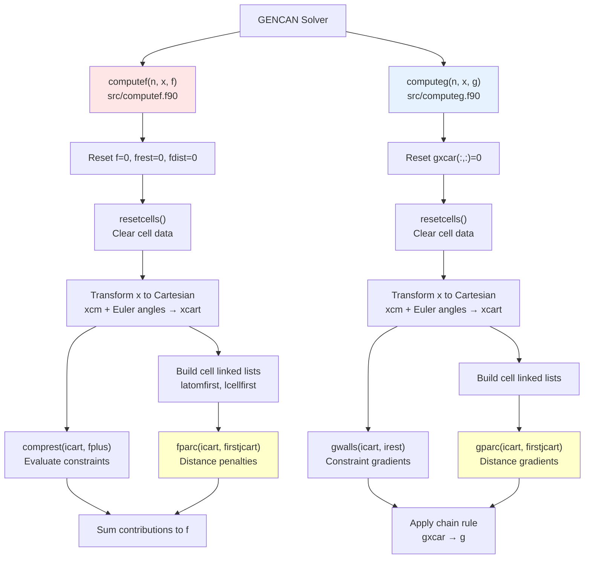
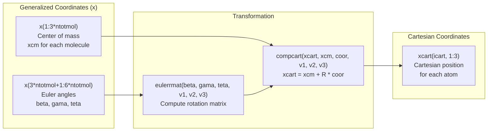
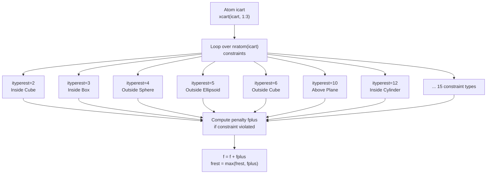
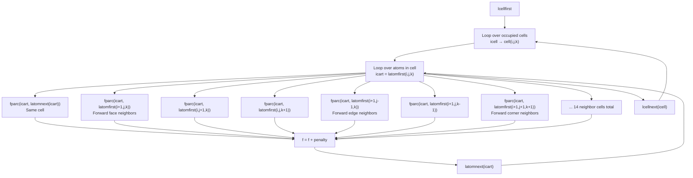
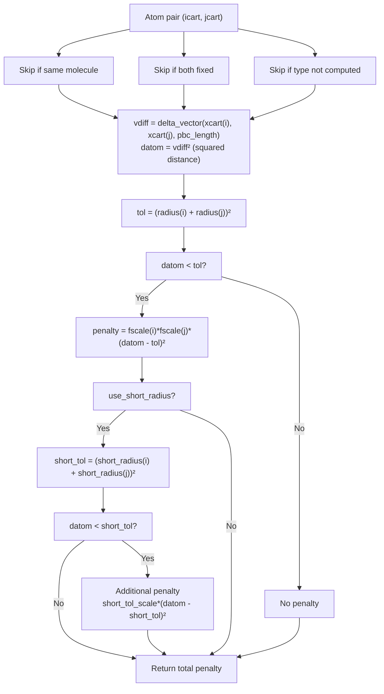
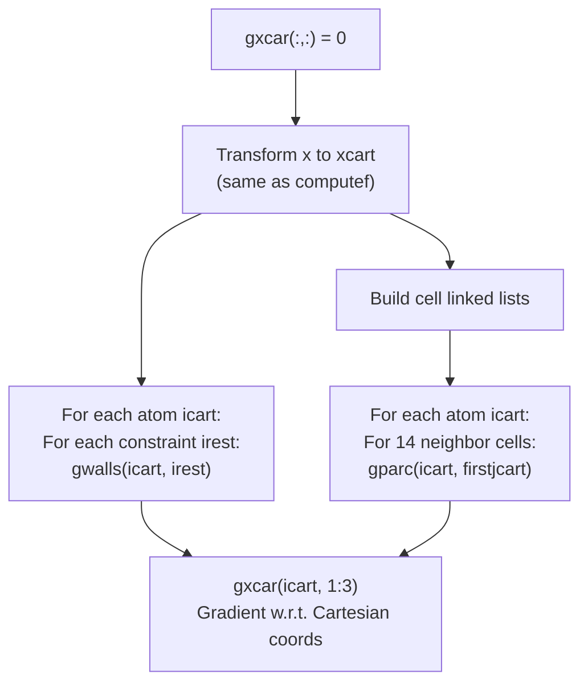
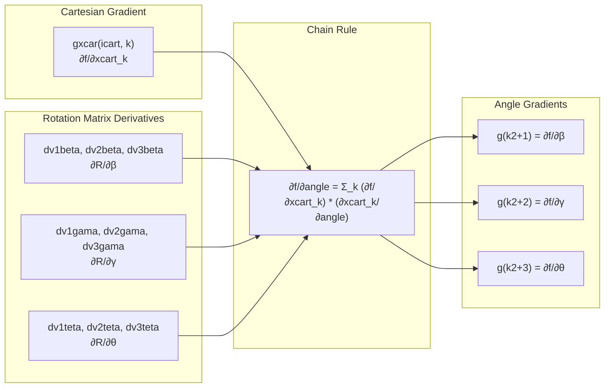
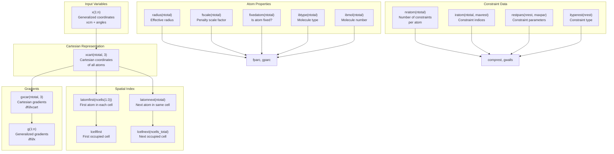

# Objective Function Evaluation

<details>
<summary>Relevant source files</summary>

The following files were used as context for generating this wiki page:

- [src/comprest.f90](src/comprest.f90)
- [src/computef.f90](src/computef.f90)
- [src/computeg.f90](src/computeg.f90)
- [src/fparc.f90](src/fparc.f90)
- [src/gparc.f90](src/gparc.f90)
- [src/gwalls.f90](src/gwalls.f90)

</details>


## Purpose and Scope

This page describes how Packmol computes the objective function value and its gradient during the optimization process. The objective function quantifies how well molecules are packed, balancing two competing goals: maintaining minimum distances between atoms and satisfying geometric constraints.

The objective function evaluation is invoked by the GENCAN optimization solver (see [Optimization Engine (GENCAN)](#4.4)) and relies on spatial data structures documented in [Spatial Management System](#4.5). For details on individual atom-pair interactions, see [Atom-to-Atom Interactions](#4.7). For constraint system details, see [Constraint System Implementation](#7.2).

## Objective Function Structure

The objective function `f(x)` consists of two main components that are summed together:

| Component | Symbol | Description | Scale Factor |
|-----------|--------|-------------|--------------|
| **Distance Penalties** | `fdist` | Quadratic penalties when atoms are closer than their combined radii | `fscale(i)*fscale(j)` |
| **Constraint Penalties** | `frest` | Penalties for violating geometric constraints (inside/outside regions) | `scale` or `scale2` |

```
f(x) = Σ fdist(i,j) + Σ frest(i)
```

The optimization succeeds when `f(x)` approaches zero, indicating all distance requirements and constraints are satisfied.

**Sources:** [src/computef.f90:1-154](), [src/compute_data.f90]()

## Function Evaluation Overview



**Sources:** [src/computef.f90:9-154](), [src/computeg.f90:9-244]()

## Function Value Computation (computef)

The `computef` subroutine in [src/computef.f90:9-154]() evaluates the objective function value through the following steps:

### Step 1: Coordinate Transformation

The optimization variables `x` are in **generalized coordinates**: center-of-mass positions and Euler angles (β, γ, θ) for each molecule. These must be converted to **Cartesian coordinates** for all atoms.



The loops in [src/computef.f90:44-109]() iterate over molecule types and molecules, computing Cartesian coordinates and simultaneously building cell data structures:

```
ilubar = 0                  ! Index for center-of-mass coordinates
ilugan = ntotmol*3          ! Index for angle coordinates
icart = 0                   ! Atom counter

for each molecule type:
  for each molecule:
    xcm = x(ilubar+1:ilubar+3)
    beta, gama, teta = x(ilugan+1:ilugan+3)
    
    for each atom in molecule:
      icart = icart + 1
      xcart(icart,:) = xcm + R(beta,gama,teta) * coor(idatom,:)
```

**Sources:** [src/computef.f90:40-109](), [src/eulerrmat.f90](), [src/compcart.f90]()

### Step 2: Constraint Evaluation

For each atom, the subroutine `comprest` evaluates all geometric constraints applied to that atom:



The penalty formulas are quadratic. For example, for an "inside cube" constraint ([src/comprest.f90:29-44]()):
- If `xcart(icart,1) < xmin`, penalty includes `scale * (xcart - xmin)²`
- If `xcart(icart,1) > xmax`, penalty includes `scale * (xcart - xmax)²`

**Sources:** [src/computef.f90:76-79](), [src/comprest.f90:11-215]()

### Step 3: Cell Construction and Distance Evaluation

After transforming all atoms to Cartesian coordinates, the code builds cell-based spatial data structures ([src/computef.f90:83-101]()):

```
call setcell(xcart(icart,:), cell)           ! Determine cell indices
latomnext(icart) = latomfirst(i,j,k)         ! Link atom into cell
latomfirst(i,j,k) = icart
if (empty_cell(i,j,k)) then
  empty_cell(i,j,k) = .false.
  lcellnext(icell) = lcellfirst              ! Link cell into occupied list
  lcellfirst = icell
end if
```

Distance penalties are then computed by iterating over occupied cells and checking neighboring cells ([src/computef.f90:115-151]()):



The 14-cell neighbor search pattern examines the atom's own cell plus 13 forward neighbors to avoid double-counting pairs. This reduces O(N²) pairwise checks to O(N).

**Sources:** [src/computef.f90:115-151](), [src/cell_indexing.f90]()

## Distance Penalty Function (fparc)

The `fparc` function in [src/fparc.f90:10-77]() computes distance penalties for atom pairs. For each pair (icart, jcart):

### Pairwise Distance Computation



The penalty formula is:

```
if datom < tol:
  penalty = fscale(i) * fscale(j) * (datom - tol)²
  
  if datom < short_tol:
    penalty += fscale(i) * fscale(j) * short_tol_scale * (datom - short_tol)²
```

This creates a smooth quadratic penalty that increases as atoms get closer. The short radius system (see [Radius and Tolerance System](#7.3)) adds extra penalties for extremely close atoms.

**Sources:** [src/fparc.f90:10-77](), [src/pbc.f90]()

## Gradient Computation (computeg)

The `computeg` subroutine in [src/computeg.f90:9-244]() computes the gradient `g` of the objective function with respect to the generalized coordinates `x`. The process mirrors `computef` but accumulates gradients instead of function values.

### Cartesian Gradient Accumulation

The gradient computation proceeds in two phases:

**Phase 1: Compute gradients in Cartesian space** ([src/computeg.f90:32-143]()):



Both `gwalls` and `gparc` accumulate contributions into the array `gxcar(icart, k)`, which stores ∂f/∂xcart for each atom's Cartesian coordinates.

**Phase 2: Transform to generalized coordinates using chain rule** ([src/computeg.f90:145-241]()):

```
g(1:n) = 0

for each molecule:
  for each atom in molecule:
    // Center-of-mass gradient: direct copy
    g(k1+1:k1+3) += gxcar(icart, 1:3)
    
    // Angle gradients: chain rule
    g(k2+1) += Σ_k coor(idatom, :) · dv1beta(k) * gxcar(icart, k)
    g(k2+2) += Σ_k coor(idatom, :) · dv1gama(k) * gxcar(icart, k)
    g(k2+3) += Σ_k coor(idatom, :) · dv1teta(k) * gxcar(icart, k)
```

**Sources:** [src/computeg.f90:9-244]()

## Chain Rule for Angle Gradients

The transformation from Cartesian gradients to angle gradients uses the chain rule. Since:

```
xcart = xcm + R(β,γ,θ) * coor
```

The gradient with respect to angles requires computing derivatives of the rotation matrix:



The rotation matrix derivatives are computed analytically in [src/computeg.f90:162-204]() using trigonometric identities:

```
dv1beta(1) = -cos(β)*sin(γ)*cos(θ) - sin(β)*cos(γ)
dv2beta(1) = -sin(β)*sin(γ)*cos(θ) + cos(β)*cos(γ)
dv3beta(1) = 0
... (27 components total for 3 angles × 3 vectors × 3 dimensions)
```

For each atom, the contribution to the angle gradient is ([src/computeg.f90:217-234]()):

```
for k = 1 to 3:
  g(k2+1) += (coor(idatom,1)*dv1beta(k) + 
              coor(idatom,2)*dv2beta(k) + 
              coor(idatom,3)*dv3beta(k)) * gxcar(icart, k)
```

This efficiently computes how changes in rotation angles affect the objective function through all atoms in the molecule.

**Sources:** [src/computeg.f90:145-241]()

## Distance Gradient Function (gparc)

The `gparc` subroutine in [src/gparc.f90:9-86]() computes the gradient of distance penalties. For each atom pair where `datom < tol`:

```
dtemp = fscale(i) * fscale(j) * 4 * (datom - tol)

gxcar(icart, k) += dtemp * vdiff(k)
gxcar(jcart, k) -= dtemp * vdiff(k)
```

This implements the derivative of the quadratic penalty:

```
∂/∂x [(d² - tol)²] = 4(d² - tol) · ∂d²/∂x = 4(d² - tol) · 2(x_i - x_j)
```

The gradient contributions are equal and opposite for the two atoms, reflecting Newton's third law.

For short radius penalties ([src/gparc.f90:65-81]()):

```
if datom < short_tol:
  short_tol_scale = sqrt(short_radius_scale(i) * short_radius_scale(j)) * (tol²/short_tol²)
  dtemp = fscale(i) * fscale(j) * 4 * short_tol_scale * (datom - short_tol)
  
  gxcar(icart, k) += dtemp * vdiff(k)
  gxcar(jcart, k) -= dtemp * vdiff(k)
```

**Sources:** [src/gparc.f90:9-86]()

## Constraint Gradient Function (gwalls)

The `gwalls` subroutine in [src/gwalls.f90:9-327]() computes gradients for geometric constraints. Each constraint type has its own analytical gradient formula.

### Example: Inside Cube Constraint

For `ityperest = 2` (inside cube), [src/gwalls.f90:24-43]():

```
if x < xmin:
  gxcar(icart, 1) += scale * 2 * (x - xmin)
  
if x > xmax:
  gxcar(icart, 1) += scale * 2 * (x - xmax)
```

This is the derivative of the penalty `scale * (x - xmin)²` or `scale * (x - xmax)²`.

### Example: Outside Sphere Constraint

For `ityperest = 4` (outside sphere), [src/gwalls.f90:63-75]():

```
d = (x - x₀)² + (y - y₀)² + (z - z₀)² - r²

if d > 0:
  gxcar(icart, 1) += 4 * scale2 * (x - x₀) * d
  gxcar(icart, 2) += 4 * scale2 * (y - y₀) * d
  gxcar(icart, 3) += 4 * scale2 * (z - z₀) * d
```

This is the derivative of `scale2 * d²` using the chain rule.

### Example: Cylinder Constraint

For `ityperest = 12` (inside cylinder), the gradient is more complex ([src/gwalls.f90:202-242]()). It decomposes the violation into:
- Axial distance from cylinder base: controlled by `w`
- Radial distance from cylinder axis: controlled by `d`

The gradient combines contributions from both components using the chain rule.

**Sources:** [src/gwalls.f90:9-327]()

## Variable Indexing Scheme

The optimization variables `x` are organized as follows:

| Range | Content | Formula |
|-------|---------|---------|
| `1 : 3*ntotmol` | Center-of-mass coordinates | `x(3*(imol-1) + k)` for molecule `imol`, coordinate `k ∈ {1,2,3}` |
| `3*ntotmol+1 : 6*ntotmol` | Euler angles | `x(3*ntotmol + 3*(imol-1) + j)` for molecule `imol`, angle `j ∈ {1,2,3}` |

The indexing variables used in the code:

```
ilubar = 3 * (imol - 1)              ! Index into center-of-mass section
ilugan = 3*ntotmol + 3*(imol - 1)    ! Index into angle section
k1 = ilubar                          ! For gradient accumulation
k2 = ilugan                          ! For gradient accumulation
```

The correspondence between atoms and molecules is maintained through:

```
icart        ! Global atom index (1 to ntotal)
ibtype(icart) ! Molecule type of atom icart
ibmol(icart)  ! Molecule instance number within type
```

**Sources:** [src/computef.f90:40-109](), [src/computeg.f90:43-96](), [src/computeg.f90:148-241]()

## Performance Characteristics

The objective function evaluation scales as:

| Operation | Complexity | Notes |
|-----------|-----------|-------|
| Coordinate transformation | O(N) | Loop over all atoms |
| Constraint evaluation | O(N·C) | C = average constraints per atom (typically small) |
| Cell construction | O(N) | Insert each atom into cell list |
| Distance evaluation | O(N) | With cell indexing; O(N²) without |
| Gradient transformation | O(N) | Chain rule application |

The cell-based spatial indexing is critical: without it, the distance evaluation would require checking all O(N²) atom pairs. With cells, each atom only checks its 14 neighboring cells, reducing the expected complexity to O(N) for uniformly distributed atoms.

**Sources:** [src/computef.f90](), [src/computeg.f90](), [src/fparc.f90](), [src/gparc.f90]()

## Key Data Structures

The following arrays are used during objective function evaluation:



**Sources:** [src/compute_data.f90](), [src/sizes.f90]()

---