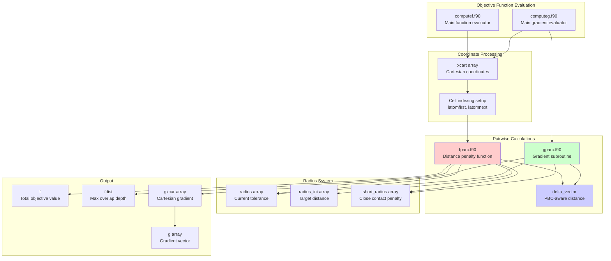
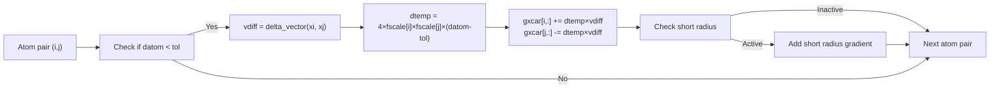
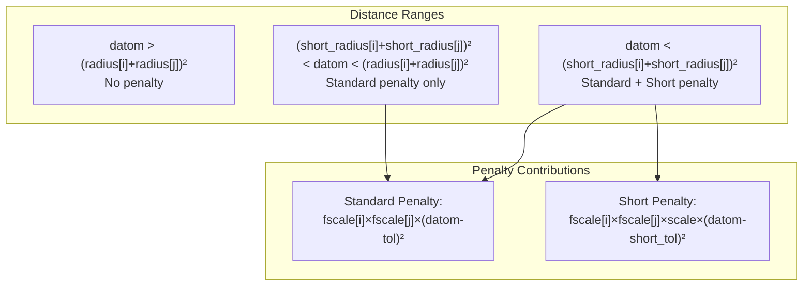
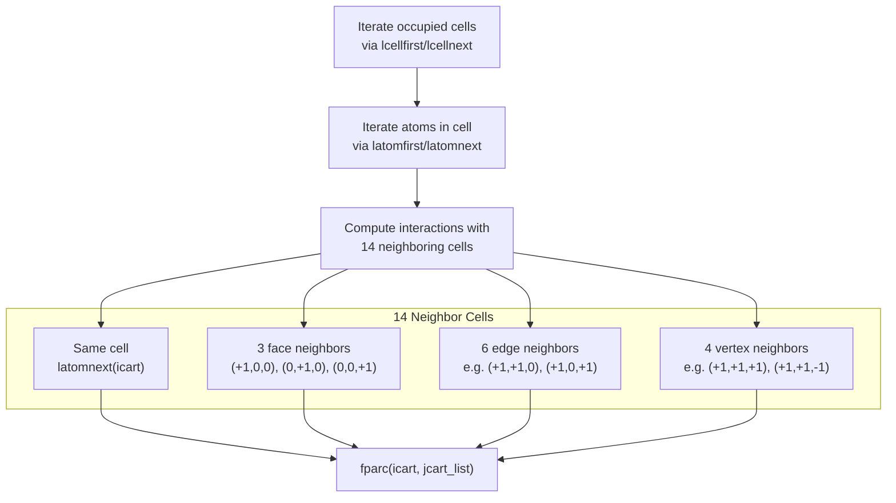
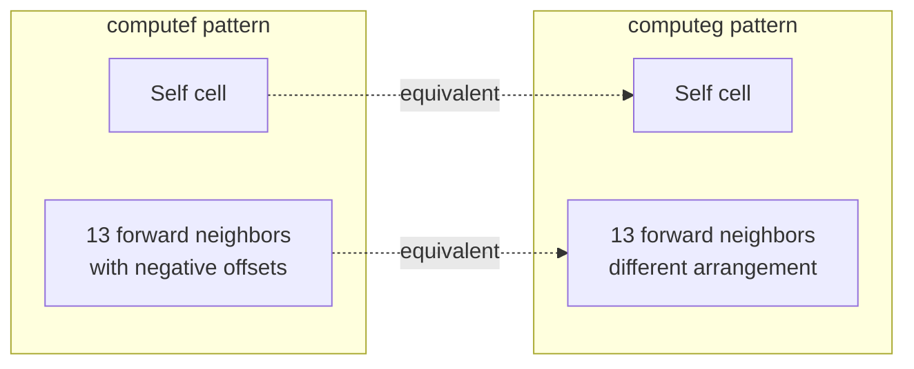

# Atom-to-Atom Interactions

<details>
<summary>Relevant source files</summary>

The following files were used as context for generating this wiki page:

- [src/computef.f90](src/computef.f90)
- [src/computeg.f90](src/computeg.f90)
- [src/fparc.f90](src/fparc.f90)
- [src/gparc.f90](src/gparc.f90)

</details>


## Purpose and Scope

This document describes the pairwise atom-to-atom interaction calculations that form the distance penalty component of Packmol's objective function. These calculations ensure that molecules maintain appropriate separation distances during the packing optimization process.

For the overall objective function structure (including constraint penalties), see [Objective Function Evaluation](#4.6). For the spatial acceleration structures that make these calculations efficient, see [Spatial Management System](#4.5). For how coordinates are transformed before distance calculations, see [Coordinate Transformations](#4.8).

## System Overview

The atom-to-atom interaction system computes quadratic penalties when pairs of atoms are closer than their combined tolerance radii. These penalties drive the optimization process to find configurations where all atoms are properly separated while satisfying geometric constraints.



**Sources:** [src/computef.f90:1-155](), [src/computeg.f90:1-246](), [src/fparc.f90:1-79](), [src/gparc.f90:1-88]()

## Distance Penalty Function

The function `fparc` in [src/fparc.f90]() computes the penalty for a single atom's interactions with all atoms in a given linked list. The penalty is applied when the squared distance between atoms falls below their combined tolerance radii.

### Basic Penalty Formula

For each atom pair (i, j), the penalty is computed as:

```
tol = (radius[i] + radius[j])²
if (datom < tol):
    penalty = fscale[i] × fscale[j] × (datom - tol)²
```

Where:
- `datom` is the squared distance between atoms
- `tol` is the squared sum of tolerance radii
- `fscale` is a per-atom scaling factor

The function iterates through atom pairs using the linked-list structure, skipping pairs that should not be evaluated:

| Skip Condition | Reason |
|----------------|--------|
| `ibtype(jcart)` not in `comptype` | Molecule type not being optimized |
| `ibmol(icart) == ibmol(jcart)` and same type | Atoms from same molecule |
| Both `fixedatom(icart)` and `fixedatom(jcart)` | Both atoms fixed |

**Sources:** [src/fparc.f90:10-77]()

### Distance Tracking

Beyond computing penalties, `fparc` also tracks the maximum overlap depth using `radius_ini`, which represents the target minimum distance:

```fortran
tol = (radius_ini(icart)+radius_ini(jcart))**2
fdist = dmax1(tol-datom,fdist)
```

This `fdist` value provides a measure of how far the current configuration is from achieving all target distances, independent of the penalty function.

**Sources:** [src/fparc.f90:68-73]()

## Gradient Computation

The `gparc` subroutine in [src/gparc.f90]() computes the gradient of the distance penalty with respect to Cartesian coordinates. This gradient is essential for the GENCAN optimizer to determine descent directions.

### Gradient Formula

For a pair of atoms within the tolerance distance:

```
dtemp = fscale[i] × fscale[j] × 4 × (datom - tol)
∇penalty[i] = dtemp × (x[i] - x[j])
∇penalty[j] = -dtemp × (x[i] - x[j])
```

The factor of 4 comes from the chain rule derivative of `(datom - tol)²` where `datom = ||x[i] - x[j]||²`.

The gradient is accumulated into the `gxcar` array, which stores gradients in Cartesian space before they are transformed back to generalized coordinates (center-of-mass + Euler angles) by `computeg`.



**Sources:** [src/gparc.f90:9-86]()

## Radius Types and Tolerance System

Packmol uses three distinct radius types for each atom, stored in separate arrays. Understanding their roles is critical to understanding the penalty system.

| Array Name | Type | Purpose | Usage |
|------------|------|---------|-------|
| `radius` | Dynamic | Current tolerance for penalty calculation | Penalty applied when `datom < (radius[i]+radius[j])²` |
| `radius_ini` | Static | Target minimum distance | Used to track overlap depth in `fdist` |
| `short_radius` | Static | Close contact threshold | Triggers additional steep penalty |
| `short_radius_scale` | Static | Penalty scaling factor | Multiplies short radius penalty |

### Dynamic Radius Adjustment

The `radius` array can be dynamically adjusted during optimization (controlled by the `discale` parameter in input), allowing the tolerance to change over time. This enables a strategy where molecules initially pack with tighter constraints that gradually relax.

**Sources:** [src/fparc.f90:22-23,51-68](), [src/gparc.f90:21-22,51-82]()

## Short Radius Penalty System

The short radius system provides an additional steep penalty when atoms get extremely close, helping prevent molecular overlap and improving convergence.

### Two-Level Penalty Structure



### Short Radius Calculation Details

When both atoms have short radii enabled (`use_short_radius` flag):

```fortran
short_tol = (short_radius(icart)+short_radius(jcart))**2
if ( datom < short_tol ) then
    short_tol_penalty = datom-short_tol
    short_tol_scale = dsqrt(short_radius_scale(icart)*short_radius_scale(jcart))
    short_tol_scale = short_tol_scale*(tol**2/short_tol**2)
    penalty = penalty + fscale(icart)*fscale(jcart)*short_tol_scale*short_tol_penalty**2
end if
```

The scaling factor `short_tol_scale` is computed as the geometric mean of the two atoms' scale factors, multiplied by a ratio that accounts for the difference in tolerance magnitudes. This ensures the short radius penalty has appropriate relative magnitude.

**Sources:** [src/fparc.f90:58-66](), [src/gparc.f90:65-81]()

## Spatial Optimization via Cell Indexing

The naive approach of computing all pairwise distances would require O(N²) operations for N atoms. Packmol reduces this to O(N) using spatial cell indexing.

### Neighbor Search Integration

In `computef` and `computeg`, the pairwise calculations are organized to examine only nearby cells:



The cell size is chosen such that only adjacent cells need to be checked. The use of periodic boundary conditions via `cell_ind` function wraps cell indices appropriately.

**Sources:** [src/computef.f90:115-151](), [src/computeg.f90:105-141]()

## Neighbor Search Pattern

The neighbor search examines 14 cells: the current cell plus 13 forward neighbors in a 3D stencil. This avoids double-counting pairs while ensuring all pairs within cutoff distance are evaluated.

### Cell Pattern in computef

The calls to `fparc` from `computef` follow this pattern:

| Cell Offset | Description | Code Line |
|-------------|-------------|-----------|
| (0,0,0) | Self-cell interactions | [src/computef.f90:128]() |
| (+1,0,0) | Face neighbor | [src/computef.f90:130]() |
| (0,+1,0) | Face neighbor | [src/computef.f90:131]() |
| (0,0,+1) | Face neighbor | [src/computef.f90:132]() |
| (+1,-1,0) | Edge neighbor | [src/computef.f90:134]() |
| (+1,0,-1) | Edge neighbor | [src/computef.f90:135]() |
| (0,+1,-1) | Edge neighbor | [src/computef.f90:136]() |
| (0,+1,+1) | Edge neighbor | [src/computef.f90:137]() |
| (+1,+1,0) | Edge neighbor | [src/computef.f90:138]() |
| (+1,0,+1) | Edge neighbor | [src/computef.f90:139]() |
| (+1,-1,-1) | Vertex neighbor | [src/computef.f90:141]() |
| (+1,-1,+1) | Vertex neighbor | [src/computef.f90:142]() |
| (+1,+1,-1) | Vertex neighbor | [src/computef.f90:143]() |
| (+1,+1,+1) | Vertex neighbor | [src/computef.f90:144]() |

### Cell Pattern Differences

Note that `computeg` uses a slightly different pattern (13 neighbors instead of 14 in one dimension), but the logic is equivalent - both ensure all pairs are evaluated exactly once:



Both patterns examine the same set of atom pairs but with different cell iteration orders.

**Sources:** [src/computef.f90:128-144](), [src/computeg.f90:118-134]()

## Periodic Boundary Conditions

All distance calculations use the `delta_vector` function from the PBC module, which computes the minimum image distance when periodic boundary conditions are active:

```fortran
vdiff = delta_vector(xcart(icart,:), xcart(jcart,:), pbc_length)
datom = (vdiff(1))**2 + (vdiff(2))**2 + (vdiff(3))**2
```

This ensures that:
1. In non-periodic systems, `delta_vector` simply returns the direct difference
2. In periodic systems, it returns the shortest vector considering periodic images
3. The same code path handles both cases transparently

**Sources:** [src/fparc.f90:53-54](), [src/gparc.f90:52-53]()

## Performance Characteristics

The atom-to-atom interaction calculation dominates computational cost in Packmol. Key performance characteristics:

| Aspect | Complexity | Notes |
|--------|-----------|-------|
| Naive pairwise | O(N²) | Would be prohibitively expensive |
| With cell indexing | O(N) | Assuming uniform density |
| Cell size | Set by max radius | Determines neighbors to check |
| Gradient computation | O(N) | Same as function evaluation |
| PBC overhead | O(1) per pair | Minimal cost for distance wrapping |

The efficiency of this system enables Packmol to handle systems with millions of atoms in reasonable time.

**Sources:** [src/fparc.f90:10-77](), [src/gparc.f90:9-86]()

---