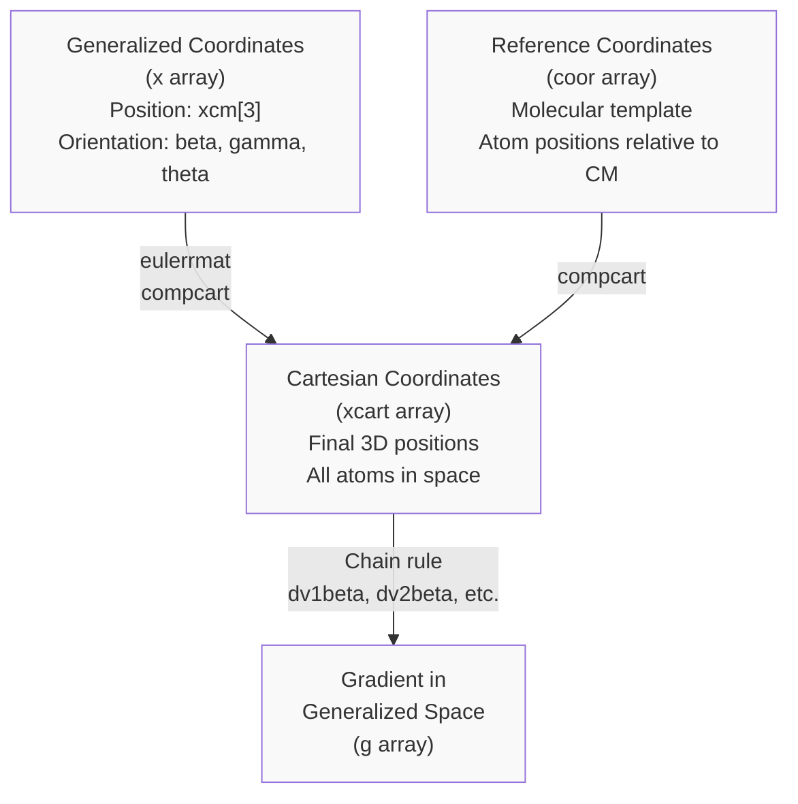
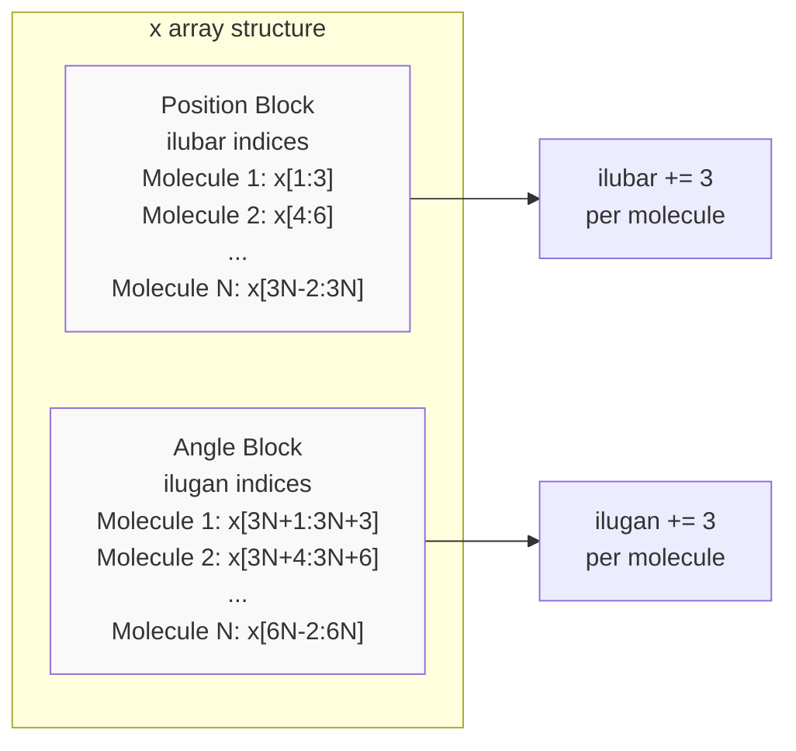
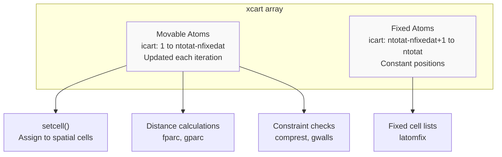
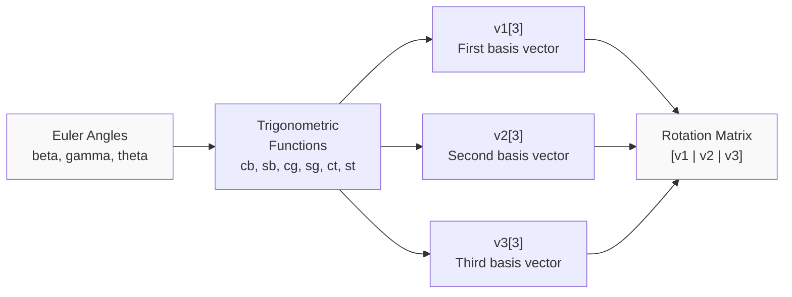
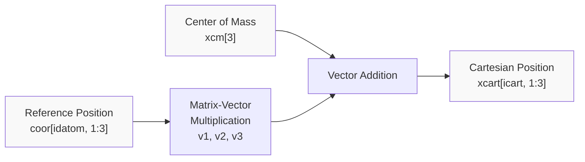
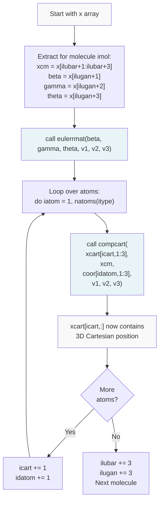
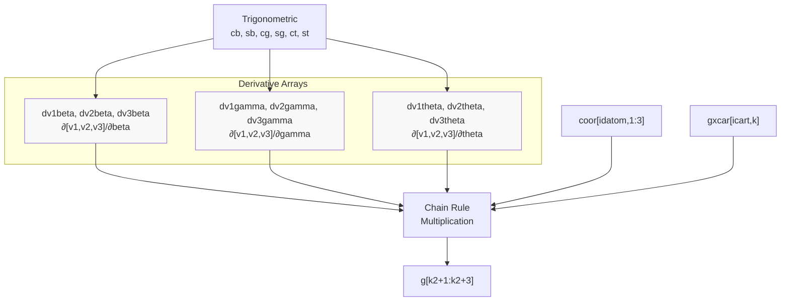
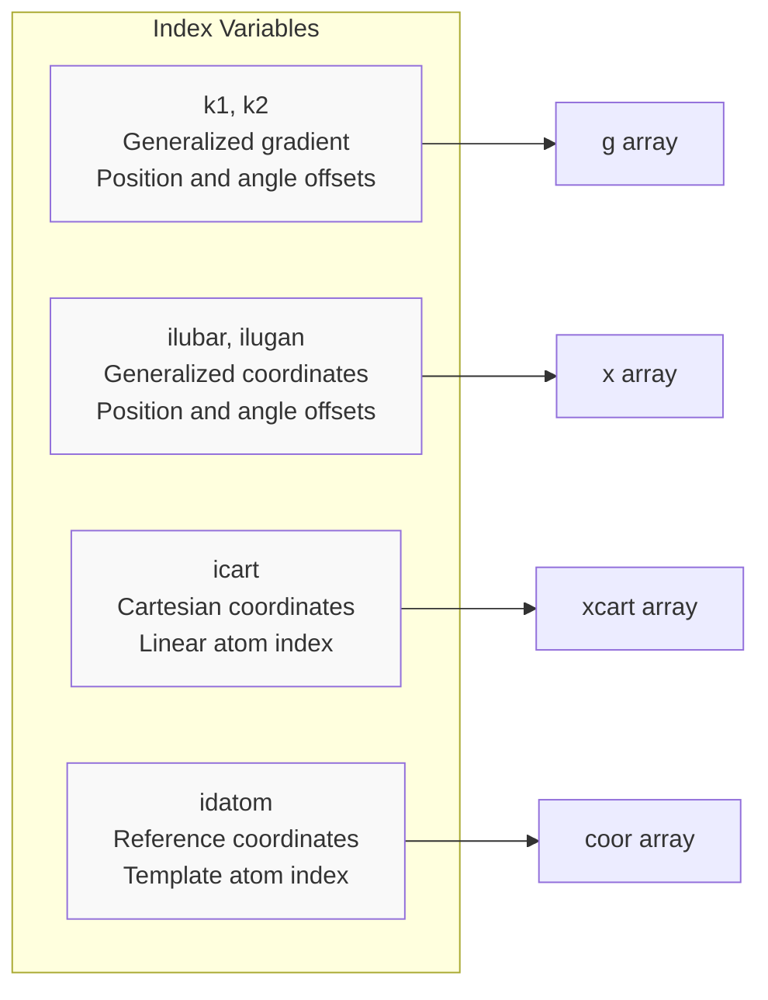

# Coordinate Transformations

<details>
<summary>Relevant source files</summary>

The following files were used as context for generating this wiki page:

- [src/computef.f90](src/computef.f90)
- [src/computeg.f90](src/computeg.f90)
- [src/initial.f90](src/initial.f90)

</details>


## Purpose and Scope

This page documents Packmol's coordinate transformation system, which converts between three representations: generalized coordinates (center of mass + Euler angles), reference coordinates (molecular templates), and Cartesian coordinates (3D atom positions). These transformations are fundamental to the optimization process and appear in every function and gradient evaluation.

For information about how these coordinates are used in the optimization loop, see [Optimization Engine (GENCAN)](#4.4). For details on how Cartesian coordinates are used in spatial queries, see [Spatial Management System](#4.5).

---

## Overview of Coordinate Representations

Packmol maintains three distinct coordinate representations to enable efficient optimization of molecular packing:



**Sources:** [src/computef.f90:38-72](), [src/computeg.f90:39-66](), [src/initial.f90:121-138]()

---

## Generalized Coordinates (x array)

The optimization variables are stored in the `x(n)` array using a two-block structure:

| Block | Range | Content | Description |
|-------|-------|---------|-------------|
| Position | `1` to `ntotmol*3` | `xcm[1:3]` for each molecule | Center of mass coordinates (x, y, z) |
| Orientation | `ntotmol*3+1` to `n` | `beta, gamma, theta` for each molecule | Euler angles defining rotation |

The array is accessed using index variables `ilubar` (position block) and `ilugan` (angle block):



### Position Block Layout

For a system with `ntype` molecule types, each containing `nmols(itype)` molecules:

```fortran
ilubar = 0
do itype = 1, ntype
  do imol = 1, nmols(itype)
    xcm(1:3) = x(ilubar+1:ilubar+3)  ! Center of mass
    ilubar = ilubar + 3
  end do
end do
```

**Sources:** [src/computef.f90:40-52](), [src/initial.f90:89-116]()

### Angle Block Layout

The Euler angles follow the same molecule ordering as positions, starting at offset `ntotmol*3`:

```fortran
ilugan = ntotmol*3
do itype = 1, ntype
  do imol = 1, nmols(itype)
    beta  = x(ilugan+1)
    gamma = x(ilugan+2)
    theta = x(ilugan+3)
    ilugan = ilugan + 3
  end do
end do
```

Angles can be constrained to specific ranges using `constrain_rot(itype, axis)` and `rot_bound(itype, axis, 1:2)`. Unconstrained angles are initialized in the full range `[0, 2π]`.

**Sources:** [src/computef.f90:56-58](), [src/initial.f90:96-116](), [src/initial.f90:431-458]()

---

## Reference Coordinates (coor array)

The `coor` array stores template molecular structures with atom positions relative to the molecular center of mass:

| Array | Dimensions | Content |
|-------|------------|---------|
| `coor(idatom, 1:3)` | `maxatom × 3` | Reference (x, y, z) for each atom |
| `idfirst(itype)` | `ntype` | Index of first atom for molecule type |
| `natoms(itype)` | `ntype` | Number of atoms per molecule type |

Atoms are accessed using an offset pattern:

```fortran
idatom = idfirst(itype) - 1
do iatom = 1, natoms(itype)
  idatom = idatom + 1
  ! coor(idatom, 1:3) contains reference coordinates
end do
```

These reference coordinates are read from PDB or XYZ files during input parsing and remain constant throughout optimization. They define the rigid molecular geometry.

**Sources:** [src/computef.f90:64-68](), [src/computeg.f90:61-65](), [src/initial.f90:56-70]()

---

## Cartesian Coordinates (xcart array)

The `xcart(icart, 1:3)` array stores the actual 3D positions of all atoms in the system:



The `icart` index increments linearly through all atoms:

```fortran
icart = 0
do itype = 1, ntype
  do imol = 1, nmols(itype)
    do iatom = 1, natoms(itype)
      icart = icart + 1
      ! xcart(icart, 1:3) contains Cartesian position
    end do
  end do
end do
```

Additional metadata arrays indexed by `icart`:
- `ibtype(icart)`: Molecule type index
- `ibmol(icart)`: Molecule number within type
- `fixedatom(icart)`: Boolean flag for fixed atoms
- `latomnext(icart)`: Linked list pointer for spatial indexing

**Sources:** [src/computef.f90:42-101](), [src/initial.f90:123-165]()

---

## Transformation: Generalized to Cartesian

### Step 1: Euler Rotation Matrix (eulerrmat)

The `eulerrmat` subroutine computes three basis vectors `v1`, `v2`, `v3` from Euler angles:



The rotation matrix columns are:

```
v1 = [ sb*sg*ct + cb*cg,   sb*cg*ct - cb*sg,   sb*st ]
v2 = [ cb*sg*ct - sb*cg,   cb*cg*ct + sb*sg,   cb*st ]
v3 = [      -sg*st,             cg*st,           ct   ]
```

Where: `cb = cos(beta)`, `sb = sin(beta)`, `cg = cos(gamma)`, `sg = sin(gamma)`, `ct = cos(theta)`, `st = sin(theta)`

**Sources:** [src/computef.f90:60](), [src/computeg.f90:60](), [src/initial.f90:130]()

### Step 2: Cartesian Composition (compcart)

The `compcart` subroutine applies the rotation matrix and translation:



The mathematical formula:

```
xcart[icart, :] = xcm[:] + coor[idatom, 1] * v1[:] 
                         + coor[idatom, 2] * v2[:] 
                         + coor[idatom, 3] * v3[:]
```

This transformation appears in three key locations:

1. **Initial point generation:** [src/initial.f90:126-138]()
2. **Function evaluation:** [src/computef.f90:52-72]()
3. **Gradient evaluation:** [src/computeg.f90:54-66]()

**Sources:** [src/computef.f90:72](), [src/computeg.f90:66](), [src/initial.f90:135]()

---

## Full Transformation Pipeline



**Sources:** [src/computef.f90:40-108](), [src/computeg.f90:43-96]()

---

## Gradient Transformation via Chain Rule

Computing gradients requires the reverse transformation: from Cartesian gradient `gxcar(icart, k)` to generalized gradient `g(n)`.

### Cartesian Gradient Accumulation

During function evaluation, gradients are accumulated in `gxcar`:

```fortran
gxcar(icart, 1:3) = 0.d0  ! Reset
! Distance penalties contribute via gparc
! Constraint penalties contribute via gwalls
```

**Sources:** [src/computeg.f90:33](), [src/computeg.f90:69-71](), [src/computeg.f90:99-143]()

### Position Gradient (Direct)

The gradient with respect to center of mass is straightforward:

```fortran
do k = 1, 3
  g(k1+k) = g(k1+k) + gxcar(icart, k)
end do
```

This is a direct copy because `∂xcart/∂xcm = I` (identity matrix).

**Sources:** [src/computeg.f90:212-214]()

### Angle Gradient (Chain Rule)

The gradient with respect to Euler angles requires the chain rule:

```
g(k2+1) += Σ_k [∂xcart_k/∂beta  * gxcar(icart, k)]
g(k2+2) += Σ_k [∂xcart_k/∂gamma * gxcar(icart, k)]
g(k2+3) += Σ_k [∂xcart_k/∂theta * gxcar(icart, k)]
```

The partial derivatives are:

```
∂xcart_k/∂beta  = coor[idatom,1] * dv1beta[k]  + coor[idatom,2] * dv2beta[k]  + coor[idatom,3] * dv3beta[k]
∂xcart_k/∂gamma = coor[idatom,1] * dv1gamma[k] + coor[idatom,2] * dv2gamma[k] + coor[idatom,3] * dv3gamma[k]
∂xcart_k/∂theta = coor[idatom,1] * dv1theta[k] + coor[idatom,2] * dv2theta[k] + coor[idatom,3] * dv3theta[k]
```

**Sources:** [src/computeg.f90:217-234]()

### Rotation Matrix Derivatives

The `dv*` arrays contain derivatives of the rotation matrix basis vectors:



Example derivatives for `dv1beta`:

```fortran
dv1beta(1) = - cb * sg * ct - sb * cg
dv1beta(2) = - cb * cg * ct + sb * sg
dv1beta(3) =   cb * st
```

All 27 derivatives (9 per angle) are computed from trigonometric functions in [src/computeg.f90:162-204]().

**Sources:** [src/computeg.f90:158-204](), [src/computeg.f90:217-234]()

---

## Index Management Pattern

The transformation code follows a consistent index management pattern across all three arrays:



Typical loop structure:

```fortran
k1 = 0              ! Position gradient offset
k2 = ntotmol * 3    ! Angle gradient offset
ilubar = 0          ! Position variable offset
ilugan = ntotmol*3  ! Angle variable offset
icart = 0           ! Cartesian atom index

do itype = 1, ntype
  idatom = idfirst(itype) - 1  ! Reference offset
  
  do imol = 1, nmols(itype)
    ! Use ilubar, ilugan for x array access
    ! Use icart for xcart array access
    ! Use idatom for coor array access
    
    do iatom = 1, natoms(itype)
      icart = icart + 1
      idatom = idatom + 1
      ! Process atom
    end do
    
    ilubar = ilubar + 3
    ilugan = ilugan + 3
    k1 = k1 + 3
    k2 = k2 + 3
  end do
end do
```

**Sources:** [src/computeg.f90:147-241](), [src/computef.f90:40-108]()

---

## Type Masking with comptype

The `comptype(itype)` boolean array controls which molecule types are included in transformations:

| Mode | `comptype` State | Purpose |
|------|------------------|---------|
| Full optimization | All `.true.` | All molecules optimized together |
| Type-specific (via `swaptype`) | One type `.true.`, rest `.false.` | Isolate single molecule type |
| Initialization | Per-phase | Sequential constraint satisfaction |

This masking appears in loops:

```fortran
if(.not.comptype(itype)) then
  icart = icart + nmols(itype)*natoms(itype)
  cycle
end if
```

When a type is masked, its atoms are skipped but `icart` still increments to maintain consistent indexing.

**Sources:** [src/computef.f90:45-48](), [src/computeg.f90:49-52](), [src/initial.f90:44-45]()

---

## Performance Considerations

The coordinate transformation is performed in every function and gradient evaluation, making it performance-critical:

1. **Function evaluations:** Transform all atoms to compute distances and constraints
2. **Gradient evaluations:** Transform all atoms, then apply chain rule for all atoms
3. **Typical call frequency:** Hundreds to thousands of times per optimization

Key optimizations:
- In-place updates of `xcart` array
- Reuse of trigonometric values (`cb`, `sb`, etc.)
- Cell indexing built during transformation to avoid separate pass
- Skipping masked types via `comptype`

The transformation cost is O(ntotat) where `ntotat` is the total number of atoms. This is acceptable since subsequent distance calculations are O(ntotat) using cell indexing (see [Spatial Management System](#4.5)).

**Sources:** [src/computef.f90:1-154](), [src/computeg.f90:1-244]()

---