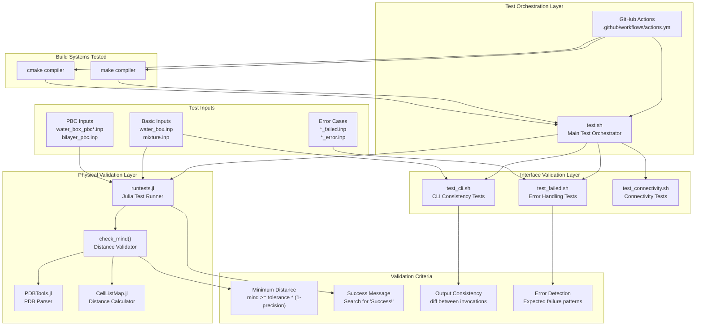
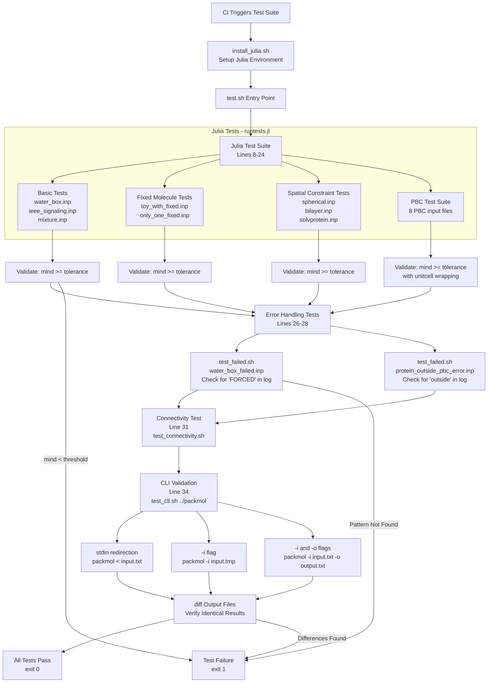
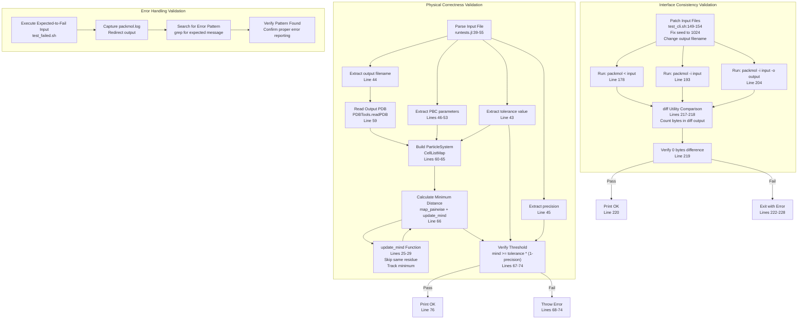
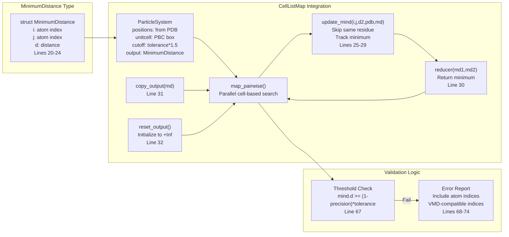
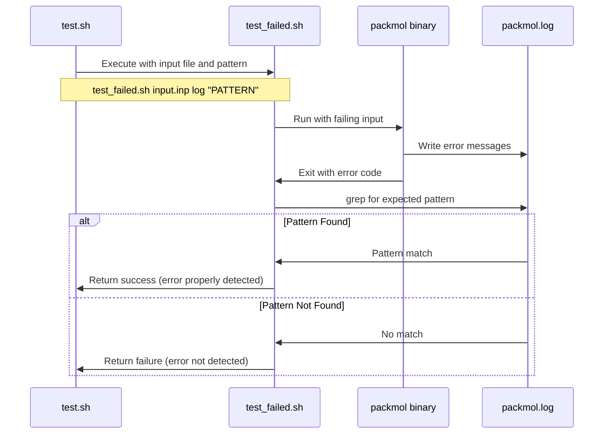
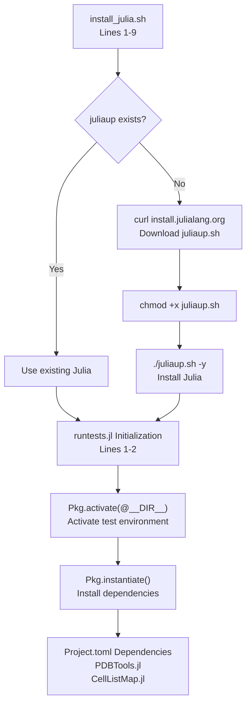

# Testing and Validation

Relevant source files

The following files were used as context for generating this wiki page:

- [.github/workflows/actions.yml](.github/workflows/actions.yml)
- [testing/Project.toml](testing/Project.toml)
- [testing/input_files/bilayer_pbc.inp](testing/input_files/bilayer_pbc.inp)
- [testing/input_files/mixture_pbc.inp](testing/input_files/mixture_pbc.inp)
- [testing/input_files/protein_outside_pbc_error.inp](testing/input_files/protein_outside_pbc_error.inp)
- [testing/input_files/toy_with_fixed.inp](testing/input_files/toy_with_fixed.inp)
- [testing/input_files/water_box_pbc2.inp](testing/input_files/water_box_pbc2.inp)
- [testing/input_files/water_box_pbc_outside_box.inp](testing/input_files/water_box_pbc_outside_box.inp)
- [testing/install_julia.sh](testing/install_julia.sh)
- [testing/runtests.jl](testing/runtests.jl)
- [testing/test.sh](testing/test.sh)
- [testing/test_cli.sh](testing/test_cli.sh)

## Purpose and Scope

This document provides an overview of Packmol's comprehensive testing infrastructure, which validates both the correctness of molecular packing results and the robustness of the software interface. The testing system employs a multi-layered validation strategy combining Julia-based physical validation, shell-based interface testing, and continuous integration orchestration.

For detailed information about specific test components, see:
- Julia-based minimum distance validation: [5.1](#5.1)
- Shell-based interface and error handling tests: [5.2](#5.2)
- CI/CD pipeline configuration: [5.3](#5.3)

## Testing Architecture Overview

Packmol's testing system is organized as a hierarchical test orchestration framework with three primary validation layers:

**Test Execution Flow**

The testing system follows a staged execution model where each stage validates different aspects of functionality.

Sources: [testing/test.sh:1-35](), [.github/workflows/actions.yml:1-46]()

## Test Orchestration

The main test orchestration is handled by `test.sh`, which executes tests in a specific sequence designed to validate progressively complex scenarios:

**Execution Stages**

Sources: [testing/test.sh:1-35]()

## Test Categories and Input Files

The test suite includes 17+ input files organized into functional categories:

| Category | Input Files | Purpose |
|----------|-------------|---------|
| **Basic Functionality** | `water_box.inp` `mixture.inp` `ieee_signaling.inp` | Validate core packing without PBC or special constraints |
| **Fixed Molecules** | `toy_with_fixed.inp` `only_one_fixed.inp` | Test molecules with `fixed` keyword holding positions constant |
| **Spatial Constraints** | `spherical.inp` `bilayer.inp` `solvprotein.inp` | Test geometric constraints (inside/outside regions) |
| **Periodic Boundaries** | `water_box_pbc.inp` `water_box_pbc2.inp` `water_box_pbc_negative_coordinates.inp` `water_box_pbc_slab.inp` `water_box_pbc_outside_box.inp` | Validate PBC with various coordinate configurations |
| **Complex PBC Systems** | `mixture_pbc.inp` `bilayer_pbc.inp` `solvprotein_pbc.inp` `spherical_pbc.inp` | Test PBC combined with constraints |
| **Error Handling** | `water_box_failed.inp` `protein_outside_pbc_error.inp` | Validate error detection and reporting |

Sources: [testing/test.sh:8-24](), [testing/input_files/water_box_pbc_outside_box.inp:1-20](), [testing/input_files/mixture_pbc.inp:1-22]()

## Validation Criteria and Mechanisms

The testing system validates multiple dimensions of correctness:

**Distance Validation Algorithm**

The `check_mind()` function implements a sophisticated validation algorithm:

1. **Parse Input**: Extract `tolerance`, `output`, `pbc`, and `precision` keywords from input file [testing/runtests.jl:39-55]()
2. **Read Structure**: Parse generated PDB using PDBTools [testing/runtests.jl:59]()
3. **Build Cell System**: Create `ParticleSystem` with cutoff = `tolerance * 1.5` for efficient neighbor search [testing/runtests.jl:60-65]()
4. **Calculate Minimum Distance**: Use `map_pairwise()` with custom reducer to find minimum inter-molecular distance [testing/runtests.jl:66]()
5. **Validate Threshold**: Ensure `mind >= tolerance * (1 - precision)` [testing/runtests.jl:67-74]()

The `update_mind()` function ensures molecules are identified by residue number, skipping intra-molecular atom pairs [testing/runtests.jl:25-29]().

Sources: [testing/runtests.jl:34-78]()

## Minimum Distance Calculation Subsystem

The validation system leverages Julia's CellListMap package for O(N) complexity distance calculations:

Sources: [testing/runtests.jl:20-32](), [testing/runtests.jl:60-74]()

## CLI Consistency Testing Mechanism

The `test_cli.sh` script validates that all three command-line interface methods produce identical output:

| Invocation Method | Command Syntax | Output File Source |
|-------------------|----------------|-------------------|
| **Standard Input** | `packmol < input.txt` | Specified in `output` keyword in input file |
| **Input Flag** | `packmol -i input.tmp` | Specified in `output` keyword in input file |
| **Input and Output Flags** | `packmol -i input.txt -o output.txt` | Overridden by `-o` flag |

**Test Procedure**:
1. Filter input files to exclude `*_error.inp` and `*_fail*.inp` patterns [testing/test_cli.sh:124]()
2. Patch input files: replace `seed -1` with `seed 1024` for reproducibility [testing/test_cli.sh:150]()
3. Create three variants with different output filenames [testing/test_cli.sh:152]()
4. Execute packmol using each invocation method [testing/test_cli.sh:178,193,204]()
5. Use GNU `diff` to compare output files byte-by-byte [testing/test_cli.sh:217-218]()
6. Verify zero byte difference (identical files) [testing/test_cli.sh:219]()

Sources: [testing/test_cli.sh:1-241]()

## Error Handling Test Pattern

The `test_failed.sh` script validates that Packmol correctly detects and reports specific error conditions:

**Test Cases**:
1. `water_box_failed.inp` → Expect "FORCED" in log [testing/test.sh:27]()
2. `protein_outside_pbc_error.inp` → Expect "outside" in log [testing/test.sh:28]()

Sources: [testing/test.sh:26-28]()

## Continuous Integration Configuration

The GitHub Actions workflow orchestrates testing across multiple platforms and compiler configurations:

| Matrix Dimension | Values | Purpose |
|------------------|--------|---------|
| **Operating System** | `ubuntu-latest`, `macOS-latest` | Cross-platform validation |
| **GCC Version** | `13` | Consistent compiler version |
| **Build System** | `make`, `cmake` | Validate both build systems |

**Pipeline Stages**:
1. **Checkout**: Retrieve code from repository [.github/workflows/actions.yml:20]()
2. **Setup Fortran**: Install GCC 13 using `fortran-lang/setup-fortran` [.github/workflows/actions.yml:21-25]()
3. **Compile (make)**: Run `./configure && make` [.github/workflows/actions.yml:27-32]()
4. **Compile (cmake)**: Run `cmake ./ && cmake --build ./` [.github/workflows/actions.yml:34-38]()
5. **Test**: Execute `install_julia.sh` followed by `test.sh` [.github/workflows/actions.yml:40-45]()

This creates 4 test jobs per push: (ubuntu×make, ubuntu×cmake, macOS×make, macOS×cmake), with failure isolation via `fail-fast: false` [.github/workflows/actions.yml:11]().

Sources: [.github/workflows/actions.yml:1-46]()

## Test Input File Requirements

For Julia validation tests to function correctly, PDB files must adhere to specific structural requirements:

**Structural Constraints**:
- Each molecule must be identified as a single residue [testing/runtests.jl:7-11]()
- Proteins must have one residue name for all atoms
- Residue numbers can be overwritten using the `resnumbers` option in input files
- The `update_mind()` function uses `residue(pdb[i]) == residue(pdb[j])` to skip intra-molecular pairs [testing/runtests.jl:26]()

**Input File Parameters Parsed**:
- `tolerance`: Required minimum distance between molecules [testing/runtests.jl:43]()
- `output`: Required output filename [testing/runtests.jl:44]()
- `precision`: Optional, defaults to 0.01 [testing/runtests.jl:45]()
- `pbc`: Optional, can specify 3 values (box size) or 6 values (min/max bounds) [testing/runtests.jl:46-53]()

Sources: [testing/runtests.jl:6-56](), [testing/input_files/toy_with_fixed.inp:1-27]()

## Test Execution Environment Setup

The test environment requires Julia with specific package dependencies:

**Dependencies** [testing/Project.toml:1-4]():
- `PDBTools`: Parse and manipulate PDB files
- `CellListMap`: Efficient O(N) distance calculations with cell lists

Sources: [testing/install_julia.sh:1-9](), [testing/runtests.jl:1-4](), [testing/Project.toml:1-4]()

---