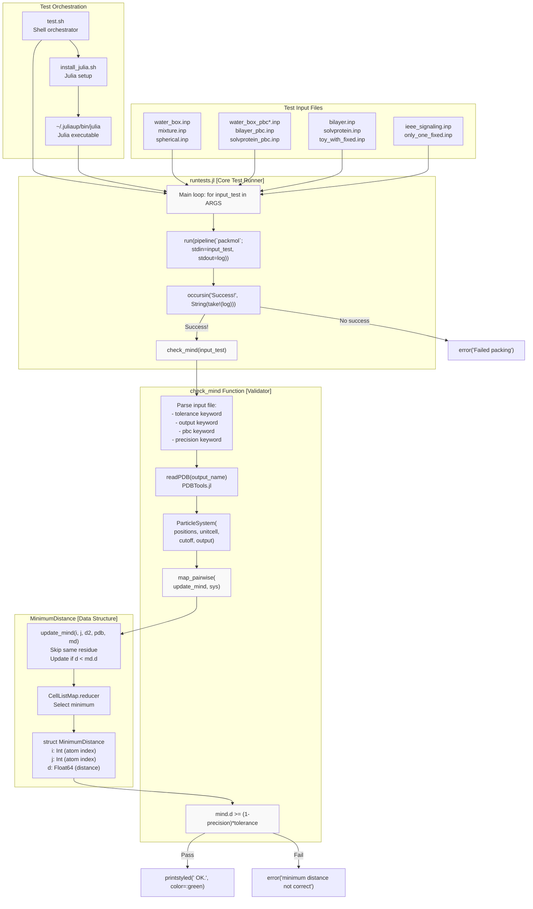
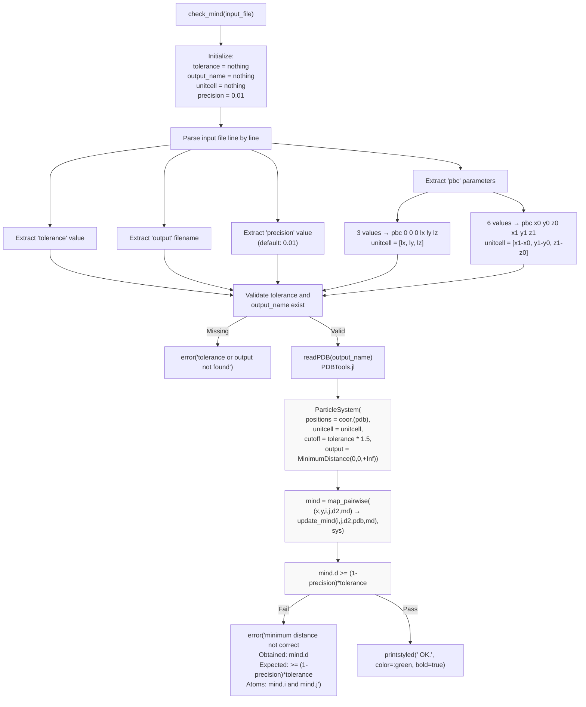
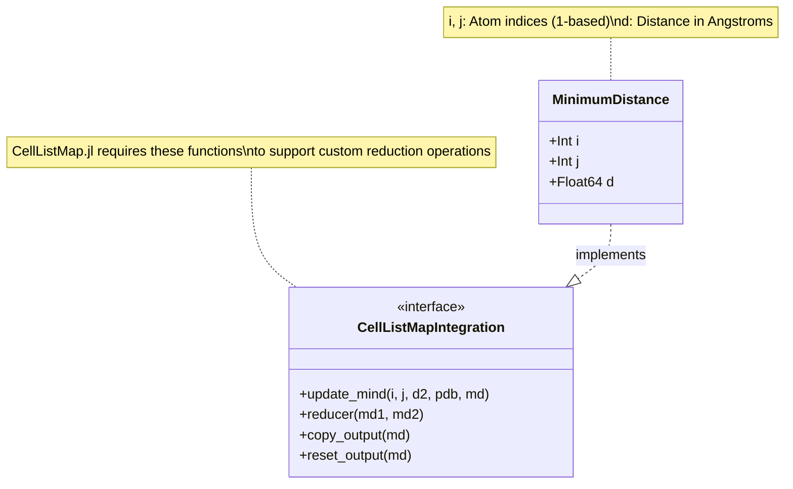
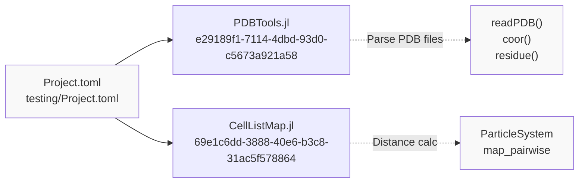
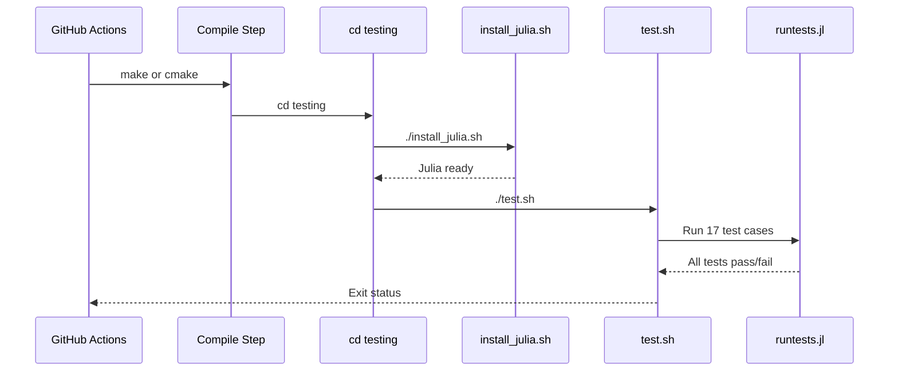
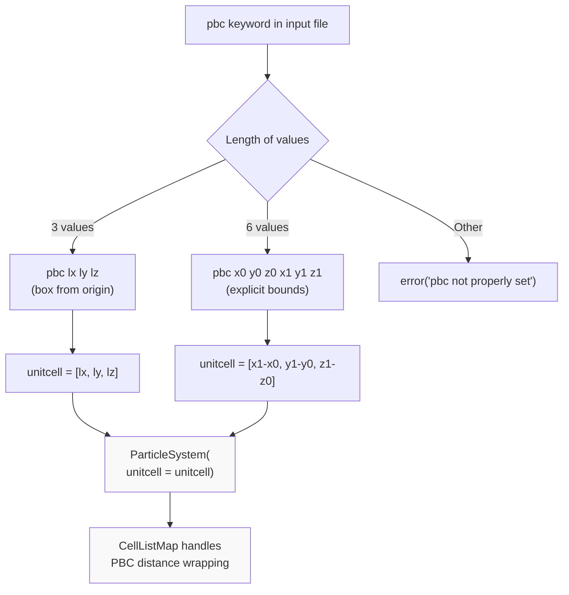

# Julia Test Suite

<details>
<summary>Relevant source files</summary>

The following files were used as context for generating this wiki page:

- [.github/workflows/actions.yml](.github/workflows/actions.yml)
- [testing/Project.toml](testing/Project.toml)
- [testing/input_files/bilayer_pbc.inp](testing/input_files/bilayer_pbc.inp)
- [testing/input_files/mixture_pbc.inp](testing/input_files/mixture_pbc.inp)
- [testing/input_files/protein_outside_pbc_error.inp](testing/input_files/protein_outside_pbc_error.inp)
- [testing/input_files/toy_with_fixed.inp](testing/input_files/toy_with_fixed.inp)
- [testing/input_files/water_box_pbc2.inp](testing/input_files/water_box_pbc2.inp)
- [testing/input_files/water_box_pbc_outside_box.inp](testing/input_files/water_box_pbc_outside_box.inp)
- [testing/install_julia.sh](testing/install_julia.sh)
- [testing/runtests.jl](testing/runtests.jl)
- [testing/test.sh](testing/test.sh)

</details>


## Purpose and Scope

The Julia Test Suite is Packmol's primary validation layer that performs deep structural analysis of generated molecular packings. It executes Packmol, parses the output PDB files, and validates that inter-molecular minimum distances meet specified tolerance requirements within numerical precision bounds. This test suite uses the PDBTools.jl library for PDB parsing and CellListMap.jl for efficient O(N) distance calculations with periodic boundary condition support.

For information about shell-based CLI and error handling tests, see [Shell Test Scripts](#5.2). For the overall CI/CD orchestration, see [Continuous Integration](#5.3).

## Architecture Overview

The Julia test infrastructure consists of three main components: a test orchestrator script, a minimum distance validation function, and a collection of input test cases spanning basic scenarios to complex biological systems.



**Sources:** [testing/test.sh:1-35](), [testing/runtests.jl:1-109](), [testing/install_julia.sh:1-9]()

## Test Execution Flow

### Test Orchestration

The test suite is launched by `test.sh`, which sets up the Julia environment and invokes `runtests.jl` with a list of input files to test.

```mermaid
sequenceDiagram
    participant CI as GitHub Actions
    participant test_sh as test.sh
    participant install as install_julia.sh
    participant juliaup as juliaup
    participant runtests as runtests.jl
    participant packmol as packmol binary
    
    CI->>test_sh: Execute ./test.sh
    test_sh->>install: ./install_julia.sh
    install->>juliaup: Check if juliaup exists
    alt juliaup not found
        install->>juliaup: curl install.julialang.org
        install->>juliaup: ./juliaup.sh -y
    end
    
    test_sh->>runtests: $julia_exe runtests.jl [input files...]
    Note over runtests: Parse -packmol argument<br/>Default: ../packmol
    
    loop For each input file
        runtests->>packmol: run(pipeline(`packmol`; stdin=input_file))
        packmol-->>runtests: stdout log
        runtests->>runtests: Check for "Success!" in log
        alt Success found
            runtests->>runtests: check_mind(input_file)
        else No success
            runtests->>runtests: error("Failed packing")
        end
    end
    
    runtests-->>test_sh: Exit status
    test_sh-->>CI: Test results
```

The test script accepts an optional `-packmol` argument to specify the path to the Packmol executable. If not provided, it defaults to `../packmol` relative to the testing directory.

**Sources:** [testing/test.sh:5-24](), [testing/runtests.jl:81-106]()

### Input File Coverage

The test suite covers 17 distinct input files representing various molecular packing scenarios:

| Category | Input Files | Purpose |
|----------|-------------|---------|
| Basic Systems | `water_box.inp`, `mixture.inp`, `spherical.inp` | Simple packings without PBC |
| Periodic Boundary | `water_box_pbc.inp`, `water_box_pbc2.inp`, `mixture_pbc.inp` | Standard PBC configurations |
| PBC Edge Cases | `water_box_pbc_negative_coordinates.inp`, `water_box_pbc_outside_box.inp`, `water_box_pbc_slab.inp` | Negative coords, outside box, slab geometry |
| Complex Biological | `bilayer.inp`, `bilayer_pbc.inp`, `solvprotein.inp`, `solvprotein_pbc.inp` | Lipid bilayers, solvated proteins |
| Fixed Molecules | `toy_with_fixed.inp`, `only_one_fixed.inp` | Systems with fixed molecular positions |
| Numerical Edge Cases | `ieee_signaling.inp`, `spherical_pbc.inp` | IEEE floating-point handling, spherical constraints with PBC |

**Sources:** [testing/test.sh:8-24]()

## Minimum Distance Validation

### The `check_mind` Function

The core validation logic is implemented in the `check_mind` function, which performs a multi-step validation process:



**Sources:** [testing/runtests.jl:34-78]()

### Input File Parsing

The function parses the input file to extract key parameters:

- **`tolerance`**: The minimum allowed inter-molecular distance
- **`output`**: The output PDB filename to validate
- **`precision`**: Tolerance precision factor (default: 0.01 if not specified)
- **`pbc`**: Periodic boundary condition box dimensions

The PBC parameter can be specified in two formats:
- 3 values: `pbc lx ly lz` (box from origin)
- 6 values: `pbc x0 y0 z0 x1 y1 z1` (explicit box bounds)

**Sources:** [testing/runtests.jl:39-55]()

### Distance Calculation with CellListMap

The minimum distance calculation leverages the CellListMap.jl library, which provides O(N) scaling through cell list spatial partitioning. The system is configured with:

| Parameter | Value | Purpose |
|-----------|-------|---------|
| `positions` | `coor.(pdb)` | Cartesian coordinates from PDB file |
| `unitcell` | Parsed from `pbc` keyword | Box dimensions for PBC wrapping |
| `cutoff` | `tolerance * 1.5` | Interaction cutoff radius |
| `output` | `MinimumDistance(0, 0, +Inf)` | Initial output structure |

The `map_pairwise` function efficiently computes pairwise interactions by only evaluating atom pairs within the cutoff distance, automatically handling periodic boundary conditions when `unitcell` is specified.

**Sources:** [testing/runtests.jl:59-66]()

## MinimumDistance Data Structure

### Custom Type Definition

The validation uses a custom `MinimumDistance` struct to track the closest inter-molecular approach:



**Sources:** [testing/runtests.jl:20-32]()

### Custom Reduction Operations

The `MinimumDistance` type integrates with CellListMap through four required functions:

#### `update_mind`

This function is called for each atom pair within the cutoff distance:

```
function update_mind(i, j, d2, pdb, md::MinimumDistance)
    residue(pdb[i]) == residue(pdb[j]) && return md  # Skip intra-molecular
    d = sqrt(d2)
    return d < md.d ? MinimumDistance(i, j, d) : md  # Keep minimum
end
```

The function skips atom pairs from the same residue (intra-molecular distances) since the validation only concerns inter-molecular spacing. This relies on the PDB structure having distinct residue identifiers for each molecule, which is ensured by the `resnumbers` option in Packmol input files.

**Sources:** [testing/runtests.jl:25-29](), [testing/runtests.jl:6-12]()

#### Reducer Functions

The remaining three functions enable CellListMap's parallel reduction:

| Function | Purpose | Implementation |
|----------|---------|----------------|
| `reducer(md1, md2)` | Combine results from parallel threads | Return `md1.d < md2.d ? md1 : md2` |
| `copy_output(md)` | Create independent copy for thread safety | Return `md` (immutable struct) |
| `reset_output(md)` | Initialize accumulator for each thread | Return `MinimumDistance(0, 0, +Inf)` |

**Sources:** [testing/runtests.jl:30-32]()

## Validation Criteria

### Precision-Based Tolerance

The validation checks that the computed minimum distance meets the tolerance with a precision allowance:

```
mind.d >= (1 - precision) * tolerance
```

| Parameter | Typical Value | Source |
|-----------|---------------|--------|
| `tolerance` | 2.0 Å | Input file `tolerance` keyword |
| `precision` | 0.01 (1%) | Input file `precision` keyword or default |
| Threshold | 1.98 Å | `(1 - 0.01) * 2.0` |

This precision allowance accounts for numerical artifacts in the optimization and floating-point arithmetic. If the minimum distance falls below the threshold, the test fails with a detailed error message including:

- The input file name
- Obtained minimum distance
- Expected threshold
- Atom indices (both 1-based Julia indexing and 0-based VMD indexing)

**Sources:** [testing/runtests.jl:67-75]()

### Success Message Verification

Before running minimum distance validation, the test suite verifies that Packmol reported successful completion by searching for the string `"Success!"` in the execution log. If this message is not found, the test fails immediately without attempting validation.

**Sources:** [testing/runtests.jl:96-100]()

## Dependency Management

### Julia Package Environment

The test suite uses a local Julia environment defined by `Project.toml`:



The environment is activated and instantiated at the beginning of `runtests.jl`:

```julia
import Pkg; Pkg.activate(@__DIR__); Pkg.instantiate()
```

This ensures all dependencies are available before running tests.

**Sources:** [testing/runtests.jl:1-4](), [testing/Project.toml:1-4]()

## Integration with Test Suite

### Invocation Pattern

The Julia test suite is invoked from `test.sh` after the Packmol binary is compiled:

```bash
julia_exe=~/.juliaup/bin/julia
$julia_exe runtests.jl ./input_files/water_box.inp \
                      ./input_files/mixture.inp \
                      # ... (17 total input files)
```

Each input file path is passed as a command-line argument, and `runtests.jl` processes them sequentially.

**Sources:** [testing/test.sh:5-24]()

### CI/CD Integration

The GitHub Actions workflow compiles Packmol using both `make` and `cmake`, then runs the test suite on both Ubuntu and macOS:



The workflow tests on multiple platforms and compilers to ensure cross-platform compatibility.

**Sources:** [.github/workflows/actions.yml:1-46]()

## Periodic Boundary Condition Handling

### PBC Parameter Extraction

When the input file contains a `pbc` keyword, the validator extracts box dimensions and passes them to CellListMap:



When `unitcell` is provided to `ParticleSystem`, CellListMap automatically applies minimum image convention for distance calculations, ensuring correct validation for periodic systems.

**Sources:** [testing/runtests.jl:46-54]()

## Error Reporting

### Failure Message Format

When validation fails, the error message provides comprehensive debugging information:

```
Packing reported success, but minimum distance is not correct for $input_file
Obtained minimum-distance = $(mind.d) for tolerance $tolerance and precision $precision.
Atoms: $(mind.i) and $(mind.j) - VMD: index $(mind.i-1) $(mind.j-1)
```

The message includes both 1-based Julia indexing and 0-based VMD indexing to facilitate visualization and debugging in molecular visualization tools.

**Sources:** [testing/runtests.jl:68-74]()

### Test Isolation

Each test case runs independently. If one test fails, the error is immediately reported and the test suite terminates due to the `set -e` flag in `test.sh`. This fail-fast behavior ensures that test failures are noticed and addressed promptly.

**Sources:** [testing/test.sh:3-4]()

---