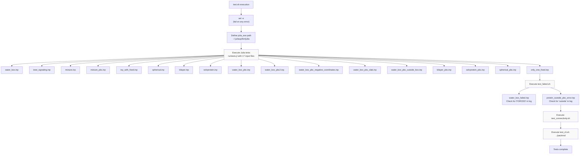
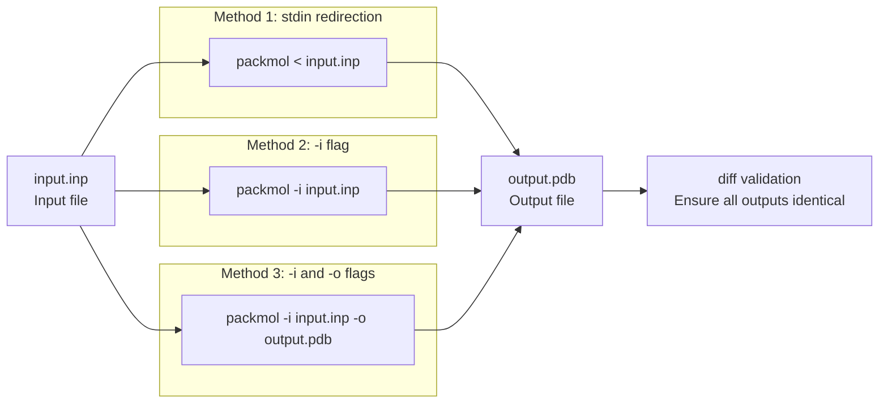
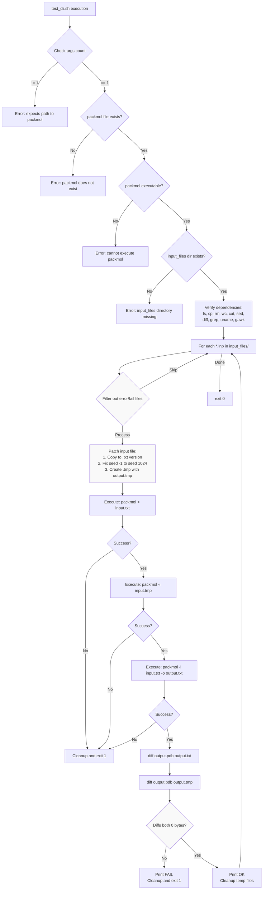
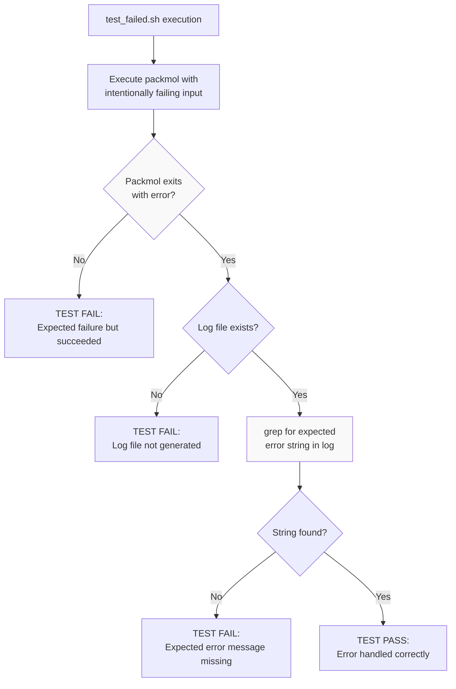
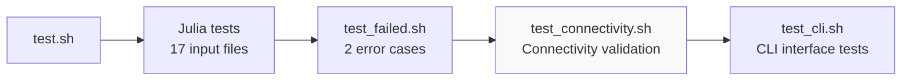
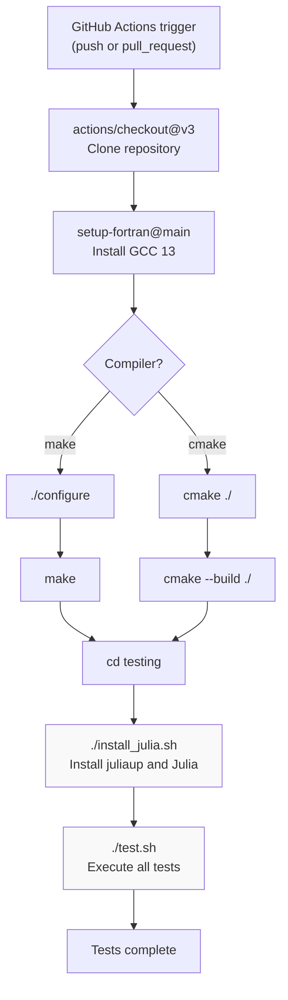
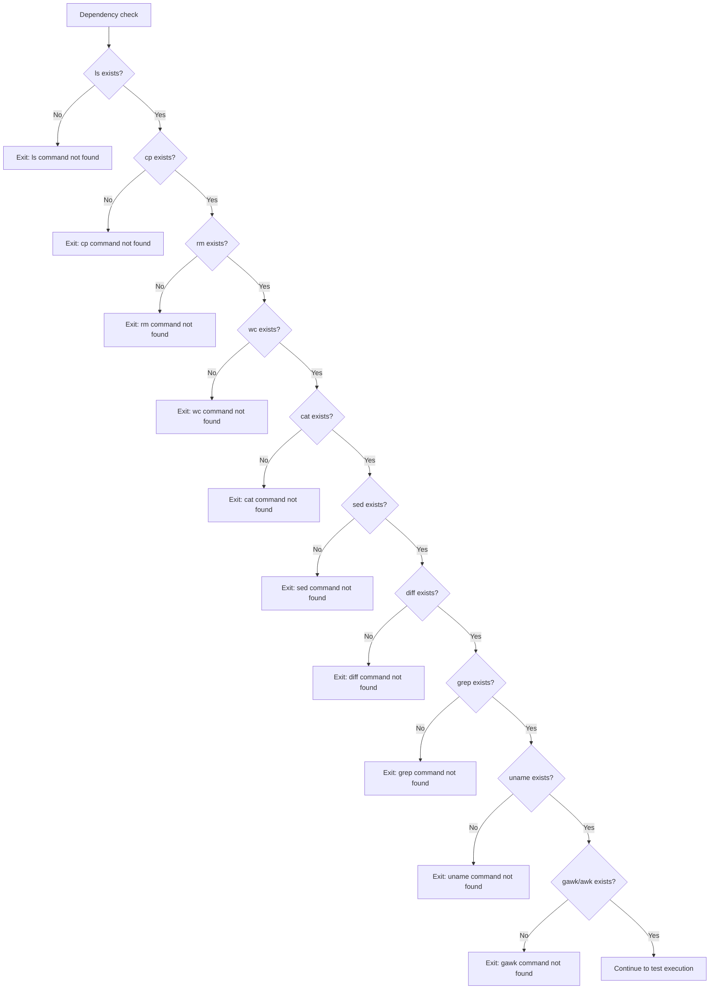
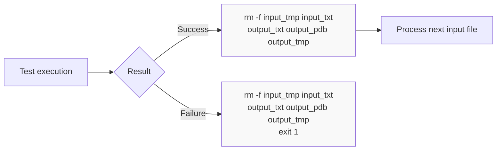

# Shell Test Scripts

<details>
<summary>Relevant source files</summary>

The following files were used as context for generating this wiki page:

- [.github/workflows/actions.yml](.github/workflows/actions.yml)
- [testing/Project.toml](testing/Project.toml)
- [testing/input_files/mixture_pbc.inp](testing/input_files/mixture_pbc.inp)
- [testing/input_files/protein_outside_pbc_error.inp](testing/input_files/protein_outside_pbc_error.inp)
- [testing/input_files/toy_with_fixed.inp](testing/input_files/toy_with_fixed.inp)
- [testing/input_files/water_box_pbc_outside_box.inp](testing/input_files/water_box_pbc_outside_box.inp)
- [testing/install_julia.sh](testing/install_julia.sh)
- [testing/test.sh](testing/test.sh)
- [testing/test_cli.sh](testing/test_cli.sh)

</details>


## Purpose and Scope

This document describes Packmol's shell-based testing infrastructure, which validates command-line interface behavior, error handling, and output consistency. These tests complement the Julia-based distance validation tests (see [Julia Test Suite](#5.1)) by focusing on interface correctness and deterministic output generation. The shell scripts are executed as part of the CI/CD pipeline (see [Continuous Integration](#5.3)) and provide a lightweight validation layer that doesn't require external dependencies beyond standard Unix utilities.

**Sources:** [testing/test.sh:1-35](), [testing/test_cli.sh:1-241]()

---

## Test Orchestration Script

### Overview

The `test.sh` script serves as the main test orchestrator, coordinating execution of all test types in a specific sequence. It invokes Julia tests first (delegated to `runtests.jl`), followed by shell-based validation tests.

**Test Execution Flow**



**Sources:** [testing/test.sh:1-35]()

### Test Categories

The orchestrator executes four distinct test categories in sequence:

| Test Category | Script | Purpose | Input Files |
|---------------|--------|---------|-------------|
| **Validation Tests** | `runtests.jl` | Verify physical correctness (minimum distances) | 17 input files covering basic, PBC, and complex scenarios |
| **Error Handling** | `test_failed.sh` | Ensure proper error messages and log output | 2 intentionally failing input files |
| **Connectivity** | `test_connectivity.sh` | Validate molecular connectivity preservation | Test-specific inputs |
| **CLI Interface** | `test_cli.sh` | Verify deterministic output across invocation methods | All non-failing input files |

**Sources:** [testing/test.sh:8-34]()

### Error Handling Configuration

The script sets `set -e` at line 4, which causes immediate exit if any test fails. This fail-fast behavior ensures that test failures are caught early in the CI pipeline and that subsequent tests don't run on a broken build.

**Sources:** [testing/test.sh:3-4]()

---

## CLI Interface Validation

### Purpose

The `test_cli.sh` script validates that Packmol produces identical, deterministic output regardless of how it is invoked. It tests three command-line invocation methods and uses GNU `diff` to ensure byte-for-byte output consistency.

**Sources:** [testing/test_cli.sh:1-19]()

### Three Invocation Methods



**Sources:** [testing/test_cli.sh:177-212]()

### Test Execution Flow



**Sources:** [testing/test_cli.sh:23-240]()

### Input File Patching

The script performs two critical preprocessing steps to ensure deterministic output:

**Step 1: Seed Normalization**
```bash
# Replace seed -1 (time-based) with seed 1024 (fixed)
sed -e 's/seed -1/seed 1024/g' -i'.tmp' "$input_txt"
```

Input files with `seed -1` would generate different random seeds based on system time, making output comparison impossible. The script patches these to use a fixed seed value of 1024.

**Step 2: Output File Redirection**
```bash
# Create variant with different output filename
sed -e 's/output\.pdb/output.tmp/g' -i'.tmp' "$input_tmp"
```

The `.tmp` version redirects output to `output.tmp` instead of `output.pdb`, allowing simultaneous comparison of multiple invocation methods.

**Sources:** [testing/test_cli.sh:145-154]()

### Filtering Logic

The script excludes input files designed to fail using pattern matching:

```bash
sw=$(echo "$input_file" | "$grep" -v "error" | "$grep" -v "fail" | "$wc" -c)
if [ "$sw" -eq 0 ] ; then
    continue  # Skip files with "error" or "fail" in filename
fi
```

This prevents false test failures from intentional error cases like `protein_outside_pbc_error.inp` or `water_box_failed.inp`.

**Sources:** [testing/test_cli.sh:124-130]()

### Output Comparison

The validation uses GNU `diff` in normal mode to compare outputs byte-by-byte:

```bash
res1=$("$diff" --normal "$output_pdb" "$output_txt" | "$wc" -c)
res2=$("$diff" --normal "$output_pdb" "$output_tmp" | "$wc" -c)
if [ "$res1" -eq 0 ] && [ "$res2" -eq 0 ] ; then
    echo "OK"  # Outputs are identical
else
    echo "FAIL"  # Outputs differ
    exit 1
fi
```

The script pipes `diff` output to `wc -c` (byte count). Zero bytes indicates no differences.

**Sources:** [testing/test_cli.sh:217-229]()

### Platform Compatibility

The script includes special handling for macOS, which doesn't ship with GNU `gawk`:

```bash
os=$("$uname")
if [ "Darwin" == "$os" ] ; then
    gawk=$(which awk)  # Use BSD awk on macOS
else
    gawk=$(which gawk)  # Use GNU awk on Linux
fi
```

**Sources:** [testing/test_cli.sh:103-114]()

---

## Error Handling Tests

### Purpose

The `test_failed.sh` script validates that Packmol correctly handles error conditions, produces appropriate error messages, and generates log files even when failing. This ensures users receive actionable diagnostic information when their input files contain errors.

**Sources:** [testing/test.sh:27-28]()

### Test Cases

The orchestrator invokes `test_failed.sh` twice with different error scenarios:

| Test Case | Input File | Expected Log String | Error Type |
|-----------|------------|---------------------|------------|
| Forced failure | `water_box_failed.inp` | `"FORCED"` | Intentional termination condition |
| PBC constraint violation | `protein_outside_pbc_error.inp` | `"outside"` | Protein center placed outside PBC box |

**Sources:** [testing/test.sh:27-28](), [testing/input_files/protein_outside_pbc_error.inp:1-21]()

### Validation Logic



**Sources:** [testing/test.sh:27-28]()

### Example: PBC Constraint Violation

The `protein_outside_pbc_error.inp` test case places a protein center at coordinates (20, 20, 20) with a PBC box of 30×30×30 Ångströms:

```
tolerance 2.0
pbc 30.0 30.0 30.0

structure ./structure_files/protein.pdb
  number 1 
  fixed 20. 20. 20. 0. 0. 0.  # Violates PBC constraints
  centerofmass
end structure
```

The protein's atoms would extend outside the PBC box, triggering an error containing the string "outside" in the log file.

**Sources:** [testing/input_files/protein_outside_pbc_error.inp:1-21]()

---

## Connectivity Tests

### Purpose

The `test_connectivity.sh` script validates that Packmol preserves molecular connectivity information during the packing process. While the script itself is not shown in the provided files, it is invoked by the orchestrator at line 31.

**Sources:** [testing/test.sh:31]()

### Execution Context



**Sources:** [testing/test.sh:8-34]()

---

## Integration with CI Pipeline

### GitHub Actions Workflow

The shell tests are executed as part of the GitHub Actions CI/CD pipeline defined in `.github/workflows/actions.yml`. The workflow orchestrates test execution across multiple platforms and compilers.

**Sources:** [.github/workflows/actions.yml:1-46]()

### CI Test Execution Matrix

| Dimension | Values | Purpose |
|-----------|--------|---------|
| **Operating System** | `ubuntu-latest`, `macOS-latest` | Cross-platform validation |
| **Compiler** | `make`, `cmake` | Multi-build-system testing |
| **GCC Version** | `13` | Consistent compiler version |

**Note:** Windows is disabled due to CMake compatibility issues (see comment at lines 13-14).

**Sources:** [.github/workflows/actions.yml:9-17]()

### CI Workflow Steps



**Sources:** [.github/workflows/actions.yml:19-46]()

### Julia Installation

The `install_julia.sh` script sets up the Julia environment required for running `runtests.jl`:

```bash
#!/bin/bash
if [[ $(which juliaup) ]]; then
    echo "juliaup found"
else
    curl -fsSL https://install.julialang.org > juliaup.sh
    chmod +x juliaup.sh
    ./juliaup.sh -y
fi
```

This installs `juliaup` (the Julia version manager) if not already present, which then provides access to the Julia executable at `~/.juliaup/bin/julia` (referenced in `test.sh`).

**Sources:** [testing/install_julia.sh:1-9](), [testing/test.sh:6]()

---

## Dependency Management

### Required Unix Utilities

The `test_cli.sh` script explicitly checks for the presence of required system utilities before executing tests:

| Utility | Purpose | Validation Line |
|---------|---------|-----------------|
| `ls` | List input files | [testing/test_cli.sh:49-53]() |
| `cp` | Copy input files for patching | [testing/test_cli.sh:55-59]() |
| `rm` | Clean up temporary files | [testing/test_cli.sh:61-65]() |
| `wc` | Count bytes in diff output | [testing/test_cli.sh:67-71]() |
| `cat` | Read file contents | [testing/test_cli.sh:73-77]() |
| `sed` | Patch input files | [testing/test_cli.sh:79-83]() |
| `diff` | Compare output files | [testing/test_cli.sh:85-89]() |
| `grep` | Filter files and extract strings | [testing/test_cli.sh:91-95]() |
| `uname` | Detect operating system | [testing/test_cli.sh:97-101]() |
| `gawk`/`awk` | Extract output filenames | [testing/test_cli.sh:103-114]() |

**Sources:** [testing/test_cli.sh:48-114]()

### Dependency Verification



**Sources:** [testing/test_cli.sh:48-114]()

---

## Test Input File Coverage

### Input File Distribution

The shell tests process a comprehensive set of input files covering various molecular systems and constraint types:

| Category | Input Files | Count |
|----------|-------------|-------|
| **Basic Systems** | `water_box.inp`, `mixture.inp`, `toy_with_fixed.inp` | 3 |
| **Geometric Constraints** | `spherical.inp` | 1 |
| **Complex Systems** | `bilayer.inp`, `solvprotein.inp` | 2 |
| **PBC Variants** | `water_box_pbc.inp`, `water_box_pbc2.inp`, `water_box_pbc_negative_coordinates.inp`, `water_box_pbc_slab.inp`, `water_box_pbc_outside_box.inp`, `mixture_pbc.inp`, `bilayer_pbc.inp`, `solvprotein_pbc.inp`, `spherical_pbc.inp` | 9 |
| **Edge Cases** | `ieee_signaling.inp`, `only_one_fixed.inp` | 2 |
| **Error Cases** | `water_box_failed.inp`, `protein_outside_pbc_error.inp` | 2 |

**Total:** 19 input files (17 success cases + 2 error cases)

**Sources:** [testing/test.sh:8-28]()

### PBC Test Coverage

The periodic boundary condition tests cover diverse edge cases:

```mermaid
graph TD
    PBC_TESTS["PBC Test Coverage"] --> BASIC_PBC["water_box_pbc.inp<br/>Standard PBC box"]
    PBC_TESTS --> PBC2["water_box_pbc2.inp<br/>Alternative PBC configuration"]
    PBC_TESTS --> NEG_COORDS["water_box_pbc_negative_coordinates.inp<br/>Negative coordinate handling"]
    PBC_TESTS --> SLAB["water_box_pbc_slab.inp<br/>2D periodic (slab geometry)"]
    PBC_TESTS --> OUTSIDE["water_box_pbc_outside_box.inp<br/>Molecules outside initial box"]
    PBC_TESTS --> MIXTURE_PBC["mixture_pbc.inp<br/>Multiple species with PBC"]
    PBC_TESTS --> BILAYER_PBC["bilayer_pbc.inp<br/>Lipid bilayer with PBC"]
    PBC_TESTS --> SOLVPROT_PBC["solvprotein_pbc.inp<br/>Solvated protein with PBC"]
    PBC_TESTS --> SPHERICAL_PBC["spherical_pbc.inp<br/>Spherical constraints with PBC"]
    
    style PBC_TESTS fill:#f9f9f9
```



**Sources:** [testing/test.sh:16-23](), [testing/input_files/water_box_pbc_outside_box.inp:1-20](), [testing/input_files/mixture_pbc.inp:1-22]()

---

## Cleanup and Temporary Files

### File Lifecycle

The `test_cli.sh` script manages temporary files throughout its execution:

**Created Files:**
- `input_txt` - Patched input with fixed seed (`.txt` extension)
- `input_tmp` - Patched input with alternative output file (`.tmp` extension)
- `output_pdb` - Output from stdin invocation
- `output_txt` - Output from `-i/-o` invocation
- `output_tmp` - Output from `-i` invocation

**Cleanup Strategy:**



The script ensures cleanup occurs in both success and failure cases to prevent test artifacts from accumulating.

**Sources:** [testing/test_cli.sh:180-236]()

---

## Summary

The shell test scripts provide essential validation of Packmol's command-line interface and error handling:

1. **test.sh** orchestrates execution of all test types in a fail-fast manner
2. **test_cli.sh** ensures deterministic output across three invocation methods using byte-level diff comparison
3. **test_failed.sh** validates proper error reporting and log generation
4. **test_connectivity.sh** verifies molecular connectivity preservation
5. All scripts integrate into the GitHub Actions CI/CD pipeline for automated validation

These tests complement the Julia-based distance validation tests (see [Julia Test Suite](#5.1)) to provide comprehensive coverage of both physical correctness and interface behavior.

**Sources:** [testing/test.sh:1-35](), [testing/test_cli.sh:1-241](), [.github/workflows/actions.yml:1-46]()

---