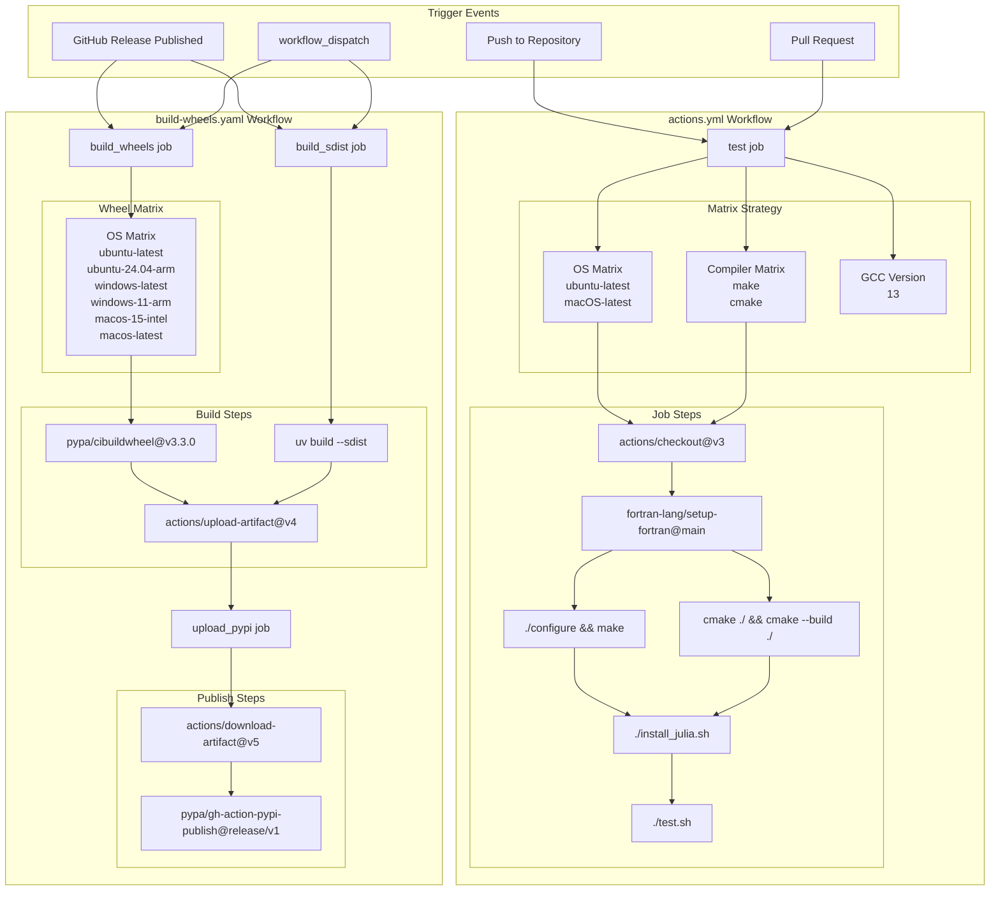
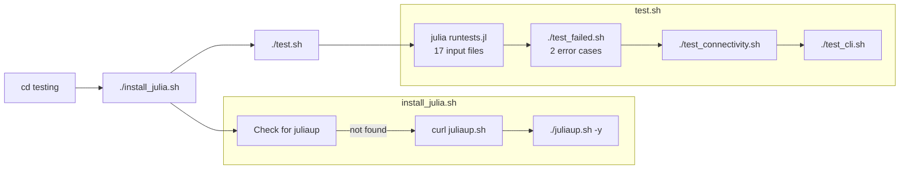
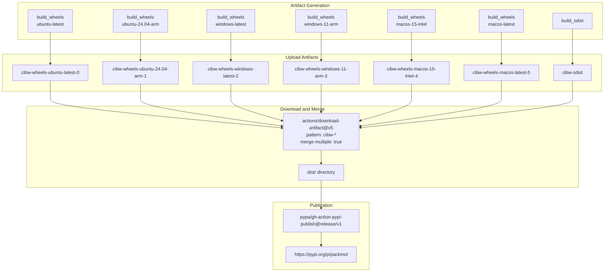

# Continuous Integration

<details>
<summary>Relevant source files</summary>

The following files were used as context for generating this wiki page:

- [.github/workflows/actions.yml](.github/workflows/actions.yml)
- [.github/workflows/build-wheels.yaml](.github/workflows/build-wheels.yaml)
- [testing/Project.toml](testing/Project.toml)
- [testing/input_files/mixture_pbc.inp](testing/input_files/mixture_pbc.inp)
- [testing/input_files/protein_outside_pbc_error.inp](testing/input_files/protein_outside_pbc_error.inp)
- [testing/input_files/toy_with_fixed.inp](testing/input_files/toy_with_fixed.inp)
- [testing/input_files/water_box_pbc_outside_box.inp](testing/input_files/water_box_pbc_outside_box.inp)
- [testing/install_julia.sh](testing/install_julia.sh)
- [testing/test.sh](testing/test.sh)

</details>


## Purpose and Scope

This document describes Packmol's continuous integration and continuous deployment (CI/CD) infrastructure implemented through GitHub Actions. The CI/CD system automates compilation testing across multiple platforms and compilers, executes the comprehensive test suite, and handles automated publication of Python packages to PyPI.

For details about the actual test cases and validation logic, see [Julia Test Suite](#5.1) and [Shell Test Scripts](#5.2). For information about the Python package release process, see [Python Distribution](#6.1).

## Overview

Packmol employs two separate GitHub Actions workflows:

1. **`actions.yml`**: Runs on every push and pull request; validates compilation and executes all tests
2. **`build-wheels.yaml`**: Triggers on releases; builds platform-specific wheels and publishes to PyPI

Both workflows leverage a matrix strategy to test multiple configurations in parallel, ensuring compatibility across operating systems and build systems.

Sources: [.github/workflows/actions.yml:1-46](), [.github/workflows/build-wheels.yaml:1-67]()

## CI Workflow Architecture



**CI Workflow Architecture**

This diagram illustrates the dual-workflow CI/CD system. The `test` job in `actions.yml` executes a 2×2 matrix (2 operating systems × 2 compilers = 4 parallel jobs), while `build_wheels` runs across 6 platforms. The `upload_pypi` job only executes on actual releases, gated by the condition `if: github.event_name == 'release' && github.event.action == 'published'`.

Sources: [.github/workflows/actions.yml:1-46](), [.github/workflows/build-wheels.yaml:1-67]()

## Test Workflow (`actions.yml`)

### Trigger Configuration

The test workflow activates on all push and pull request events:

```yaml
on:
  - push
  - pull_request
```

This ensures every code change undergoes validation before merging.

Sources: [.github/workflows/actions.yml:3-5]()

### Matrix Strategy

The `test` job employs a matrix strategy to validate multiple configurations:

| Parameter | Values | Purpose |
|-----------|--------|---------|
| `os` | `ubuntu-latest`, `macOS-latest` | Validate Linux and macOS compatibility |
| `gcc_version` | `13` | Pin GCC version for reproducibility |
| `compiler` | `make`, `cmake` | Test both build systems |

The `fail-fast: false` setting ensures all matrix jobs complete even if one fails, providing comprehensive failure information.

Sources: [.github/workflows/actions.yml:9-17]()

### Compilation Steps

The workflow includes conditional compilation steps based on the matrix `compiler` parameter:

**Make Compilation:**
```yaml
- name: Compile using make
  if: matrix.compiler == 'make'
  run: |
    ./configure
    make
```

**CMake Compilation:**
```yaml
- name: Compile using cmake
  if: matrix.compiler == 'cmake'
  run: |
    cmake ./ && cmake --build ./
```

Both approaches use the Fortran compiler configured by `fortran-lang/setup-fortran@main`, which installs GCC 13.

Sources: [.github/workflows/actions.yml:27-38]()

### Test Execution Pipeline



**Test Execution Pipeline**

The `Run` step executes three scripts sequentially. The `install_julia.sh` script uses `juliaup` for Julia installation, checking if it already exists before downloading. The `test.sh` script orchestrates all test types in a specific order, with `set -e` ensuring immediate failure on any error.

Sources: [.github/workflows/actions.yml:40-45](), [testing/install_julia.sh:1-9](), [testing/test.sh:1-35]()

### Julia Installation

The `install_julia.sh` script handles Julia environment setup:

```bash
if [[ $(which juliaup) ]]; then
    echo "juliaup found"
else
    curl -fsSL https://install.julialang.org > juliaup.sh
    chmod +x juliaup.sh
    ./juliaup.sh -y
fi
```

This idempotent approach skips installation if `juliaup` already exists, reducing CI runtime for cached environments. The Julia installation requires the `CellListMap` and `PDBTools` packages as specified in [`testing/Project.toml`]().

Sources: [testing/install_julia.sh:1-9](), [testing/Project.toml:1-4]()

### Test Script Orchestration

The `test.sh` script coordinates four test categories:

1. **Julia validation tests**: Executes `runtests.jl` with 17 input files covering basic, PBC, and complex scenarios
2. **Failure tests**: Validates error handling with `test_failed.sh`
3. **Connectivity tests**: Runs `test_connectivity.sh`
4. **CLI tests**: Validates command-line interface with `test_cli.sh`

The script uses `set -e` to halt on the first failure, ensuring test failures are immediately visible in CI logs.

```bash
#!/bin/bash
set -e
julia_exe=~/.juliaup/bin/julia
$julia_exe runtests.jl ./input_files/water_box.inp \
                  ./input_files/ieee_signaling.inp \
                  # ... 15 more input files
```

Sources: [testing/test.sh:1-35]()

## Build and Publish Workflow (`build-wheels.yaml`)

### Trigger Configuration

The wheel building workflow supports two trigger modes:

```yaml
on:
  workflow_dispatch:
  release:
    types:
      - published
```

- `workflow_dispatch`: Manual triggering for testing
- `release.published`: Automatic triggering when a GitHub release is published

Sources: [.github/workflows/build-wheels.yaml:3-7]()

### Wheel Building Matrix

The `build_wheels` job compiles binaries for six platforms:

| Platform | Architecture | Use Case |
|----------|-------------|----------|
| `ubuntu-latest` | x86_64 | Linux Intel/AMD |
| `ubuntu-24.04-arm` | ARM64 | Linux ARM (e.g., AWS Graviton) |
| `windows-latest` | x86_64 | Windows Intel/AMD |
| `windows-11-arm` | ARM64 | Windows ARM |
| `macos-15-intel` | x86_64 | macOS Intel |
| `macos-latest` | ARM64 | macOS Apple Silicon |

Each platform executes `pypa/cibuildwheel@v3.3.0`, which internally invokes the custom build hook defined in [`python/hatch_build.py`]() to compile the Fortran binary and embed it in the wheel.

Sources: [.github/workflows/build-wheels.yaml:10-29]()

### Platform-Specific Configuration

The macOS builds include a special environment variable:

```yaml
env:
  CIBW_ENVIRONMENT_MACOS: MACOSX_DEPLOYMENT_TARGET=15.0
```

This sets the minimum macOS version to 15.0, ensuring compatibility with the selected runner (`macos-15-intel` and `macos-latest`).

Sources: [.github/workflows/build-wheels.yaml:22-23]()

### Source Distribution Build

The `build_sdist` job creates a source distribution using `uv`:

```yaml
- name: Build SDist
  run: uv build --sdist
```

This produces a `.tar.gz` archive containing all source files, allowing users to compile Packmol locally if pre-built wheels are unavailable for their platform.

Sources: [.github/workflows/build-wheels.yaml:31-46]()

### Artifact Management



**Artifact Flow from Build to Publication**

Each build job uploads artifacts with unique names (`cibw-wheels-${{ matrix.os }}-${{ strategy.job-index }}`). The `upload_pypi` job downloads all artifacts matching the pattern `cibw-*` and merges them into a single `dist/` directory before publishing.

Sources: [.github/workflows/build-wheels.yaml:25-29](), [.github/workflows/build-wheels.yaml:42-46](), [.github/workflows/build-wheels.yaml:58-66]()

### PyPI Publication

The `upload_pypi` job executes only on actual releases:

```yaml
if: github.event_name == 'release' && github.event.action == 'published'
```

It requires specific permissions for trusted publishing:

```yaml
permissions:
  id-token: write
```

This enables OIDC-based authentication with PyPI, eliminating the need for API tokens. The publication step uses the official PyPI action:

```yaml
- name: Publish to PyPI
  uses: pypa/gh-action-pypi-publish@release/v1
```

This action automatically detects all `.whl` and `.tar.gz` files in the `dist/` directory and uploads them to PyPI.

Sources: [.github/workflows/build-wheels.yaml:48-67]()

## CI Dependencies

The CI system relies on several external actions and tools:

| Component | Version | Purpose |
|-----------|---------|---------|
| `actions/checkout` | v3 | Clone repository |
| `fortran-lang/setup-fortran` | main | Install GCC Fortran compiler |
| `pypa/cibuildwheel` | v3.3.0 | Build platform-specific wheels |
| `astral-sh/setup-uv` | v5 | Install `uv` package manager |
| `actions/upload-artifact` | v4 | Store build artifacts |
| `actions/download-artifact` | v5 | Retrieve build artifacts |
| `pypa/gh-action-pypi-publish` | release/v1 | Publish to PyPI |
| `juliaup` | latest | Install Julia |

The Julia environment additionally requires packages specified in [`testing/Project.toml`]():
- `CellListMap` (UUID: 69e1c6dd-3888-40e6-b3c8-31ac5f578864)
- `PDBTools` (UUID: e29189f1-7114-4dbd-93d0-c5673a921a58)

Sources: [.github/workflows/actions.yml:20-44](), [.github/workflows/build-wheels.yaml:19-66](), [testing/install_julia.sh:1-9](), [testing/Project.toml:1-4]()

## Failure Handling

### Test Workflow

The test workflow uses `fail-fast: false` in its matrix strategy, ensuring all OS/compiler combinations complete even if one fails. This provides comprehensive diagnostic information when failures occur on specific platforms.

The `test.sh` script uses `set -e`, causing immediate exit on any test failure. The CI log will show exactly which test file caused the failure.

Sources: [.github/workflows/actions.yml:11](), [testing/test.sh:4]()

### Build Workflow

The build workflow also uses `fail-fast: false`, allowing wheel builds to continue for successful platforms even if one platform fails. However, the `upload_pypi` job depends on both `build_wheels` and `build_sdist` completing:

```yaml
needs: [build_wheels, build_sdist]
```

If any wheel build fails, the entire release publication is blocked, ensuring incomplete releases never reach PyPI.

Sources: [.github/workflows/build-wheels.yaml:14](), [.github/workflows/build-wheels.yaml:49]()

## Integration with Release Process

The CI/CD system automates the entire release workflow:

1. Developer creates a GitHub release (e.g., `v20.18.2`)
2. `build-wheels.yaml` workflow triggers automatically
3. Six parallel jobs build platform-specific wheels
4. One job builds source distribution
5. Artifacts upload to GitHub Actions storage
6. `upload_pypi` job downloads all artifacts
7. PyPI publication occurs via OIDC authentication
8. Package becomes available at `https://pypi.org/p/packmol`

This automation eliminates manual release steps and ensures consistent, reproducible releases across all platforms.

Sources: [.github/workflows/build-wheels.yaml:5-7](), [.github/workflows/build-wheels.yaml:48-67]()

---