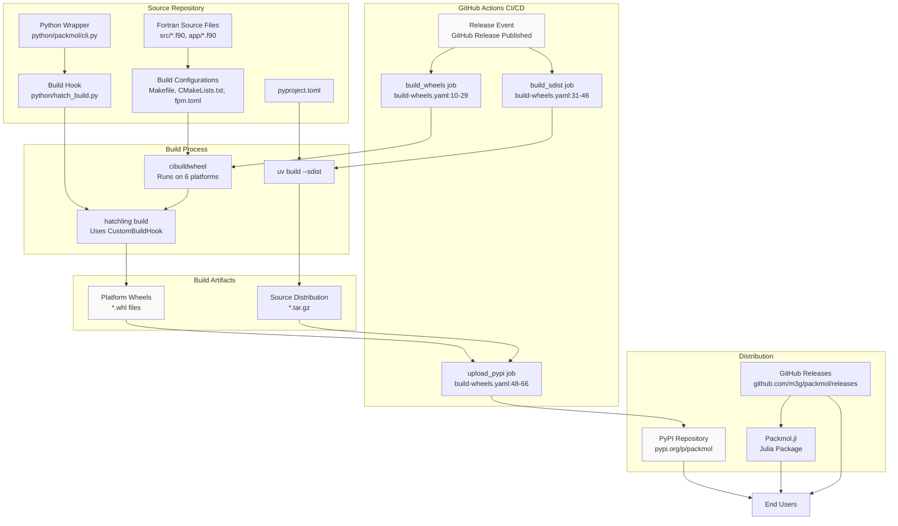
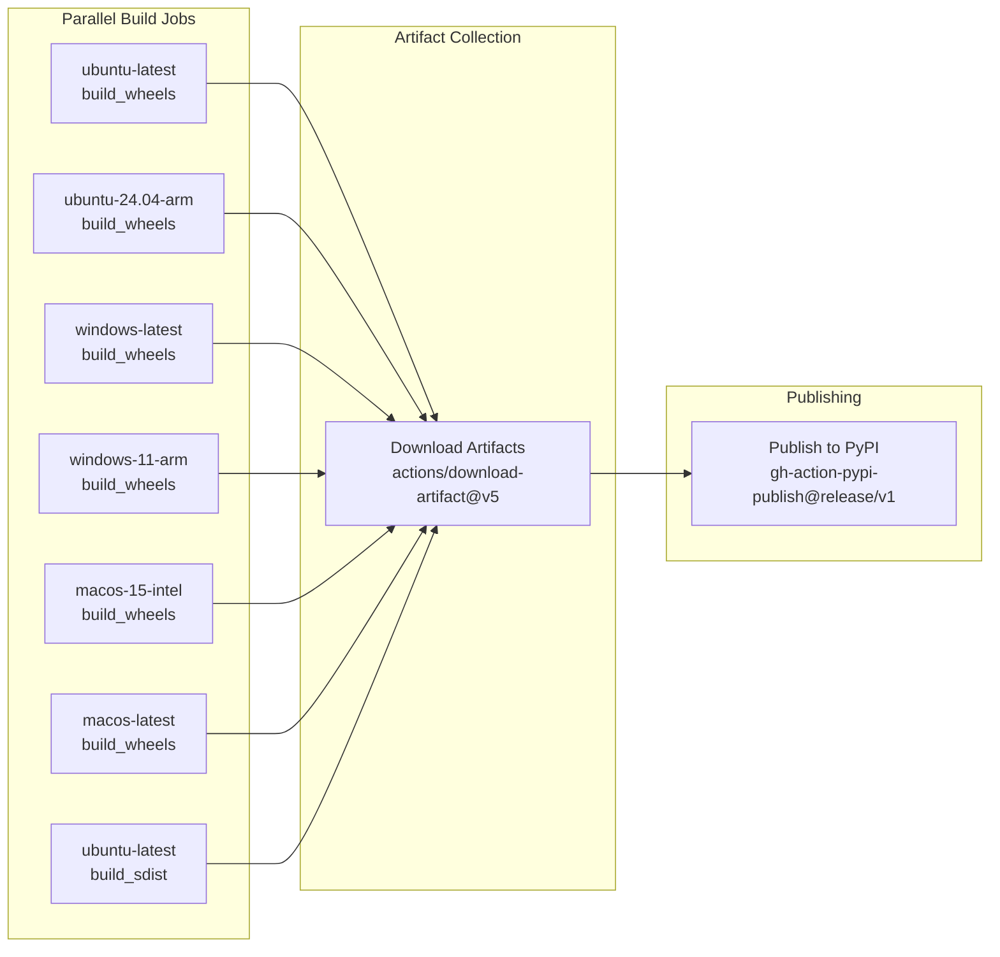
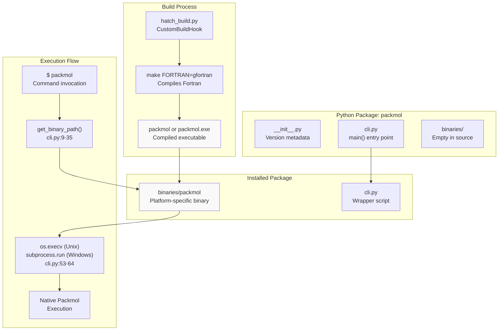
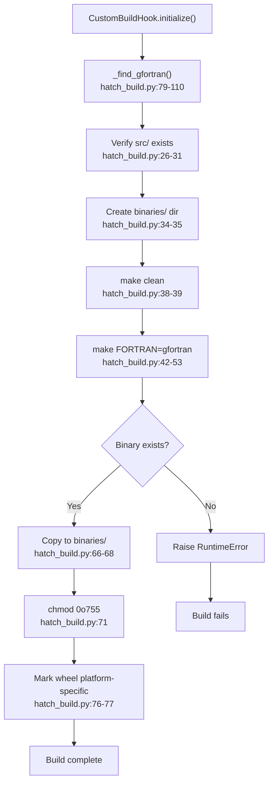
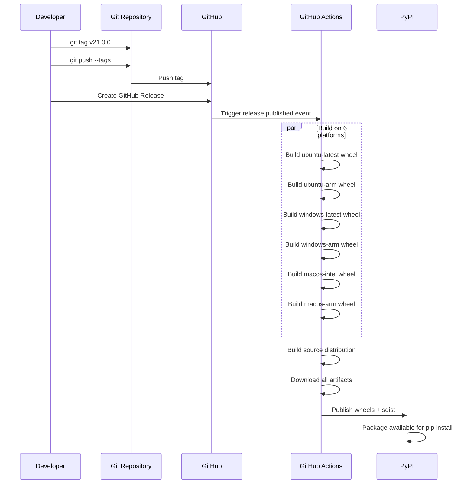

# Distribution and Release Process

<details>
<summary>Relevant source files</summary>

The following files were used as context for generating this wiki page:

- [.github/workflows/build-wheels.yaml](.github/workflows/build-wheels.yaml)
- [.gitignore](.gitignore)
- [README.md](README.md)
- [python/hatch_build.py](python/hatch_build.py)
- [python/packmol/__init__.py](python/packmol/__init__.py)
- [python/packmol/binaries/.gitignore](python/packmol/binaries/.gitignore)
- [python/packmol/cli.py](python/packmol/cli.py)

</details>


## Purpose and Scope

This document describes how Packmol is packaged and distributed to end users across multiple platforms and distribution channels. It covers the automated CI/CD pipeline, the various distribution methods (PyPI, Julia, GitHub releases), and the high-level release workflow. 

For detailed information about the Python-specific packaging mechanism and custom build hook, see [Python Distribution](#6.1). For information about how version numbers are managed across files, see [Version Management](#6.2). For installation instructions from a user perspective, see [Installation and Setup](#2).

## Distribution Channels Overview

Packmol is distributed through three primary channels, each targeting different user communities and use cases:

| Channel | Target Users | Package Manager | Binary Included |
|---------|--------------|-----------------|-----------------|
| PyPI | Python users, cross-platform | `pip` | Yes (compiled) |
| Packmol.jl | Julia users | Julia package manager | Yes (via BinaryBuilder) |
| GitHub Releases | Developers, manual installation | Manual download | No (source only) |
| Source Compilation | Advanced users, custom builds | Make/CMake/FPM | No (user compiles) |

The PyPI distribution is the most automated, with pre-compiled binaries (wheels) for major platforms. The Julia package (Packmol.jl) also provides cross-platform binaries through Julia's BinaryBuilder system. GitHub releases provide source archives for users who prefer manual compilation.

**Distribution Architecture**



Sources: [.github/workflows/build-wheels.yaml:1-67](), [python/hatch_build.py:1-111](), [README.md:23-43]()

## CI/CD Pipeline

The automated release process is orchestrated by GitHub Actions, defined in the workflow file `.github/workflows/build-wheels.yaml`. The pipeline is triggered by two events:

- `workflow_dispatch` - Manual trigger
- `release.published` - Automatic trigger when a GitHub release is created

**Pipeline Job Structure**



Sources: [.github/workflows/build-wheels.yaml:9-46]()

### Build Jobs

The pipeline executes three types of jobs:

**1. Wheel Building (`build_wheels`)**

Runs on six platform/architecture combinations:
- `ubuntu-latest` (x86_64)
- `ubuntu-24.04-arm` (ARM64)
- `windows-latest` (x86_64)
- `windows-11-arm` (ARM64)
- `macos-15-intel` (x86_64)
- `macos-latest` (ARM64)

Each job:
1. Checks out the repository [.github/workflows/build-wheels.yaml:19]()
2. Invokes `cibuildwheel` [.github/workflows/build-wheels.yaml:20-23]()
3. Uploads wheels to GitHub Actions artifacts [.github/workflows/build-wheels.yaml:25-29]()

The `CIBW_ENVIRONMENT_MACOS` environment variable sets the minimum macOS deployment target to 15.0 [.github/workflows/build-wheels.yaml:23]().

**2. Source Distribution Building (`build_sdist`)**

Runs on `ubuntu-latest` and:
1. Checks out the repository [.github/workflows/build-wheels.yaml:35]()
2. Installs `uv` package manager [.github/workflows/build-wheels.yaml:36-37]()
3. Builds source distribution with `uv build --sdist` [.github/workflows/build-wheels.yaml:39-40]()
4. Uploads to GitHub Actions artifacts [.github/workflows/build-wheels.yaml:42-46]()

**3. PyPI Upload (`upload_pypi`)**

This job only runs on release events [.github/workflows/build-wheels.yaml:56](). It:
1. Waits for `build_wheels` and `build_sdist` jobs to complete [.github/workflows/build-wheels.yaml:49]()
2. Downloads all build artifacts [.github/workflows/build-wheels.yaml:58-63]()
3. Publishes to PyPI using trusted publishing (OIDC authentication) [.github/workflows/build-wheels.yaml:65-66]()

The job requires specific GitHub environment permissions:
- Environment: `pypi` [.github/workflows/build-wheels.yaml:50-52]()
- Permission: `id-token: write` for trusted publishing [.github/workflows/build-wheels.yaml:53-54]()

Sources: [.github/workflows/build-wheels.yaml:10-66]()

## Platform Support Matrix

| Platform | Architecture | Wheel Format | Build System |
|----------|-------------|--------------|--------------|
| Linux | x86_64 | manylinux | cibuildwheel + gfortran |
| Linux | ARM64 | manylinux | cibuildwheel + gfortran |
| Windows | x86_64 | win_amd64 | cibuildwheel + gfortran (MinGW) |
| Windows | ARM64 | win_arm64 | cibuildwheel + gfortran (MinGW) |
| macOS | x86_64 | macosx_15_0_x86_64 | cibuildwheel + gfortran |
| macOS | ARM64 | macosx_15_0_arm64 | cibuildwheel + gfortran |

All platforms use `gfortran` as the Fortran compiler. On Windows, this is typically provided through MinGW-w64. The custom build hook [python/hatch_build.py:79-110]() attempts to locate `gfortran` by:
1. Checking for plain `gfortran` in PATH
2. Trying versioned variants (`gfortran-20` down to `gfortran-11`)
3. Checking Homebrew paths on macOS (`/opt/homebrew/bin/gfortran`, `/usr/local/bin/gfortran`)

Sources: [.github/workflows/build-wheels.yaml:16](), [python/hatch_build.py:79-110]()

## Python Package Structure

The Python distribution embeds the compiled Fortran binary within the package, making it a platform-specific wheel despite being a wrapper around native code.

**Python Package Layout**



Sources: [python/packmol/cli.py:1-69](), [python/hatch_build.py:12-78]()

The Python CLI wrapper [python/packmol/cli.py:38-68]() provides a seamless interface:
- On Unix-like systems (Linux, macOS), it uses `os.execv()` to replace the Python process with the native binary [python/packmol/cli.py:62]()
- On Windows, it uses `subprocess.run()` for compatibility [python/packmol/cli.py:56-60]()

The `get_binary_path()` function [python/packmol/cli.py:9-35]() locates the binary by checking:
1. `binaries/packmol` (Unix)
2. `binaries/packmol.exe` (Windows)

Sources: [python/packmol/cli.py:9-68]()

## Build Hook Compilation Process

The custom Hatchling build hook [python/hatch_build.py:12-78]() executes during wheel building:

**Build Hook Workflow**



Sources: [python/hatch_build.py:15-77]()

The build hook sets critical metadata [python/hatch_build.py:76-77]():
- `pure_python = False` - Indicates platform-specific binary content
- `infer_tag = True` - Allows automatic platform tag detection

This ensures the wheel is tagged correctly (e.g., `packmol-1.0.0-py3-none-macosx_15_0_arm64.whl`) rather than as a universal wheel.

Sources: [python/hatch_build.py:12-78]()

## Release Workflow

The typical release process follows these steps:

1. **Version Update** - Update version numbers in relevant files (see [Version Management](#6.2))
2. **Create Git Tag** - Tag the commit with version number (e.g., `v21.0.0`)
3. **Push Tag** - Push tag to GitHub repository
4. **Create GitHub Release** - Create release on GitHub, which triggers the CI/CD pipeline
5. **Automated Build** - GitHub Actions builds wheels and source distribution for all platforms
6. **Automated Testing** - CI runs test suite (see [Continuous Integration](#5.3))
7. **PyPI Publication** - On successful builds, artifacts are automatically published to PyPI

**Release Trigger Flow**



Sources: [.github/workflows/build-wheels.yaml:3-7](), [.github/workflows/build-wheels.yaml:48-66]()

## Distribution to Other Ecosystems

### Julia Package (Packmol.jl)

The Julia package [Packmol.jl](https://github.com/m3g/Packmol.jl) provides a Julia-native interface to Packmol. It uses Julia's BinaryBuilder system to provide pre-compiled binaries for multiple platforms, independent of the PyPI distribution. Users install it via Julia's package manager:

```julia
using Pkg
Pkg.add("Packmol")
```

The Julia wrapper does not depend on the Python package; it downloads binaries from its own artifact system.

Sources: [README.md:23-29]()

### Manual Installation from GitHub Releases

GitHub releases provide source archives (`.tar.gz` and `.zip` files) for users who want to compile manually. The release artifacts are automatically created by GitHub when a release is published. Users can then build using any of the supported build systems (Make, CMake, FPM).

Sources: [README.md:44-84]()

## Artifact Management

Build artifacts are stored temporarily in GitHub Actions:
- Wheel artifacts: Named `cibw-wheels-{os}-{index}` [.github/workflows/build-wheels.yaml:28]()
- Source distribution: Named `cibw-sdist` [.github/workflows/build-wheels.yaml:44]()

The `.gitignore` file ensures build artifacts are not committed to the repository [.gitignore:1-22]():
- Compiled binaries: `/packmol` [.gitignore:6]()
- Python cache: `__pycache__/` [.gitignore:21]()
- Build directories: `build/`, `CMakeFiles/` [.gitignore:1-2]()

The Python package's `binaries/` directory contains only a `.gitignore` file in source control [python/packmol/binaries/.gitignore:1](), which excludes all content (`*`). The actual binary is placed there during the build process and included in the wheel.

Sources: [.gitignore:1-22](), [python/packmol/binaries/.gitignore:1]()

---